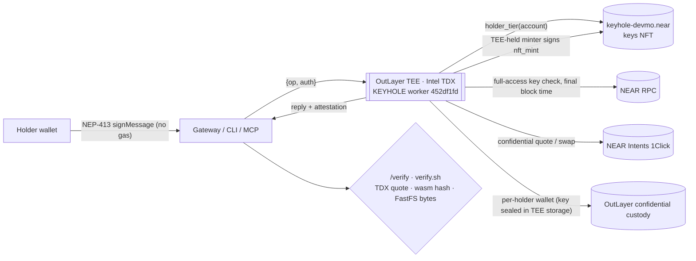
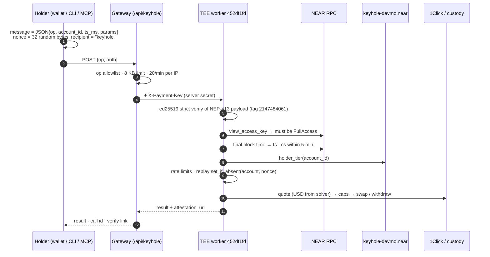
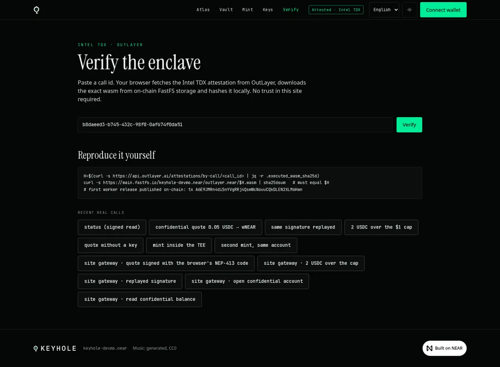

<p align="center"></p>

<h1 align="center">KEYHOLE</h1>
<p align="center"><b>mainnet, TEE-confidential, verifiable NFT trading account</b></p>
<p align="center">An NFT on NEAR is the viewing key for a trading account inside an Intel TDX enclave. The chain records who holds the key. Balances and trades stay in the enclave until that holder signs a read.</p>

<p align="center"><a href="https://github.com/mohamedwael201193/keyhole/actions/workflows/ci.yml"></a></p>

<p align="center">
<a href="https://keyhole-seven.vercel.app">Live site</a> ·
<a href="https://keyhole-seven.vercel.app/verify">Verify a TEE call</a> ·
<a href="https://nearblocks.io/address/keyhole-devmo.near">Keys contract</a> ·
<a href="#9-verify-it-yourself-judges">Judge kit</a> ·
<a href="#10-mainnet-end-to-end-30-steps">30-step mainnet E2E</a>
</p>

Everything below runs on **NEAR mainnet**. Author and deployer: **devmo** ([`keyhole-devmo.near`](https://nearblocks.io/address/keyhole-devmo.near)).

## What it is

KEYHOLE is three pieces that work together. The contract [`keyhole-devmo.near`](https://nearblocks.io/address/keyhole-devmo.near) is the NFT. The worker runs in an OutLayer Intel TDX enclave and is the only minter. The website at [https://keyhole-seven.vercel.app](https://keyhole-seven.vercel.app) asks the holder to sign a message, sends that message to the worker, and shows the worker's answer.

The confidential account belongs to the token, not to a NEAR account. The enclave keeps one custody wallet per `token_id` and lets only the account that owns that token right now operate it. Ownership is read live (`nft_tokens_for_owner` and `nft_token.owner_id`) on every request and again just before a swap or withdraw is sent. Transfer the NFT and the new owner operates the same balance; the old account's next call is refused with `not_owner`.

**NFTs that do something.** Each key holds sealed credentials: the enclave keeps one custody wallet key per `token_id` inside Intel TDX, and that key never leaves it ([worker source](tee/worker/src/lib.rs), `custody_lookup`). Only the current on-chain owner can make it act: the worker reads `nft_token.owner_id` on every request and again right before a swap or withdraw ([refusal `not_owner` on mainnet](https://api.outlayer.ai/attestations/by-call/711795b9-3e77-4a59-98ee-d798cb63ccc2)). Selling the NFT moves the access with it, including in the middle of a payout ([mainnet evidence](docs/evidence/mid-payout/README.md)).

## The problem it solves

A public chain shows balances and trades. Here those stay in the enclave. The holder still has a token they can transfer, and the account goes with it, and each enclave answer includes an attestation the browser can check against the published worker.

## Try it

Live site: [https://keyhole-seven.vercel.app](https://keyhole-seven.vercel.app). Do the step. The words after the dash are what the page shows.

1. Open [https://keyhole-seven.vercel.app](https://keyhole-seven.vercel.app) and click **Connect wallet**. Choose a NEAR wallet or MetaMask. A NEAR wallet signs NEP-413. MetaMask signs the same intent with EIP-191 (`personal_sign`). The published worker `67c5cd77` checks both. — The header shows your account. **Vault** shows "Vault · connected as" and the full account id.
2. Open [https://keyhole-seven.vercel.app/mint](https://keyhole-seven.vercel.app/mint) and click **Sign and mint**. Approve the signature. There is no transaction and no gas. — The page shows "Your key is revealed." and **Open your vault →**. The line under the card reads "Bronze tier · caps $1.00 per trade / $5.00 per day". One key per account. A second mint is refused.
3. Open [https://keyhole-seven.vercel.app/vault](https://keyhole-seven.vercel.app/vault) with the wallet that holds the key. — You see your key, **Tier limits**, and the steps **1 · Fund**, **2 · Trade**, and **3 · Withdraw**. Before a balance signature, the total is "—" and the note says "Balances stay sealed until you sign a read." A connected wallet that does not hold a key sees **Only the key holder can open this** and no fund, trade, or withdraw form.
4. Open **1 · Fund**, enter an amount, and click **Get deposit address**. Approve the signature. That signature is not a transfer. — The page shows **Deposit address** and the address. Sending funds there is a normal transfer you approve in your wallet, and that transfer pays gas. The site does not send it for you.
5. Click **Read balance** and approve the signature. — The total becomes a USD amount, or the token amounts if nothing is priced. A held asset with no price stays in the total as "+ … unpriced". **Assets · N** lists one row per asset: symbol, name, the amount on one line, and the USD value under it when a price exists. The note says "Read from the enclave with your signature."
6. Open **2 · Trade**. The form lists USDC and wNEAR and the line "Bronze · $1.00 per trade · $5.00 per day" (Silver and Gold caps replace this after a higher tier is read). Click **Get attested quote**. — The receipt shows **You give**, **You get**, **Price**, and **Cap**. Click **Sign & trade** and approve. — The result card starts with "Traded", names the amount out, and includes a status and **Verify**.
7. Open **3 · Withdraw**. — The note names the account you connected. Enter an amount and click **Sign & withdraw**. — The result card starts with "Withdrawn" and names that account. The worker refuses any other destination.
8. Open the result's **Verify** link, or open [https://keyhole-seven.vercel.app/verify?call=7882f97a-06e5-46d3-9e58-5fe6428fb187](https://keyhole-seven.vercel.app/verify?call=7882f97a-06e5-46d3-9e58-5fe6428fb187). — The page shows **Intel TDX quote present**, **Worker code hash matches**, **Published on NEAR**, and the result **The enclave is genuine.** The verdict element has `data-match="true"`.

A declined signature shows "You declined the signature." Starting another action clears that message. A redirect wallet that returns with a completed trade or withdraw shows that result card and does not keep the decline.

## Architecture

- **Contract** [`keyhole-devmo.near`](https://nearblocks.io/address/keyhole-devmo.near). NEP-171 NFT. `nft_mint` accepts only the enclave-held minter. The worker reads `holder_tier(account_id)` on each call.
- **OutLayer TEE worker.** Rust wasm in an Intel TDX enclave. The live build sha256 begins `452df1fd` (full hash in [`tee/worker/DEPLOYED_SHA256`](tee/worker/DEPLOYED_SHA256)). It checks the signature, the nonce, a 5-minute window, the tier caps, and the rate limit. For a NEAR signature it also checks that the public key is a full-access key. It sends confidential quotes and swaps through NEAR Intents.
- **Website.** Next.js. The browser posts `{op, auth}` to `/api/worker`. The server adds the OutLayer payment key and does not log the body. The browser never holds that key.

## Run it locally

Node 20. Rust stable for the contract (1.86.0 in CI) and rustc 1.99.1 for the worker build that must match `DEPLOYED_SHA256`.

```bash
cargo test --locked --manifest-path contracts/keys/Cargo.toml
cargo test --locked --manifest-path tee/worker/Cargo.toml
cd cli && npm ci && npx tsc -p . --noEmit && npm test
cd web && npm ci && npm run lint && npm run typecheck && npm test && npm run build
```

The site in development:

```bash
cd web && npm run dev
```

That serves [http://localhost:3000](http://localhost:3000). The browser reads NEAR mainnet. Mint, trade, and withdraw also need the server env `OUTLAYER_PAYMENT_KEY`. Without it, `/api/health` reports the enclave offline.

End-to-end tests use the production build on port 3100:

```bash
cd web && npx playwright install --with-deps chromium
npx next start -p 3100 &
npx playwright test
```

`./judge/1-contract.sh` reads the live contract. `./verify.sh 7882f97a-06e5-46d3-9e58-5fe6428fb187` checks that call. It prints the executed wasm hash, the TDX measurement (not the same value), and `tee/worker/DEPLOYED_SHA256`. `./verify.sh <call_id> --rebuild` also compares a local worker build. `node tee/worker/verify-log.mjs --self-test` checks the key-log script.

## Invariants

These are properties of the worker source in this repository. The enclave serving the site is build `452df1fd`, built from this source. A property added to source after that build is not live until a new wasm is published. The checks are in [`THREAT_MODEL.md`](THREAT_MODEL.md).

- **Who can authorize.** `account`, `balance`, `quote`, `swap`, `withdraw`, `history`, `lock`, and `prove` run only after the signature verifies and the signer owns the key on [`keyhole-devmo.near`](https://nearblocks.io/address/keyhole-devmo.near) (`nft_token.owner_id`, a live view on that call). A wallet that no longer holds the key gets `not_owner`.
- **Who owns the money.** The custody wallet is bound to the `token_id`. A transfer moves it to the new owner. Wallets that earlier builds created per NEAR account move to that account's key once, on its first call (`custody_lookup` in [`tee/worker/src/lib.rs`](tee/worker/src/lib.rs)). Caps are per key, so moving a key between your own accounts does not reset the day's spend.
- **Holder limits.** A holder can set caps under the tier caps (`limits`). A cut applies at once; a raise waits 24 hours. A new owner cannot withdraw for 10 minutes after the enclave records the transfer; trades inside the account still run. Details in [`THREAT_MODEL.md`](THREAT_MODEL.md).
- **Who can be paid.** `assert_withdraw_to` refuses a withdraw whose `to` is not the account that signed the request. The vault also sets `to` to the connected account. Tier caps still apply: Bronze is $1 per trade and $5 per UTC day, so a larger balance cannot all leave in one day.
- **What is public.** The NEAR account does not store the confidential balances. The worker returns them in the JSON reply to the holder who just signed. That reply is plaintext to the holder. The gateway does not log the body. The website's 60-second RPC cache is for public contract reads only; `nft_tokens_for_owner` is not cached.
- **Replay and expiry.** Each `(account, nonce)` is stored once. A second use is `replay`. `ts_ms` must be within five minutes of the final block time or the answer is `expired`. The same nonce store is used after a NEP-413 check and after an EIP-191 check.
- **The page matches the chain.** A connected wallet with no key on the contract sees "Only the key holder can open this" and no fund, trade, or withdraw form. That gate uses `nft_tokens_for_owner`. It is not a substitute for the worker's check.

## Hackathon window

Development started 2026-10-27, inside the window that opened 2026-10-19 (Q-001). The live rules also list the event start as 2026-11-01 and the submission deadline as 2026-11-14.

## Built with

Direct dependencies from this repository's `package.json` and `Cargo.toml` files. AI coding assistants were used (Q-005).

| Piece | File | Libraries and frameworks |
|---|---|---|
| Keys contract | [`contracts/keys/Cargo.toml`](contracts/keys/Cargo.toml) | Rust, near-sdk ~5.17, near-contract-standards ~5.17 |
| TEE worker | [`tee/worker/Cargo.toml`](tee/worker/Cargo.toml) | Rust, serde, serde_json, ed25519-dalek, sha2, bs58, base64, hex, wit-bindgen, wasi-http-client, getrandom |
| CLI and MCP | [`cli/package.json`](cli/package.json) | TypeScript, `@modelcontextprotocol/sdk`, `@noble/curves`, `@noble/hashes`, bs58, zod |
| Website | [`web/package.json`](web/package.json) | Next.js, React, Tailwind CSS, `@near-wallet-selector/core` and its wallet modules, `@noble/curves`, `@noble/hashes`, bs58, gsap, motion, ogl |

## Try it on the live site

The steps, and the words each one should show, are in [Try it](#try-it).

## At a glance

| | |
|---|---|
| Keys NFT contract | [`keyhole-devmo.near`](https://nearblocks.io/address/keyhole-devmo.near). NEP-171 core, NEP-177 metadata, NEP-181 enumeration, NEP-199 payouts, tiers 1–3. Deployed wasm 195,389 bytes, sha256 `d985104e…817b`, on-chain code hash `Fe79rQUH…tqxYA` ([`judge/1-contract.sh`](judge/1-contract.sh)) |
| TEE worker | Rust, `wasm32-wasip2`, running in an OutLayer Intel TDX enclave. Project `keyhole-devmo.near/keyhole`, build **`452df1fd…134d`** (681219 bytes), published with [`add_version`](https://nearblocks.io/txns/FXbXhGNirZCkiP2bx1aiBFQL3Q1EHFMpniJTY579oGWN). Previous versions `6367401a` ([`AJWVEN6F…`](https://nearblocks.io/txns/AJWVEN6FfQaE3ZE3V7KDHj1BtzCKTx3iMH3tx8CLYqKx)), `38bd67b9` ([`9pk1mDC1…`](https://nearblocks.io/txns/9pk1mDC1dxzTXE7H7mHLXVVckHMEmRA4VnfxfxAzdb2z)), `b3fa1a39` ([`B3x8cU6G…`](https://nearblocks.io/txns/B3x8cU6GH25cPDxNZ56mP4fACRuqXUbopobeJxR11kCU)) and `f13efe92` ([`22KDVU1s…`](https://nearblocks.io/txns/22KDVU1sNKQhjoYbN8h1JqyQbcNxHRNednT6sz4nogxS)) |
| Mint authority | `nft_mint` is callable only by the minter, the implicit account [`015a0259…c443`](https://nearblocks.io/address/015a025906a59f9f40ca17daf2a3c61c5e63a37c081c75230870caa6a82ac443). Its key was generated inside the enclave and never leaves it ([set_minter tx](https://nearblocks.io/txns/7QFqM5GiUgZuWJEpRUKvARn1LKyy91NVWFZmzNQscQDp)) |
| Reproducible build | rustc **1.99.1**, `cargo build --locked`, path remapping. [`DEPLOYED_SHA256`](tee/worker/DEPLOYED_SHA256) is `452df1fd`, the active enclave. It binds custody to the token, re-checks the owner at request and settle time, refuses a withdraw `to` that is not the signer, writes `media` on mint, accepts MetaMask `personal_sign` (`scheme: eip191`), enforces holder limits (a cut at once, a raise after 24 hours) and a 10-minute withdraw cooldown after a transfer |
| Mainnet E2E | **30 recorded steps** on the previous version `f13efe92`. **24 TEE calls**, each attested to `f13efe926132` and re-verified, plus 6 MCP steps ([table](#10-mainnet-end-to-end-30-steps)) |
| Refusals proven on mainnet | `over_cap_per_tx`, `replay`, `wrong_recipient`, `bad_signature`, `op_mismatch`, `expired`, `no_auth`, `already_holder`, `rate_limited`. Each one is an attested call |
| Tests | contract **15**, worker **22**, CLI **6**, web unit **44**, web e2e **40** (20 checks × desktop + mobile) |
| CI | 6 jobs (contract, worker with reproducible-build check, cli, judge-kit, hygiene, web), all green ([run 40572408070](https://github.com/mohamedwael201193/keyhole/actions/runs/40572408070)) |
| Website | [https://keyhole-seven.vercel.app](https://keyhole-seven.vercel.app). Mobile Lighthouse: performance 98–100, LCP 1.5–2.3 s. Desktop: 100 on every page. Accessibility, best practices and SEO: 100 ([lighthouse.json](docs/evidence/lighthouse.json)) |

---

## Contents
- [What it is](#what-it-is)
- [The problem it solves](#the-problem-it-solves)
- [Try it](#try-it)
- [Architecture](#architecture)
- [Run it locally](#run-it-locally)
- [Invariants](#invariants)
- [Threat model](THREAT_MODEL.md)
- [Hackathon window](#hackathon-window)
- [Built with](#built-with)
1. [The idea](#1-the-idea)
2. [Judge steps](#2-judge-steps)
3. [Track hints](#3-track-hints)
4. [Architecture](#4-architecture)
5. [The keys contract](#5-the-keys-nft-contract)
6. [The TEE worker](#6-the-tee-worker)
7. [CLI, MCP and the website gateway](#7-cli-mcp-and-the-website-gateway)
8. [Threat model, security controls, privacy](#8-threat-model-security-controls-and-privacy)
9. [Verify it yourself (judges)](#9-verify-it-yourself-judges)
10. [Mainnet end-to-end (30 steps)](#10-mainnet-end-to-end-30-steps)
11. [On-chain transactions](#11-on-chain-transactions)
12. [Tests and CI](#12-tests-and-ci)
13. [The website](#13-the-website)
14. [Quickstart for everyone](#14-quickstart-for-everyone)
15. [Roadmap](#15-roadmap)
16. [Repository map, credits, license](#16-repository-map-credits-license)

---

## 1. The idea

A trading account that nobody can watch, together with a transferable right to watch it.

- The **account** lives inside an Intel TDX enclave run by OutLayer.
  - Its custody wallet, its API key, its trade log and its per-day spend are kept in the enclave's encrypted storage.
  - Nothing about the trading appears on the NEAR chain under the holder's name.
  - Trades are confidential swaps through NEAR Intents (1Click) with `confidentiality: basic | advanced`.
- The **key** is an NFT on [`keyhole-devmo.near`](https://nearblocks.io/address/keyhole-devmo.near).
  - The enclave answers a request only if the signer holds a key right now.
  - It checks `holder_tier(account_id)` live on mainnet for every call ([`tee/worker/README.md`](tee/worker/README.md), step 6).
- **Selling the key moves the account.**
  - The custody wallet is stored under the `token_id` (`t/<token_id>/wallet` in enclave storage), so whoever owns the token operates its balance.
  - The old owner is refused (`not_owner`) on their next call, including a signature they made before the transfer.
  - Before listing, the seller can `lock` the key for 1 to 168 hours: swap and withdraw are refused until the lock ends or the key moves, and the holder cannot lift it early. A buyer can ask the seller for a `prove` statement (enclave-signed "this key's account holds at least X", no exact balance) and check it with `node tee/worker/verify-log.mjs --proof`.
  - The buyer sees the balance, not the seller's trade rows: `history` returns only the rows the caller wrote.
  - Marketplaces get royalties through NEP-199 (`nft_payout`, `nft_transfer_payout`, 500 bps on-chain, see [`config`](#5-the-keys-nft-contract)).
- **Every answer comes with proof.**
  - Each reply carries an OutLayer attestation: an Intel TDX quote plus `executed_wasm_sha256`.
  - Anyone can hash the wasm stored on-chain (FastFS) and compare the two.



### Private assistant (/ask)

[`/ask`](https://keyhole-seven.vercel.app/ask) sends a short question to `Qwen/Qwen3.6-35B-A3B-FP8`, a model NEAR AI Cloud runs in an Intel TDX confidential VM with NVIDIA GPU attestation. The browser makes a 32-byte nonce; the server route requests the model's attestation report with it, sends the completion, and fetches the model's ECDSA signature over `model:sha256(request):sha256(response)`. The browser then checks that the TDX quote's report_data carries its nonce and the signing address, that both hashes match the exact bytes, and that the signature recovers that address. It does not verify the Intel/NVIDIA certificate chains (download the evidence and use NEAR AI's verifier). The route stores and logs nothing; prompts are capped at 400 characters and rate limited.

## 2. Judge steps

**Fastest path (5 minutes, browser only):** open [keyhole-seven.vercel.app/judge](https://keyhole-seven.vercel.app/judge). It walks through six checks with real mainnet call ids and tx links: the enclave code equals the repo build, the NFT contract equals the repo wasm, the new holder controls the account and the old one gets `not_owner`, holder limits and the transfer cooldown are enforced in the enclave, and tier caps hold. Every call links to `/verify` and to its raw attestation. Raw files: [`docs/evidence/ownership-and-limits/`](docs/evidence/ownership-and-limits/).


Do the step. The result on the right is what a correct tree produces. Commands are read-only except where a test binary runs locally.

| Do | See |
|---|---|
| Open [https://keyhole-seven.vercel.app/gallery](https://keyhole-seven.vercel.app/gallery) | One card per token on [`keyhole-devmo.near`](https://nearblocks.io/address/keyhole-devmo.near). Supply on the home page matches `nft_total_supply` |
| Open [https://keyhole-seven.vercel.app/verify?call=7882f97a-06e5-46d3-9e58-5fe6428fb187](https://keyhole-seven.vercel.app/verify?call=7882f97a-06e5-46d3-9e58-5fe6428fb187) | The page fetches the attestation in the browser, re-hashes the FastFS wasm, and the verdict element has `data-match="true"`. This call's `executed_wasm_sha256` is `b3fa1a394bceca3dc34efd044e430498d7d3bb9c5032290eaab87021fda2388a` |
| `./judge/1-contract.sh` | On-chain code hash equals sha256 `d985104e128c598996932a1504cff26093277f4528ef513578af7386a29e817b` of [`contracts/keys/deployed/keyhole_keys.wasm`](contracts/keys/deployed/keyhole_keys.wasm) |
| `./verify.sh 7882f97a-06e5-46d3-9e58-5fe6428fb187 --rebuild` | The `executed` line equals `tee/worker/DEPLOYED_SHA256` (`452df1fd…`). Then `OK` for a TDX quote, `wasm_hash == executed`, `executed == published build 452df1fd`, the FastFS bytes, and your local `build.sh` |
| `./verify.sh f4768da8-2e87-4622-8654-d1e67f6cd1f0` | Previous version `6367401a`. Prints `OK executed == previous build 6367401a, superseded by 452df1fd` |
| `./verify.sh 0f0bf448-1b66-4200-b6de-7cf095aead54` | Previous version `67c5cd77`. Prints `OK executed == previous build 67c5cd77, superseded by 452df1fd` |
| `./verify.sh 763812bc-0012-4528-a45d-66a3ce17cae9` | Previous version `38bd67b9`. Prints `OK executed == previous build 38bd67b9, superseded by 452df1fd` |
| `./verify.sh 9d19bceb-986b-4745-9bf9-91f7dcb62b6e` | Previous version `b3fa1a39`. Prints `OK executed == previous build b3fa1a39, superseded by 452df1fd` |
| `./verify.sh cefbc64e-6c08-4bfe-a165-1667d9f5f25b` | Previous version `f13efe92`. Prints `OK executed == previous build f13efe92, superseded by 452df1fd` |
| `cargo test --locked --manifest-path tee/worker/Cargo.toml over_cap` | `over_cap_per_tx_refused` and `over_cap_daily_refused_and_rolled_back` pass. A $1.000001 trade on tier 1 returns `over_cap_per_tx` and does not change the daily counter |
| Read [`docs/evidence/mainnet-e2e/SUMMARY.json`](docs/evidence/mainnet-e2e/SUMMARY.json) and one refusal file, for example [`15_overcap_swap_2usdc.json`](docs/evidence/mainnet-e2e/15_overcap_swap_2usdc.json) | 30 recorded steps. The 2 USDC swap against the $1 Bronze cap is an attested refusal, call [`a02613a2-d503-45e2-83b8-ef71927c2533`](https://api.outlayer.ai/attestations/by-call/a02613a2-d503-45e2-83b8-ef71927c2533) |
| Read [`web/lib/gateway.ts`](web/lib/gateway.ts) and [`web/tests/gateway.test.ts`](web/tests/gateway.test.ts), then open [/vault](https://keyhole-seven.vercel.app/vault) and connect a wallet | `swap` and `withdraw` are relayed only with a NEP-413 `auth` whose message `op` matches. The TEE checks the signature, the nonce, the tier caps and the rate limit. Unsigned and junk auth are `no_auth`. `copy` and `sweep_minter` stay `bad_op`. Bodies over 8 KB are 413. Once connected, the vault shows **1 · Fund**, **2 · Trade** (quote, then Sign & trade, with the caps on the form) and **3 · Withdraw**. Withdraw always names the connected account. Each result has an attestation link and **Verify** |

## 3. Track hints

Hints named for the tracks this repository is built for. Each row is a shipped behavior.

| Track | Hint | Where it is | Proof |
|---|---|---|---|
| `nfts` | NEP-171 | `nft_transfer`, `nft_mint` event | [`contracts/keys/src/lib.rs`](contracts/keys/src/lib.rs), [mint #0](https://nearblocks.io/txns/UYHismxe3a2Xb5YvbVHuGhsHWf7ERrx5oCrxREePBFR) |
| `nfts` | NEP-177 | `nft_metadata` / `nft_token` metadata | [`NonFungibleTokenMetadataProvider`](contracts/keys/src/lib.rs) |
| `nfts` | NEP-181 | `nft_tokens`, `nft_tokens_for_owner`, `nft_total_supply` | same file, enumeration impl |
| `nfts` | NEP-199 | `nft_payout`, `nft_transfer_payout`, 500 bps | [`nft_payout`](contracts/keys/src/lib.rs), [`config`](https://nearblocks.io/address/keyhole-devmo.near) via [`judge/1-contract.sh`](judge/1-contract.sh) |
| `nfts` | dynamic metadata | `beat()` emits `nft_metadata_update` | [beat tx](https://nearblocks.io/txns/2ShJpaoicEm49L9rcsJjXoubuzoF3SvbQFZASUQBi5dq) |
| `privacy` | TEE | Worker runs in an OutLayer Intel TDX enclave. Each call returns a TDX quote | [`tee/worker`](tee/worker), [attestation `a02613a2`](https://api.outlayer.ai/attestations/by-call/a02613a2-d503-45e2-83b8-ef71927c2533) |
| `privacy` | private compute | Balances, the trade log, and the custody API key stay in enclave storage. The gateway does not log bodies | [`tee/worker/src/main.rs`](tee/worker/src/main.rs) `history`, [`web/app/api/worker/route.ts`](web/app/api/worker/route.ts) |
| `security` | TEE attestation | `executed_wasm_sha256` must equal the wasm registered for the project and the FastFS bytes | [`verify.sh`](verify.sh), [`web/lib/verify.ts`](web/lib/verify.ts) |
| `security` | spending limits / policy | Tier 1/2/3 caps in `limits_for_tier`, enforced before a swap | [`tee/worker/src/lib.rs`](tee/worker/src/lib.rs), [`over_cap_per_tx_refused`](tee/worker/src/tests.rs) |
| `security` | NEP-413 signed intents | ed25519 strict verify, recipient `keyhole`, full-access key, 5-minute freshness | [`tee/worker/src/lib.rs`](tee/worker/src/lib.rs) |
| `security` | nonce replay protection | `(account, nonce)` stored with `set_if_absent` | [`16_replay_first.json`](docs/evidence/mainnet-e2e/16_replay_first.json), [`17_replay_second_refused.json`](docs/evidence/mainnet-e2e/17_replay_second_refused.json) |
| `security` | rate limits | Per holder per minute (6/12/30) and 120/minute global | [`rate_limit_per_holder`](tee/worker/src/tests.rs), [`docs/evidence/mainnet-e2e/`](docs/evidence/mainnet-e2e/) |

## 3b. Spec to shipped

Source sentence, [status 2106269343881519444](https://x.com/ilblackdragon/status/2106269343881519444), the private-trading idea only. A clause with no shipped row is omitted. Nothing below adds behavior the repository does not contain.

| Quoted line | What this repository ships | Proof |
|---|---|---|
| "Private trading" | `swap` runs a confidential NEAR Intents swap inside the worker. The fill is not written to the NEAR account of the holder | [step 8](docs/evidence/mainnet-e2e/08_swap_0.005_usdc.json), [`swap`](tee/worker/src/main.rs) |
| "you sell your viewing keys" | The token is the account: custody is keyed by `token_id`. `nft_transfer` / `nft_transfer_payout` moves it, and the next call re-reads the owner | [`nft_transfer_payout`](contracts/keys/src/lib.rs), [TEE-signed mint](https://nearblocks.io/txns/DJxbuaJVAhwBrK9xne1t623XuL8dMSm8So3eEVtZpHgF) |
| "for people to follow/copy trade" | `copy` is a two-step tool: preview, then a one-time confirmation code, then the swap | [steps 10–12](docs/evidence/mainnet-e2e/12_mcp_copy_confirmed.json), [`cli/src/mcp.ts`](cli/src/mcp.ts) |
| "NEAR Intents confidential trading is all private" | Quotes and swaps set `confidentiality` to `basic` or `advanced`. `history` and `balance` require the holder's NEP-413 signature | [step 5](docs/evidence/mainnet-e2e/05_quote_advanced.json), [step 24](docs/evidence/mainnet-e2e/24_history.json) |
| "sell \"keys\" for only select people to see" | The worker answers the account that holds the NFT at call time. Anyone else is refused `not_owner` | [`holder_tier`](tee/worker/src/main.rs), [step 6 in the worker README](tee/worker/README.md) |

## 4. Architecture



**Components**

| Part | Path | Language | Notes |
|---|---|---|---|
| Keys NFT contract | [`contracts/keys`](contracts/keys) | Rust, near-sdk 5.17.2, rustc 1.86.0 | Deployed wasm committed at [`contracts/keys/deployed/`](contracts/keys/deployed) |
| TEE worker | [`tee/worker`](tee/worker) | Rust, `wasm32-wasip2`, rustc 1.99.1 | OutLayer WIT host functions for RPC and encrypted storage |
| CLI and MCP server | [`cli`](cli) | TypeScript | `keyhole` and `keyhole-mcp` binaries. Stable interface in [`cli/src/core.ts`](cli/src/core.ts) |
| Website and gateway | [`web`](web) | Next.js 16, React 19 | Live at [https://keyhole-seven.vercel.app](https://keyhole-seven.vercel.app) |
| Judge kit | [`judge`](judge), [`verify.sh`](verify.sh) | bash + jq | Uses none of our keys |

## 5. The keys NFT contract

Live configuration, read with [`judge/1-contract.sh`](judge/1-contract.sh):

```json
{"owner":"keyhole-devmo.near","minter":"015a025906a59f9f40ca17daf2a3c61c5e63a37c081c75230870caa6a82ac443","treasury":"keyhole-devmo.near","royalty_bps":500,"beats":"1"}
```

- **Standards.**
  - NEP-171 core and NEP-177 metadata (`KEYHOLE` / `KEY`) come from `near-contract-standards`.
  - NEP-181 enumeration provides `nft_tokens`, `nft_tokens_for_owner` and `nft_total_supply`.
  - NEP-199 `nft_payout` and `nft_transfer_payout` are written by hand. The royalty cap is `MAX_ROYALTY_BPS = 1000`; live it is `500`.
- **Tiers.**
  - `nft_tier(token_id)` and `holder_tier(account_id)` return 1–3 (`MAX_TIER = 3`). The worker maps tier to limits ([§6](#6-the-tee-worker)).
  - **Legendary is a finish, not a tier.** Every key is a one-of-one (`copies: 1` on the minted metadata). The site names tier 1 Bronze, tier 2 Silver, and tier 3 Gold. When the on-chain tier is 3, one key in eight (`seed[1] & 7 == 0` in [`finishOf`](web/lib/traits.ts)) is drawn as the Legendary finish. Its caps stay the Gold caps: $100 per trade and $500 per UTC day ([`CAPS`](web/lib/traits.ts)). The ten catalog pictures on the home gallery and the identity sheet pair two artworks with that finish; a live token still takes its finish from the chain tier and that seed.
- **Mint authority.**
  - `nft_mint` asserts `predecessor == minter`.
  - The minter is an implicit account whose secret key was drawn inside the enclave, so only the attested worker can mint.
  - `token_id` is at most 64 bytes, and storage is measured with any excess refunded.
- **Heartbeat.**
  - `beat(token_ids)` (minter only, batch ≤ 50) emits `nft_metadata_update`. It signals that a key's public card changed, and indexers pick it up.
  - First beat: [`2ShJpaoi…`](https://nearblocks.io/txns/2ShJpaoicEm49L9rcsJjXoubuzoF3SvbQFZASUQBi5dq).
- **Owner controls.**
  - `set_minter` and `set_royalty` require 1 yoctoNEAR, and `set_royalty` is capped at 10%.
  - `init` is guarded so that `predecessor == self`.
- **Tests.**
  - 15 unit tests in [`contracts/keys/src/lib.rs`](contracts/keys/src/lib.rs), run in CI with `cargo test --locked` and `clippy -D warnings`.
- **Code identity.**
  - On-chain `code_hash` `Fe79rQUHKXnjhuY4NCDYrv3twNKPw7YTmqK3yxjtqxYA` is the base58 of sha256 `d985104e128c598996932a1504cff26093277f4528ef513578af7386a29e817b`, the sha256 of the committed wasm.

Tokens on mainnet today (`nft_total_supply` = 3):

| token | holder | tier | mint tx |
|---|---|---|---|
| `0` | `keyhole-devmo.near` | 1 | [`UYHismxe…`](https://nearblocks.io/txns/UYHismxe3a2Xb5YvbVHuGhsHWf7ERrx5oCrxREePBFR) |
| `k857b6b68facc0f94` | [`a7458a83…91da`](https://nearblocks.io/address/a7458a83e9c4693286692efab949fc0f7d089b7f46352fb2a87a514ec2c391da) | 1 | [`FaYzSUYT…`](https://nearblocks.io/txns/FaYzSUYTzoG3udAE3d31sUwWFeskndkhrZ8iehk1NxJ4) (signed by the first TEE minter) |
| `k5f4750858f328940` | [`3bde8ce5…8447`](https://nearblocks.io/address/3bde8ce5eb4e15403d49ba9512a98070db68958b39f378816f7862cee6168447) | 1 | [`DJxbuaJV…`](https://nearblocks.io/txns/DJxbuaJVAhwBrK9xne1t623XuL8dMSm8So3eEVtZpHgF) (signed in-enclave by the current minter) |

## 6. The TEE worker

The worker is a WASI program (`wasm32-wasip2`) that runs inside an OutLayer Intel TDX enclave. Version `keyhole-worker/0.2.0` ([`01_info.json`](docs/evidence/mainnet-e2e/01_info.json)). Full reference: [`tee/worker/README.md`](tee/worker/README.md).

**Ops**

| op | auth | what it does |
|---|---|---|
| `info` | none | version, keys contract, NEP-413 recipient, TEE minter, limits per tier |
| `status` | NEP-413 | tier, limits, today's spend |
| `quote` | NEP-413 + key | confidential 1Click quote checked against caps. `execute: true` returns a real deposit address and counts toward the daily cap |
| `mint` | NEP-413 | one free Bronze key per account, within a global daily quota. The enclave writes `media` (the key art URL) and `media_hash` (base64 sha256 of that file) |
| `account` | NEP-413 + key | the key's confidential custody wallet (one per `token_id`), created inside the TEE. It can optionally return a cross-chain deposit address |
| `balance` | NEP-413 + key | confidential balances |
| `swap` / `copy` | NEP-413 + key | confidential swap within caps, logged privately |
| `withdraw` | NEP-413 + key | funds out of the confidential account, within caps. The enclave refuses any `to` other than the NEP-413 signer |
| `history` | NEP-413 + key | the caller's own rows of the key's private log (last 100 entries), plus the key log chain |
| `lock` | NEP-413 + key | `{hours: 1..168}`: refuse swap and withdraw until then. Cannot be lifted early; ends on transfer |
| `prove` | NEP-413 + key | `{token, min}`: enclave-signed statement that the key's account holds at least `min`. No exact amount |
| `sweep_minter` | none | moves a retired minter's NEAR to the current minter ([sweep tx](https://nearblocks.io/txns/5Z7TktfcgeFrzRnz8NSpFSbTw77R5779d3PRsrEBPbYA), 0.0286 NEAR) |

**Request checks, in order** (each one has a refusal code that was proven on mainnet):

1. **Signature.** NEP-413 payload `sha256(borsh(u32 2147484061) ‖ borsh{message, nonce[32], recipient, callbackUrl: None})`, ed25519 *strict* verification. Tampered message → `bad_signature` ([`942b4cff`](https://api.outlayer.ai/attestations/by-call/942b4cff-23c9-4e4d-8ebc-79bfa01cd029)). The enclave also accepts `scheme: "eip191"`: `personal_sign` over the same intent JSON (`op`, `account_id`, `ts_ms`, `params`, `nonce`, `recipient`). It recovers the secp256k1 address and requires it to equal the lowercase `0x` account id, then uses the same freshness, tier, rate limit, nonce and caps.
2. **Recipient binding.** `recipient == "keyhole"`. A signature made for another app → `wrong_recipient` ([`b9c8cb4f`](https://api.outlayer.ai/attestations/by-call/b9c8cb4f-e3aa-480f-bb47-70fc30a96d67)).
3. **Signed intent.** `message` is JSON `{op, account_id, ts_ms, params}`, and the worker acts only on signed fields. Mismatched op → `op_mismatch` ([`7a703e8f`](https://api.outlayer.ai/attestations/by-call/7a703e8f-2678-4978-b6ce-4d291828141d)). Missing auth → `no_auth` ([`750defed`](https://api.outlayer.ai/attestations/by-call/750defed-2267-45b1-8a8c-74b528aa30ee)).
4. **Key authority.** For a NEP-413 signature, the public key must be a **full-access** key of `account_id`, checked live over RPC. For `eip191`, the recovered `0x` address is the account. There is no ed25519 key lookup.
5. **Freshness.** `ts_ms` must be within 5 minutes of the latest *final block* time, not the caller's clock. Stale → `expired` ([`e7ac0627`](https://api.outlayer.ai/attestations/by-call/e7ac0627-be6d-41e9-95d0-71dcc59aed43)).
6. **Key holding.** `nft_tokens_for_owner` and `nft_token.owner_id` are read from the contract on every call, before the nonce is used. A signer who does not own the key → `not_owner`. It is read again just before a swap or withdraw is sent.
7. **Rate limits.** Per holder per minute by tier (6 / 12 / 30), plus 120 per minute globally → `rate_limited` ([`d892ac43`](https://api.outlayer.ai/attestations/by-call/d892ac43-b786-4d5b-909a-764b6c92f6fd)).
8. **Replay.** `(account, nonce)` is written with atomic `set_if_absent`. A second use → `replay` ([`ac289f04`](https://api.outlayer.ai/attestations/by-call/ac289f04-0df8-4161-9123-e872ab3b75ab)).
9. **Caps.** The USD value comes from the solver's quote (`amountInUsd`), never from the caller. Per-trade and per-UTC-day caps apply per holder. Over cap → `over_cap_per_tx` or `over_cap_daily`, and nothing is sent ([`a02613a2`](https://api.outlayer.ai/attestations/by-call/a02613a2-d503-45e2-83b8-ef71927c2533)).

**Limits per tier** (from the attested `info` reply, [`01_info.json`](docs/evidence/mainnet-e2e/01_info.json)):

| tier | per trade | per UTC day | requests / min |
|---|---|---|---|
| 1 Bronze | $1 | $5 | 6 |
| 2 Silver | $10 | $50 | 12 |
| 3 Gold | $100 | $500 | 30 |

Global limits: 120 requests per minute and 25 free mints per day.

**Keys that never leave the enclave**

- **Minter key.** On first use the worker draws 32 random bytes inside the TEE and stores them in encrypted storage. Only the public key leaves, and its implicit account is the contract's `minter`.
  - The minter signs NEAR transactions itself. They are borsh-encoded and tested byte-for-byte against near-api-js in [`tests.rs`](tee/worker/src/tests.rs), then broadcast with `send_tx`.
  - Example: TEE-signed mint [`DJxbuaJV…`](https://nearblocks.io/txns/DJxbuaJVAhwBrK9xne1t623XuL8dMSm8So3eEVtZpHgF).
- **Per-holder wallet.** `account` creates one OutLayer confidential custody wallet per holder.
  - Its API key is stored under `h/<account>/…` in encrypted storage (NEAR account ids cannot contain `/`).
  - Holder's confidential id in the E2E: `2c2c4942…21ca` ([`06`](docs/evidence/mainnet-e2e/06_account_crosschain_deposit_address_base.json)).

**Reproducible build**

```bash
cd tee/worker && ./build.sh      # rustc 1.99.1 (rust-toolchain.toml), cargo --locked, --remap-path-prefix, SOURCE_DATE_EPOCH=0
# 452df1fd4f69fac618da0a5c11f9b8b5a9f7b0c1c95d5785850dd4746c5c134d
cat DEPLOYED_SHA256              # same value. CI warns if they differ (source ahead of the enclave).
```

The four tokens minted before this version (`0`, `k0642e7964b2fb515`, `k5f4750858f328940`, `k857b6b68facc0f94`) have `media: null` on-chain. The site draws their art from the same formula the enclave now stores: `sha256(contract id + token id)` picks the picture in the tier's pool. New mints write that URL and its hash into the token.

## 7. CLI, MCP and the website gateway

**CLI** ([`cli/README.md`](cli/README.md)). It works with any NEAR account. The key stays on your machine and only signatures are sent.

```bash
cd cli && npm ci
export KEYHOLE_ACCOUNT=you.near KEYHOLE_PRIVATE_KEY=ed25519:...   # or near-cli credentials / --key-file
export KEYHOLE_GATEWAY=https://keyhole-seven.vercel.app/api/keyhole                   # or your own OUTLAYER_PAYMENT_KEY
npx tsx src/cli.ts mint
npx tsx src/cli.ts status
npx tsx src/cli.ts quote --amount 10000                   # 0.01 USDC → wNEAR, confidential
npx tsx src/cli.ts swap --amount 10000
npx tsx src/cli.ts withdraw --chain near --to you.near --token nep141:wrap.near --amount ...
npx tsx src/cli.ts verify <call_id>
```

**MCP server.** Its tools are `verify`, `explain_pnl`, `quote_buy` and `copy`.

- `copy` is a two-step trade. The first call returns a preview and a single-use `confirm_code` that is valid for 5 minutes. The trade runs only when the tool is called again with that code.
- Mainnet proof: preview ([`10`](docs/evidence/mainnet-e2e/10_mcp_copy_preview.json)), wrong code refused ([`11`](docs/evidence/mainnet-e2e/11_mcp_copy_bad_code.json)), confirmed trade with intent `Gagspu7r…` ([`12`](docs/evidence/mainnet-e2e/12_mcp_copy_confirmed.json)).

**Website gateway** ([`web/app/api/worker/route.ts`](web/app/api/worker/route.ts), also mounted at `/api/keyhole`):

- **Allowlist:** `info`, `status`, `quote`, `mint`, `account`, `balance`, `history`, `swap`, `withdraw`. `swap` and `withdraw` are forwarded only when the body carries a NEP-413 `auth` (account, public key, signature, nonce, recipient, and a message whose `op` matches). The TEE checks the signature, the nonce, the tier caps and the per-minute rate limit on both. The vault sets the withdraw destination to the connected account. Unsigned, incomplete and junk auth are refused with `no_auth`. `copy` stays on the CLI and MCP. `sweep_minter` is for the operator only. Both refusals are `bad_op`. All of this is unit-tested in [`web/tests/gateway.test.ts`](web/tests/gateway.test.ts) and [`web/tests/trade.test.ts`](web/tests/trade.test.ts).
- **Request limits:** bodies over 8 KB are rejected with 413. Each IP gets 20 calls a minute (429 with `retry-after`). The signed `op` must match the requested op.
- **Secret handling:** the OutLayer payment key is a server-only Vercel secret and never reaches the browser.
- **Logging:** request bodies, amounts and accounts are never logged.
- **Caching and health:** `info` is cached for 5 minutes. Health (`/api/health`) is checked on the server.
- **Parity with the worker:** the browser signs with the same NEP-413 construction as the CLI. [`web/tests/nep413.test.ts`](web/tests/nep413.test.ts) checks it byte-for-byte against the reference that the TEE accepted on mainnet.

Gateway calls on mainnet, signed with the website's own [`web/lib/nep413.ts`](web/lib/nep413.ts). They ran on build `3ea56ee6`, the 0.2.0 worker on project `keyhole-probe`:

| call | result | attestation | evidence |
|---|---|---|---|
| status | ok, tier 1 | [`9c258ced`](https://api.outlayer.ai/attestations/by-call/9c258ced-40c4-4738-8621-794e35f41f5d) | — |
| quote 0.05 USDC → wNEAR | policy passed | [`57d03a3b`](https://api.outlayer.ai/attestations/by-call/57d03a3b-def4-46dc-a66f-6cfd36570572) | [quote.json](docs/evidence/site-gateway/quote.json) |
| quote 2 USDC | refused `over_cap_per_tx` | [`a28106f0`](https://api.outlayer.ai/attestations/by-call/a28106f0-8eff-49e6-8998-57d99d2e9298) | [quote_overcap.json](docs/evidence/site-gateway/quote_overcap.json) |
| same signed request twice | first ok, then `replay` | [`1792da1a`](https://api.outlayer.ai/attestations/by-call/1792da1a-0a36-4df0-84b0-0d28e7a4828c) → [`6eccc374`](https://api.outlayer.ai/attestations/by-call/6eccc374-ed17-4764-810b-f3f56a1ad6bd) | [replay.json](docs/evidence/site-gateway/replay.json) |
| account | confidential id issued | [`e977cb88`](https://api.outlayer.ai/attestations/by-call/e977cb88-0490-47f8-abfd-eb409eb572b4) | [account.json](docs/evidence/site-gateway/account.json) |
| balance | ok | [`22cb472d`](https://api.outlayer.ai/attestations/by-call/22cb472d-a759-4284-a3fd-651b059dc576) | [balance.json](docs/evidence/site-gateway/balance.json) |
| history | ok | [`b4038809`](https://api.outlayer.ai/attestations/by-call/b4038809-2347-43fd-aa28-f829b677e7d1) | [history.json](docs/evidence/site-gateway/history.json) |
| info via `/api/keyhole` on project `keyhole` | `keyhole-worker/0.2.0` | [`f198ce3a`](https://api.outlayer.ai/attestations/by-call/f198ce3a-a3df-4c27-ac26-79ef50003fb1) (build `f13efe92`) | — |

## 8. Threat model, security controls and privacy

| Threat | Control | Where | Proof |
|---|---|---|---|
| Someone else's request in my name | ed25519 strict NEP-413 verification plus a full-access-key check on-chain | worker steps 1, 4 | [`942b4cff`](https://api.outlayer.ai/attestations/by-call/942b4cff-23c9-4e4d-8ebc-79bfa01cd029) |
| A signature phished by another app | recipient bound to `keyhole` | step 2 | [`b9c8cb4f`](https://api.outlayer.ai/attestations/by-call/b9c8cb4f-e3aa-480f-bb47-70fc30a96d67) |
| Replayed or delayed requests | atomic `(account, nonce)` store, 5-minute window against final block time | steps 5, 8 | [`ac289f04`](https://api.outlayer.ai/attestations/by-call/ac289f04-0df8-4161-9123-e872ab3b75ab), [`e7ac0627`](https://api.outlayer.ai/attestations/by-call/e7ac0627-be6d-41e9-95d0-71dcc59aed43) |
| A wrapper swapping the action | the worker acts only on the signed `op` and `params` | step 3 | [`7a703e8f`](https://api.outlayer.ai/attestations/by-call/7a703e8f-2678-4978-b6ce-4d291828141d) |
| Draining the account | per-trade and per-day caps by tier, USD priced by the solver | step 9 | [`a02613a2`](https://api.outlayer.ai/attestations/by-call/a02613a2-d503-45e2-83b8-ef71927c2533) |
| Flooding | per-holder and global rate limits in the TEE, plus a per-IP limit at the gateway | step 7, gateway | [`d892ac43`](https://api.outlayer.ai/attestations/by-call/d892ac43-b786-4d5b-909a-764b6c92f6fd), [gateway tests](web/tests/gateway.test.ts) |
| Minting outside the rules | only the enclave-held minter can call `nft_mint`, one key per account | contract and worker | [`a516a457`](https://api.outlayer.ai/attestations/by-call/a516a457-0be8-4805-acb1-4f3a9ad30ad3), [config](#5-the-keys-nft-contract) |
| Operator swapping the code | attestation of `executed_wasm_sha256`, bytes on FastFS, reproducible build | §9 | [`verify.sh`](verify.sh), [`/verify`](https://keyhole-seven.vercel.app/verify) |
| Leaked infrastructure secrets | the payment key lives only in a server env, the 1Click JWT is an enclave secret, and CI scans for secrets on every push | gateway, worker, CI `hygiene` | [CI](https://github.com/mohamedwael201193/keyhole/actions/runs/40572408070) |
| Browser attacks on the site | CSP, HSTS (2 years, preload), `nosniff`, `frame-ancestors 'none'`, strict referrer and permissions policies | [`web/next.config.ts`](web/next.config.ts) | `curl -I https://keyhole-seven.vercel.app` |

**Privacy guarantees**

- **Balances and trades stay off the public record.**
  - Balances, trade history and spend live in TEE encrypted storage under the holder's key.
  - They are readable only through a signed request from the full-access key of the account that holds the key NFT.
- **Swaps are confidential.** They use 1Click `confidentiality: basic | advanced` ([`03`](docs/evidence/mainnet-e2e/03_quote_dry.json), [`05`](docs/evidence/mainnet-e2e/05_quote_advanced.json)).
- **No identity is collected.** The site and CLI ask for no email, no KYC and no region.
- **The gateway keeps no record.** It does not log bodies, amounts or accounts.
- **Wallet signing moves nothing.** Wallets sign messages, not transactions, so signing costs no gas and moves no funds.

### Key scoping (function-call keys) and agents

Every key on the project accounts, as read from mainnet RPC (`view_access_key_list`):

| Account | Key | Permission | Why |
|---|---|---|---|
| `keyhole-devmo.near` (contract + publisher) | `ed25519:7N1fLo9M…` | FullAccess | Deploys the contract and publishes worker versions. Kept offline, never on the website or in the worker. |
| `keyhole-devmo.near` | `ed25519:FNe2aYtz…` | **FunctionCall** to `social`, methods `__fastdata_kv`, `__fastdata_fastfs` only, 1 NEAR allowance | Uploads the worker wasm to FastFS. It cannot transfer NEAR, call the contract or add keys. |
| minter `015a0259…c443` (implicit) | `ed25519:6H1iG1oH…` | FullAccess | Generated and held inside the TEE (OutLayer secret); the minter signs mints, PnL statements and log heads. The contract only lets this account mint (`set_minter`). |

Holders never hand a key to the website or the worker. A request is a NEP-413 message (or EIP-191 from MetaMask) signed in the wallet, bound to one operation, one nonce and the recipient `keyhole`; the worker checks the signing key is a full-access key of the current NFT owner, because a function-call key could be added by any dapp the holder once approved and would not prove ownership.

For an AI agent, do not give it your main account. Mint or move a key to an account the agent controls (an implicit account is enough), set low holder caps from your wallet first (a cut is immediate, a raise waits 24 h), and lock the key while you are away. The worker then enforces, inside the TEE: payouts only to the signing holder, per-trade and per-day caps, one use per signature, a 10-minute withdraw cooldown after a transfer, and the lock. The MCP `copy` tool needs a second confirmation code. See the attack log in [`docs/evidence/prompt-injection`](docs/evidence/prompt-injection/README.md): an agent that obeys an injected "send everything to attacker.near" is refused on every path.

## 9. Verify it yourself (judges)

These checks need `bash`, `curl`, `jq` and `sha256sum`. None of them uses our keys ([`judge/README.md`](judge/README.md)).

```bash
git clone https://github.com/mohamedwael201193/keyhole && cd keyhole

./judge/1-contract.sh            # on-chain code_hash == committed wasm; minter is the TEE-held implicit account
./judge/2-attestations.sh        # every recorded call: attested build + output_hash of the published output
./verify.sh 09d58c09-c1e9-48b6-bebb-485f5ae79539            # one call: TDX quote, wasm_hash == executed, FastFS bytes
./verify.sh 09d58c09-c1e9-48b6-bebb-485f5ae79539 --rebuild  # plus: rebuild from source, compare sha256
./judge/4-live-refusals.sh       # live with your own NEAR account: replay + over-cap refused right now
```

Real output of `./verify.sh 09d58c09-…` on the previous version `f13efe92` (the confidential 0.005 USDC swap):

```
call      09d58c09-c1e9-48b6-bebb-485f5ae79539
project   keyhole-devmo.near/keyhole
attested  f13efe92613284bac3a4d09b1e8eca45d0f36a84ec238be125975a8eca28119c
OK   TDX quote present (6676 chars)
OK   registered wasm_hash == executed
OK   FastFS https://main.fastfs.io/keyhole-devmo.near/outlayer.near/f13efe92613284bac3a4d09b1e8eca45d0f36a84ec238be125975a8eca28119c.wasm sha256 matches
```

A live judge run with a different account (`a7458a83…`) gave all three expected results, each attested to `f13efe926132` ([`judge-live-run.txt`](docs/evidence/judge-live-run.txt)):

| case | result | call |
|---|---|---|
| first use | ok | [`d3c285ae`](https://api.outlayer.ai/attestations/by-call/d3c285ae-54a2-442f-a9ee-e9d9af02e4c6) |
| replay of the same request | `replay` | [`b6d8ce4e`](https://api.outlayer.ai/attestations/by-call/b6d8ce4e-6d46-4b57-a126-ab4ff9e7a563) |
| over-cap quote ($2) | `over_cap_per_tx` | [`9b37dfee`](https://api.outlayer.ai/attestations/by-call/9b37dfee-47bf-4482-a445-0623a49d3f11) |

Previous version `f13efe92`, funded on 2026-10-28. `./verify.sh` on each call below matched that build (`f13efe92613284bac3a4d09b1e8eca45d0f36a84ec238be125975a8eca28119c`), now superseded by `b3fa1a39` and then `67c5cd77`. The attestation response has no output body, so the result column is the recorded outcome of that call. The same checks are the live-proof slot in [`docs/policy.md`](docs/policy.md).

| Call | Result | Attestation |
|---|---|---|
| `info` | worker info | [`d03f935f`](https://api.outlayer.ai/attestations/by-call/d03f935f-dfc4-4548-8109-b9aabb5560fc) |
| `status` | Bronze, tier 1. Caps $1 per trade and $5 per day | [`7d42db8d`](https://api.outlayer.ai/attestations/by-call/7d42db8d-d786-457f-b505-a96359f82393) |
| quote of 2 USDC | `over_cap_per_tx`. Amount $1.99 exceeds the per-trade cap $1.00. No funds moved | [`c23f7bbf`](https://api.outlayer.ai/attestations/by-call/c23f7bbf-c37c-4327-8edd-e773d3a8324f) |
| `swap` 0.01 wNEAR → 0.046955 USDC | recorded fill. Intent `6eDwG5Am8GHwcK5umz9W4zgtLMjPCoFrZ87NpnkP7UuA`. The attestation JSON has no output body; `./verify.sh` matched the published build | [`7f52f7d8`](https://api.outlayer.ai/attestations/by-call/7f52f7d8-e4f6-4290-97e8-0754b90bcfc8) |
| replay of a signed swap | recorded refusal `replay` | [`a6b78742`](https://api.outlayer.ai/attestations/by-call/a6b78742-f5ed-436b-845d-da5880f63ea1) |
| over-cap swap | recorded refusal `over_cap_per_tx` | [`fffe6327`](https://api.outlayer.ai/attestations/by-call/fffe6327-2e0c-47c5-9942-bf785c8c152a) |
| `mint` | recorded mint. Transaction [`krSpH895juhCnwP91CbXkePWEQvnu39fsnfJHGvmsee`](https://nearblocks.io/txns/krSpH895juhCnwP91CbXkePWEQvnu39fsnfJHGvmsee) | [`9e62569d`](https://api.outlayer.ai/attestations/by-call/9e62569d-9444-4503-8bf2-4c1c266b8316) |

**In the browser.** Open [`https://keyhole-seven.vercel.app/verify`](https://keyhole-seven.vercel.app/verify?call=09d58c09-c1e9-48b6-bebb-485f5ae79539).

- Your browser fetches the attestation, downloads the wasm from FastFS and hashes it with `crypto.subtle`.
- It runs the same three checks, so you don't have to trust the site.
- The e2e test [`verify: a real mainnet call passes all three checks`](web/e2e/site.spec.ts) runs this on desktop and mobile.



## 10. Mainnet end-to-end (30 steps)

Previous version `f13efe92`. These 30 steps were run with a real named wallet (`keyhole-devmo.near`) through the CLI and MCP against that build.

- All 24 TEE calls were re-verified: the attestation is present, `executed_wasm_sha256 == f13efe926132…`, and `output_hash` matches the published output ([`VERIFY.json`](docs/evidence/mainnet-e2e/VERIFY.json)).
- Funds that went in were withdrawn back to the owner, and the final balance is empty (step 30).

| # | Step | Result | TEE call (attestation) | Evidence |
|---|---|---|---|---|
| 1 | `info` — worker version, limits, TEE minter | ok | [`cefbc64e`](https://api.outlayer.ai/attestations/by-call/cefbc64e-6c08-4bfe-a165-1667d9f5f25b) ✓ `f13efe926132` | [01_info.json](docs/evidence/mainnet-e2e/01_info.json) |
| 2 | `status` — signed read of tier, caps, spend | ok | [`c96f3729`](https://api.outlayer.ai/attestations/by-call/c96f3729-c266-4fec-a0df-73770915ab7a) ✓ `f13efe926132` | [02_status.json](docs/evidence/mainnet-e2e/02_status.json) |
| 3 | `quote` dry, confidentiality basic | ok | [`a62c9d76`](https://api.outlayer.ai/attestations/by-call/a62c9d76-81b2-47e8-865d-c2d1714d507e) ✓ `f13efe926132` | [03_quote_dry.json](docs/evidence/mainnet-e2e/03_quote_dry.json) |
| 4 | `quote` execute → real deposit address (no funds sent) | ok | [`a1bf58e8`](https://api.outlayer.ai/attestations/by-call/a1bf58e8-d3ba-4a77-ae86-9e31fe5b8523) ✓ `f13efe926132` | [04_quote_execute_deposit_address.json](docs/evidence/mainnet-e2e/04_quote_execute_deposit_address.json) |
| 5 | `quote` confidentiality advanced | ok | [`44c12951`](https://api.outlayer.ai/attestations/by-call/44c12951-5cda-48b1-beba-0632e70dc98d) ✓ `f13efe926132` | [05_quote_advanced.json](docs/evidence/mainnet-e2e/05_quote_advanced.json) |
| 6 | `account` + cross-chain deposit address on Base | ok | [`a523a6ea`](https://api.outlayer.ai/attestations/by-call/a523a6ea-56ca-466d-99c3-7f7d4dccd3ad) ✓ `f13efe926132` | [06_account_crosschain_deposit_address_base.json](docs/evidence/mainnet-e2e/06_account_crosschain_deposit_address_base.json) |
| 7 | `balance` before trading | ok | [`9374b0ac`](https://api.outlayer.ai/attestations/by-call/9374b0ac-dcdf-4416-b162-2ebc8c13483d) ✓ `f13efe926132` | [07_balance_before.json](docs/evidence/mainnet-e2e/07_balance_before.json) |
| 8 | `swap` 0.005 USDC → wNEAR inside the confidential account | ok · intent `Xr4TM3tEwf…` | [`09d58c09`](https://api.outlayer.ai/attestations/by-call/09d58c09-c1e9-48b6-bebb-485f5ae79539) ✓ `f13efe926132` | [08_swap_0.005_usdc.json](docs/evidence/mainnet-e2e/08_swap_0.005_usdc.json) |
| 9 | MCP `tools/list` | ok (local MCP step) | — (local MCP step, no TEE call) | [09_mcp_tools_list.json](docs/evidence/mainnet-e2e/09_mcp_tools_list.json) |
| 10 | MCP `copy` step 1: preview + one-time confirm code | ok (local MCP step) | — (local MCP step, no TEE call) | [10_mcp_copy_preview.json](docs/evidence/mainnet-e2e/10_mcp_copy_preview.json) |
| 11 | MCP `copy` with a wrong confirm code | refused: invalid confirm code | — (local MCP step, no TEE call) | [11_mcp_copy_bad_code.json](docs/evidence/mainnet-e2e/11_mcp_copy_bad_code.json) |
| 12 | MCP `copy` step 2: confirmed trade | ok · intent `Gagspu7rB2…` · request `6ef53a84` | — (MCP tool output; the call id is not part of this file) | [12_mcp_copy_confirmed.json](docs/evidence/mainnet-e2e/12_mcp_copy_confirmed.json) |
| 13 | MCP `quote_buy` | ok · policy passed | — (MCP tool output; the call id is not part of this file) | [13_mcp_quote_buy.json](docs/evidence/mainnet-e2e/13_mcp_quote_buy.json) |
| 14 | MCP `explain_pnl` (plain-language P&L) | ok (local MCP step) | — (local MCP step, no TEE call) | [14_mcp_explain_pnl.json](docs/evidence/mainnet-e2e/14_mcp_explain_pnl.json) |
| 15 | `swap` 2 USDC (over the $1 Bronze cap) | refused: `over_cap_per_tx` | [`a02613a2`](https://api.outlayer.ai/attestations/by-call/a02613a2-d503-45e2-83b8-ef71927c2533) ✓ `f13efe926132` | [15_overcap_swap_2usdc.json](docs/evidence/mainnet-e2e/15_overcap_swap_2usdc.json) |
| 16 | signed request, first use | ok | [`85582544`](https://api.outlayer.ai/attestations/by-call/85582544-8e08-4c9f-b3f0-ecad128201ab) ✓ `f13efe926132` | [16_replay_first.json](docs/evidence/mainnet-e2e/16_replay_first.json) |
| 17 | the same signed request again | refused: `replay` | [`ac289f04`](https://api.outlayer.ai/attestations/by-call/ac289f04-0df8-4161-9123-e872ab3b75ab) ✓ `f13efe926132` | [17_replay_second_refused.json](docs/evidence/mainnet-e2e/17_replay_second_refused.json) |
| 18 | signature made for another recipient | refused: `wrong_recipient` | [`b9c8cb4f`](https://api.outlayer.ai/attestations/by-call/b9c8cb4f-e3aa-480f-bb47-70fc30a96d67) ✓ `f13efe926132` | [18_wrong_recipient_refused.json](docs/evidence/mainnet-e2e/18_wrong_recipient_refused.json) |
| 19 | tampered message | refused: `bad_signature` | [`942b4cff`](https://api.outlayer.ai/attestations/by-call/942b4cff-23c9-4e4d-8ebc-79bfa01cd029) ✓ `f13efe926132` | [19_tampered_refused.json](docs/evidence/mainnet-e2e/19_tampered_refused.json) |
| 20 | signed op ≠ requested op | refused: `op_mismatch` | [`7a703e8f`](https://api.outlayer.ai/attestations/by-call/7a703e8f-2678-4978-b6ce-4d291828141d) ✓ `f13efe926132` | [20_op_mismatch_refused.json](docs/evidence/mainnet-e2e/20_op_mismatch_refused.json) |
| 21 | signature older than 5 minutes | refused: `expired` | [`e7ac0627`](https://api.outlayer.ai/attestations/by-call/e7ac0627-be6d-41e9-95d0-71dcc59aed43) ✓ `f13efe926132` | [21_stale_refused.json](docs/evidence/mainnet-e2e/21_stale_refused.json) |
| 22 | no signature | refused: `no_auth` | [`750defed`](https://api.outlayer.ai/attestations/by-call/750defed-2267-45b1-8a8c-74b528aa30ee) ✓ `f13efe926132` | [22_no_auth_refused.json](docs/evidence/mainnet-e2e/22_no_auth_refused.json) |
| 23 | second mint by the same holder | refused: `already_holder` | [`a516a457`](https://api.outlayer.ai/attestations/by-call/a516a457-0be8-4805-acb1-4f3a9ad30ad3) ✓ `f13efe926132` | [23_mint_again_refused.json](docs/evidence/mainnet-e2e/23_mint_again_refused.json) |
| 24 | `history` — private trade log | ok | [`f0cf9778`](https://api.outlayer.ai/attestations/by-call/f0cf9778-1874-4c0b-b1a5-091218f9fcc6) ✓ `f13efe926132` | [24_history.json](docs/evidence/mainnet-e2e/24_history.json) |
| 25 | `balance`, again within the same minute | refused: `rate_limited` | [`d892ac43`](https://api.outlayer.ai/attestations/by-call/d892ac43-b786-4d5b-909a-764b6c92f6fd) ✓ `f13efe926132` | [25_balance_after_trades.json](docs/evidence/mainnet-e2e/25_balance_after_trades.json) |
| 26 | `balance`, again within the same minute | refused: `rate_limited` | [`1a88f79f`](https://api.outlayer.ai/attestations/by-call/1a88f79f-49dd-45fb-bcae-96b746f38423) ✓ `f13efe926132` | [26_balance_final.json](docs/evidence/mainnet-e2e/26_balance_final.json) |
| 27 | `balance` after the window | ok | [`6b992a3c`](https://api.outlayer.ai/attestations/by-call/6b992a3c-5909-4a75-a694-dd08918e33da) ✓ `f13efe926132` | [27_balance.json](docs/evidence/mainnet-e2e/27_balance.json) |
| 28 | `withdraw` wNEAR → native NEAR to keyhole-devmo.near | ok · request `633af674` | [`afc0f232`](https://api.outlayer.ai/attestations/by-call/afc0f232-7d93-4a0e-8768-f62f245c537e) ✓ `f13efe926132` | [28_withdraw_wnear.json](docs/evidence/mainnet-e2e/28_withdraw_wnear.json) |
| 29 | `withdraw` USDC to keyhole-devmo.near | ok · request `4330a163` | [`a39fffd9`](https://api.outlayer.ai/attestations/by-call/a39fffd9-201b-4af2-927f-94a90d54cbf5) ✓ `f13efe926132` | [29_withdraw_usdc.json](docs/evidence/mainnet-e2e/29_withdraw_usdc.json) |
| 30 | `balance` final: empty, funds recovered | ok | [`3ef04098`](https://api.outlayer.ai/attestations/by-call/3ef04098-f287-4527-a8f2-52511beaa9e3) ✓ `f13efe926132` | [30_balance_final.json](docs/evidence/mainnet-e2e/30_balance_final.json) |


## 11. On-chain transactions

| What | Transaction |
|---|---|
| Deploy + init keys contract (owner = treasury = `keyhole-devmo.near`, royalty 500 bps) | [`HEgxese5…`](https://nearblocks.io/txns/HEgxese5vwUeAz2ctbwpdNDjfyhLib7xWXpTJLhwhRD7) |
| Mint key `0` (tier 1) | [`UYHismxe…`](https://nearblocks.io/txns/UYHismxe3a2Xb5YvbVHuGhsHWf7ERrx5oCrxREePBFR) |
| `beat` → `nft_metadata_update` | [`2ShJpaoi…`](https://nearblocks.io/txns/2ShJpaoicEm49L9rcsJjXoubuzoF3SvbQFZASUQBi5dq) |
| First worker version published (FastFS `add_version`) | [`A6E9JMRn…`](https://nearblocks.io/txns/A6E9JMRn4di5nYVgRRj4QsmWcNouuCQkDLEN2XLM6Hwn) |
| `set_minter` → first TEE minter | [`HZ3Srg1K…`](https://nearblocks.io/txns/HZ3Srg1K2S2srBkBFTF6gGnTMdXYRdAjcgjooTwhv8eE) |
| Mint signed by the first TEE minter | [`FaYzSUYT…`](https://nearblocks.io/txns/FaYzSUYTzoG3udAE3d31sUwWFeskndkhrZ8iehk1NxJ4) |
| Create OutLayer project `keyhole` | [`9pvby5e2…`](https://nearblocks.io/txns/9pvby5e2qFkHND3roKaaZvXtkD7wPu5rQjrqSBPSuExc) |
| Publish current worker `452df1fd` (`add_version`), with review fixes R1 to R4 | [`FXbXhGNi…`](https://nearblocks.io/txns/FXbXhGNirZCkiP2bx1aiBFQL3Q1EHFMpniJTY579oGWN) |
| FastFS upload for `452df1fd` (expected prepaid-gas revert) | [`AUyw7Kjq…`](https://nearblocks.io/txns/AUyw7KjqweNGSMD7ChYh7MJGMthQXTJhFqQzfEMZzZ3c) |
| Live `info` on `452df1fd`, attestation 1246133 | [`7882f97a`](https://api.outlayer.ai/attestations/by-call/7882f97a-06e5-46d3-9e58-5fe6428fb187) |
| Publish previous worker `6367401a` (`add_version`) | [`AJWVEN6F…`](https://nearblocks.io/txns/AJWVEN6FfQaE3ZE3V7KDHj1BtzCKTx3iMH3tx8CLYqKx) |
| FastFS upload for `6367401a` (expected prepaid-gas revert) | [`oGGRn6jW…`](https://nearblocks.io/txns/oGGRn6jWffHF8GpryWMhMsGETLYRhL8RWzTC1dbWQoF) |
| Live `info` on `6367401a`, attestation 1227292 | [`f4768da8`](https://api.outlayer.ai/attestations/by-call/f4768da8-2e87-4622-8654-d1e67f6cd1f0) |
| Publish previous worker `67c5cd77` (`add_version`) | [`86tCjm92…`](https://nearblocks.io/txns/86tCjm92yBqKoHt2kz99es1NadZeKf91AfUTx2uaqfmr) |
| FastFS upload for `67c5cd77` (expected prepaid-gas revert) | [`4Wz1EUh1…`](https://nearblocks.io/txns/4Wz1EUh1SFPvnYGRyMKWXeDhFfE4ZD6y5hsH5WWgwwgk) |
| Live `info` on `67c5cd77`, attestation 1225814, deploy cost 0.008253 NEAR | [`0f0bf448`](https://api.outlayer.ai/attestations/by-call/0f0bf448-1b66-4200-b6de-7cf095aead54) |
| Publish previous worker `38bd67b9` (`add_version`) | [`9pk1mDC1…`](https://nearblocks.io/txns/9pk1mDC1dxzTXE7H7mHLXVVckHMEmRA4VnfxfxAzdb2z) |
| FastFS upload for `38bd67b9` (expected prepaid-gas revert) | [`AvQNnkVt…`](https://nearblocks.io/txns/AvQNnkVtU8e8iudT35QXeHuTbwv7L49GL8kKRXPqwpuZ) |
| Live `info` on `38bd67b9`, attestation 1223764, deploy cost 0.008171 NEAR | [`763812bc`](https://api.outlayer.ai/attestations/by-call/763812bc-0012-4528-a45d-66a3ce17cae9) |
| Publish previous worker `b3fa1a39` (`add_version`) | [`B3x8cU6G…`](https://nearblocks.io/txns/B3x8cU6GH25cPDxNZ56mP4fACRuqXUbopobeJxR11kCU) |
| FastFS upload for `b3fa1a39` (expected prepaid-gas revert) | [`72P1YcuV…`](https://nearblocks.io/txns/72P1YcuVUJD3pX9dTnkNzii2gx3jFEcvBrAKDKVo2XR8) |
| Live `info` on `b3fa1a39`, attestation 1189623, deploy cost 0.008012 NEAR | [`9d19bceb`](https://api.outlayer.ai/attestations/by-call/9d19bceb-986b-4745-9bf9-91f7dcb62b6e) |
| Previous version `f13efe92` (`add_version`) | [`22KDVU1s…`](https://nearblocks.io/txns/22KDVU1sNKQhjoYbN8h1JqyQbcNxHRNednT6sz4nogxS) |
| `set_minter` → current TEE minter `015a0259…` | [`7QFqM5Gi…`](https://nearblocks.io/txns/7QFqM5GiUgZuWJEpRUKvARn1LKyy91NVWFZmzNQscQDp) |
| Fund the current minter (0.01 + 0.02 NEAR) | [`BLEWXFX8…`](https://nearblocks.io/txns/BLEWXFX8qdX8iAkytAT8pjYpY382PjzGP38S3vUMZPQx), [`ARt9BRAd…`](https://nearblocks.io/txns/ARt9BRAdZDF3nipDD5swjTxL68Vt8uPEG9hQ4KvK8V7F) |
| `sweep_minter`: the old enclave minter sends 0.0286 NEAR to the new one, signed in the TEE | [`5Z7Tktfc…`](https://nearblocks.io/txns/5Z7TktfcgeFrzRnz8NSpFSbTw77R5779d3PRsrEBPbYA) |
| Mint signed in-enclave by the current minter (`k5f4750858f328940`) | [`DJxbuaJV…`](https://nearblocks.io/txns/DJxbuaJVAhwBrK9xne1t623XuL8dMSm8So3eEVtZpHgF) |

Security summary (STRIDE, invariants and the test for each, audit checklist, scope): [SECURITY.md](SECURITY.md). AI security review on a NEAR AI Cloud TEE model, two passes, signed and DCAP-verified replies, hand triage, 4 fixes with regression tests: [docs/evidence/red-review](docs/evidence/red-review/README.md).

## 12. Tests and CI

**447 passing tests** at commit `5f4502b`: [CI run 41496705855](https://github.com/mohamedwael201193/keyhole/actions/runs/41496705855) (all jobs green), reproduce with `scripts/test-count.sh`, output in [`docs/evidence/tests`](docs/evidence/tests/README.md). Each test is counted once; e2e tests also run at two widths.

| Suite | Count | Where | What it covers | Reproduce |
|---|---|---|---|---|
| Contract unit | 43 | [`contracts/keys/src/lib.rs`](contracts/keys/src/lib.rs) | mint authority, tiers and holder tier after transfers, NEP-171 events and transfer rules, NEP-177 metadata, NEP-181 enumeration and paging, NEP-199 payout conservation, rounding and royalty cap, minter rotation, batch limits, owner-only setters, init guard | `cd contracts/keys && cargo test --locked` |
| Worker unit | 195 | [`tee/worker/src/tests.rs`](tee/worker/src/tests.rs), [`matrix.rs`](tee/worker/src/matrix.rs) (one table row per test) | NEP-413 payload and signature, replay, caps, rate limits, holder limits, cooldown, lock, transfer during a payout, PnL statement, request binding, sub-cent formatting | `cd tee/worker && cargo test --locked` |
| CLI | 7 | [`cli/test`](cli/test) | signing, request shape, verification helpers, skill file | `cd cli && npm ci && npm test` |
| Web unit | 150 | [`web/tests`](web/tests) | Intel DCAP quote verification on a real mainnet quote (and tampered copies), report_data binding, key-log chain and signature, published evidence integrity, NEP-413 parity, gateway allowlist, PnL signatures, NEAR AI attestation checks, every worker error code in English | `cd web && npm ci && npx vitest run` |
| Web e2e (Playwright) | 43 (in CI: 81 passing runs at 1440 and 390 px, 5 runs skipped where a test sets its own width or is desktop-only) | [`web/e2e/site.spec.ts`](web/e2e/site.spec.ts) | every page without console errors, in-browser verify and DCAP of real calls, key history (real and tampered log), private AI panel, PnL tamper, gateway refusals, no sideways scroll at 390 px | `cd web && npx playwright install chromium && npm run build && npx playwright test` |

Mainnet integrations used live (8 of 10 on the common checklist): OutLayer TEE worker, NEAR AI Cloud (TEE model with attestation), NEAR Intents 1Click (quotes and executed swaps), NEAR wallets + MetaMask, NEP-171, NEP-177, NEP-199, NEP-413. Not used: Chain Signatures, Rhea/Ref. The per-track mapping is in [`TRACK_COVERAGE.md`](TRACK_COVERAGE.md).

CI ([`.github/workflows/ci.yml`](.github/workflows/ci.yml)) runs 6 jobs on every push:

- **contract:** `cargo test --locked`, `clippy -D warnings`, and the deployed wasm checked against the on-chain `code_hash`.
- **worker:** `cargo test --locked`, `clippy -D warnings`, a **reproducible build that must equal `DEPLOYED_SHA256`**, and the FastFS bytes hashed against it.
- **cli:** typecheck and tests.
- **judge-kit:** `2-attestations.sh` and `verify.sh` on a recorded call.
- **hygiene:** a scan for keys and tokens.
- **web:** lint, typecheck, unit tests, build, and Playwright e2e against the production build.

All six jobs passed on [run 40572408070](https://github.com/mohamedwael201193/keyhole/actions/runs/40572408070) (`ca27b3c`), and earlier on [run 40561970338](https://github.com/mohamedwael201193/keyhole/actions/runs/40561970338) for the CLI and worker branch.

## 13. The website

[https://keyhole-seven.vercel.app](https://keyhole-seven.vercel.app). Next.js 16 and React 19 on Vercel. It talks to mainnet only.

| Page | What it shows | Data source |
|---|---|---|
| `/` | Heirloom home: the line "Nothing on the chain. Everything in the key.", a key with official chain marks in orbit, three moves, tiers, a ten-key gallery, and a proof list | `nft_total_supply`, `config` (`revalidate = 30` in [`web/app/page.tsx`](web/app/page.tsx)) |
| `/atlas` | Every chain mark with its trail; chains without one are labeled "No trail yet" | NearBlocks txs, OutLayer attestations |
| `/vault` | After connect: the holder's key card and signed limits, then **1 · Fund** (deposit address from `account`), **2 · Trade** (quote, then Sign & trade, caps on the form, over-cap shown as a refusal), **3 · Withdraw** to the connected account. Balance and history stay. Every result has an attestation link and Verify | worker `status`, `account`, `quote`, `swap`, `withdraw`, `balance`, `history`, plus `nft_tokens_for_owner` |
| `/mint` | Bronze mint in one signature, with the cap table for Bronze, Silver, Gold, and Legendary | worker `mint` |
| `/gallery` | Every key on the contract. State comes from the chain (`locked`, `unlocked`, `expired`). The finish comes from the tier and the token seed | `nft_tokens`, `nft_tier` |
| `/verify` | The three attestation checks, computed in your browser | OutLayer and FastFS |
| `/identity` | How a key is drawn: specimen cards, wallet and market lockups, the NEP-177 document, and the four finishes | catalog art plus `nep177` for the first live token, or a sample when the contract is empty |

- **Wallets.** A NEAR wallet signs a NEP-413 message. MetaMask signs the same intent with EIP-191 (`personal_sign`). The published enclave `452df1fd` checks both. The wallet bundle loads when you click **Connect wallet**, or when this browser has connected before. A redirect wallet returns the signature in the URL hash, and the vault renders the trade or withdraw result from that return.
- **Language.** English only. `html` is `lang="en"` and `dir="ltr"`. There is no language switcher. A request to `/ar` or `/ar/…` redirects to the same path without the prefix, and keeps the query string ([`web/e2e/site.spec.ts`](web/e2e/site.spec.ts)).
  - Copy lives in [`web/messages/en.json`](web/messages/en.json). Every worker and gateway error has a plain English message and a fix.
  - USD amounts and the local time of the UTC daily-cap reset use the browser locale.
- **Mobile and access.**
  - Works from 360 px, touch targets are at least 44 px, and there is a skip link and visible focus rings.
  - `prefers-reduced-motion` and `?static` add `no-motion` on the document. The hero entrance, the rotating text ring, and the scroll reveals stay on their settled frames.
- **Motion and sound.**
  - The home entrance is CSS (headline, key, orbit marks, the three moves). Scroll scenes use GSAP and only start after the first scroll, a hash jump, or a quiet delay, and a watchdog clears a reveal that is on screen but still transparent ([`web/components/HomeMotion.tsx`](web/components/HomeMotion.tsx)).
  - An optional ambient loop, off by default. It was generated procedurally for this project and is released under **CC0** ([`web/public/audio/LICENSE.txt`](web/public/audio/LICENSE.txt)).
- **Finishes on the card.** Bronze, Silver, and Gold follow on-chain tiers 1–3. Legendary is the rare Gold-cap finish described in [§5](#5-the-keys-nft-contract). The home tier row, the mint cap table, and the identity sheet all show that fourth finish with Gold's caps.

**Lighthouse 12.8.2 on production**, fetched 2026-10-27 against `https://keyhole-seven.vercel.app` ([`docs/evidence/lighthouse.json`](docs/evidence/lighthouse.json)). Each cell is that file:

| Page | Mobile perf | Mobile LCP | Desktop perf | Desktop LCP | A11y · BP · SEO |
|---|---|---|---|---|---|
| home | 100 | 1.82 s | 100 | 0.46 s | 100 · 100 · 100 |
| atlas | 98 | 1.83 s | 100 | 0.48 s | 100 · 100 · 100 |
| vault | 98 | 2.13 s | 100 | 0.48 s | 100 · 100 · 100 |
| mint | 99 | 1.95 s | 100 | 0.55 s | 100 · 100 · 100 |
| gallery | 98 | 2.29 s | 100 | 0.51 s | 100 · 100 · 100 |
| verify | 100 | 1.52 s | 100 | 0.47 s | 100 · 100 · 100 |

## 14. Quickstart for everyone

Follow [Try it](#try-it) on [https://keyhole-seven.vercel.app](https://keyhole-seven.vercel.app). Connect a NEAR wallet or MetaMask, mint, fund, read the balance, quote and trade, withdraw, then open **Verify**. Local commands are under [Run it locally](#run-it-locally).

Copy-trading stays on the CLI and MCP server. The website gateway refuses `copy` with `bad_op`. Swap and withdraw on the CLI use the same signed request as the site.

## 15. Roadmap

- **Tier upgrades:** Silver and Gold keys with the caps already defined in the worker ($10 / $50 and $100 / $500).
- **Policy Engine:** OutLayer's Policy Engine on the custody wallets as a second, independent layer of caps.
- **Marketplace flow:** a listing page that shows the seller's `lock` and `prove` statement next to a NEP-199 listing, with key cards refreshed by `beat()`.
- **Status page:** a public page for enclave and routing availability, built on `/api/health`.

## 16. Repository map, credits, license

```
contracts/keys/   NFT viewing-key contract (+ deployed/ wasm and SHA256SUMS)
tee/worker/       TEE worker (Rust, wasm32-wasip2), build.sh, DEPLOYED_SHA256
cli/              keyhole CLI + MCP server (TypeScript)
web/              website + gateway (Next.js), tests/, e2e/, screenshots/
judge/            judge kit (1-contract, 2-attestations, 4-live-refusals, evidence.json)
verify.sh         one-call verifier (attestation · FastFS · optional rebuild)
docs/evidence/    public mainnet evidence (E2E JSON, site gateway calls, Lighthouse)
```

**Commits:** [`6063b69`](https://github.com/mohamedwael201193/keyhole/commit/6063b69) keys contract · [`063318f`](https://github.com/mohamedwael201193/keyhole/commit/063318f) TEE worker · [`321b827`](https://github.com/mohamedwael201193/keyhole/commit/321b827) CLI, MCP, judge kit, reproducible build · [`0dc39e2`](https://github.com/mohamedwael201193/keyhole/commit/0dc39e2) website · [`a9d65df`](https://github.com/mohamedwael201193/keyhole/commit/a9d65df) site polish · [`7584d9b`](https://github.com/mohamedwael201193/keyhole/commit/7584d9b) step numbering and current minter.

**Author and deployer:** devmo ([`keyhole-devmo.near`](https://nearblocks.io/address/keyhole-devmo.near)).

**License:** [MIT](LICENSE). Copyright 2026 devmo.

**Credits:** the ambient music was generated for this project and is released under CC0. Chain marks are the official logos of their projects, shown only to name the supported assets.

Built on NEAR.
