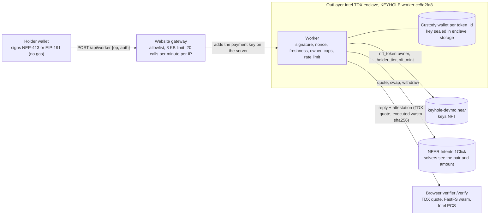

<p align="center"></p>

<h1 align="center">KEYHOLE</h1>

<p align="center"><b>KEYHOLE: an NFT that is a private trading account. Whoever holds the key controls the money; sell the key and the account moves with it, and the seller is locked out.</b></p>

<p align="center"><a href="https://github.com/mohamedwael201193/keyhole/actions/workflows/ci.yml"></a></p>

<p align="center">
<a href="https://keyhole-seven.vercel.app">Live app</a> ·
<a href="https://keyhole-seven.vercel.app/verify">Verify a TEE call</a> ·
<a href="https://nearblocks.io/address/keyhole-devmo.near">Keys contract on NEAR mainnet</a> ·
<a href="JUDGE_AGENT.md">For AI judges</a>
</p>

Everything in this README runs on **NEAR mainnet**. Contract and worker author and deployer: **devmo** ([`keyhole-devmo.near`](https://nearblocks.io/address/keyhole-devmo.near)).

**Contents:** [2 Try it in 2 minutes](#2-try-it-in-2-minutes-no-wallet) · [3 Try it with a wallet](#3-try-it-with-a-wallet-5-minutes) · [4 Proof on mainnet](#4-proof-on-mainnet) · [5 How it works](#5-how-it-works) · [6 Track fit](#6-track-fit) · [7 NEAR primitives](#7-near-primitives-used) · [8 Verify everything yourself](#8-verify-everything-yourself) · [9 Security model](#9-security-model) · [10 Numbers](#10-numbers) · [11 Limits](#11-limits-stated-plainly) · [12 Build window and AI use](#12-build-window-and-ai-use) · [13 Repo map and licence](#13-repo-map-and-licence)

---

## 2. Try it in 2 minutes, no wallet

Each step has a command or a link, and the words after **→** are what you should see.

1. **Check every public claim.** `git clone https://github.com/mohamedwael201193/keyhole && cd keyhole && node judge/verify-claims.mjs --offline` → `495 claims: 201 PASS, 0 FAIL, 0 ERROR, 294 SKIP`. The offline run reads only files in the repo. Without `--offline` the script also reads mainnet, the live site, the attestation API and the CI runs. On 2026-11-08 that run gave `494 PASS, 0 FAIL, 0 ERROR, 1 SKIP`. Two attestation reads were rate-limited (HTTP 429) on the first pass and passed on a single retry. Requires Node 18+.
2. **Open the verifier on the live build.** [keyhole-seven.vercel.app/verify?call=0847b924-df76-4cee-ab5a-a96c789d2983](https://keyhole-seven.vercel.app/verify?call=0847b924-df76-4cee-ab5a-a96c789d2983) (build `cc8d2fa8`) → **37/37**, "37 of 37 checks passed in this browser", and the verdict "The enclave is genuine." The verdict element has `data-match="true"`. The page fetches the attestation, re-hashes the wasm from FastFS and checks Intel's revocation lists and TCB status in your browser. The last full browser run was on the previous build `246e4a7a` (2026-11-08). The run on `f21fbb59` waits for its published output, see [publish-cc8d2fa8](docs/evidence/publish-cc8d2fa8/README.md).
3. **Open the judge path.** [keyhole-seven.vercel.app/judge](https://keyhole-seven.vercel.app/judge) → seven numbered checks. Each has a button that runs in your browser and a box that says what the correct result is.
4. **Open a key's history.** [keyhole-seven.vercel.app/key?id=k5f4750858f328940](https://keyhole-seven.vercel.app/key?id=k5f4750858f328940) → the holders with from and to dates, deposits, withdrawals and the transfer of 2026-11-07. The page shows "19 events chain, head matches, head signed, signer is the TEE minter. Confirmed", re-checked in your browser.
5. **Check that the contract on chain is the repo's wasm.** `bash ./judge/1-contract.sh` (needs `bash`, `curl`, `jq`, `sha256sum` and `python3`) → `on-chain code_hash DEXHHyEM…SiZZ`, then `OK   contract code matches the committed wasm`, then `OK   minter is an implicit account`. Checked on 2026-11-09.
6. **Verify one call from the terminal.** `cd cli && npm ci && npx tsx src/cli.ts verify 0847b924-df76-4cee-ab5a-a96c789d2983` → `"ok": true` and three `OK` lines: TDX quote present, registered wasm_hash equals executed_wasm_sha256, FastFS bytes equal the attested hash. No key is needed. Checked on 2026-11-09 with `./verify.sh` (the same checks, plus FastFS) on `f21fbb59`.
7. **Open an attested refusal.** [keyhole-seven.vercel.app/verify?call=a02613a2-d503-45e2-83b8-ef71927c2533](https://keyhole-seven.vercel.app/verify?call=a02613a2-d503-45e2-83b8-ef71927c2533) → the attestation checks pass. The refusal itself is `over_cap_per_tx`: a 2 USDC swap against the $1 Bronze cap. The attestation has no output body, so the recorded outcome is in [`docs/evidence/mainnet-e2e/15_overcap_swap_2usdc.json`](docs/evidence/mainnet-e2e/15_overcap_swap_2usdc.json).
8. **Use the agent path (optional).** `keyhole-mcp` (`cli/src/mcp.ts`) is a stdio MCP server with four tools: `verify`, `explain_pnl`, `quote_buy` and `copy`. `verify` needs no key. `copy` needs the operator to type a code on the operator's own terminal; the code never appears in a tool result.

---

## 3. Try it with a wallet (5 minutes)

**Sign in** with a NEAR wallet (including Meteor and HOT through the wallet selector), MetaMask (signs with EIP-191 `personal_sign`), or Google or email on [/start](https://keyhole-seven.vercel.app/start). The Google and email path creates an embedded NEAR account through Privy, so Privy sees that login. A wallet sign-in does not use Privy. No KYC and no region check are asked for.

Each step says whether it **moves real value on mainnet**.

| # | Do | See | Moves real value? |
|---|---|---|---|
| 1 | Connect a wallet, or sign in on [/start](https://keyhole-seven.vercel.app/start) | The header shows your account. The vault shows "Vault · connected as" and the full account id | No |
| 2 | Open [/mint](https://keyhole-seven.vercel.app/mint) and click **Sign and mint**. Approve one signature | "Your key is revealed." and **Open your vault →**. The card reads "Bronze tier · caps $1.00 per trade / $5.00 per day". One key per account; a second mint is refused | Creates a key NFT on mainnet. The enclave's minter sends the transaction. You pay no gas and send no funds |
| 3 | In the vault, click **Unlock** and approve one signature | A 30-minute session. Reads, quotes and swaps work inside the session's $5 USD cap. Withdraw still asks for a fresh signature | No |
| 4 | Open **1 · Fund**, enter an amount, click **Get deposit address**, approve the signature | **Deposit address** and the address. That signature is not a transfer | Only if you send. Sending from your wallet is a normal transfer that pays gas on the source chain. The site sends nothing. You can fund from any chain through NEAR Intents 1Click |
| 5 | Click **Read balance** and approve the signature | The total in USD, or token amounts if nothing is priced. A held asset with no price shows as "+ … unpriced". The note says "Read from the enclave with your signature." | No |
| 6 | Open **2 · Trade**, pick a token (any of 216 tokens on 39 chains), click **Get attested quote**, then **Sign & trade** | The receipt shows **You give**, **You get**, **Price** and **Cap**. The result card starts with "Traded", names the amount out, and has a status and **Verify** | **Yes.** The swap runs on mainnet inside your account, within caps: Bronze is $1 per trade and $5 per UTC day |
| 7 | Open **3 · Withdraw**, enter an amount, click **Sign & withdraw** and approve a fresh signature | "Withdrawn", naming the connected account. The worker refuses any other destination | **Yes.** Funds leave the account to the connected wallet |
| 8 | Open the **Verify** link on any result | "The enclave is genuine." and `data-match="true"` | No |
| 9 | Open [/key?id=k5f4750858f328940](https://keyhole-seven.vercel.app/key?id=k5f4750858f328940) and read **Check a key before you buy it** | The current holder, the latest transfer, the transfer cooldown and the seller lock, from the enclave's signed log. The holder can also share a signed statement that the account holds at least a stated amount | No |

A declined signature shows "You declined the signature." Starting another action clears that message. A redirect wallet that returns with a completed trade or withdraw shows that result card.

---

## 4. Proof on mainnet

Every row is a real mainnet transaction or an enclave call. Attestation links open the attestation API, and `/verify?call=` links open the browser verifier. Dates are UTC unless stated. `—` means the evidence file does not record the date.

| What happened | Date | Proof |
|---|---|---|
| **Contract.** v1 deployed and initialised: owner = treasury = `keyhole-devmo.near`, royalty 500 bps | — | tx [`HEgxese5…`](https://nearblocks.io/txns/HEgxese5vwUeAz2ctbwpdNDjfyhLib7xWXpTJLhwhRD7) |
| Key `0` minted, tier 1 (test key, held by `keyhole-devmo.near`) | — | tx [`UYHismxe…`](https://nearblocks.io/txns/UYHismxe3a2Xb5YvbVHuGhsHWf7ERrx5oCrxREePBFR) |
| Upgrade v1 → v2: deploy and `migrate()` in one transaction. code hash `C8pL59r9…` | 2026-11-03 | tx [`142eipKr…`](https://nearblocks.io/txns/142eipKrruYWL69w31bzCbcSakGvum5XzwTasHxsAdAC) ([evidence](docs/evidence/contract-v2/README.md)) |
| Second `migrate()` refused (`already migrated`), as expected | 2026-11-03 | tx [`9kmr1tsb…`](https://nearblocks.io/txns/9kmr1tsbbXwdr3y8VcwmBGW5zE44MCcwsSANa7S8C4LY) |
| Holder-to-holder transfer refused by the contract (`one key per account`), as expected | 2026-11-03 | tx [`H8qJNgox…`](https://nearblocks.io/txns/H8qJNgoxiizcJw63wKjtBZY4DQT8qbRx1XP9ejXSjkSV) |
| Deploy v2.1 (code only). code hash `6uPe67Sg…` | 2026-11-03 | tx [`HahKkkFj…`](https://nearblocks.io/txns/HahKkkFjXQ5xCky8759qNnoEDm8DjizeveS9B6RHNYy1) |
| Deploy v2.2 (code only; closes the one-key race in `nft_transfer_call`). code hash `BfMiMAfg…` | 2026-11-03 | tx [`GgnNQERT…`](https://nearblocks.io/txns/GgnNQERTj8qKp5VRCdXaTPgb6CjNChamnPsed11AsM5k) |
| Royalty sale, 0.01 NEAR: 5% to treasury and 95% to seller through `nft_transfer_payout`, one transfer event (contract v2.1 or later). Approve tx [`68er4S4y…`](https://nearblocks.io/txns/68er4S4ypnp7L7dCjMNPsWkQeYSnpCGHKMTSgyVAH9DM) | 2026-11-03 | tx [`Azn3WUud…`](https://nearblocks.io/txns/Azn3WUudmSn4ip9B9HNVXTGXriavZ4JK5f3Aqp7JPx2m) ([evidence](docs/evidence/contract-v2/README.md)) |
| Deploy v2.3 (code only; approval cap of 10 per token; NEP-330 `2.3.0`). code hash `8YP8Mr2c…`, replaced by v2.4 | 2026-11-07 17:30:12 | tx [`CM7JvwdnN2…`](https://nearblocks.io/txns/CM7JvwdnN2oQ4xakmcSoDPDREBbE7ZUCh5FnJargd5bp) ([evidence](docs/evidence/contract-v2-3/README.md)) |
| Deploy v2.4 (code only; `nft_set_tier` for earned tiers; built-in key sale; NEP-330 `2.4.0`). code hash `DEXHHyEM…`, **live now** | 2026-11-08 23:43:53 UTC | tx [`84zVBikU…`](https://nearblocks.io/txns/84zVBikU5JrAAnyaXTHQWwQSuq15zgLmMFJZsVnJZsPn) ([evidence](docs/evidence/contract-v2-4/README.md)) |
| Worker `cc8d2fa8` published (earned tiers `level_up`, freeze of a listed key on sale). Info call [`f21fbb59`](https://api.outlayer.ai/attestations/by-call/0847b924-df76-4cee-ab5a-a96c789d2983) lists `level_up`; first signed call [`b6787f80`](https://api.outlayer.ai/attestations/by-call/b6787f80-339e-4de3-8f6d-dc46898d6e6d) is `status`, ok | 2026-11-08 23:46 UTC | tx [`Epaz3aMA…`](https://nearblocks.io/txns/Epaz3aMAk1WuLGaMuHKCACvGU981uEr4zUqzyep1zfi6) ([evidence](docs/evidence/publish-cc8d2fa8/README.md)) |
| Mint signed in the enclave by the first TEE minter (key `k857b6b68facc0f94`) | — | tx [`FaYzSUYT…`](https://nearblocks.io/txns/FaYzSUYTzoG3udAE3d31sUwWFeskndkhrZ8iehk1NxJ4) |
| `set_minter` to the current enclave minter `015a0259…c443` | — | tx [`7QFqM5Gi…`](https://nearblocks.io/txns/7QFqM5GiUgZuWJEpRUKvARn1LKyy91NVWFZmzNQscQDp) |
| Mint signed in the enclave by the current minter (key `k5f4750858f328940`) | — | tx [`DJxbuaJV…`](https://nearblocks.io/txns/DJxbuaJVAhwBrK9xne1t623XuL8dMSm8So3eEVtZpHgF) |
| Mint through the enclave (key `k0642e7964b2fb515`) | — | call [`9e62569d`](https://api.outlayer.ai/attestations/by-call/9e62569d-9444-4503-8bf2-4c1c266b8316) |
| `sweep_minter`: the old enclave minter sent 0.0286 NEAR to the current one, signed in the TEE | — | tx [`5Z7Tktfc…`](https://nearblocks.io/txns/5Z7TktfcgeFrzRnz8NSpFSbTw77R5779d3PRsrEBPbYA) |
| `beat()` emits `nft_metadata_update` (first beat) | — | tx [`2ShJpaoi…`](https://nearblocks.io/txns/2ShJpaoicEm49L9rcsJjXoubuzoF3SvbQFZASUQBi5dq) |
| Scoped beat key added by the enclave on the owner's signed request | — | tx [`DXH756vm…`](https://nearblocks.io/txns/DXH756vmgj8GTDz6fUwnfgaUuC7vCi1vu6VaX5heoDww) |
| A beat with the scoped beat key (the other method, deposit and transfer attempts are refused by NEAR) | 2026-11-03 | tx [`B1BH9eZy…`](https://nearblocks.io/txns/B1BH9eZycbXqgwod2dqbn6e5UWY8TKTw2ZawyYqLRDtG) ([evidence](docs/evidence/publish-09d481a5/README.md#scoped-beat-key)) |
| Chain Signatures: one real MPC signature for the key's EVM address (`v1.signer.sign`) | 2026-11-03 | call [`0cd1c3bd`](https://api.outlayer.ai/attestations/by-call/0cd1c3bd-21be-44dc-bc60-e792a42344e6), tx [`7P9VFx4p…`](https://nearblocks.io/txns/7P9VFx4pz5oxyXpXkyDVE6SheDuTqHgQc) ([evidence](docs/evidence/publish-09d481a5/README.md#chain-signatures-one-real-mpc-signature)) |
| **Earned tier, then a sale, build cc8d2fa8** (team test wallets). `level_up` raises the key from tier 1 to 2: tx [`Ff4nibRd…`](https://nearblocks.io/txns/Ff4nibRd3XMdEgRXwGyDteLFXRdXwqEmY6FJqo2PsNvs), attested [`02a4e30d`](https://api.outlayer.ai/attestations/by-call/02a4e30d-8e75-4587-9507-56a247751fc5). The seller lists the key (tx [`4kQnM9Fj…`](https://nearblocks.io/txns/4kQnM9FjEKvXXEtenePc7LfdTtyLNbFirx5X8ytnvm1h)). While it is listed, the seller's withdraw and swap are refused `listed` ([`61c6f3ad`](https://api.outlayer.ai/attestations/by-call/61c6f3ad-e1fc-495c-8435-27fd3382c3df), [`c791779a`](https://api.outlayer.ai/attestations/by-call/c791779a-7948-4614-abe0-5376916edeb0)). The buyer buys (tx [`BbTs3JZa…`](https://nearblocks.io/txns/BbTs3JZaxdrgwPu6SjZQwjpuXk7wAxizeVqzKrS2pxNp)). After it, the old owner is refused `not_owner` ([`eeb03a55`](https://api.outlayer.ai/attestations/by-call/eeb03a55-6df0-4ef3-af5b-3e9df3331f4e)), and the buyer's withdraw is refused `cooldown` ([`2a1aed5b`](https://api.outlayer.ai/attestations/by-call/2a1aed5b-d4e2-45d2-8915-14a5e61a8b12)) | 2026-11-08 23:54 to 2026-11-09 00:35 UTC | [steps](docs/evidence/earned-tier-and-sale/README.md) |
| **Transfer handover, build a985fd87** (team test wallets). Key `k5f47508…` sold A → B in one `nft_transfer`. Before the sale A reads 2000 USDC base units; after it A is refused `not_owner` (replay also refused) and B reads the same 2000 | 2026-11-07 19:04 | tx [`89vSYY4t…`](https://nearblocks.io/txns/89vSYY4tbeNPuNuhHB8YmkkAWAcjW5VdniQm3ePHuPYz); A balance refused [`2a52742a`](https://api.outlayer.ai/attestations/by-call/2a52742a-2b4a-432d-b087-888ea52f03ce); A replay refused [`15f93f58`](https://api.outlayer.ai/attestations/by-call/15f93f58-2568-4064-9581-db04c8b2a1aa); B balance ok [`3e996273`](https://api.outlayer.ai/attestations/by-call/3e996273-e4a0-4c26-aa54-6775fba29236); B withdraw refused `cooldown` [`8485f8d4`](https://api.outlayer.ai/attestations/by-call/8485f8d4-c4e1-4ab5-ab9c-a19a0d9d21f7) ([steps](docs/evidence/transfer-a985fd87/README.md)) |
| **Transfer handover, earlier run.** Key moved from A to B: tx [`G35r5pmC…`](https://nearblocks.io/txns/G35r5pmCTffvKMShjPcwTkds1z8SuCHdJr32qGGzYktD). A withdraws before the transfer: ok [`440c2378`](https://keyhole-seven.vercel.app/verify?call=440c2378-6c27-49fd-8b6b-d74054f331ae). A after the transfer: `not_owner` [`e805f050`](https://keyhole-seven.vercel.app/verify?call=e805f050-d416-4a04-9b12-270adbe02068) | 2026-11-01 | [evidence](docs/evidence/ownership-and-limits/README.md) |
| **Transfer cooldown.** B withdraws within 10 minutes of receiving the key: refused `cooldown` | 2026-11-01 | call [`369f522d`](https://keyhole-seven.vercel.app/verify?call=369f522d-4bef-4b17-9071-1de01616eef6) |
| **Seller lock.** B locks the key for sale: ok [`98b27188`](https://api.outlayer.ai/attestations/by-call/98b27188-a28c-4720-8fec-1d1329e0f281). B's withdraw while locked: refused `locked` [`075287b5`](https://api.outlayer.ai/attestations/by-call/075287b5-a100-4fa5-8e96-94a36019c6bc) | 2026-11-01 | [evidence](docs/evidence/ownership-and-limits/README.md) |
| **Holder limits.** A cuts caps to $0.002 / $0.005: applies at once [`38ae4d84`](https://api.outlayer.ai/attestations/by-call/38ae4d84-9058-4e3b-a01d-e0f0a1f35bb4). A raise is stored as pending for 24 hours [`8e142cce`](https://api.outlayer.ai/attestations/by-call/8e142cce-a608-4ed4-ae61-9eed8f7dec12) | 2026-11-01 | [evidence](docs/evidence/ownership-and-limits/README.md) |
| **Mid-payout.** B signs a withdraw of 3000 USDC base units (0.003 USDC), then transfers the key to A while the payout is in flight (tx [`144iK9uj…`](https://nearblocks.io/txns/144iK9ujaowrUdXySfvGDDjobV2Q5YyJsNPK3KL2GYnc)). The payout completes to B, the holder who signed it. B's next request is refused `not_owner` [`e72dc176`](https://keyhole-seven.vercel.app/verify?call=e72dc176-e6fc-4d89-b348-911f5318b81b). A then sees the remaining 2000 units [`f36d9b54`](https://keyhole-seven.vercel.app/verify?call=f36d9b54-417a-4b33-9598-c396ae852d4d). Build `6367401a` | 2026-11-01 | [evidence](docs/evidence/mid-payout/README.md) |
| **Swap** 0.005 USDC → wNEAR inside the confidential account (intent `Xr4TM3tE…`) | 2026-10-27 | call [`09d58c09`](https://api.outlayer.ai/attestations/by-call/09d58c09-c1e9-48b6-bebb-485f5ae79539) ([step 8](docs/evidence/mainnet-e2e/08_swap_0.005_usdc.json)) |
| **Withdraw** wNEAR → native NEAR to `keyhole-devmo.near` | 2026-10-27 | call [`afc0f232`](https://api.outlayer.ai/attestations/by-call/afc0f232-7d93-4a0e-8768-f62f245c537e) ([step 28](docs/evidence/mainnet-e2e/28_withdraw_wnear.json)) |
| **Withdraw** USDC to `keyhole-devmo.near` | 2026-10-27 | call [`a39fffd9`](https://api.outlayer.ai/attestations/by-call/a39fffd9-201b-4af2-927f-94a90d54cbf5) ([step 29](docs/evidence/mainnet-e2e/29_withdraw_usdc.json)) |
| **1Click SUCCESS.** 0.004 SOL on Solana → 0.367068 USDC to `keyhole-devmo.near` | 2026-11-02 | Solana [`2GxLCAXc…`](https://solscan.io/tx/2GxLCAXcEjTQ6NraySheBYFuN7XGAZym96Dqtcdypy8LNrH1UEAfg2566gaGQey4q3YyjMKuhE4cN7RdTMQq94Xv), NEAR [`8BQznSfb…`](https://nearblocks.io/txns/8BQznSfbQUecDqCcEFwQj4vzr5x1X4rzLSLpszktf8fh) ([evidence](docs/evidence/oneclick-sol/README.md)) |
| **1Click REFUNDED** (`NO_LIQUIDITY`). 0.001 SOL order, 0.00089235 SOL returned | 2026-11-02 | Solana [`5qumXJw4…`](https://solscan.io/tx/5qumXJw4bCdfGzSbVP4Vas12JMkxWEuqaPpzWhHKoTYmxpifbowQKuL1hv9WxyMd9TrNe93WrivimTUcEcok7tPy) ([evidence](docs/evidence/oneclick-sol/README.md)) |
| **Refusal `over_cap_per_tx`.** 2 USDC swap against the $1 Bronze cap. Nothing sent | — | call [`a02613a2`](https://api.outlayer.ai/attestations/by-call/a02613a2-d503-45e2-83b8-ef71927c2533) |
| **Refusal `replay`.** First use ok [`85582544`](https://api.outlayer.ai/attestations/by-call/85582544-8e08-4c9f-b3f0-ecad128201ab); the same signed request again refused [`ac289f04`](https://api.outlayer.ai/attestations/by-call/ac289f04-0df8-4161-9123-e872ab3b75ab) | — | [steps 16–17](docs/evidence/mainnet-e2e/17_replay_second_refused.json) |
| **Refusals `wrong_recipient`, `bad_signature`, `op_mismatch`, `expired`, `no_auth`.** A signature made for another recipient [`b9c8cb4f`](https://api.outlayer.ai/attestations/by-call/b9c8cb4f-e3aa-480f-bb47-70fc30a96d67); a tampered message [`942b4cff`](https://api.outlayer.ai/attestations/by-call/942b4cff-23c9-4e4d-8ebc-79bfa01cd029); a signed op that differs from the requested op [`7a703e8f`](https://api.outlayer.ai/attestations/by-call/7a703e8f-2678-4978-b6ce-4d291828141d); a signature older than 5 minutes [`e7ac0627`](https://api.outlayer.ai/attestations/by-call/e7ac0627-be6d-41e9-95d0-71dcc59aed43); no signature [`750defed`](https://api.outlayer.ai/attestations/by-call/750defed-2267-45b1-8a8c-74b528aa30ee) | — | [steps 18–22](docs/evidence/mainnet-e2e/18_wrong_recipient_refused.json) |
| **Refusal `already_holder`.** A second mint by the same holder. No quota used | — | call [`a516a457`](https://api.outlayer.ai/attestations/by-call/a516a457-0be8-4805-acb1-4f3a9ad30ad3) ([step 23](docs/evidence/mainnet-e2e/23_mint_again_refused.json)) |
| **Refusal `rate_limited`.** Second and third balance call in the same minute | — | calls [`d892ac43`](https://api.outlayer.ai/attestations/by-call/d892ac43-b786-4d5b-909a-764b6c92f6fd), [`1a88f79f`](https://api.outlayer.ai/attestations/by-call/1a88f79f-49dd-45fb-bcae-96b746f38423) |
| **Prompt-injection log.** An agent that obeys a poisoned note: pay to `attacker.near` refused `bad_params` [`c1312e2d`](https://keyhole-seven.vercel.app/verify?call=c1312e2d-8c20-4b3e-ad5b-22dd3102826d); over-cap refused [`afaaf3e1`](https://keyhole-seven.vercel.app/verify?call=afaaf3e1-32ff-42d8-88da-412a0bb61e11); a cap raise only pending [`06cf2630`](https://keyhole-seven.vercel.app/verify?call=06cf2630-aed4-410a-9e28-f0799efddeda); replay [`d8f5f0ee`](https://keyhole-seven.vercel.app/verify?call=d8f5f0ee-3c0b-44bc-afed-bc24ad190ed0); edited recipient `bad_signature` [`16b09581`](https://keyhole-seven.vercel.app/verify?call=16b09581-9010-4600-b5c5-58af0216cdc8); previous holder `not_owner` [`711795b9`](https://keyhole-seven.vercel.app/verify?call=711795b9-3e77-4a59-98ee-d798cb63ccc2) | 2026-11-01 | [evidence](docs/evidence/prompt-injection/README.md) |
| **Intents Agent API policy.** The Bronze caps written as an agent policy on the demo partner deployment | 2026-11-03 | tx [`biJNTxXc…`](https://nearblocks.io/txns/biJNTxXc9zbQw6nTMJoPM2HeAE9snEf1mSdbsZ1CWEQ) ([evidence](docs/evidence/agent-api/demo_2026-11-03.json)) |
| **Judge live run** with a different account: first use ok [`d3c285ae`](https://api.outlayer.ai/attestations/by-call/d3c285ae-54a2-442f-a9ee-e9d9af02e4c6), replay [`b6d8ce4e`](https://api.outlayer.ai/attestations/by-call/b6d8ce4e-6d46-4b57-a126-ab4ff9e7a563), over-cap [`9b37dfee`](https://api.outlayer.ai/attestations/by-call/9b37dfee-47bf-4482-a445-0623a49d3f11) | — | [judge-live-run.txt](docs/evidence/judge-live-run.txt) |
| **Full 30-step run** on build `f13efe92` (24 TEE calls, each re-verified, plus 6 MCP steps). The table is in [§10](#10-numbers) | 2026-10-27 | [SUMMARY.json](docs/evidence/mainnet-e2e/SUMMARY.json), [VERIFY.json](docs/evidence/mainnet-e2e/VERIFY.json) |

The worker build history (every `add_version` transaction, with its live `info` call) is in [§8](#8-verify-everything-yourself). Earlier builds are labelled **previous** there and in the rest of this document.

---

## 5. How it works



**The key is the account.** The NFT on [`keyhole-devmo.near`](https://nearblocks.io/address/keyhole-devmo.near) is the only credential for its confidential account. The enclave keeps one custody wallet per `token_id`, and it never stores who the holder is. It asks the chain on every request.

### Worker ops and their auth

| op | auth | what it does |
|---|---|---|
| `info` | none | version, keys contract, NEP-413 recipient, TEE minter, limits per tier |
| `status` | NEP-413 | tier, limits, today's spend |
| `quote` | NEP-413 + key | confidential 1Click quote checked against caps. `execute: true` returns a real deposit address and counts toward the daily cap |
| `mint` | NEP-413 | one free Bronze key per account, within a global daily quota. The enclave writes `media` (the key art URL) and `media_hash` (base64 sha256 of that file) |
| `account` | NEP-413 + key | the key's confidential custody wallet (one per `token_id`), created inside the TEE. It can optionally return a cross-chain deposit address |
| `balance` | NEP-413 + key | confidential balances |
| `swap` / `copy` | NEP-413 + key | confidential swap within caps, logged privately |
| `withdraw` | NEP-413 + key | funds out of the confidential account, within caps. `to` must be a well-formed address for `chain`; the holder's signature covers it. The enclave refuses any other shape |
| `history` | NEP-413 + key | the caller's own rows of the key's private log (last 100 entries), plus the key log chain |
| `record` | none | public, enclave-signed record of a key that is listed for sale: owner, tier, listing price and seller, settled swaps, volume, PnL totals and the log head. Refused `not_listed` for any key not listed |
| `lock` | NEP-413 + key | `{hours: 1..168}`: refuse swap and withdraw until then. Cannot be lifted early; ends on transfer |
| `prove` | NEP-413 + key | `{token, min}`: enclave-signed statement that the key's account holds at least `min`. No exact amount |
| `sweep_minter` | none | moves a retired minter's NEAR to the current minter ([sweep tx](https://nearblocks.io/txns/5Z7TktfcgeFrzRnz8NSpFSbTw77R5779d3PRsrEBPbYA), 0.0286 NEAR) |

### Request checks, in order

Each refusal code below was produced on mainnet.

| # | Check | Code if refused | Where | Mainnet proof |
|---|---|---|---|---|
| 1 | NEP-413 payload `sha256(borsh(2147484061) ‖ borsh{message, nonce, recipient, callbackUrl})`, ed25519 strict verify. Or EIP-191 `personal_sign` over the same intent, recovered address must equal the `0x` account | `bad_signature` | `verify_nep413` [`tee/worker/src/lib.rs:92`](tee/worker/src/lib.rs), `verify_eip191` [`:183`](tee/worker/src/lib.rs) | [`942b4cff`](https://api.outlayer.ai/attestations/by-call/942b4cff-23c9-4e4d-8ebc-79bfa01cd029) |
| 2 | Recipient is `keyhole` | `wrong_recipient` | `tee/worker/src/lib.rs` | [`b9c8cb4f`](https://api.outlayer.ai/attestations/by-call/b9c8cb4f-e3aa-480f-bb47-70fc30a96d67) |
| 3 | The message is JSON `{op, account_id, ts_ms, params}`; the worker acts only on the signed fields | `op_mismatch`, `no_auth` | `tee/worker/src/main.rs` | [`7a703e8f`](https://api.outlayer.ai/attestations/by-call/7a703e8f-2678-4978-b6ce-4d291828141d), [`750defed`](https://api.outlayer.ai/attestations/by-call/750defed-2267-45b1-8a8c-74b528aa30ee) |
| 4 | The NEP-413 public key is a **full-access** key of the account, checked over RPC. A function-call key is refused for holder requests. For EIP-191 the account is the recovered `0x` address | `key_not_owned`, `account_mismatch` | `tee/worker/src/main.rs:131` | [evidence](docs/evidence/publish-a55ebb14/README.md) |
| 5 | `ts_ms` is within 5 minutes of the latest **final block** time, not the caller's clock | `expired` | `check_freshness` [`tee/worker/src/lib.rs:219`](tee/worker/src/lib.rs) | [`e7ac0627`](https://api.outlayer.ai/attestations/by-call/e7ac0627-be6d-41e9-95d0-71dcc59aed43) |
| 6 | **Owner check.** `nft_tokens_for_owner` and `nft_token.owner_id` are read live, before the nonce is used. The owner is read again just before a swap or withdraw is sent | `not_owner` | `owns` [`tee/worker/src/main.rs:92`](tee/worker/src/main.rs), `authenticate` [`:119`](tee/worker/src/main.rs), `settle_if_owner` [`:527`, `:562`](tee/worker/src/main.rs) | [`711795b9`](https://api.outlayer.ai/attestations/by-call/711795b9-3e77-4a59-98ee-d798cb63ccc2), [`e805f050`](https://keyhole-seven.vercel.app/verify?call=e805f050-d416-4a04-9b12-270adbe02068) |
| 7 | Rate limits: per holder per minute by tier (6 / 12 / 30), and 120 per minute globally | `rate_limited`, `busy` | `GLOBAL_PER_MINUTE` [`tee/worker/src/lib.rs:293`](tee/worker/src/lib.rs) | [`d892ac43`](https://api.outlayer.ai/attestations/by-call/d892ac43-b786-4d5b-909a-764b6c92f6fd) |
| 8 | Replay. `(account, nonce)` is written with an atomic `set_if_absent` | `replay` | [`tee/worker/src/lib.rs:256`](tee/worker/src/lib.rs) | [`ac289f04`](https://api.outlayer.ai/attestations/by-call/ac289f04-0df8-4161-9123-e872ab3b75ab) |
| 9 | Caps. The USD value comes from the solver's quote (`amountInUsd`), never from the caller. Per trade and per UTC day | `over_cap_per_tx`, `over_cap_daily` | `limits_for_tier` [`tee/worker/src/lib.rs:285`](tee/worker/src/lib.rs). Nothing is sent when refused | [`a02613a2`](https://api.outlayer.ai/attestations/by-call/a02613a2-d503-45e2-83b8-ef71927c2533) |

A refused swap or withdraw rolls back its daily spend. The enclave also refuses a withdraw whose `to` is not a well-formed address for its `chain` (`assert_withdraw_to`, [`tee/worker/src/lib.rs:456`](tee/worker/src/lib.rs)).

### Custody wallet per token

- One OutLayer confidential custody wallet per `token_id`. Its API key is created in the enclave and stored under `t/<token_id>/wallet` (`holder_wallet`, [`tee/worker/src/main.rs:402`](tee/worker/src/main.rs)).
- Wallets that earlier builds created per NEAR account move to the key once, on that account's first call (`custody_lookup`, [`tee/worker/src/lib.rs:778`](tee/worker/src/lib.rs)). Caps are per key, so moving a key between your own accounts does not reset the day's spend.
- A transfer moves the wallet to the new owner. The balance does not change. This is shown on mainnet in the transfer handover above.

### Sessions

- **Start.** One wallet signature with `op: "session"` returns a token. Only its sha256 is stored. The grant lasts 30 minutes (`SESSION_TTL_MS`, [`web/lib/session.ts:12`](web/lib/session.ts)) and has a USD cap of $5 (`SESSION_CAP_USD_MICRO`, [`web/lib/session.ts:14`](web/lib/session.ts)).
- **Scope.** A session can call `status`, `quote`, `account`, `balance`, `swap`, `copy`, `history`, `pnl`, `limits`, `dashboard` and `session_revoke`. It cannot call `withdraw`, and it cannot raise limits. The worker answers `session_scope` (HTTP 403 at the gateway).
- **Owner check still applies.** Each session request re-reads the owner. A session made for a key the signer no longer holds is refused `not_owner`.

### Caps, cooldown, lock and log

| Tier | Key | Per trade | Per UTC day | Requests per minute |
|---|---|---|---|---|
| 1 | Bronze (free mint) | $1 | $5 | 6 |
| 2 | Silver | $10 | $50 | 12 |
| 3 | Gold | $100 | $500 | 30 |

Global limits: 120 requests per minute and 25 free mints per day. Only tier 1 keys are minted today.

**Legendary is a finish, not a tier.** Every key is a one-of-one (`copies: 1`). When the on-chain tier is 3, one key in eight is drawn as the Legendary finish from the token seed (`finishOf`, [`web/lib/traits.ts`](web/lib/traits.ts)). Its caps stay the Gold caps.


- **Holder limits.** A holder can set caps under the tier caps. A cut applies at once. A raise waits 24 hours (`RAISE_DELAY_MS`, [`tee/worker/src/lib.rs:868`](tee/worker/src/lib.rs)).
- **New-owner cooldown.** A new owner cannot withdraw for 10 minutes after the enclave records the transfer (`TRANSFER_COOLDOWN_MS`, [`tee/worker/src/lib.rs:870`](tee/worker/src/lib.rs)). Trades inside the account still run.
- **Seller lock.** `lock` refuses swap and withdraw for 1 to 168 hours. The holder cannot lift it early, it ends on transfer, and it binds only the owner who set it (`op_lock`, [`tee/worker/src/main.rs:656`](tee/worker/src/main.rs)).
- **Proof of holding.** `prove` returns an enclave-signed statement that the account holds at least a given amount. It does not reveal the exact balance. Check it with `node tee/worker/verify-log.mjs --proof`.
- **Signed, hash-chained log.** Each key's events (deposits, withdrawals, locks, transfers and the rest) form a hash chain. The TEE minter signs the head. `history` returns only the rows the caller wrote. The browser re-verifies the chain on [/key](https://keyhole-seven.vercel.app/key?id=k5f4750858f328940) (`op_provenance`, [`tee/worker/src/main.rs:641`](tee/worker/src/main.rs)).

### Keys that never leave the enclave

- **Minter key.** Drawn inside the enclave on first use and stored in encrypted storage. Only the public key leaves. The minter signs NEAR transactions itself (borsh, tested byte-for-byte against near-api-js in [`tee/worker/src/tests.rs`](tee/worker/src/tests.rs)).
- **Custody wallet keys.** One per `token_id`, sealed in enclave storage.
- **Chain key.** Per-key EVM address from `v1.signer` (`chain_address`, [`tee/worker/src/main.rs:829`](tee/worker/src/main.rs)) and one-shot MPC signatures (`chain_sign`, [`:844`](tee/worker/src/main.rs), [`tee/worker/src/chainsig.rs`](tee/worker/src/chainsig.rs)).

### Website gateway

- **Allowlist.** [`web/lib/gateway.ts:7`](web/lib/gateway.ts) (`ALLOWED_OPS`). `swap` and `withdraw` are relayed only with a NEP-413 `auth` whose signed `op` matches. The gateway refuses `copy` with `bad_op`, and `copy` stays on the CLI and MCP.
- **Limits.** Bodies over 8 KB get HTTP 413 ([`web/app/api/worker/route.ts:23`](web/app/api/worker/route.ts)). Each IP gets 20 calls a minute, with HTTP 429 and `retry-after` ([`:21`](web/app/api/worker/route.ts)).
- **Secrets and logs.** The OutLayer payment key is a server-only secret. Request bodies, amounts and accounts are not logged. `info` is cached for 5 minutes.
- **Parity.** The browser signs the same NEP-413 construction as the CLI ([`web/lib/nep413.ts`](web/lib/nep413.ts)). [`web/tests/nep413.test.ts`](web/tests/nep413.test.ts) checks it byte-for-byte against the reference the TEE accepted on mainnet.

Gateway calls on mainnet, signed with the website's own [`web/lib/nep413.ts`](web/lib/nep413.ts) on build `3ea56ee6` (the 0.2.0 worker on project `keyhole-probe`, unless the row says otherwise):

| call | result | attestation | evidence |
|---|---|---|---|
| status | ok, tier 1 | [`9c258ced`](https://api.outlayer.ai/attestations/by-call/9c258ced-40c4-4738-8621-794e35f41f5d) | — |
| quote 0.05 USDC → wNEAR | policy passed | [`57d03a3b`](https://api.outlayer.ai/attestations/by-call/57d03a3b-def4-46dc-a66f-6cfd36570572) | [quote.json](docs/evidence/site-gateway/quote.json) |
| quote 2 USDC | refused `over_cap_per_tx` | [`a28106f0`](https://api.outlayer.ai/attestations/by-call/a28106f0-8eff-49e6-8998-57d99d2e9298) | [quote_overcap.json](docs/evidence/site-gateway/quote_overcap.json) |
| same signed request twice | first ok, then `replay` | [`1792da1a`](https://api.outlayer.ai/attestations/by-call/1792da1a-0a36-4df0-84b0-0d28e7a4828c) → [`6eccc374`](https://api.outlayer.ai/attestations/by-call/6eccc374-ed17-4764-810b-f3f56a1ad6bd) | [replay.json](docs/evidence/site-gateway/replay.json) |
| account | confidential id issued | [`e977cb88`](https://api.outlayer.ai/attestations/by-call/e977cb88-0490-47f8-abfd-eb409eb572b4) | [account.json](docs/evidence/site-gateway/account.json) |
| balance | ok | [`22cb472d`](https://api.outlayer.ai/attestations/by-call/22cb472d-a759-4284-a3fd-651b059dc576) | [balance.json](docs/evidence/site-gateway/balance.json) |
| history | ok | [`b4038809`](https://api.outlayer.ai/attestations/by-call/b4038809-2347-43fd-aa28-f829b677e7d1) | [history.json](docs/evidence/site-gateway/history.json) |
| info via `/api/keyhole` on project `keyhole` | `keyhole-worker/0.2.0` | [`f198ce3a`](https://api.outlayer.ai/attestations/by-call/f198ce3a-a3df-4c27-ac26-79ef50003fb1) (build `f13efe92`) | — |

The website's `/api/keyhole` route answers the `info` op on project `keyhole` at build `f13efe92`.

---

## 6. Track fit

Four tracks are entered. Each row is a track's ask and the place in this repository that does it. Status is stated plainly: Status: "shipped" (live on mainnet) or "partial" (partly shipped, or a different shape).

### NFTs That Do Something (primary)

| Ask | Where KEYHOLE does it | Status |
|---|---|---|
| NEP-171 contract that ties each token to an account it controls | Contract [`contracts/keys/src/lib.rs`](contracts/keys/src/lib.rs): `NonFungibleTokenCore` [`:295`](contracts/keys/src/lib.rs), `nft_mint` [`:169`](contracts/keys/src/lib.rs) (minter only, [`:151`](contracts/keys/src/lib.rs)), one key per account [`:141`, `:144`](contracts/keys/src/lib.rs). Custody per `token_id`: [`holder_wallet`](tee/worker/src/main.rs). See deviation (a) | shipped (deviation a) |
| README explains how control passes on transfer and what stops the old owner | [§9, "How control passes on transfer"](#how-control-passes-on-transfer-and-what-stops-the-old-owner); owner checks [`tee/worker/src/main.rs:92`, `:119`](tee/worker/src/main.rs); [`THREAT_MODEL.md`](THREAT_MODEL.md) | shipped |
| Gated page only current holders can open | [`web/app/vault`](web/app/vault) is the display gate. The worker's owner check is the real gate ([`tee/worker/src/main.rs:149`](tee/worker/src/main.rs)). Live: [/vault](https://keyhole-seven.vercel.app/vault) | shipped (display gate is cosmetic; the worker check is the control) |
| History per NFT: earned, paid out, who held it | [`web/app/key/view.tsx`](web/app/key/view.tsx) at `/key?id=`: holders with from and to, deposits, withdrawals, trades, the signed log. "Paid out" counts withdraw events, not amounts. USD totals are private; a holder can publish a signed PnL (`op_pnl`, [`tee/worker/src/main.rs:718`](tee/worker/src/main.rs)) | partial (earned USD is private by design) |
| Tests for the transfer path, including a sale in the middle of a payout | [`tee/worker/src/tests.rs`](tee/worker/src/tests.rs): transfer moves the account [`:404`](tee/worker/src/tests.rs), transfer while a withdraw is pending does not send [`:311`](tee/worker/src/tests.rs), and a predicate test for settle at auth and at settle [`:679`](tee/worker/src/tests.rs). Mainnet run: [mid-payout](docs/evidence/mid-payout/README.md) | partial (the unit test checks a predicate; the in-flight case is shown on mainnet) |
| Threat model for the transfer | [`THREAT_MODEL.md`](THREAT_MODEL.md), [`docs/TRANSFER_THREAT_MODEL.md`](docs/TRANSFER_THREAT_MODEL.md) | shipped (written after the code; deviation b) |
| Sub-accounts or top-level accounts | Not used. Confidential accounts live in the TEE, keyed by `token_id`. Deviation (a) | partial different shape |

**Idea to shipped.** The source sentence is [status 2106269343881519444](https://x.com/ilblackdragon/status/2106269343881519444), the private-trading idea only. A clause with no shipped row is left out.

| Quoted line | What this repository ships | Proof |
|---|---|---|
| "Private trading" | `swap` runs a confidential NEAR Intents swap inside the worker. The solvers still see the pair and amount | [step 8](docs/evidence/mainnet-e2e/08_swap_0.005_usdc.json), [`swap`](tee/worker/src/main.rs) |
| "you sell your viewing keys" | Custody is keyed by `token_id`. `nft_transfer` or `nft_transfer_payout` moves the account, and the next call re-reads the owner | [`nft_transfer_payout`](contracts/keys/src/lib.rs), [transfer handover](docs/evidence/transfer-a985fd87/README.md) |
| "for people to follow/copy trade" | `copy` previews, checks the receiver, then needs the operator's code on the operator's terminal before the swap. CLI and MCP only | [`cli/src/mcp.ts`](cli/src/mcp.ts), [steps 10–12](docs/evidence/mainnet-e2e/12_mcp_copy_confirmed.json) |
| "confidential trading is all private" | Quotes and swaps set `confidentiality` to `basic` or `advanced`. `history` and `balance` require the holder's signature | [step 5](docs/evidence/mainnet-e2e/05_quote_advanced.json), [step 24](docs/evidence/mainnet-e2e/24_history.json) |
| "sell keys for only select people to see" | The worker answers the account that holds the NFT at call time. Anyone else gets `not_owner` | [`holder_tier`](tee/worker/src/main.rs), [worker README](tee/worker/README.md) |

### Privacy & Private AI

| Ask | Where KEYHOLE does it | Status |
|---|---|---|
| NEAR AI Cloud, OpenAI-compatible, TEE-hosted model | [`web/app/api/ai/route.ts`](web/app/api/ai/route.ts). Model `Qwen/Qwen3.6-35B-A3B-FP8` ([`web/lib/ai.ts:5`](web/lib/ai.ts)). The key is in a server env var. Live: [/ask](https://keyhole-seven.vercel.app/ask) | shipped |
| Attestation with a fresh nonce, verified per the docs, with a checks panel | The browser makes a 32-byte nonce ([`web/lib/ai.ts`](web/lib/ai.ts)). `checkReply` ([`:78`](web/lib/ai.ts)) runs 7 checks: nonce in the TDX quote, signer in the quote, nonce echo, request hash, response hash, model match, ECDSA signature. The DCAP panel ([`web/app/ask/view.tsx:113`](web/app/ask/view.tsx)) runs the Intel DCAP checks on the model's TDX quote up to the pinned Intel root, and the GPU nonce echo | partial (see below) |
| Keep nothing server side | Responses are `no-store` ([`web/app/api/ai/route.ts:25`](web/app/api/ai/route.ts)). Prompts are capped at 400 characters and rate limited | shipped |
| Confidential computation | Every account operation runs in an Intel TDX enclave. [/verify](https://keyhole-seven.vercel.app/verify) runs 37 checks in the browser: 6 attestation, 19 Intel DCAP, 12 Intel revocation and TCB ([`web/app/verify/view.tsx:22`](web/app/verify/view.tsx)) | shipped |
| Fictional sample documents | Sample chips on /ask, and the poisoned-note test in the [prompt-injection log](docs/evidence/prompt-injection/README.md) | shipped |

**What /ask verifies, exactly.** The browser checks the nonce bindings, the signature over the exact request and response bytes, the model, the Intel DCAP chain of the model's TDX quote, and that every NVIDIA GPU report echoes the nonce. **It does not check the NVIDIA certificate chain or the GPU measurements in the browser.** Those come from the downloaded evidence, which you check with NEAR AI's verifier ([how](https://docs.near.ai/cloud/verification/cloud-api/model-attestations)). The `/ask` answer is not tied to a trading account. It is a general assistant.

### Unstoppable DeFi

| Ask | Where KEYHOLE does it | Status |
|---|---|---|
| 1Click API for quotes, deposits and status | `op_quote` [`tee/worker/src/main.rs:287`](tee/worker/src/main.rs). `confidentiality` is `basic` or `advanced` ([`:294`–`:295`](tee/worker/src/main.rs)). Dry quote first; a wet quote only on execute. Client: [`web/lib/oneclick.ts`](web/lib/oneclick.ts) | shipped |
| Handle REFUNDED and FAILED, shown in the UI | [/settle](https://keyhole-seven.vercel.app/settle) reads 1Click status live. A real `NO_LIQUIDITY` order reads REFUNDED ([evidence](docs/evidence/oneclick-sol/README.md)) | shipped |
| Show where the funds sit at every step | Vault balances and deposit addresses on [/vault](https://keyhole-seven.vercel.app/vault). `/settle` shows where each 1Click order's funds are | partial |
| History of executed trades, with explorer links | Vault history lists trades with intent links. Some links are still being added | partial |
| Dry-run mode with real quotes and no funds | /settle **Dry-run quote** calls 1Click with `dry: true`. [`web/app/api/oneclick/route.ts`](web/app/api/oneclick/route.ts) refuses any body that is not dry ([tests](web/tests/oneclick.test.ts)) | shipped |
| Chain Signatures stretch | Per-key EVM address and a real MPC signature from `v1.signer` ([`chain_address`, `chain_sign`](tee/worker/src/main.rs)). Refused while the key is locked or in cooldown, and at most 5 per key per day ([evidence](docs/evidence/publish-a55ebb14/README.md)) | shipped |

### AI Security & Defense

| Ask | Where KEYHOLE does it | Status |
|---|---|---|
| Spending limits and policy for agents | Tier caps [`limits_for_tier`](tee/worker/src/lib.rs), holder caps with a 24-hour raise delay, per-minute limits, the seller lock and the cooldown. All enforced inside the TEE. The policy is the worker's own; OutLayer's policy engine is not used | shipped |
| Agent signs with a scoped key, and the limits are explained | Function-call key on the minter, allowed only `beat` on `keyhole-devmo.near`, 0.05 NEAR gas allowance, no deposit or transfer. Added by the enclave on the owner's signed request ([`op_beat_key`, `tee/worker/src/main.rs:879`](tee/worker/src/main.rs)). Holder requests still need a full-access key of the NFT owner ([§5](#5-how-it-works)) | partial (only the beat key is scoped) |
| Agent wallet with a policy (NEAR Intents Agent API) | The Bronze caps written as an Agent API policy on the demo partner deployment (swap only, $1 per swap and $5 per day on USDC, six routed assets). [/settle](https://keyhole-seven.vercel.app/settle) compares the live policy with the caps. Tests: [`web/tests/agentPolicy.test.ts`](web/tests/agentPolicy.test.ts) | shipped (demo partner) |
| Attack demo: a prompt-injected agent tries to pay a bad address, with a log | Six mainnet attack calls, all stopped ([evidence](docs/evidence/prompt-injection/README.md)) | shipped |
| Counterparty check, allow / warn / block, with signals and a shared blocklist | `cli/src/counterparty.ts` (identical copy in [`web/lib/counterparty.ts`](web/lib/counterparty.ts)), served read-only by [`GET /api/check`](web/app/api/check/route.ts). Guards `withdraw`, `quote --execute` and MCP `copy`. Blocklist in [`security/blocklist.json`](security/blocklist.json). Tests: [`cli/test/counterparty.test.ts`](cli/test/counterparty.test.ts), [`cli/test/guard.test.ts`](cli/test/guard.test.ts), [`web/tests/check.test.ts`](web/tests/check.test.ts) | partial (advisory; not enforced in the TEE) |
| Attack demo on the guard: a scripted agent obeys an injected instruction, and the guard refuses before signing | [`scripts/attack-demo.mts`](scripts/attack-demo.mts). The signer is a stub that throws, and the run asserts it was never called. Log: [`docs/evidence/attack-demo/2026-11-07.log`](docs/evidence/attack-demo/2026-11-07.log). Refusals only: the worker does not pay third parties yet | partial |
| TEE attestation | [/verify](https://keyhole-seven.vercel.app/verify), [`verify.sh`](verify.sh), [judge kit](judge/README.md) | shipped |

**Reporting a bad receiver.** An agent reports with a NEP-413 signed JSON made by `signReport` ([`cli/src/report.ts`](cli/src/report.ts)), recipient `keyhole-blocklist`. A curator checks it with `verifyReport`, confirms on chain that the public key is a full-access key of the reporter, and only then adds the entry by pull request, to [`security/blocklist.json`](security/blocklist.json) and its two copies. Nothing is added automatically, and reports are not written on chain. The demo entry `keyhole-demo-blocked.near` is labelled as a demo, not a real account.

**Attack demo.** `cd cli && npx tsx ../scripts/attack-demo.mts`. A scripted agent obeys an injected document and tries to pay the demo blocked account and a Base address. Both are refused before signing. The signer is a stub that throws if called, and the run asserts it was never called. Log: [`docs/evidence/attack-demo/2026-11-07.log`](docs/evidence/attack-demo/2026-11-07.log).

**Counterparty check, in detail.** Before an agent pays or copies, the CLI and MCP check the receiver and return `allow`, `warn` or `block`. `block` stops the call before anything is signed. `warn` needs a person to type a code on their own terminal (`/dev/tty` or `CONIN$`). The code is never written to stdout or into an MCP result. Signals come from NEAR RPC, archival RPC and Nearblocks. A failed read is a WARN, never an ALLOW. The rules and reason codes are in [`cli/src/counterparty.ts`](cli/src/counterparty.ts).

| Verdict | Reason | When |
|---|---|---|
| BLOCK | `blocklist: …` | the receiver is in the blocklist (the entry's `evidence_tx` is printed) |
| BLOCK | `receiver_missing`, `invalid_account_id` | the account does not exist, or is not a NEAR id |
| BLOCK | `code_changed_within_24h` | a contract that is not allowlisted, with code changed in the last 24 hours |
| WARN | `account_age_days=N<7` | account younger than 7 days |
| WARN | `no_prior_interactions` | an agent is given and has no transaction with the receiver in its newest 100 |
| WARN | `code_changed_within_7d` | a contract that is not allowlisted, with code changed in the last 7 days |
| WARN | `low_activity: N txns in 30d<5` | fewer than 5 transactions in 30 days |
| WARN | `foreign_destination` | the destination is on another chain; no NEAR signal applies |
| WARN | `signal unavailable: …` | a signal could not be read |
| ALLOW | none | everything else |

Limits of this check: it is advisory. Anyone with the full-access key can sign without it. A new address with history can still be a scam, so ALLOW is not safety. Nearblocks returned HTTP 429 after a short burst of test checks, and a 429 is a WARN. Comparing code hashes proves that code differs between two points in time; it does not count deploys.

**Function-call keys, precisely.**
- The beat key `ed25519:9FiNXX2M…` on the minter (`015a0259…c443`) is a FunctionCall key. Its receiver is `keyhole-devmo.near`, its only method is `beat`, and its remaining allowance was 0.0498 NEAR on 2026-11-07 (read over RPC `view_access_key_list`).
- It cannot transfer NEAR, attach a deposit, add or delete keys, or call any method except `beat`. A different method is refused with `MethodNameMismatch`. Its allowance is the only NEAR it can spend, as gas, and the owner revokes it with `del_beat_key`.
- It is not the payment key. The worker refuses function-call keys for holder requests (`key_not_owned`), so `withdraw`, `quote --execute` and `copy` still need a holder's full-access key.

### Track 10 prompt: how each requirement is met

One row per requirement of the Track 10 prompt. Where a row is not fully met, the note says so.

| Requirement | Where it is | Honest note |
|---|---|---|
| NEP-171 contract, with tie logic from each token to its account | Contract: [`contracts/keys/src/lib.rs`](contracts/keys/src/lib.rs) (`nft_transfer`, `nft_mint`, one key per account). Custody by `token_id`: `holder_wallet` in [`tee/worker/src/main.rs`](tee/worker/src/main.rs) | NEP-171 is shipped. The tie is to a TEE custody wallet per `token_id`, not a NEAR sub-account. See deviation (a). |
| README explains control on transfer and what stops the old owner | This README, [§9](#9-security-model); [`THREAT_MODEL.md`](THREAT_MODEL.md); [`docs/TRANSFER_THREAT_MODEL.md`](docs/TRANSFER_THREAT_MODEL.md) | Written. The old owner is stopped by the live owner check on every request and again before a send. A payout already in flight is not stopped; it completes to the holder who signed it. |
| Holder-only gated page | [`web/app/vault`](web/app/vault) (the page gate); owner check on every request in [`tee/worker/src/main.rs`](tee/worker/src/main.rs) | The page gate is display-only. The worker's owner check is the real control. |
| Per-NFT history of earned, paid out and held | [`web/app/key/view.tsx`](web/app/key/view.tsx) at `/key?id=`: deposits, withdraw events and the holder list | Shipped with limits. "Paid out" counts withdraw events, not amounts. Earned amounts are private; the PnL view is opt-in. |
| Transfer tests, including a sale in the middle of a payout | [`tee/worker/src/tests.rs`](tee/worker/src/tests.rs): `transfer_moves_the_confidential_account_to_the_new_holder`, `transfer_while_withdraw_is_pending_does_not_send`, `invariant_a_payout_settles_only_if_its_signer_owns_the_key_at_auth_and_at_settle`; mainnet run in [`docs/evidence/mid-payout`](docs/evidence/mid-payout/README.md) | The mid-payout unit test checks a predicate, not a send in flight. The in-flight case is shown on mainnet: the payout completed to the signer, and that holder's next request was refused `not_owner`. |
| Threat model before coding | [`THREAT_MODEL.md`](THREAT_MODEL.md), [`docs/TRANSFER_THREAT_MODEL.md`](docs/TRANSFER_THREAT_MODEL.md) | Not met in order. The files were written after the first contract and worker code. See deviation (b). |

**Strongest run: an earned tier, then a sale.** The same key goes from tier 1 to tier 2 through `level_up`, is listed and sold, and the seller is frozen while it is listed and locked out after. The steps, ids, links and results are in [`docs/evidence/earned-tier-and-sale`](docs/evidence/earned-tier-and-sale/README.md).

| Step | Id | Result |
|---|---|---|
| `level_up` by the seller, tier 1 to 2 | [`02a4e30d`](https://api.outlayer.ai/attestations/by-call/02a4e30d-8e75-4587-9507-56a247751fc5) | ok, `nft_tier` now 2 |
| Seller refused while listed (withdraw, swap) | [`61c6f3ad`](https://api.outlayer.ai/attestations/by-call/61c6f3ad-e1fc-495c-8435-27fd3382c3df), [`c791779a`](https://api.outlayer.ai/attestations/by-call/c791779a-7948-4614-abe0-5376916edeb0) | refused `listed`. Balance read still ok ([`314e34ca`](https://api.outlayer.ai/attestations/by-call/314e34ca-8868-445b-b62b-bf53621c8068)) |
| Buyer buys (`nft_buy`) | tx [`BbTs3JZa…`](https://nearblocks.io/txns/BbTs3JZaxdrgwPu6SjZQwjpuXk7wAxizeVqzKrS2pxNp) | ok, royalty 0.005 NEAR |
| Old owner after the sale | [`eeb03a55`](https://api.outlayer.ai/attestations/by-call/eeb03a55-6df0-4ef3-af5b-3e9df3331f4e) | refused `not_owner` |
| Buyer dashboard, tier 2 kept | [`d5077866`](https://api.outlayer.ai/attestations/by-call/d5077866-7353-4e4d-b5e3-4c932beb8845) | ok. Buyer's withdraw right after: refused `cooldown` ([`2a1aed5b`](https://api.outlayer.ai/attestations/by-call/2a1aed5b-d4e2-45d2-8915-14a5e61a8b12)) |

**Deviation (a): no NEAR sub-account.** Each `token_id` maps to one custody wallet held inside the OutLayer Intel TDX enclave. A NEAR sub-account would need an access key, and someone would hold that key. Here the keys never leave the enclave. The cost is that the account is not a NEAR account a wallet can open directly; it runs only through the enclave.

**Deviation (b): threat model written after the code.** The contract and worker code were first committed on 2026-10-28 (`66f7070`). [`THREAT_MODEL.md`](THREAT_MODEL.md) was first committed on 2026-10-31 (`701faf4`), and [`docs/TRANSFER_THREAT_MODEL.md`](docs/TRANSFER_THREAT_MODEL.md) on 2026-11-03 (`4736e9c`). The track asked for the threat model first.

---

## 7. NEAR primitives used

| Primitive | Used for | Where | Proof |
|---|---|---|---|
| NEP-171 core | Mint, transfer, transfer call, one key per account | [`contracts/keys/src/lib.rs`](contracts/keys/src/lib.rs): `nft_mint` [`:169`](contracts/keys/src/lib.rs), `nft_transfer` [`:297`](contracts/keys/src/lib.rs), `nft_transfer_call` [`:302`](contracts/keys/src/lib.rs) | mint [`UYHismxe…`](https://nearblocks.io/txns/UYHismxe3a2Xb5YvbVHuGhsHWf7ERrx5oCrxREePBFR) |
| NEP-177 metadata | Name, symbol and per-token metadata | [`lib.rs:352`](contracts/keys/src/lib.rs) (`NonFungibleTokenMetadataProvider`) | [`nft_metadata.json`](docs/evidence/contract-v2/nft_metadata.json) |
| NEP-178 approvals | `nft_approve`, `nft_revoke`, `nft_is_approved`. Cleared on transfer. Cap of 10 per token (v2.3) | [`lib.rs:326`](contracts/keys/src/lib.rs) (`nft_approve`), cap [`:162`–`:163`](contracts/keys/src/lib.rs), `MAX_APPROVALS` [`:24`](contracts/keys/src/lib.rs) | approve [`68er4S4y…`](https://nearblocks.io/txns/68er4S4ypnp7L7dCjMNPsWkQeYSnpCGHKMTSgyVAH9DM) |
| NEP-181 enumeration | `nft_tokens`, `nft_tokens_for_owner`, `nft_total_supply` | [`lib.rs:344`](contracts/keys/src/lib.rs) | [`nft_tokens.json`](docs/evidence/contract-v2/nft_tokens.json) |
| NEP-199 payouts | `nft_payout`, `nft_transfer_payout`, 500 bps live (cap 1000) | `nft_payout` [`lib.rs:238`](contracts/keys/src/lib.rs), `nft_transfer_payout` [`:254`](contracts/keys/src/lib.rs) | sale [`Azn3WUud…`](https://nearblocks.io/txns/Azn3WUudmSn4ip9B9HNVXTGXriavZ4JK5f3Aqp7JPx2m) |
| NEP-297 event format | `EVENT_JSON` for `nft_metadata_update` (`beat`). It is not listed in the contract's standards metadata | [`lib.rs:198`–`:199`](contracts/keys/src/lib.rs) | tx [`2ShJpaoi…`](https://nearblocks.io/txns/2ShJpaoicEm49L9rcsJjXoubuzoF3SvbQFZASUQBi5dq) |
| NEP-330 source metadata | Version, repository link, standards | [`lib.rs:61`](contracts/keys/src/lib.rs) | live `2.4.0` ([v2.4 evidence](docs/evidence/contract-v2-4/README.md)); an older snapshot is [`contract_source_metadata.json`](docs/evidence/contract-v2/contract_source_metadata.json) |
| NEP-413 signed intents | Holder authentication for every request | [`verify_nep413`, `tee/worker/src/lib.rs:92`](tee/worker/src/lib.rs); browser side [`web/lib/nep413.ts`](web/lib/nep413.ts) | [`942b4cff`](https://api.outlayer.ai/attestations/by-call/942b4cff-23c9-4e4d-8ebc-79bfa01cd029) |
| EIP-191 (MetaMask) | Holder authentication from an Ethereum key; the account is the `0x` address | [`verify_eip191`, `tee/worker/src/lib.rs:183`](tee/worker/src/lib.rs) | Key `k102a806df6867547`, minted from a MetaMask account ([§10](#keys-on-the-contract)) |
| Function-call keys | Scoped beat key: `beat` only, 0.05 NEAR gas allowance | [`tee/worker/src/beatkey.rs`](tee/worker/src/beatkey.rs), [`op_beat_key`, `tee/worker/src/main.rs:879`](tee/worker/src/main.rs) | `add_beat_key` [`DXH756vm…`](https://nearblocks.io/txns/DXH756vmgj8GTDz6fUwnfgaUuC7vCi1vu6VaX5heoDww) |
| NEAR Intents 1Click | Dry and live quotes, deposits, swaps, status | [`op_quote`, `tee/worker/src/main.rs:287`](tee/worker/src/main.rs), [`web/lib/oneclick.ts`](web/lib/oneclick.ts), [`web/app/api/oneclick/route.ts`](web/app/api/oneclick/route.ts) | [`oneclick-sol`](docs/evidence/oneclick-sol/README.md) |
| NEAR Intents Agent API | Demo partner policy for the Bronze caps | [`docs/evidence/agent-api`](docs/evidence/agent-api/demo_2026-11-03.json), [`web/tests/agentPolicy.test.ts`](web/tests/agentPolicy.test.ts) | [`biJNTxXc…`](https://nearblocks.io/txns/biJNTxXc9zbQw6nTMJoPM2HeAE9snEf1mSdbsZ1CWEQ) |
| Chain Signatures (`v1.signer`) | Per-key EVM address and MPC signature from the TEE | [`tee/worker/src/chainsig.rs`](tee/worker/src/chainsig.rs), [`chain_address`, `:829`](tee/worker/src/main.rs), [`chain_sign`, `:844`](tee/worker/src/main.rs) | [evidence](docs/evidence/publish-09d481a5/README.md#chain-signatures-one-real-mpc-signature) |
| OutLayer TEE (Intel TDX) | Runs the worker, attests every call, seals storage, custody wallet, payment key | [`tee/worker`](tee/worker), [`verify.sh`](verify.sh), [`web/app/api/worker/route.ts`](web/app/api/worker/route.ts) | [/verify](https://keyhole-seven.vercel.app/verify?call=0847b924-df76-4cee-ab5a-a96c789d2983) |
| NEAR AI Cloud | Private model with TEE attestation for [/ask](https://keyhole-seven.vercel.app/ask) | [`web/app/api/ai/route.ts`](web/app/api/ai/route.ts), [`web/lib/ai.ts`](web/lib/ai.ts) | [`ai_poisoned_note.json`](docs/evidence/prompt-injection/ai_poisoned_note.json) |
| NEAR wallets, Meteor, HOT | Sign-in and NEP-413 signing through the wallet selector | [`web/lib/nearConnect.ts`](web/lib/nearConnect.ts) | [`web/tests/near-connect.test.ts`](web/tests/near-connect.test.ts) |
| Privy embedded NEAR wallet | Google and email sign-in; Privy creates the account | [`web/lib/privy.ts`](web/lib/privy.ts), [`web/lib/privySigner.ts`](web/lib/privySigner.ts) | — |
| Named accounts | Contract and minter are named or implicit accounts | [`keyhole-devmo.near`](https://nearblocks.io/address/keyhole-devmo.near), minter `015a0259…c443` | [§8](#8-verify-everything-yourself) |

Not used: NEP-366 meta-transactions, NEP-145/148/141, sub-accounts, Intent Connect, OutLayer VRF.

---

## 8. Verify everything yourself

### Reproducible builds

**Contract.** `contracts/keys/release/` holds the wasm for each version. The code hash on chain is base58 of the wasm's sha256. These values were computed from the committed files on 2026-11-09.

| Version | Wasm sha256 (`release/`) | Code hash (base58) | Status |
|---|---|---|---|
| v1 | `d985104e128c598996932a1504cff26093277f4528ef513578af7386a29e817b` (195,389 bytes) | `Fe79rQUHKXnjhuY4NCDYrv3twNKPw7YTmqK3yxjtqxYA` | previous |
| v2 | `a57123002dbc164bfd5684dc2a360d35c5681c4b4ab59172cb6c45b331a73ad2` (207,996 bytes) | `C8pL59r9NorJxcYXnXusZxz2cNaGEgiVbMnZPANivLc1` | previous |
| v2.1 | `57b63c36d782bb4e60c4a25e9cc238093bc909a328617be864ba6327191a30ac` (208,204 bytes) | `6uPe67SgsPuE71E73jp8zsbReQPGhTbW8UmUV5mjwtuh` | previous |
| v2.2 | `9e685c32bf5f57e0fda86f270e96f79723b54499a670306bb8f8bc0a68d5089e` (209,952 bytes) | `BfMiMAfgMzVYHRREaZr4QTfifwzbqR1wjGweH86xMLeZ` | previous |
| v2.3 | `700bd51fc1cd9bfb46b655f2c6c77632f2c6b6c3c53329dd2990ea36eb00e09d` (210,474 bytes) | `8YP8Mr2c8yCxtZU1xtio8K5Lk5YuPC7WPBzuGFS9WwLG` | previous (live 2026-11-07 to 2026-11-08) |
| **v2.4** | `b5c30849079e18a4a6d13037e43f56952ca8a479bbf64848ce20d21b481a1e5c` (241,621 bytes) | **`DEXHHyEMdFTdFQ32dYnj264RSj3QG2FSwCY5fbjzSiZZ`** | **live on `keyhole-devmo.near`** (deploy tx [`84zVBikU…`](https://nearblocks.io/txns/84zVBikU5JrAAnyaXTHQWwQSuq15zgLmMFJZsVnJZsPn), [evidence](docs/evidence/contract-v2-4/README.md)) |


Contract configuration at capture (2026-11-03; `beats` grows with each heartbeat, re-read by `judge/1-contract.sh`):

```json
{"owner":"keyhole-devmo.near","minter":"015a025906a59f9f40ca17daf2a3c61c5e63a37c081c75230870caa6a82ac443","treasury":"keyhole-devmo.near","royalty_bps":500,"beats":"2"}
```

- **Standards.** NEP-171 core and NEP-177 metadata (`KEYHOLE` / `KEY`) come from `near-contract-standards`. NEP-178 approvals come from the same crate, and every transfer clears them. NEP-181 enumeration provides `nft_tokens`, `nft_tokens_for_owner` and `nft_total_supply`. NEP-199 `nft_payout` and `nft_transfer_payout` are written by hand: the royalty cap is `MAX_ROYALTY_BPS = 1000` (10%), the live value is 500, and the payout always adds up to the sale price. NEP-330 reports version `2.4.0` with the repository link.
- **One key per account.** `nft_mint`, `nft_transfer`, `nft_transfer_call` and `nft_transfer_payout` refuse a receiver that already holds a key (`ERR_ONE_KEY`, [`contracts/keys/src/lib.rs:25`](contracts/keys/src/lib.rs)). That refusal is shown on mainnet in [§4](#4-proof-on-mainnet). The worker's `already_holder` check runs before the mint transaction, so a refused mint costs no gas.
- **Mint authority.** `nft_mint` asserts `predecessor == minter` ([`lib.rs:151`](contracts/keys/src/lib.rs)). The minter is an implicit account whose secret key was drawn inside the enclave, so only the attested worker can mint. `token_id` is at most 64 bytes, and storage is measured with any excess refunded.
- **Heartbeat.** `beat(token_ids)`, minter only, batch of at most 50, emits `nft_metadata_update` ([`lib.rs:189`](contracts/keys/src/lib.rs)).
- **Owner controls.** `set_minter` and `set_royalty` require 1 yoctoNEAR, and `set_royalty` is capped at 10%. `init` and `migrate` are private to the contract account. The tier is read from the contract's `holder_tier` on each call (`limits_for_tier`, [`tee/worker/src/lib.rs:285`](tee/worker/src/lib.rs)).

`contracts/keys/deployed/keyhole_keys.wasm` is the code on the account. It is v2.4, checked against the on-chain code hash by `judge/1-contract.sh`. The sha256 table is in [`contracts/keys/release/SHA256SUMS`](contracts/keys/release/SHA256SUMS). Build with `cargo near build non-reproducible-wasm` (rustc 1.86 through `rust-toolchain.toml`, cargo-near 0.22.0, near-sdk 5.17.2); CI rebuilds the source and compares it with the newest entry in `release/SHA256SUMS`.

**Worker.** `cd tee/worker && ./build.sh` (rustc 1.99.1 from `rust-toolchain.toml`, `cargo --locked`, `--remap-path-prefix`, `SOURCE_DATE_EPOCH=0`) prints `cc8d2fa8e2e4cc3b05705c5b98ac7eaab0ad119fae1745458a3b733d6270ec4c`. [`tee/worker/DEPLOYED_SHA256`](tee/worker/DEPLOYED_SHA256) holds the same value, and it is the hash every attestation of the live build reports as `executed_wasm_sha256`. The worker's sha256 is the identity of the code; the TDX measurement in a quote names the OutLayer runtime, not the KEYHOLE code.

| Build | Role | `add_version` tx | Live `info` call |
|---|---|---|---|
| `cc8d2fa8` (755,751 bytes) | **current, live** | [`Epaz3aMA…`](https://nearblocks.io/txns/Epaz3aMAk1WuLGaMuHKCACvGU981uEr4zUqzyep1zfi6) | [`f21fbb59`](https://api.outlayer.ai/attestations/by-call/0847b924-df76-4cee-ab5a-a96c789d2983) |
| `a985fd87` (745,180 bytes) | previous | [`A1o8882h…`](https://nearblocks.io/txns/A1o8882hpjZmBr56hhDop236MrSFtEnMfNt9nEZwo4sG) | [`246e4a7a`](https://api.outlayer.ai/attestations/by-call/246e4a7a-f138-4459-8548-350dd9960751) |
| `ebeb6a34` | previous, rolled back to `94c355ff` | [`MG7pGVSN…`](https://nearblocks.io/txns/MG7pGVSNjFDz85yqrAA9stN4yyXECYfYLDmCgYE4gyq) | [`5650a6b7`](https://api.outlayer.ai/attestations/by-call/5650a6b7-b7de-410c-b206-e189171bad15) |
| `94c355ff` | previous | [`EA7S1TeV…`](https://nearblocks.io/txns/EA7S1TeVnMF1v5FthV4ffQf9NYXfGJTtzo4ZRp25ZBjy) | [`ecb0d1d6`](https://api.outlayer.ai/attestations/by-call/ecb0d1d6-90e3-4522-852a-578ca50fdeb6) |
| `cff9fd3c` | previous | [`AepKgT8M…`](https://nearblocks.io/txns/AepKgT8M1XhMjWMHMzaJSo3YnBXzG58YYrLVyp8tUW3z) | [`643a012d`](https://api.outlayer.ai/attestations/by-call/643a012d-0389-44d7-9c78-efb5d7835e80) |
| `a55ebb14` | previous | [`GNqXiicF…`](https://nearblocks.io/txns/GNqXiicFgXQpS5LsYiNRffK6Xhp5W7Yi8EZK2XqKvX8X) | [`b0a6eadb`](https://api.outlayer.ai/attestations/by-call/b0a6eadb-cee9-400e-8eca-8b0f4df7bcec) |
| `09d481a5` | previous | [`F1XzcCcz…`](https://nearblocks.io/txns/F1XzcCczrnkGryZ4UuvmGQA1gFeW6U26KJEu9mne6ZQu) | [`2896d0ad`](https://api.outlayer.ai/attestations/by-call/2896d0ad-aa27-4e21-b4a1-0cf2d3755d56) |
| `f7217ae2` | previous | [`CcttLJdw…`](https://nearblocks.io/txns/CcttLJdwCa8EaLhY42fh6SBZbcVphtycrNTc74jnvkyW) | [`54207d9e`](https://api.outlayer.ai/attestations/by-call/54207d9e-b4f0-438b-9a74-cdba33de80d9) |
| `452df1fd` | previous | [`FXbXhGNi…`](https://nearblocks.io/txns/FXbXhGNirZCkiP2bx1aiBFQL3Q1EHFMpniJTY579oGWN) | [`7882f97a`](https://api.outlayer.ai/attestations/by-call/7882f97a-06e5-46d3-9e58-5fe6428fb187) |
| `6367401a` | previous | [`AJWVEN6F…`](https://nearblocks.io/txns/AJWVEN6FfQaE3ZE3V7KDHj1BtzCKTx3iMH3tx8CLYqKx) | [`f4768da8`](https://api.outlayer.ai/attestations/by-call/f4768da8-2e87-4622-8654-d1e67f6cd1f0) |
| `67c5cd77` | previous | [`86tCjm92…`](https://nearblocks.io/txns/86tCjm92yBqKoHt2kz99es1NadZeKf91AfUTx2uaqfmr) | [`0f0bf448`](https://api.outlayer.ai/attestations/by-call/0f0bf448-1b66-4200-b6de-7cf095aead54) |
| `38bd67b9` | previous | [`9pk1mDC1…`](https://nearblocks.io/txns/9pk1mDC1dxzTXE7H7mHLXVVckHMEmRA4VnfxfxAzdb2z) | [`763812bc`](https://api.outlayer.ai/attestations/by-call/763812bc-0012-4528-a45d-66a3ce17cae9) |
| `b3fa1a39` | previous | [`B3x8cU6G…`](https://nearblocks.io/txns/B3x8cU6GH25cPDxNZ56mP4fACRuqXUbopobeJxR11kCU) | [`9d19bceb`](https://api.outlayer.ai/attestations/by-call/9d19bceb-986b-4745-9bf9-91f7dcb62b6e) |
| `f13efe92` | previous (the 30-step E2E build) | [`22KDVU1s…`](https://nearblocks.io/txns/22KDVU1sNKQhjoYbN8h1JqyQbcNxHRNednT6sz4nogxS) | [`cefbc64e`](https://api.outlayer.ai/attestations/by-call/cefbc64e-6c08-4bfe-a165-1667d9f5f25b) |

The live build is published as project `keyhole-devmo.near/keyhole`. Its `info` call is the one the browser verifier shows by default. Each earlier build was published with the same `add_version` method and has its own FastFS upload. Those transactions are in the list below. [`identity.json`](identity.json) is the single source for the live build, the contract hashes and the publish transaction. `node scripts/gen-identity.mjs --check` fails CI when generated files drift.

### CLI and MCP

The CLI ([`cli/README.md`](cli/README.md)) works with any NEAR account, and the key stays on your machine. Only signatures are sent.

```bash
cd cli && npm ci
export KEYHOLE_ACCOUNT=you.near KEYHOLE_PRIVATE_KEY=ed25519:...   # or near-cli credentials / --key-file
export KEYHOLE_GATEWAY=https://keyhole-seven.vercel.app/api/keyhole                   # or your own OUTLAYER_PAYMENT_KEY
npx tsx src/cli.ts mint
npx tsx src/cli.ts status
npx tsx src/cli.ts quote --amount 10000                   # 0.01 USDC → wNEAR, confidential
npx tsx src/cli.ts swap --amount 10000
npx tsx src/cli.ts withdraw --chain near --to you.near --token nep141:wrap.near --amount ...
npx tsx src/cli.ts verify <call_id>
```

### The checks

```bash
git clone https://github.com/mohamedwael201193/keyhole && cd keyhole

node judge/verify-claims.mjs --offline   # 495 claims, file checks only
node judge/verify-claims.mjs             # all claims, live (mainnet, the site, attestations, CI)
bash ./judge/1-contract.sh               # on-chain code hash == committed v2.4 wasm
bash ./judge/2-attestations.sh           # every recorded call: attested build and output hash
./verify.sh 0847b924-df76-4cee-ab5a-a96c789d2983            # one call: TDX quote, wasm_hash == executed, FastFS bytes
./verify.sh 0847b924-df76-4cee-ab5a-a96c789d2983 --rebuild  # plus: rebuild the worker from source, compare sha256
bash ./judge/4-live-refusals.sh          # with your own NEAR account: replay and over-cap refused right now
```

[`judge/README.md`](judge/README.md) lists the sources each check reads (NEAR RPC, `api.outlayer.ai`, `main.fastfs.io`, the live site and the GitHub API). None of them uses keys from this project. [`docs/claims.json`](docs/claims.json) lists each claim with the file that states it, its evidence and its check.

Real output of `./verify.sh 09d58c09-…` on the previous version `f13efe92` (the confidential 0.005 USDC swap):

```
call      09d58c09-c1e9-48b6-bebb-485f5ae79539
project   keyhole-devmo.near/keyhole
attested  f13efe92613284bac3a4d09b1e8eca45d0f36a84ec238be125975a8eca28119c
OK   TDX quote present (6676 chars)
OK   registered wasm_hash == executed
OK   FastFS https://main.fastfs.io/keyhole-devmo.near/outlayer.near/f13efe92613284bac3a4d09b1e8eca45d0f36a84ec238be125975a8eca28119c.wasm sha256 matches
```

**In the browser.** [/verify](https://keyhole-seven.vercel.app/verify?call=0847b924-df76-4cee-ab5a-a96c789d2983) downloads the wasm from FastFS and hashes it with `crypto.subtle`. It runs the 6 attestation checks, the 19 Intel DCAP checks on the quote and the 12 Intel revocation and TCB checks. Intel data comes through a fixed-URL pass-through because Intel sends no CORS headers. The e2e test [`verify: the default page checks the published cc8d2fa8 info call`](web/e2e/site.spec.ts) runs this on desktop and mobile.

### Every on-chain transaction of the project

Deploys, mints, publishes, FastFS uploads, live `info` calls and funding transactions:

| What | Transaction |
|---|---|
| Deploy + init keys contract (owner = treasury = `keyhole-devmo.near`, royalty 500 bps) | [`HEgxese5…`](https://nearblocks.io/txns/HEgxese5vwUeAz2ctbwpdNDjfyhLib7xWXpTJLhwhRD7) |
| Mint key `0` (tier 1) | [`UYHismxe…`](https://nearblocks.io/txns/UYHismxe3a2Xb5YvbVHuGhsHWf7ERrx5oCrxREePBFR) |
| `beat` → `nft_metadata_update` | [`2ShJpaoi…`](https://nearblocks.io/txns/2ShJpaoicEm49L9rcsJjXoubuzoF3SvbQFZASUQBi5dq) |
| First worker version published (FastFS `add_version`) | [`A6E9JMRn…`](https://nearblocks.io/txns/A6E9JMRn4di5nYVgRRj4QsmWcNouuCQkDLEN2XLM6Hwn) |
| `set_minter` → first TEE minter | [`HZ3Srg1K…`](https://nearblocks.io/txns/HZ3Srg1K2S2srBkBFTF6gGnTMdXYRdAjcgjooTwhv8eE) |
| Mint signed by the first TEE minter | [`FaYzSUYT…`](https://nearblocks.io/txns/FaYzSUYTzoG3udAE3d31sUwWFeskndkhrZ8iehk1NxJ4) |
| Create OutLayer project `keyhole` | [`9pvby5e2…`](https://nearblocks.io/txns/9pvby5e2qFkHND3roKaaZvXtkD7wPu5rQjrqSBPSuExc) |
| Publish worker `a985fd87` (`add_version`, set active; now previous): the PR #134 hardening (wallet-signed withdraw, swap slippage floor, refunds on refused calls) without nonce pruning (PR #139) | [`A1o8882h…`](https://nearblocks.io/txns/A1o8882hpjZmBr56hhDop236MrSFtEnMfNt9nEZwo4sG) |
| FastFS upload for `a985fd87` (expected prepaid-gas revert) | [`Bc8YArR3…`](https://nearblocks.io/txns/Bc8YArR3dwjaTY5fVPbqxCVEXf7xp62DkSBuWjuUmdUY) |
| Live `info` on `a985fd87` (now previous) | [`246e4a7a`](https://api.outlayer.ai/attestations/by-call/246e4a7a-f138-4459-8548-350dd9960751) |
| Publish current worker `cc8d2fa8` (`add_version`, set active): earned tiers (`level_up`, #164) and the freeze of a listed key's account on sale (#173) | [`Epaz3aMA…`](https://nearblocks.io/txns/Epaz3aMAk1WuLGaMuHKCACvGU981uEr4zUqzyep1zfi6) |
| Live `info` on `cc8d2fa8` (lists `level_up`) | [`f21fbb59`](https://api.outlayer.ai/attestations/by-call/0847b924-df76-4cee-ab5a-a96c789d2983) |
| First signed call on `cc8d2fa8` (`status`, ok) | [`b6787f80`](https://api.outlayer.ai/attestations/by-call/b6787f80-339e-4de3-8f6d-dc46898d6e6d) |
| Deploy keys contract v2.4 (code only; `nft_set_tier`, built-in key sale) | [`84zVBikU…`](https://nearblocks.io/txns/84zVBikU5JrAAnyaXTHQWwQSuq15zgLmMFJZsVnJZsPn) |
| Publish worker `ebeb6a34` (`add_version`): wallet-signed withdraw, swap slippage floor, refunds, nonce pruning after 15 minutes (PR #134). Signed calls hung on OutLayer, so it was rolled back | [`MG7pGVSN…`](https://nearblocks.io/txns/MG7pGVSNjFDz85yqrAA9stN4yyXECYfYLDmCgYE4gyq) |
| Roll back to `94c355ff` (set-active-version call) | [`ArXzjsWP…`](https://nearblocks.io/txns/ArXzjsWPs9ii119Q3zy3dViPERaKF26rE7Q1xnLmZrEW) |
| FastFS upload for `ebeb6a34` (expected prepaid-gas revert) | [`HSCTERXC…`](https://nearblocks.io/txns/HSCTERXCUv1uEfrcz44pxM5Ltcy4BKXTfZxxtYUTQsc7) |
| Live `info` on previous `ebeb6a34` (rolled back) | [`5650a6b7`](https://api.outlayer.ai/attestations/by-call/5650a6b7-b7de-410c-b206-e189171bad15) |
| Publish previous worker `94c355ff` (`add_version`): hardening batch 1 (nonce order, chain_sign quota, withdraw re-check, quote pinning, beat-key owner) on top of sessions | [`EA7S1TeV…`](https://nearblocks.io/txns/EA7S1TeVnMF1v5FthV4ffQf9NYXfGJTtzo4ZRp25ZBjy) |
| FastFS upload for previous `94c355ff` (expected prepaid-gas revert) | [`8r5RMGJo…`](https://nearblocks.io/txns/8r5RMGJo7mZqk9r42T8S54hQfKbCLjqY2BNALiTVHH1x) |
| Live `info` on previous `94c355ff` | [`ecb0d1d6`](https://api.outlayer.ai/attestations/by-call/ecb0d1d6-90e3-4522-852a-578ca50fdeb6) |
| Publish previous worker `cff9fd3c` (`add_version`): sessions (`session`, `session_revoke`, sign-in-and-sign-message with blank `account_id`), `parse_usd_micro` fix | [`AepKgT8M…`](https://nearblocks.io/txns/AepKgT8M1XhMjWMHMzaJSo3YnBXzG58YYrLVyp8tUW3z) |
| FastFS upload for `cff9fd3c` (expected prepaid-gas revert) | [`3PvLd4W1…`](https://nearblocks.io/txns/3PvLd4W1yyjBkt2sfxZVkznuV4yZSndTRS5Cd8aYsmG2) |
| Live `info` on previous `cff9fd3c` | [`643a012d`](https://api.outlayer.ai/attestations/by-call/643a012d-0389-44d7-9c78-efb5d7835e80) |
| Publish previous worker `a55ebb14` (`add_version`), audit fixes: FullAccess parsed from JSON, mint quota after the id check, chain_sign lock/cooldown/daily guards, wet-quote cap, multi-key pick, wallet claim | [`GNqXiicF…`](https://nearblocks.io/txns/GNqXiicFgXQpS5LsYiNRffK6Xhp5W7Yi8EZK2XqKvX8X) |
| FastFS upload for previous `a55ebb14` (expected prepaid-gas revert) | [`Fs4Kqj7Y…`](https://nearblocks.io/txns/Fs4Kqj7YLmsqozWakfCKH6tQ1oFm4xHW4fkXY6FNvD1i) |
| Previous `info` on `a55ebb14`, attestation 1255082 | [`b0a6eadb`](https://api.outlayer.ai/attestations/by-call/b0a6eadb-cee9-400e-8eca-8b0f4df7bcec) |
| Publish previous worker `09d481a5` (`add_version`), adds the scoped beat key ops and chain_sign at 15 Tgas | [`F1XzcCcz…`](https://nearblocks.io/txns/F1XzcCczrnkGryZ4UuvmGQA1gFeW6U26KJEu9mne6ZQu) |
| FastFS upload for previous build `09d481a5` (expected prepaid-gas revert) | [`CFm3suTw…`](https://nearblocks.io/txns/CFm3suTwXmvtcEKvjUaBekepaxGu2buu9mRUa9qMr85s) |
| Live `info` on previous build `09d481a5`, attestation 1253394 | [`2896d0ad`](https://api.outlayer.ai/attestations/by-call/2896d0ad-aa27-4e21-b4a1-0cf2d3755d56) |
| Publish previous worker `f7217ae2` (`add_version`), adds Chain Signatures (`chain_address`, `chain_sign`) | [`CcttLJdw…`](https://nearblocks.io/txns/CcttLJdwCa8EaLhY42fh6SBZbcVphtycrNTc74jnvkyW) |
| FastFS upload for `f7217ae2` (expected prepaid-gas revert) | [`GaK1ham7…`](https://nearblocks.io/txns/GaK1ham7MwpPYrRVJHCh3PuaNyfSgMF5U3WKdPWqTLiW) |
| Live `info` on previous build `f7217ae2`, attestation 1252377 | [`54207d9e`](https://api.outlayer.ai/attestations/by-call/54207d9e-b4f0-438b-9a74-cdba33de80d9) |
| Publish previous worker `452df1fd` (`add_version`), with review fixes R1 to R4 | [`FXbXhGNi…`](https://nearblocks.io/txns/FXbXhGNirZCkiP2bx1aiBFQL3Q1EHFMpniJTY579oGWN) |
| FastFS upload for `452df1fd` (expected prepaid-gas revert) | [`AUyw7Kjq…`](https://nearblocks.io/txns/AUyw7KjqweNGSMD7ChYh7MJGMthQXTJhFqQzfEMZzZ3c) |
| Live `info` on previous build `452df1fd`, attestation 1246133 | [`7882f97a`](https://api.outlayer.ai/attestations/by-call/7882f97a-06e5-46d3-9e58-5fe6428fb187) |
| Publish previous worker `6367401a` (`add_version`) | [`AJWVEN6F…`](https://nearblocks.io/txns/AJWVEN6FfQaE3ZE3V7KDHj1BtzCKTx3iMH3tx8CLYqKx) |
| FastFS upload for `6367401a` (expected prepaid-gas revert) | [`oGGRn6jW…`](https://nearblocks.io/txns/oGGRn6jWffHF8GpryWMhMsGETLYRhL8RWzTC1dbWQoF) |
| Live `info` on previous build `6367401a`, attestation 1227292 | [`f4768da8`](https://api.outlayer.ai/attestations/by-call/f4768da8-2e87-4622-8654-d1e67f6cd1f0) |
| Publish previous worker `67c5cd77` (`add_version`) | [`86tCjm92…`](https://nearblocks.io/txns/86tCjm92yBqKoHt2kz99es1NadZeKf91AfUTx2uaqfmr) |
| FastFS upload for `67c5cd77` (expected prepaid-gas revert) | [`4Wz1EUh1…`](https://nearblocks.io/txns/4Wz1EUh1SFPvnYGRyMKWXeDhFfE4ZD6y5hsH5WWgwwgk) |
| Live `info` on previous build `67c5cd77`, attestation 1225814, deploy cost 0.008253 NEAR | [`0f0bf448`](https://api.outlayer.ai/attestations/by-call/0f0bf448-1b66-4200-b6de-7cf095aead54) |
| Publish previous worker `38bd67b9` (`add_version`) | [`9pk1mDC1…`](https://nearblocks.io/txns/9pk1mDC1dxzTXE7H7mHLXVVckHMEmRA4VnfxfxAzdb2z) |
| FastFS upload for `38bd67b9` (expected prepaid-gas revert) | [`AvQNnkVt…`](https://nearblocks.io/txns/AvQNnkVtU8e8iudT35QXeHuTbwv7L49GL8kKRXPqwpuZ) |
| Live `info` on previous build `38bd67b9`, attestation 1223764, deploy cost 0.008171 NEAR | [`763812bc`](https://api.outlayer.ai/attestations/by-call/763812bc-0012-4528-a45d-66a3ce17cae9) |
| Publish previous worker `b3fa1a39` (`add_version`) | [`B3x8cU6G…`](https://nearblocks.io/txns/B3x8cU6GH25cPDxNZ56mP4fACRuqXUbopobeJxR11kCU) |
| FastFS upload for `b3fa1a39` (expected prepaid-gas revert) | [`72P1YcuV…`](https://nearblocks.io/txns/72P1YcuVUJD3pX9dTnkNzii2gx3jFEcvBrAKDKVo2XR8) |
| Live `info` on previous build `b3fa1a39`, attestation 1189623, deploy cost 0.008012 NEAR | [`9d19bceb`](https://api.outlayer.ai/attestations/by-call/9d19bceb-986b-4745-9bf9-91f7dcb62b6e) |
| Previous version `f13efe92` (`add_version`) | [`22KDVU1s…`](https://nearblocks.io/txns/22KDVU1sNKQhjoYbN8h1JqyQbcNxHRNednT6sz4nogxS) |
| `set_minter` → current TEE minter `015a0259…` | [`7QFqM5Gi…`](https://nearblocks.io/txns/7QFqM5GiUgZuWJEpRUKvARn1LKyy91NVWFZmzNQscQDp) |
| Fund the current minter (0.01 + 0.02 NEAR) | [`BLEWXFX8…`](https://nearblocks.io/txns/BLEWXFX8qdX8iAkytAT8pjYpY382PjzGP38S3vUMZPQx), [`ARt9BRAd…`](https://nearblocks.io/txns/ARt9BRAdZDF3nipDD5swjTxL68Vt8uPEG9hQ4KvK8V7F) |
| `sweep_minter`: the old enclave minter sends 0.0286 NEAR to the new one, signed in the TEE | [`5Z7Tktfc…`](https://nearblocks.io/txns/5Z7TktfcgeFrzRnz8NSpFSbTw77R5779d3PRsrEBPbYA) |
| Mint signed in-enclave by the current minter (`k5f4750858f328940`) | [`DJxbuaJV…`](https://nearblocks.io/txns/DJxbuaJVAhwBrK9xne1t623XuL8dMSm8So3eEVtZpHgF) |

### CI

[`.github/workflows/ci.yml`](.github/workflows/ci.yml) runs on every push to `main`, in six jobs:

- **contract:** `cargo test --locked`, `clippy -D warnings`, the source rebuilt and compared with the newest release wasm in SHA256SUMS, the sandbox tests, and the deployed wasm checked against the on-chain `code_hash`.
- **worker:** `cargo test --locked`, `clippy -D warnings`, a reproducible build that must equal `DEPLOYED_SHA256`, the key-log verifier self-test, and the FastFS bytes hashed against it.
- **cli:** typecheck and tests.
- **judge-kit:** `2-attestations.sh` and `verify.sh` on a recorded call; `identity.json` drift check; `verify-claims.mjs --offline`.
- **hygiene:** a scan for keys and tokens, and a check that none are committed.
- **web:** lint, typecheck, unit tests, build, and Playwright e2e against the production build.

---

## 9. Security model

### Who can make the enclave act

Only the holder of the key can make the enclave act for that key's account. The request must be signed by the holder's full-access key (NEP-413) or by the holder's Ethereum key (EIP-191). The worker reads the owner from [`keyhole-devmo.near`](https://nearblocks.io/address/keyhole-devmo.near) on every request, and again just before a swap or withdraw is sent. A signature from any other account is refused `not_owner`. The enclave stores no record of who the holder is, so there is nothing to update when the key moves.

### How control passes on transfer, and what stops the old owner

| Control | What it does | Test or proof |
|---|---|---|
| Owner check on every request (T1) | The signer must own the key now | [`transfer_then_old_signature_is_not_owner`](tee/worker/src/tests.rs) ([`:300`](tee/worker/src/tests.rs)); mainnet A refused `not_owner` |
| Owner check again before the send (T2) | Settle re-reads the owner. A transfer that lands before the last check stops the send and rolls back the daily spend | [`transfer_while_withdraw_is_pending_does_not_send`](tee/worker/src/tests.rs) ([`:311`](tee/worker/src/tests.rs)), `settle_after_transfer_is_refused` |
| Custody follows the token (T3) | The confidential wallet is keyed by `token_id`. The new owner operates the same balance | [`transfer_moves_the_confidential_account_to_the_new_holder`](tee/worker/src/tests.rs) ([`:404`](tee/worker/src/tests.rs)); mainnet B reads 2000 units |
| New-owner cooldown (T4) | 10 minutes before the new owner's first withdraw | `withdraw_waits_after_a_transfer_only_for_the_new_owner` ([`:522`](tee/worker/src/tests.rs)), `invariant_cooldown_binds_only_the_latest_transferee` ([`:613`](tee/worker/src/tests.rs)); mainnet `cooldown` |
| Single-use nonces and expiry (T5) | Replays and old requests are refused | `set_if_absent` ([`tee/worker/src/lib.rs:256`](tee/worker/src/lib.rs)); mainnet `replay` and `expired` |
| Seller lock binds only its setter (T6) | The seller can lock the key before a sale. The lock never traps the buyer | [`seller_lock_binds_only_the_owner_who_set_it`](tee/worker/src/tests.rs) ([`:460`](tee/worker/src/tests.rs)) |

**What is left open, and what is not stopped.**

- **A payout already in flight is not recalled.** On build `6367401a`, a withdraw signed before the sale completed to the holder who signed it. The next request from that holder was refused. The seller therefore keeps a payout that was already in flight.
- **One window.** Between the last owner read and the send there is one RPC read. A seller can set a lock before a sale to close it.
- **Money already paid out is not recalled** by a later transfer.

The full list, with the test for each row, is in [`THREAT_MODEL.md`](THREAT_MODEL.md) and [`docs/TRANSFER_THREAT_MODEL.md`](docs/TRANSFER_THREAT_MODEL.md). [`SECURITY.md`](SECURITY.md) lists the STRIDE table and the audit checklist.

### What if TDX is broken

An attestation proves which code ran only while the enclave is genuine. If an attacker broke Intel TDX, a forged quote could pass every check on this page. Then the attacker could read the sealed keys and act for any custody wallet. The blast radius is:

- **Confidential balances in custody wallets.** These are the funds that are not on the NEAR chain. All of them would be exposed.
- **Minting.** The minter key is sealed in the same enclave, so an attacker could mint keys.
- **The contract account is the royalty treasury.** `config.treasury` is `keyhole-devmo.near`, which is the contract account itself. Royalties from built-in sales and from royalty payouts therefore accrue to the contract account, and so do the 0.01 NEAR listing deposits of open listings until they end. The owner can change the treasury and the rate with `set_royalty`, and that change applies at buy time to open listings too, because `nft_buy` reads the current treasury and rate.

Caps and locks are enforced by the enclave, so they do not stop an attacker who runs outside it. The practical limit is to keep balances small. Custody is also run through OutLayer's custody API, so OutLayer is part of the trust base (see [§11](#11-limits-stated-plainly)).

### Privacy

- **Balances and history** live in TEE encrypted storage under the holder's key. They are readable only by a signed request from the full-access key of the account that holds the key NFT.
- **Swaps** use 1Click `confidentiality: basic | advanced`. The solvers still see the asset pair and amount of each quote. Cross-chain settlement works both ways it can end: 0.004 SOL became 0.367068 USDC at `keyhole-devmo.near`, and an order with no liquidity came back as a refund ([`docs/evidence/oneclick-sol`](docs/evidence/oneclick-sol/README.md)).
- **No KYC and no region.** Three ways in: a NEAR wallet, MetaMask, or Google or email on [/start](https://keyhole-seven.vercel.app/start), which goes through Privy.
- **The gateway keeps no record.** It does not log bodies, amounts or accounts.
- **Wallets sign messages, not transactions.** Signing costs no gas and moves no funds.
- **Public reads.** The website caches public contract reads for 60 seconds. `nft_tokens_for_owner` is not cached.

### Browser and site

[`web/next.config.ts`](web/next.config.ts) sets a Content-Security-Policy with `frame-ancestors 'none'`, HSTS (2 years, preload), `nosniff` and strict referrer and permissions policies. `curl -I https://keyhole-seven.vercel.app` shows them.

### Agents

Do not give an agent your main account. Mint or move a key to an account the agent controls (an implicit account is enough), set low holder caps from your wallet first (a cut is immediate, a raise waits 24 hours), and lock the key while you are away. The worker then enforces, inside the TEE: payouts only to the signing holder, per-trade and per-day caps, one use per signature, the transfer cooldown, and the lock. The MCP `copy` tool needs the operator's confirmation on their own terminal. The attack log in [`docs/evidence/prompt-injection`](docs/evidence/prompt-injection/README.md) shows an agent that obeys an injected "send everything to attacker.near" refused on every path.

### Operator keys on the contract account

`keyhole-devmo.near` holds two full-access keys and one function-call key (RPC, 2026-11-09). The table lists each key and its stated purpose. The second full-access key is not described anywhere in this repository. The minter account `015a0259…c443` holds a full-access key generated and sealed inside the enclave, and a function-call key for the beat. The contract has no multisig and is not locked.

| Account | Key | Permission | Stated purpose |
|---|---|---|---|
| `keyhole-devmo.near` (contract) | `ed25519:7N1fLo9M…` | FullAccess | Deploy and publish key. The earlier revision of this README says it is kept offline and never on the website or in the worker |
| `keyhole-devmo.near` | `ed25519:8NP9x5eF…` | **FullAccess** | The owner's second wallet key: Meteor Wallet holds it for this account (it is the key Meteor lists for `keyhole-devmo.near` at sign-in). Same owner as the key above; an operator key, listed in Limits |
| `keyhole-devmo.near` | `ed25519:FNe2aYtz…` | **FunctionCall** to `social`, methods `__fastdata_kv` and `__fastdata_fastfs`, 1 NEAR allowance | Uploads the worker wasm to FastFS. It cannot transfer NEAR, call the contract or add keys |
| minter `015a0259…c443` (implicit) | `ed25519:6H1iG1oH…` | FullAccess | Generated and held inside the TEE (OutLayer secret). The minter signs mints, PnL statements and log heads. The contract only lets this account mint |
| minter `015a0259…c443` | `ed25519:9FiNXX2M…` (beat key) | **FunctionCall** to `keyhole-devmo.near`, method `beat` only, 0.05 NEAR allowance | Lets an off-enclave agent emit the per-key heartbeat. Added by the enclave on the owner's signed `add_beat_key` ([AddKey tx](https://nearblocks.io/txns/DXH756vmgj8GTDz6fUwnfgaUuC7vCi1vu6VaX5heoDww)). Remaining allowance 0.0498 NEAR on 2026-11-07 |

The first full-access key is described in the repository as the deploy and publish key, kept offline and never on the website or in the worker. See [§11](#11-limits-stated-plainly).

---

## 10. Numbers

Every count below was measured on this commit (`2f7ac1e`, on top of `7356cfa`) unless the row says otherwise. Windows checkout notes are at the end of the table.

| Component | Count | How it was measured |
|---|---|---|
| Keys contract unit tests | **140** pass | `cd contracts/keys && cargo test --locked` (measured 2026-11-09) |
| Keys contract sandbox tests | **9** test functions in [`contracts/keys-sandbox/tests/upgrade.rs`](contracts/keys-sandbox/tests/upgrade.rs) | counted, not run here. The near-workspaces sandbox binary is available only on Linux and macOS, so CI runs them |
| TEE worker unit tests | **511** pass | `cd tee/worker && cargo test --locked` (lib and main test binaries, summed) |
| CLI tests | **53** cases; 52 pass here | `cd cli && npm test`. The one failure is a checkout artefact: [`skills/keyhole/SKILL.md`](skills/keyhole/SKILL.md) is LF in git, but this Windows checkout has CRLF (`core.autocrlf` is on), and the test's regex expects LF |
| Web unit tests (Vitest) | **1256** cases in 65 files; 1254 pass in the full run | `cd web && npx vitest run`. One failure is the same CRLF artefact, in [`web/tests/sourceTarball.test.ts`](web/tests/sourceTarball.test.ts) (the `.sha256` file has CRLF here). One Meteor test timed out at 5 s while other work was running; it passes alone (10 of 10) |
| Web e2e (Playwright) | not re-run for this README | [`web/e2e/site.spec.ts`](web/e2e/site.spec.ts) and the rest of [`web/e2e`](web/e2e). CI runs them at 1440 and 390 px |
| Claims in `docs/claims.json` | **495**: offline 201 PASS, 0 FAIL, 294 SKIP. Online 494 PASS, 0 FAIL, 1 SKIP | `node judge/verify-claims.mjs --offline` and `node judge/verify-claims.mjs` (2026-11-08) |
| Attestation calls linked in this README | every one resolves | each call id was requested from `api.outlayer.ai/attestations/by-call/` (HTTP 200) |
| Tokens for swap | **216** tokens on **39** chains | live `GET keyhole-seven.vercel.app/api/tokens` (2026-11-09) |
| Keys minted | **6** on the contract: 5 keys held by people and token `0`, a test key held by `keyhole-devmo.near` | live RPC `nft_total_supply` (2026-11-09). The home page counts the five holder keys |
| Settled 1Click orders read live | **2**: one SUCCESS (0.367068 USDC), one REFUNDED (`NO_LIQUIDITY`) | [`oneclick-sol`](docs/evidence/oneclick-sol/README.md) |
| Mainnet E2E | **30** recorded steps: 24 TEE calls, each attested and re-verified, plus 6 MCP steps | [§10 table below](#e2e-table) |
| Website performance | Mobile performance 98–100, mobile LCP 1.5–2.3 s. Desktop 100 on every page. Accessibility, best practices and SEO 100 on every page. Lighthouse 12.8.2, fetched 2026-10-27 | [`docs/evidence/lighthouse.json`](docs/evidence/lighthouse.json) |

Commits on `main`: **163**, all dated 2026-10-27 or later ([§12](#12-build-window-and-ai-use)). CI runs the six jobs in [§8](#ci).

### Keys on the contract

Six tokens exist (`nft_total_supply` = 6, read 2026-11-09). Five are tier 1. `k5f4750858f328940` is tier 2 after `level_up` (2026-11-09) and is held by the buyer of the 2026-11-09 sale. All six are held by the accounts below. Token `0` is a test key held by the contract account. The four tokens minted before the build that writes `media` (`0`, `k0642e7964b2fb515`, `k5f4750858f328940`, `k857b6b68facc0f94`) have `media: null` on chain; the site draws their art from `sha256(contract id + token id)`. Newer mints write `media` and its hash into the token.

| token | holder | tier | mint tx |
|---|---|---|---|
| `0` (test key) | `keyhole-devmo.near` | 1 | [`UYHismxe…`](https://nearblocks.io/txns/UYHismxe3a2Xb5YvbVHuGhsHWf7ERrx5oCrxREePBFR) |
| `k857b6b68facc0f94` | [`a7458a83…91da`](https://nearblocks.io/address/a7458a83e9c4693286692efab949fc0f7d089b7f46352fb2a87a514ec2c391da) | 1 | [`FaYzSUYT…`](https://nearblocks.io/txns/FaYzSUYTzoG3udAE3d31sUwWFeskndkhrZ8iehk1NxJ4) (signed by the first TEE minter) |
| `k5f4750858f328940` | [`3bde8ce5…8447`](https://nearblocks.io/address/3bde8ce5eb4e15403d49ba9512a98070db68958b39f378816f7862cee6168447) (bought from `0705fdc1…8228` on 2026-11-09, see [the earned-tier and sale run](docs/evidence/earned-tier-and-sale/README.md); before that, `0705fdc1…8228` had bought it from `3bde8ce5…8447` on 2026-11-07, see [the transfer run](docs/evidence/transfer-a985fd87/README.md)) | 2 | [`DJxbuaJV…`](https://nearblocks.io/txns/DJxbuaJVAhwBrK9xne1t623XuL8dMSm8So3eEVtZpHgF) (signed in-enclave by the current minter) |
| `k0642e7964b2fb515` | [`476abdb5…8c8`](https://nearblocks.io/address/476abdb54d0a55fba7cf45c624aa5a65665aaa92f50f4dd36f09abc1890ca8c8) | 1 | minted through the enclave, call [`9e62569d`](https://api.outlayer.ai/attestations/by-call/9e62569d-9444-4503-8bf2-4c1c266b8316) |
| `k102a806df6867547` | [`0xf76e6b09…71a3`](https://nearblocks.io/address/0xf76e6b0920e9332ff4410f6dd53f01722abc71a3) (MetaMask, EIP-191) | 1 | minted through the enclave from a MetaMask account; carries `media` on-chain |
| `k22b07f20ff167d8d` | `a838e946…92f4` (read over RPC) | 1 | not in the earlier table; `media` is set on chain |

<a id="e2e-table"></a>

<details>
<summary><b>The 30-step mainnet E2E table</b> (build <code>f13efe92</code>, run 2026-10-27 with the CLI and MCP against a named wallet)</summary>

All 24 TEE calls were re-verified: the attestation is present, `executed_wasm_sha256 == f13efe926132…`, and `output_hash` matches the published output ([`VERIFY.json`](docs/evidence/mainnet-e2e/VERIFY.json)). Funds that went in were withdrawn back to the owner, and the final balance is empty (step 30).

| # | Step | Result | TEE call (attestation) | Evidence |
|---|---|---|---|---|
| 1 | `info`: worker version, limits, TEE minter | ok | [`cefbc64e`](https://api.outlayer.ai/attestations/by-call/cefbc64e-6c08-4bfe-a165-1667d9f5f25b) ✓ | [01_info.json](docs/evidence/mainnet-e2e/01_info.json) |
| 2 | `status`: signed read of tier, caps, spend | ok | [`c96f3729`](https://api.outlayer.ai/attestations/by-call/c96f3729-c266-4fec-a0df-73770915ab7a) ✓ | [02_status.json](docs/evidence/mainnet-e2e/02_status.json) |
| 3 | `quote` dry, confidentiality basic | ok | [`a62c9d76`](https://api.outlayer.ai/attestations/by-call/a62c9d76-81b2-47e8-865d-c2d1714d507e) ✓ | [03_quote_dry.json](docs/evidence/mainnet-e2e/03_quote_dry.json) |
| 4 | `quote` execute, real deposit address, no funds sent | ok | [`a1bf58e8`](https://api.outlayer.ai/attestations/by-call/a1bf58e8-d3ba-4a77-ae86-9e31fe5b8523) ✓ | [04_quote_execute_deposit_address.json](docs/evidence/mainnet-e2e/04_quote_execute_deposit_address.json) |
| 5 | `quote` confidentiality advanced | ok | [`44c12951`](https://api.outlayer.ai/attestations/by-call/44c12951-5cda-48b1-beba-0632e70dc98d) ✓ | [05_quote_advanced.json](docs/evidence/mainnet-e2e/05_quote_advanced.json) |
| 6 | `account` and a cross-chain deposit address on Base | ok | [`a523a6ea`](https://api.outlayer.ai/attestations/by-call/a523a6ea-56ca-466d-99c3-7f7d4dccd3ad) ✓ | [06_account_crosschain_deposit_address_base.json](docs/evidence/mainnet-e2e/06_account_crosschain_deposit_address_base.json) |
| 7 | `balance` before trading | ok | [`9374b0ac`](https://api.outlayer.ai/attestations/by-call/9374b0ac-dcdf-4416-b162-2ebc8c13483d) ✓ | [07_balance_before.json](docs/evidence/mainnet-e2e/07_balance_before.json) |
| 8 | `swap` 0.005 USDC → wNEAR inside the confidential account | ok, intent `Xr4TM3tE…` | [`09d58c09`](https://api.outlayer.ai/attestations/by-call/09d58c09-c1e9-48b6-bebb-485f5ae79539) ✓ | [08_swap_0.005_usdc.json](docs/evidence/mainnet-e2e/08_swap_0.005_usdc.json) |
| 9 | MCP `tools/list` | ok (local MCP step) | none | [09_mcp_tools_list.json](docs/evidence/mainnet-e2e/09_mcp_tools_list.json) |
| 10 | MCP `copy` step 1: preview and one-time confirm code | ok (local MCP step) | none | [10_mcp_copy_preview.json](docs/evidence/mainnet-e2e/10_mcp_copy_preview.json) |
| 11 | MCP `copy` with a wrong confirm code | refused: invalid confirm code | none | [11_mcp_copy_bad_code.json](docs/evidence/mainnet-e2e/11_mcp_copy_bad_code.json) |
| 12 | MCP `copy` step 2: confirmed trade | ok, intent `Gagspu7r…`, request `6ef53a84` | MCP output (no call id in the file) | [12_mcp_copy_confirmed.json](docs/evidence/mainnet-e2e/12_mcp_copy_confirmed.json) |
| 13 | MCP `quote_buy` | ok, policy passed | MCP output | [13_mcp_quote_buy.json](docs/evidence/mainnet-e2e/13_mcp_quote_buy.json) |
| 14 | MCP `explain_pnl` | ok (local MCP step) | none | [14_mcp_explain_pnl.json](docs/evidence/mainnet-e2e/14_mcp_explain_pnl.json) |
| 15 | `swap` 2 USDC, over the $1 Bronze cap | refused `over_cap_per_tx` | [`a02613a2`](https://api.outlayer.ai/attestations/by-call/a02613a2-d503-45e2-83b8-ef71927c2533) ✓ | [15_overcap_swap_2usdc.json](docs/evidence/mainnet-e2e/15_overcap_swap_2usdc.json) |
| 16 | signed request, first use | ok | [`85582544`](https://api.outlayer.ai/attestations/by-call/85582544-8e08-4c9f-b3f0-ecad128201ab) ✓ | [16_replay_first.json](docs/evidence/mainnet-e2e/16_replay_first.json) |
| 17 | the same signed request again | refused `replay` | [`ac289f04`](https://api.outlayer.ai/attestations/by-call/ac289f04-0df8-4161-9123-e872ab3b75ab) ✓ | [17_replay_second_refused.json](docs/evidence/mainnet-e2e/17_replay_second_refused.json) |
| 18 | signature made for another recipient | refused `wrong_recipient` | [`b9c8cb4f`](https://api.outlayer.ai/attestations/by-call/b9c8cb4f-e3aa-480f-bb47-70fc30a96d67) ✓ | [18_wrong_recipient_refused.json](docs/evidence/mainnet-e2e/18_wrong_recipient_refused.json) |
| 19 | tampered message | refused `bad_signature` | [`942b4cff`](https://api.outlayer.ai/attestations/by-call/942b4cff-23c9-4e4d-8ebc-79bfa01cd029) ✓ | [19_tampered_refused.json](docs/evidence/mainnet-e2e/19_tampered_refused.json) |
| 20 | signed op differs from the requested op | refused `op_mismatch` | [`7a703e8f`](https://api.outlayer.ai/attestations/by-call/7a703e8f-2678-4978-b6ce-4d291828141d) ✓ | [20_op_mismatch_refused.json](docs/evidence/mainnet-e2e/20_op_mismatch_refused.json) |
| 21 | signature older than 5 minutes | refused `expired` | [`e7ac0627`](https://api.outlayer.ai/attestations/by-call/e7ac0627-be6d-41e9-95d0-71dcc59aed43) ✓ | [21_stale_refused.json](docs/evidence/mainnet-e2e/21_stale_refused.json) |
| 22 | no signature | refused `no_auth` | [`750defed`](https://api.outlayer.ai/attestations/by-call/750defed-2267-45b1-8a8c-74b528aa30ee) ✓ | [22_no_auth_refused.json](docs/evidence/mainnet-e2e/22_no_auth_refused.json) |
| 23 | second mint by the same holder | refused `already_holder` | [`a516a457`](https://api.outlayer.ai/attestations/by-call/a516a457-0be8-4805-acb1-4f3a9ad30ad3) ✓ | [23_mint_again_refused.json](docs/evidence/mainnet-e2e/23_mint_again_refused.json) |
| 24 | `history`, the private trade log | ok | [`f0cf9778`](https://api.outlayer.ai/attestations/by-call/f0cf9778-1874-4c0b-b1a5-091218f9fcc6) ✓ | [24_history.json](docs/evidence/mainnet-e2e/24_history.json) |
| 25 | `balance`, again within the same minute | refused `rate_limited` | [`d892ac43`](https://api.outlayer.ai/attestations/by-call/d892ac43-b786-4d5b-909a-764b6c92f6fd) ✓ | [25_balance_after_trades.json](docs/evidence/mainnet-e2e/25_balance_after_trades.json) |
| 26 | `balance`, again within the same minute | refused `rate_limited` | [`1a88f79f`](https://api.outlayer.ai/attestations/by-call/1a88f79f-49dd-45fb-bcae-96b746f38423) ✓ | [26_balance_final.json](docs/evidence/mainnet-e2e/26_balance_final.json) |
| 27 | `balance` after the window | ok | [`6b992a3c`](https://api.outlayer.ai/attestations/by-call/6b992a3c-5909-4a75-a694-dd08918e33da) ✓ | [27_balance.json](docs/evidence/mainnet-e2e/27_balance.json) |
| 28 | `withdraw` wNEAR → native NEAR to `keyhole-devmo.near`, request `633af674` | ok | [`afc0f232`](https://api.outlayer.ai/attestations/by-call/afc0f232-7d93-4a0e-8768-f62f245c537e) ✓ | [28_withdraw_wnear.json](docs/evidence/mainnet-e2e/28_withdraw_wnear.json) |
| 29 | `withdraw` USDC to `keyhole-devmo.near`, request `4330a163` | ok | [`a39fffd9`](https://api.outlayer.ai/attestations/by-call/a39fffd9-201b-4af2-927f-94a90d54cbf5) ✓ | [29_withdraw_usdc.json](docs/evidence/mainnet-e2e/29_withdraw_usdc.json) |
| 30 | `balance` final: empty, funds recovered | ok | [`3ef04098`](https://api.outlayer.ai/attestations/by-call/3ef04098-f287-4527-a8f2-52511beaa9e3) ✓ | [30_balance_final.json](docs/evidence/mainnet-e2e/30_balance_final.json) |

</details>

---

## 11. Limits, stated plainly

- **A payout already in flight completes.** A withdraw signed before a sale is paid to the holder who signed it. The mid-payout run used build `6367401a` (2026-11-01). Later source changes, such as the `needs_review` flag, are not in that run.
- **No NEAR sub-account per key.** The custody wallet is one OutLayer custody wallet per `token_id`. OutLayer runs that custody service, so it is a third-party custody API. The key stays in the enclave, but a holder cannot take it out.
- **The contract account is not locked.** `keyhole-devmo.near` holds two full-access keys, and the owner can change the contract. There is no multisig, and the account is not keyless.
- **Intents solvers see the pair and amount.** Intents has no testnet, so the live checks use small mainnet amounts (under one dollar per settled order in the evidence).
- **Advisory checks and copy trading.** The counterparty check is not enforced inside the TEE. Copy trading exists on the CLI and MCP only, behind an operator's terminal code. The web gateway refuses `copy`.
- **The threat model came after the code.** [`THREAT_MODEL.md`](THREAT_MODEL.md) is dated 2026-10-31 and the transfer threat model 2026-11-03. The first contract and worker code are dated 2026-10-28. See deviation (b) in [§6](#track-10-prompt-how-each-requirement-is-met).
- **/ask checks are partial.** The NVIDIA certificate chain and GPU measurements are not checked in the browser, and the assistant is not tied to a trading account.
- **Earned tiers can be farmed.** A tier counts settled swaps and volume from the key's own trade log. A holder can trade back and forth to reach a tier, paying its own fees and spread on each trip. The tier is then real history on chain, but it does not show that the holder's trading was useful to anyone.
- **The listing freeze is checked once per value move.** Before a value move the enclave reads the key's listing once, as it reads the owner. A listing made after that read, within the same move, is seen by the next request, not by this one.
- **Transfer events declare NEP-171 1.0.0.** The custom transfer helper emits the `nft_transfer` event through the crate's `NftTransfer` struct, which declares version 1.0.0. The other NEP-171 event, `nft_metadata_update`, declares 1.2.0. The transfer event is to be aligned to 1.2.0 in the next contract release.
- **Operator keys.** `keyhole-devmo.near` has two full-access keys: the deploy key and the owner's Meteor wallet key. The enclave's minter account has a key that was generated inside the TEE and is kept there. There is no timelock or multisig yet.
---

## 12. Build window and AI use

- **Window.** The hackathon was announced on 2026-10-19. The live rules list the event start as 2026-11-01 and the submission deadline as 2026-11-14.
- **Start.** The first commit is [`7a8ec4a`](https://github.com/mohamedwael201193/keyhole/commit/7a8ec4a), dated 2026-10-27, a one-line README change. The first commit with code is [`66f7070`](https://github.com/mohamedwael201193/keyhole/commit/66f7070), dated 2026-10-28: the v1 contract, TEE worker, CLI and MCP, judge kit and website.
- **Size.** `main` has 163 commits, all dated 2026-10-27 or later. There is no pre-hackathon code and no baseline tags.
- **AI coding agents.** The code was written with AI coding agents, directed by the author, devmo. Cursor (Cursor Agent) is a co-author on 25 commits, and 20 `cursor/*` branches were pushed to origin. Run `git log --all --grep "Cursor Agent"` to list them. From 2026-11-07, Claude Code (Anthropic) was also used. Those commits name no tool in their trailers, and other commits name none either.
- **Review.** The author set the scope and merged the changes through pull requests; most commit subjects carry the PR number. CI runs the test suites in [§10](#10-numbers) on each push to `main`. The AI output is not offered as independent review. The threat model, the mainnet evidence and the judge kit are the checks a reader can run.
- **Libraries.** Direct dependencies from this repository's `package.json` and `Cargo.toml` files.

| Piece | File | Libraries and frameworks |
|---|---|---|
| Keys contract | [`contracts/keys/Cargo.toml`](contracts/keys/Cargo.toml) | Rust, near-sdk ~5.17, near-contract-standards ~5.17 |
| TEE worker | [`tee/worker/Cargo.toml`](tee/worker/Cargo.toml) | Rust, serde, serde_json, ed25519-dalek, sha2, bs58, base64, hex, wit-bindgen, wasi-http-client, getrandom |
| CLI and MCP | [`cli/package.json`](cli/package.json) | TypeScript, `@modelcontextprotocol/sdk`, `@noble/curves`, `@noble/hashes`, bs58, zod |
| Website | [`web/package.json`](web/package.json) | Next.js, React, Tailwind CSS, `@near-wallet-selector/core` and its wallet modules, `@noble/curves`, `@noble/hashes`, bs58, gsap, motion, ogl |

---

## 13. Repo map and licence

```
contracts/keys/       NFT contract (+ deployed/ wasm, release/ wasm for each version and SHA256SUMS)
contracts/keys-sandbox/  near-workspaces upgrade and sale tests
tee/worker/           TEE worker (Rust, wasm32-wasip2), build.sh, DEPLOYED_SHA256, verify-log.mjs
cli/                  keyhole CLI and MCP server (TypeScript)
web/                  website and gateway (Next.js), tests/, e2e/, screenshots/
judge/                judge kit (1-contract, 2-attestations, 4-live-refusals, claims checker)
docs/                 claims.json, threat model, evidence/ (mainnet proofs), images/
scripts/              identity generator, attack demo, test count
security/             shared counterparty blocklist
skills/keyhole/       agent skill file
identity.json         single source of build identities
verify.sh             one-call verifier (attestation, FastFS, optional rebuild)
```

**Website pages.** [keyhole-seven.vercel.app](https://keyhole-seven.vercel.app). Mainnet only. English only.

| Page | What it shows | Data source |
|---|---|---|
| `/` | The home page: a key with chain marks, three moves, tiers, a gallery and a proof list | `nft_total_supply`, `config` (cached 60 s; [`web/app/page.tsx`](web/app/page.tsx)) |
| `/atlas` | Chain marks and their trails | NearBlocks, OutLayer attestations |
| `/vault` | After connect: key card and signed limits, then **1 · Fund**, **2 · Trade**, **3 · Withdraw** | worker `status`, `account`, `quote`, `swap`, `withdraw`, `balance`, `history`; `nft_tokens_for_owner` |
| `/mint` | Bronze mint in one signature, with the cap table for each tier | worker `mint` |
| `/gallery` | Every key on the contract, with its state | `nft_tokens`, `nft_tier` |
| `/verify` | 37 checks computed in your browser | OutLayer, FastFS, Intel PCS |
| `/judge` | Seven checks against mainnet with no wallet | static; every call links to `/verify` |
| `/settle` | Dry-run quote, attested vault trade, real 1Click orders with live status, Agent API policy | 1Click `/v0/quote`, `/v0/status`, Agent API |
| `/key` | One key's history, its signed log and the buy-side check | worker `provenance`, `prove`, NEAR |
| `/pnl` | A holder-published, minter-signed PnL statement and its check | worker `pnl` |
| `/ask` | Private AI on NEAR AI Cloud with the model's attestation checked in the browser | NEAR AI Cloud |
| `/identity` | How a key is drawn: specimen cards and the NEP-177 document | catalog art and `nep177` |

**Wallets.** A NEAR wallet signs a NEP-413 message. MetaMask signs the same intent with EIP-191. A redirect wallet returns the signature in the URL hash, and the vault shows the result from that return. The wallet bundle loads when you click **Connect wallet**. Motion is off under `prefers-reduced-motion`. The ambient audio loop is off by default and released under **CC0** ([`web/public/audio/LICENSE.txt`](web/public/audio/LICENSE.txt)).

**Live on mainnet: earned tiers and a built-in key sale.** Contract v2.4 is live on `keyhole-devmo.near` since 2026-11-08 (deploy tx [`84zVBikU…`](https://nearblocks.io/txns/84zVBikU5JrAAnyaXTHQWwQSuq15zgLmMFJZsVnJZsPn), code hash `DEXHHyEM…`, [evidence](docs/evidence/contract-v2-4/README.md)). It adds the minter-only `nft_set_tier` and the built-in sale: `nft_list`, `nft_unlist`, `nft_buy`, and the views `nft_listing` and `nft_listings`. At the check, `nft_listings` returned `[]`, so no key was listed. The worker `cc8d2fa8` is live ([publish](docs/evidence/publish-cc8d2fa8/README.md)): its info call [`f21fbb59`](https://api.outlayer.ai/attestations/by-call/0847b924-df76-4cee-ab5a-a96c789d2983) lists `level_up` ([`tee/worker/src/level.rs`](tee/worker/src/level.rs)), and its first signed call [`b6787f80`](https://api.outlayer.ai/attestations/by-call/b6787f80-339e-4de3-8f6d-dc46898d6e6d) (`status`) returned ok. The app's sell and buy screens are in the repository (commit `d3bb985`); a sale on mainnet is not recorded in this README yet. Nothing else in this README depends on them.

**Commits:** [`6063b69`](https://github.com/mohamedwael201193/keyhole/commit/6063b69) keys contract · [`063318f`](https://github.com/mohamedwael201193/keyhole/commit/063318f) TEE worker · [`321b827`](https://github.com/mohamedwael201193/keyhole/commit/321b827) CLI, MCP, judge kit and reproducible build · [`0dc39e2`](https://github.com/mohamedwael201193/keyhole/commit/0dc39e2) website · [`a9d65df`](https://github.com/mohamedwael201193/keyhole/commit/a9d65df) site polish · [`7584d9b`](https://github.com/mohamedwael201193/keyhole/commit/7584d9b) step numbering and current minter.

**Author and deployer:** devmo ([`keyhole-devmo.near`](https://nearblocks.io/address/keyhole-devmo.near)).

**Licence:** [MIT](LICENSE). Copyright 2026 devmo.

**Credits:** the ambient music was generated for this project and is released under CC0. Chain marks are the official logos of their projects, shown only to name the supported assets.

Built on NEAR.
