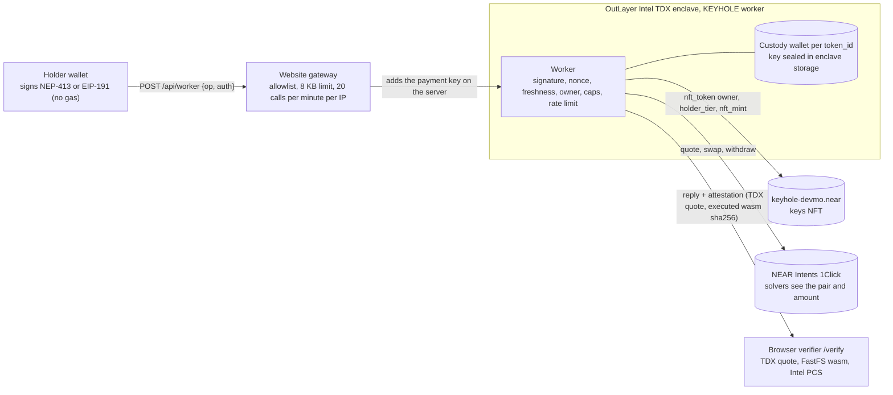

<p align="center"></p>

<h1 align="center">KEYHOLE</h1>

<p align="center"><b>KEYHOLE turns a private trading account into an NFT: sell the NFT, and the account, its history and its limits move to the buyer, while the seller is refused on the very next request.</b></p>

<p align="center">Live on NEAR mainnet. Account operations run in an Intel TDX enclave on OutLayer, and every refusal is attested and checkable.</p>

<p align="center">
<a href="https://github.com/mohamedwael201193/keyhole/actions/workflows/ci.yml"></a>
<a href="https://nearblocks.io/address/keyhole-devmo.near"></a>
<a href="https://www.getkeyhole.xyz"></a>
</p>

<p align="center">
<a href="https://www.getkeyhole.xyz">Live app</a> ·
<a href="https://www.getkeyhole.xyz/verify">Verify a TEE call</a> ·
<a href="https://nearblocks.io/address/keyhole-devmo.near">Keys contract</a> ·
<a href="VERIFY.md">Verify the deployment</a>
</p>

Live contract v2.7.0 on NEAR mainnet: code hash `3cZsaySYgqZntFaRKEUffQUMGqRjkQ2DuSmFWXwiKGZH` ([deploy](https://nearblocks.io/txns/6rD2iMs146L3H3ghKTGwhcXtAmNQCGU2P3C7nx1ewi2h)). Contract source candidate **2.7.0**, matches live deployment. Live worker `5c786666…43231` (1,382,841 bytes, [publish](https://nearblocks.io/txns/Mi9fYL9UdYQSRXEQzii1LS37vsBCJbP4bPtwNsHaqWU)). Supply **9** (`nft_total_supply`, read live 14 Nov 2026). Lending is off. Author and deployer: **devmo** ([`keyhole-devmo.near`](https://nearblocks.io/address/keyhole-devmo.near)).

**Contents:** [Try it](#try-it-5-minutes) · [Proof](#proof) · [How it works](#how-it-works) · [Lock / no-rug](#lock--no-rug) · [Loans](#loans) · [Video](#video) · [Known issues](#known-issues) · [Real vs simulated](#real-vs-simulated) · [Repo map](#repo-map) · [License](#license)

## Try it (5 minutes)

No wallet, no Rust, no `npm install`. You need `curl`, `bash` and `python3`.

Step 0 checks out the pinned review commit `d42920f8531dfa37429d8876f73eb86d9f421304` (from [`identity.json`](identity.json)), not HEAD, so the checks below run against the exact source that was reviewed — HEAD moves, the pinned commit does not.

<!-- keyhole-fence: safe -->
<!-- VERIFY-CHECKOUT:START -->
```bash
git init keyhole && cd keyhole
git remote add origin https://github.com/mohamedwael201193/keyhole.git
git fetch --depth 1 origin d42920f8531dfa37429d8876f73eb86d9f421304
git checkout --detach FETCH_HEAD
test "$(git rev-parse HEAD)" = "d42920f8531dfa37429d8876f73eb86d9f421304"
```
<!-- VERIFY-CHECKOUT:END -->

1. **Run the live check.** Do: `bash verify/0-live.sh`. See: `PASS` for each step — on-chain `code_hash` equals `3cZsaySY…KGZH`, supply **9**, owner, minter `015a0259…c443`, and a valid TDX attestation for the live `info` call; exit 0. (No git? Download the source tarball from the pinned commit — see [AGENTS.md](AGENTS.md).)
2. **Watch a real handover.** Do: open [getkeyhole.xyz/attack](https://www.getkeyhole.xyz/attack). See: the key moves A → B in one transfer ([tx `G35r5pmC…`](https://nearblocks.io/txns/G35r5pmCTffvKMShjPcwTkds1z8SuCHdJr32qGGzYktD)); A's withdraw before it is ok, A's next withdraw after it is refused `not_owner`; every card links its attestation. <!-- TODO(H): replace with the newest handover tx hashes once H lands. -->
3. **Verify one attested call.** Do: open [getkeyhole.xyz/verify?call=91b0e9a9-219b-46ec-a174-1f74e2f24b85](https://www.getkeyhole.xyz/verify?call=91b0e9a9-219b-46ec-a174-1f74e2f24b85). See: a valid TDX quote, `executed_wasm_sha256` = `5c786666…43231` = the worker in [`identity.json`](identity.json).

More checks: Claims machine (451 claims): `node verify/verify-claims.mjs --offline` → **451 claims: 178 PASS, 0 FAIL, 0 ERROR, 273 SKIP** (**451**: offline 178 PASS, 0 FAIL, 0 ERROR, 273 SKIP). `bash verify/1-contract.sh --strict` (committed wasm == chain), `bash verify/2-attestations.sh` (every recorded call). Full instructions: [AGENTS.md](AGENTS.md).

## Proof

Every row is a mainnet transaction or an attested TEE call. Full history, including earlier builds, is in [docs/IDENTITY.md](docs/IDENTITY.md).

| Claim | Evidence | Check it |
|---|---|---|
| Contract v2.7.0 live on mainnet | code hash `3cZsaySY…KGZH` | [deploy `6rD2iMs1…`](https://nearblocks.io/txns/6rD2iMs146L3H3ghKTGwhcXtAmNQCGU2P3C7nx1ewi2h) · `bash verify/0-live.sh` |
| Worker `5c786666` published | add_version tx | [`Mi9fYL9U…`](https://nearblocks.io/txns/Mi9fYL9UdYQSRXEQzii1LS37vsBCJbP4bPtwNsHaqWU) · info call [`91b0e9a9`](https://api.outlayer.ai/attestations/by-call/91b0e9a9-219b-46ec-a174-1f74e2f24b85) |
| Mint signed in the enclave | key `k5f4750858f328940` | [tx `DJxbuaJV…`](https://nearblocks.io/txns/DJxbuaJVAhwBrK9xne1t623XuL8dMSm8So3eEVtZpHgF) |
| Handover A → B, seller refused after | transfer + `not_owner` | [tx `G35r5pmC…`](https://nearblocks.io/txns/G35r5pmCTffvKMShjPcwTkds1z8SuCHdJr32qGGzYktD) · before [`440c2378`](https://www.getkeyhole.xyz/verify?call=440c2378-6c27-49fd-8b6b-d74054f331ae) ok · after [`e805f050`](https://www.getkeyhole.xyz/verify?call=e805f050-d416-4a04-9b12-270adbe02068) `not_owner` · [evidence](docs/evidence/ownership-and-limits/README.md) |
| Sale via NEP-178 direct approval | approve → pay 0.1 NEAR → transfer → revoke | transfer [`F52PyT43…`](https://nearblocks.io/txns/F52PyT43rVizWmkcJVxbcKuj7n3KZFK5GQsNyuiXY2iT) |
| 1Click cross-chain, SUCCESS | 0.004 SOL → 0.367068 USDC | NEAR [`8BQznSfb…`](https://nearblocks.io/txns/8BQznSfbQUecDqCcEFwQj4vzr5x1X4rzLSLpszktf8fh) · [evidence](docs/evidence/oneclick-sol/README.md) |
| 1Click REFUNDED (`NO_LIQUIDITY`) | 0.00089235 SOL returned | SOL [`5qumXJw4…`](https://solscan.io/tx/5qumXJw4bCdfGzSbVP4Vas12JMkxWEuqaPpzWhHKoTYmxpifbowQKuL1hv9WxyMd9TrNe93WrivimTUcEcok7tPy) |
| Prompt-injection refusal | poisoned note: pay `attacker.near` refused | [`c1312e2d`](https://www.getkeyhole.xyz/verify?call=c1312e2d-8c20-4b3e-ad5b-22dd3102826d) `bad_params` · [evidence](docs/evidence/prompt-injection/README.md) |
| Lost payout recovered | 0.02124 NEAR paid to the minter | tx [`J5dHg2q…`](https://nearblocks.io/txns/J5dHg2qran5QaHuizajA4vCzJjeU8g8BVPaTUUBXzEvi) — rebroadcast via public RPC 22:44:57 UTC Nov 13, block 224428029 |
| Loans A + B | <!-- TODO: tx hashes once on-chain --> | — |
| Handover H (token 0) | <!-- TODO: tx hashes once on-chain --> | — |
| Lock + key deletions | <!-- TODO: tx hashes once on-chain --> | — |

History: worker version r5 (`1992b736…`) was added 21:43 UTC Nov 13, active 41 minutes, set inactive 22:24 UTC ([`HHN5SC6U…`](https://nearblocks.io/txns/HHN5SC6UGifXQJCbQ6GcC72mH7AaPYyxxCJoJB2Wcyck)), and removed 23:09:45 UTC ([`C4mjHMwU…`](https://nearblocks.io/txns/C4mjHMwURnRPC5JTN7jegEj3zBSqhKrMcs6CgDnxY6kC)). The r5 export op was used once, to recover the lost payout above. Round 6 (`e9e570e5…`, [publish](https://nearblocks.io/txns/4ueDpiq5jm6VXMjr96X1f3UVGWeAKNA2fLsosxWuG43t)) fixed the recovery-pointer leak, then round 7 (`5c786666…`, [publish](https://nearblocks.io/txns/Mi9fYL9UdYQSRXEQzii1LS37vsBCJbP4bPtwNsHaqWU)) fixed the storage allowlist; r6 was removed ([`H7AuJHbj…`](https://nearblocks.io/txns/H7AuJHbjqrLMa8mv5LR1LPkBmMbpK5NWjnhTid2JoYDB)). The registry is a singleton again (active `5c786666` only).

Collateral provisioning is an internal reproducible review of the repository, not an external audit — see [docs/IDENTITY.md](docs/IDENTITY.md) ([R2 map](docs/evidence/worker-provisioning/R2.md)).

## How it works

- **One key, one account.** Each NFT maps to one confidential custody wallet inside the Intel TDX enclave. Transfer the NFT and the wallet moves with it; the balance does not change.
- **Owner check on every request.** The worker reads the owner from `keyhole-devmo.near` on each signed request, and again just before a swap or withdraw is sent. The old owner is refused `not_owner`.
- **Caps and cooldowns.** Bronze: $1 per trade, $5 per UTC day. A new owner cannot withdraw for 10 minutes. Holder caps can be cut at once; a raise waits 24 hours.
- **Everything is attested.** Every call returns a TDX quote with the executed wasm hash. Check any call at `/verify?call=<id>`.
- **Built-in sale.** `nft_list`, `nft_unlist` and `nft_buy` are in the contract; a listed key's account is frozen for value moves.



Details, ops, caps and the full request-check order: [docs/IDENTITY.md](docs/IDENTITY.md) and [SECURITY.md](SECURITY.md).

## Lock / no-rug

<!-- TODO(LOCK): fill with real tx hashes + the empty-key verification only after the lock lands and the user approves. Do NOT ship "no keys" before view_access_key_list returns empty. -->

The contract enforces the lock in two steps. First, ownership moves to a lock account (`ee91dc…`) via `propose_owner` + `accept_owner` after a 24-hour timelock — the timelock elapsed 22:55:39 UTC Nov 13 and the owner is still the guardian (`0705fdc1…`). Second, every access key on `keyhole-devmo.near` is deleted, so no one can deploy new code to the contract account again. Verify the end state yourself:

```bash
# expect: no keys on keyhole-devmo.near (and none on the lock account, once its key is deleted)
curl -s https://rpc.mainnet.near.org -X POST -H 'Content-Type: application/json' \
  -d '{"jsonrpc":"2.0","id":"t","method":"query","params":{"request_type":"view_access_key_list","account_id":"keyhole-devmo.near","finality":"final"}}'
```

Token 0 is currently listed at 0.1 NEAR (the handover attempt in [Known issues](#known-issues) left the listing open); the listing must resolve — sale completed or `nft_unlist` — before the lock, which requires no listing.

What stays true after the lock: the contract keeps working for everyone from their own accounts (NFT, vault, loans); the worker keeps running while OutLayer credit lasts. What stops: no upgrades, no worker or secrets updates, no transfers from `keyhole-devmo.near`. The guardian's only remaining power is `recover_treasury` (timelocked, treasury is 0, it cannot move tokens or upgrade). The full lock proof (transactions + key-list reads) lands with the lock.

## Loans

<!-- TODO(LOANS): fill with real tx hashes once loans A+B are on-chain. -->

Lending is **off** on mainnet. The contract supports guarded loans against a key's whole account as collateral: borrow NEAR without publishing the full balance; miss repayment and the lender can claim the entire account. The first mainnet loans are being executed now; their transaction hashes land in the proof table above when they are final. After them, lending stays off.

Status 14 Nov 2026: the 0.90 USDC funding was sent once ([tx `0x4f37ad7a…`](https://basescan.org/tx/0x4f37ad7aee14fd5fbd4d8c14bd343495c1191ccd58e02d9eda7e266d201915df), block 57185863) and credited 899,818 raw USDC to the loan wallet; it is never sent again. The provision step then hit a deterministic worker bug — the host returns the gas price as a bare string (`"100000000"`) and the worker expects an object with a `gas_price` field, so `provision_collateral` fails before any transaction is built. Round 8 fixes that plus a full sweep of the remaining loan path; the loans then run on the new worker with a fresh borrower and a fresh mint. See [SECURITY.md](SECURITY.md) for the stranded wallets this republish creates.

## Video

<!-- TODO(VIDEO): link once the video is recorded today, 14 Nov 2026, before the 23:59 UTC submission deadline (the submission cannot be edited after it is sent). -->

## Known issues

- **Stuck payout, recovered.** The OutLayer host RPC returned Ok on an error JSON, so a minter payout never landed and its journal blocked new mints. Recovered with a read-only export op plus a public-RPC rebroadcast ([tx `J5dHg2q…`](https://nearblocks.io/txns/J5dHg2qran5QaHuizajA4vCzJjeU8g8BVPaTUUBXzEvi)). Root cause in [SECURITY.md](SECURITY.md).
- **Three stranded collateral wallets.** 2,699,454 raw USDC (~2.70 USDC) sits in three confidential wallets no current worker can spend, because each wallet's provision plan is bound to the worker hash it was prepared under. See [SECURITY.md](SECURITY.md) (§ Stranded collateral wallets).
- **Loan provision blocked by a worker bug (round 8 fix in progress).** The host returns the gas price as a bare string and the worker expects an object, so `provision_collateral` fails deterministically before any transaction is built. No money is at risk from the bug itself; the fix plus a full sweep of the loan path ships as round 8. See [Loans](#loans).
- **Handover attempt failed (token 0 still listed).** The 14 Nov handover of token 0 failed on-chain: the buyer already held a KEYHOLE key and the contract enforces one key per account ([tx `89SJxNHk…`](https://nearblocks.io/txns/89SJxNHkeYXBkheNkJEekizKb8nDYdziSt1TLJYspVaX)). The buyer's 0.1 NEAR payment was refunded in full ([tx `8dPmJjus…`](https://nearblocks.io/txns/8dPmJjus3B2T5uJPcjDC5f4RfnK2pg6JMJ9brTHqKJnL)). Token 0 stays with `keyhole-devmo.near`, listed at 0.1 NEAR, until a fresh buyer completes the handover.
- **Cap leak (F11).** A failed swap did not release its $0.01 daily-cap hold. The leak is bounded by the $5 daily cap and resets at 00:00 UTC. See [SECURITY.md](SECURITY.md).
- **After the lock**, a stuck minter ticket clears only by expiry (~13.7 h) — the export tool needs `keyhole-devmo.near` keys, which will be gone. See [SECURITY.md](SECURITY.md).
- Older mint metadata uses the phrase "viewing key"; the key is a control key.

## Real vs simulated

| What | Status | Where to check |
|---|---|---|
| NFT contract `keyhole-devmo.near` on mainnet | **Real mainnet** | [/verify](https://www.getkeyhole.xyz/verify) · `bash verify/1-contract.sh` |
| TEE worker published on OutLayer | **Real mainnet + attestation** | [/verify](https://www.getkeyhole.xyz/verify) · OutLayer attestation API |
| Mint, swap, withdraw, transfer, freeze, caps | **Real mainnet** (tiny amounts) | [Proof](#proof) · evidence under `docs/evidence/` |
| Attested refusals | **Real mainnet attestations** (recorded on previous builds, labelled on each card) | [/attack](https://www.getkeyhole.xyz/attack) |
| Key handover transfer A→B | **Real mainnet tx** | [tx `G35r5pmC…`](https://nearblocks.io/txns/G35r5pmCTffvKMShjPcwTkds1z8SuCHdJr32qGGzYktD) |
| Claims machine | **File checks reproduced offline** | `node verify/verify-claims.mjs --offline` (skips are live checks: mainnet, site, attestations, CI) |
| Demo vault replay on [/demo](https://www.getkeyhole.xyz/demo) | **Recorded replay** (read-only) | Labelled as demo; does not move funds |
| Free trial on [/try](https://www.getkeyhole.xyz/try) | **Real testnet** for the key; the vault trade is a **recorded mainnet** swap, labelled so | [`docs/trial/testnet.json`](docs/trial/testnet.json) |
| Pledge dashboard (`/pledge`) | **Preview — in review · not live** (CTA disabled; lending off) | [/pledge](https://www.getkeyhole.xyz/pledge) |
| Market demand / unrelated-party volume | **Not claimed** | Demo sizes stay tiny; no invented PnL |

Caveats that are not features live in [SECURITY.md](SECURITY.md).

## Repo map

```
contracts/keys/       NFT contract (+ deployed/ wasm, release/ wasm for each version and SHA256SUMS)
contracts/keys-sandbox/  near-workspaces upgrade and sale tests
tee/worker/           TEE worker (Rust, wasm32-wasip2), build.sh, DEPLOYED_SHA256, verify-log.mjs
cli/                  keyhole CLI and MCP server (TypeScript)
web/                  website and gateway (Next.js), tests/, e2e/, screenshots/
verify/               verification kit (wrappers for 0-live, 1-contract, 2-attestations, claims checker)
docs/                 claims.json, COSTS_AND_RISK.md, IDENTITY.md (live identities, build history), evidence/ (mainnet proofs)
scripts/              identity generator, attack demo, test count
security/             shared counterparty blocklist
skills/keyhole/       agent skill file
identity.json         single source of build identities
verify.sh             one-call verifier (attestation, FastFS, optional rebuild)
```

**Tests** (from the pinned review commit; re-verified at PR time): keys contract 342 unit + 62 sandbox; TEE worker 758; CLI 81; web 2032 in 124 files; web e2e 221 pass, 15 opt-in skipped. CI runs six jobs on every push to `main` (contract, worker, cli, verification kit, hygiene, web).

## License

**Licence:** [MIT](LICENSE). Copyright 2026 devmo. Author and deployer: devmo ([`keyhole-devmo.near`](https://nearblocks.io/address/keyhole-devmo.near)). Built on NEAR.

History and contributions: [CONTRIBUTIONS.md](CONTRIBUTIONS.md). Proof index: [PROOFS.md](PROOFS.md). Source history starts at [`66f7070`](https://github.com/mohamedwael201193/keyhole/commit/66f7070); the reviewed baseline is the [compare](https://github.com/mohamedwael201193/keyhole/compare/7a8ec4a...d451a25bab95817e73585dd5db3c323e230a9140).
