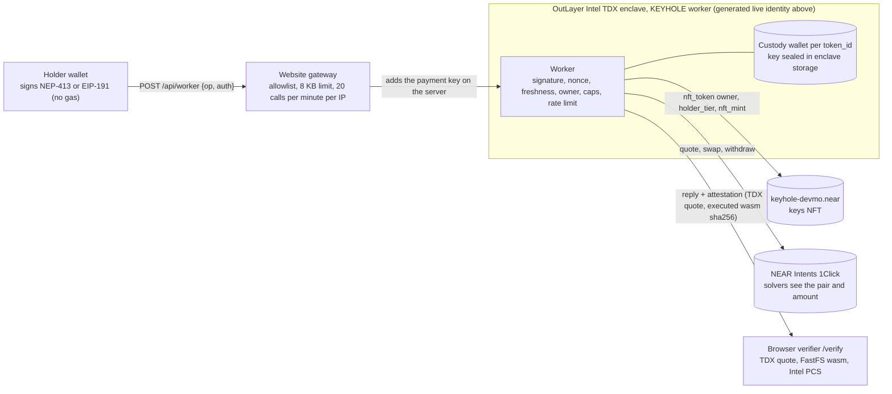

<p align="center"></p>

<h1 align="center">KEYHOLE</h1>

<p align="center"><b>KEYHOLE: an NFT that is a private trading account. Sell the key. The private account goes with it.</b> Hold the key, control the money. The account, its record and its tier move to the buyer; the seller is refused on the next request. Proof: <a href="docs/evidence/ownership-and-limits/README.md">ownership and limits</a> and <a href="THREAT_MODEL.md">THREAT_MODEL.md</a>.</p>

<p align="center">
<a href="https://github.com/mohamedwael201193/keyhole/actions/workflows/ci.yml"></a>
<a href="https://nearblocks.io/address/keyhole-devmo.near"></a>
<a href="https://keyhole-seven.vercel.app"></a>
<a href="LICENSE"></a>
</p>

<p align="center">
<a href="https://keyhole-seven.vercel.app">Live app</a> ·
<a href="https://keyhole-seven.vercel.app/verify">Verify a TEE call</a> ·
<a href="https://nearblocks.io/address/keyhole-devmo.near">Keys contract</a> ·
<a href="VERIFY.md">Verify the deployment</a>
</p>

Only explicitly labelled deployed functionality runs on **NEAR mainnet**; prepared source/sandbox features are not live. Contract and worker author and deployer: **devmo** ([`keyhole-devmo.near`](https://nearblocks.io/address/keyhole-devmo.near)).


<!-- LIVE-SUMMARY:START -->
> **Live contract v2.7:** deployment is FINAL on mainnet ([deployment](https://nearblocks.io/txns/6rD2iMs146L3H3ghKTGwhcXtAmNQCGU2P3C7nx1ewi2h)); the historical Pledge migration remains [FINAL](https://nearblocks.io/txns/EwKUkWjuznyWJ1iPxuX1tU5Voe6tpfwxKRD1gB84FBaa) and is not repeated. Worker publishing is separate; lending remains disabled at release. [Live identities and strict online verification](#live-mainnet-identities).
<!-- LIVE-SUMMARY:END -->

Release status: contract v2.7.0 is the live wasm (code hash `3cZsaySYgqZntFaRKEUffQUMGqRjkQ2DuSmFWXwiKGZH`, deploy [`6rD2iMs1…`](https://nearblocks.io/txns/6rD2iMs146L3H3ghKTGwhcXtAmNQCGU2P3C7nx1ewi2h)). The published worker withdraws NEAR only to the current holder. Lending is off. The owner is still `keyhole-devmo.near`. v2.6 is the previous contract. The v2.6 restoration record is historical: [docs/evidence/live-v2.6/restored](docs/evidence/live-v2.6/restored/README.md).

**Contents:** [1 Verify in 5 minutes](#1-verify-in-5-minutes-zero-install) · [2 Proven](#2-proven-on-near-mainnet) · [3 Try it](#3-try-it) · [3a Real vs simulated](#3a-real-vs-simulated) · [4 How it works](#4-how-it-works) · [5 Why an NFT that does something](#5-why-this-is-an-nft-that-does-something) · [6 NEAR stack](#6-near-stack-used) · [7 Verify](#7-verify-everything-yourself) · [8 Security](#8-security-model) · [9 Numbers](#9-numbers) · [10 Built during the hackathon](#10-built-during-the-hackathon) · [11 Repo map](#11-repo-map) · [12 License](#12-license)

## 1. Verify in 5 minutes (zero install)

No wallet, no Rust, no `npm install`. You need `curl`, `bash` and `python3` (standard library only).

Use the immutable source commit recorded in [`identity.json`](identity.json). The checkout and no-checkout paths below are generated together by [`scripts/gen-identity.mjs`](scripts/gen-identity.mjs).

<!-- keyhole-fence: safe -->
<!-- JUDGE-CHECKOUT:START -->
```bash
git init keyhole && cd keyhole
git remote add origin https://github.com/mohamedwael201193/keyhole.git
git fetch --depth 1 origin c2d8bd390c01acb54d461ad3ce2267eb2ca52a6a
git checkout --detach FETCH_HEAD
test "$(git rev-parse HEAD)" = "c2d8bd390c01acb54d461ad3ce2267eb2ca52a6a"
```
<!-- JUDGE-CHECKOUT:END -->

```bash
test -f judge/0-live.sh
bash judge/0-live.sh
```

No git? Download all three files from that same immutable source commit and run them together:

<!-- JUDGE-RAW:START -->
```bash
curl -fsSL https://raw.githubusercontent.com/mohamedwael201193/keyhole/c2d8bd390c01acb54d461ad3ce2267eb2ca52a6a/judge/0-live.sh -o keyhole-live.sh
curl -fsSL https://raw.githubusercontent.com/mohamedwael201193/keyhole/c2d8bd390c01acb54d461ad3ce2267eb2ca52a6a/judge/receipt_proof.py -o receipt_proof.py
curl -fsSL https://raw.githubusercontent.com/mohamedwael201193/keyhole/c2d8bd390c01acb54d461ad3ce2267eb2ca52a6a/identity.json -o identity.json
IDENTITY_JSON="$PWD/identity.json" bash keyhole-live.sh
```
<!-- JUDGE-RAW:END -->

It prints `PASS` or `FAIL` for each step and exits non-zero on any `FAIL`:

| Step | What it reads | PASS means |
|---|---|---|
| Identity | [`identity.json`](identity.json) | the live contract account, code hash, worker wasm and `info` call are named in one file |
| Contract code | NEAR RPC `view_account` | the on-chain `code_hash` equals `identity.json` |
| State views | `config`, `contract_source_metadata`, `nft_total_supply` | owner, treasury, `config.minter` equal to the 64-hex minter in [`identity.json`](identity.json), live royalty 500 bps, NEP-330 `2.7.0`, supply ≥ 6 |
| Attestation | `api.outlayer.ai/attestations/by-call/<info_call>` | a TDX quote is present and `executed_wasm_sha256` equals the worker hash in `identity.json`. This is an existing attestation, not a new paid call |
| Receipt | archival NEAR RPC `tx` with `wait_until: FINAL` and the recorded signer | [`H8qJNgox…`](https://nearblocks.io/txns/H8qJNgoxiizcJw63wKjtBZY4DQT8qbRx1XP9ejXSjkSV) refused `one key per account: receiver already holds a KEYHOLE key` as expected; matches hash, signer, receiver, `nft_transfer`, 1 yocto, decoded args, and the typed contract `ExecutionError` in [`judge/receipt_proof.py`](judge/receipt_proof.py) |

Read-only mainnet judge: each step prints PASS or FAIL, including `identity.governance` (owner `keyhole-devmo.near`, lending off, three access keys). Historical runs of the earlier script are **9 PASS, 0 FAIL** ([r3 log](docs/evidence/worker-provisioning/r3/live-final.log) · [earlier log](docs/evidence/judge-zero-install/run.txt)).

Only a browser? Open [/verify](https://keyhole-seven.vercel.app/verify) (attestation, Intel DCAP and revocation checks, computed in the page) and [/judge](https://keyhole-seven.vercel.app/judge).

Fees and deposits for every action, and what a sealed-floor attestation does and does not prove: [**docs/COSTS_AND_RISK.md**](docs/COSTS_AND_RISK.md).

### Internally reviewed collateral provisioning

This is an internal reproducible review of the repository, not an independent audit. The published guarded worker prepares its provider policy inside the enclave, quotes storage with the minter refund beneficiary, and submits collateral with the enclave-only minter. A pinned, signed authority review in this repository binds the wallet, policy, build and owner epoch it names. The sealed eligibility writer runs only after the original registration is FINAL and the immutable binding matches. Holder-only exit previews retain provider minima without broadcasting a withdrawal. The live contract is v2.7. The v2.6 CAS sentence in older notes is historical.

[R4 release lifecycle and finding map](docs/evidence/worker-provisioning/R4.md) · [Production path and runnable proof](docs/evidence/worker-provisioning/README.md) · [Independent-review schema](tee/worker/src/collateral.rs) · [Reproducible candidate identity](docs/evidence/worker-provisioning/candidate.json) · [Storage, route and bounded compute accounting](docs/evidence/worker-provisioning/RESEARCH.md).

<!-- IDENTITY:START -->
### Live mainnet identities

This block is generated from [`identity.json`](identity.json) by `node scripts/gen-identity.mjs`. Do not edit it by hand.

The live worker is `62398a8a` (1,085,333 bytes).

| Piece | Live value | Proof |
|---|---|---|
| Contract account | `keyhole-devmo.near` | [nearblocks](https://nearblocks.io/address/keyhole-devmo.near) |
| TEE minter | `015a025906a59f9f40ca17daf2a3c61c5e63a37c081c75230870caa6a82ac443` | [`judge/0-live.sh`](judge/0-live.sh) requires `config.minter` to equal this 64-hex implicit account |
| Contract version | `2.7.0` | NEP-330 `contract_source_metadata` |
| Pledge migration | `EwKUkWju…` | [nearblocks](https://nearblocks.io/txns/EwKUkWjuznyWJ1iPxuX1tU5Voe6tpfwxKRD1gB84FBaa) |
| Contract code hash | `3cZsaySYgqZntFaRKEUffQUMGqRjkQ2DuSmFWXwiKGZH` | deploy tx [`6rD2iMs1…`](https://nearblocks.io/txns/6rD2iMs146L3H3ghKTGwhcXtAmNQCGU2P3C7nx1ewi2h) |
| Contract wasm sha256 | `26d3deeff8a4445515d6356097bd7634e8b26deaee7e7ea1ebe47849b807c08c` | [`contracts/keys/deployed/keyhole_keys.wasm`](contracts/keys/deployed/keyhole_keys.wasm) |
| Worker project | `keyhole-devmo.near/keyhole` | |
| Worker wasm sha256 | `62398a8aa0451ce58cb5ab814ad8dc7f4e2f3fc55ce874c7672ea986abcc307f` | [`tee/worker/DEPLOYED_SHA256`](tee/worker/DEPLOYED_SHA256) |
| Worker publish tx | `3emr8M4RZUapyGWynK5r3MhtAEA7R3SMzzdEEY4u8i9P` | [nearblocks](https://nearblocks.io/txns/3emr8M4RZUapyGWynK5r3MhtAEA7R3SMzzdEEY4u8i9P) |
| Live `info` call | `962d4374-b9ec-411a-9efa-973b36260431` | [attestation](https://api.outlayer.ai/attestations/by-call/962d4374-b9ec-411a-9efa-973b36260431) · [verify](https://keyhole-seven.vercel.app/verify?call=962d4374-b9ec-411a-9efa-973b36260431) |

The contract release is **live on mainnet**. Release bytes and recipe are in [`contracts/keys/release/v2.7/identity.json`](contracts/keys/release/v2.7/identity.json). The worker identity is separate: updating the contract does not publish the guarded worker or enable lending.

| Contract release | Bytes | SHA256 | Code storage at 0.00001 NEAR/B |
|---|---:|---|---:|
| v2.7 (live) | 519,382 | `26d3deeff8a4445515d6356097bd7634e8b26deaee7e7ea1ebe47849b807c08c` | 5.19382 NEAR |

Strict read-only online verification of the live deployment:

```bash
CARGO_BUILD_JOBS=1 bash judge/1-contract.sh --strict
node judge/verify-claims.mjs --strict
```

Worker source candidate: `62398a8aa0451ce58cb5ab814ad8dc7f4e2f3fc55ce874c7672ea986abcc307f` (1,085,333 bytes), generated from the reproducible artifact. [Candidate identity](docs/evidence/worker-provisioning/candidate.json) · [Provisioning proof](docs/evidence/worker-provisioning/README.md).

Contract source candidate **2.7.0**, matches live deployment: [generated release identity](contracts/keys/release/v2.7/identity.json). Its owner/epoch CAS is required before collateral provisioning.

Live governance (`governance_state`, `get_pledge_config`): owner `keyhole-devmo.near`; pending owner `0705fdc1581a35351453bd4625f22d0c41b2b9edc3e7bed860586623c6778228`; pending_owner_not_before_ns `1794486987377190950`; staged_upgrade_sha256 `26d3deeff8a4445515d6356097bd7634e8b26deaee7e7ea1ebe47849b807c08c`; staged_upgrade_not_before_ns `1794486857027935824`; min_upgrade_delay_ns `86400000000000`; wind_down_ns `1801440000000000000`; wound_down false; lending_enabled false. Access keys: 2 FullAccess and 1 FunctionCall (`ed25519:7N1fLo9M…`, `ed25519:FNe2aYtz…`). Stage [tx](https://nearblocks.io/txns/5CYYbe6Zx1BVW3qmS63gR6XDGKMx2QzfJ8Pcft8BM3v5) · owner proposal [tx](https://nearblocks.io/txns/9fAHo9ckryNCXr6wxJzr89wayP6fTFKwqjFezXVGYnyk). The owner is still the contract account.

Measured size steps are in [`docs/evidence/integration-stack/contract-size.md`](docs/evidence/integration-stack/contract-size.md). Live public post-upgrade views and both FINAL receipt trees are in [`docs/evidence/live-v2.5/all-live-views.json`](docs/evidence/live-v2.5/all-live-views.json).
<!-- IDENTITY:END -->

The downloadable source bundle carries the same generated live and candidate identities as this checkout. Public rollout evidence retains both FINAL receipt trees and transaction hashes; public transaction signatures are represented by SHA256 digests in the sanitized capture. The CLI's historical v2.4 compatibility pin stays tied to its released wasm, while current requests require the current owner epoch. The serial funded acceptance keeps its 13-transaction ledger and 96 screenshots, with bounded browser operations and an overall evidence-capture budget suitable for shared CI runners.


---

## 2. Proven on NEAR mainnet

Historical mainnet transactions and TEE calls are labelled by their release. Raw timestamps remain in the linked evidence. Current identities are in the generated block above.

| # | What happened | Proof |
|---|---|---|
| 1 | **Keys contract v2.4 deployed**, code only: `nft_set_tier` for earned tiers and a built-in key sale. Code hash `DEXHHyEM…` | tx [`84zVBikU…`](https://nearblocks.io/txns/84zVBikU5JrAAnyaXTHQWwQSuq15zgLmMFJZsVnJZsPn) · [evidence](docs/evidence/contract-v2-4/README.md) |
| 2 | **Worker `cc8d2fa8` published (now previous)**: earned tiers (`level_up`) and the freeze of a listed key | tx [`Epaz3aMA…`](https://nearblocks.io/txns/Epaz3aMAk1WuLGaMuHKCACvGU981uEr4zUqzyep1zfi6) · info call [`0847b924`](https://api.outlayer.ai/attestations/by-call/0847b924-df76-4cee-ab5a-a96c789d2983) lists `level_up` · [evidence](docs/evidence/publish-cc8d2fa8/README.md) |
| 3 | **Mint** signed in the enclave by the current minter (key `k5f4750858f328940`) | tx [`DJxbuaJV…`](https://nearblocks.io/txns/DJxbuaJVAhwBrK9xne1t623XuL8dMSm8So3eEVtZpHgF) |
| 4 | **Handover.** A withdraws before the transfer (ok). The key moves A to B in one transfer (tx [`G35r5pmC…`](https://nearblocks.io/txns/G35r5pmCTffvKMShjPcwTkds1z8SuCHdJr32qGGzYktD)). A's withdraw after it is refused `not_owner` | before [`440c2378`](https://keyhole-seven.vercel.app/verify?call=440c2378-6c27-49fd-8b6b-d74054f331ae) ok · after [`e805f050`](https://keyhole-seven.vercel.app/verify?call=e805f050-d416-4a04-9b12-270adbe02068) `not_owner` · [evidence](docs/evidence/ownership-and-limits/README.md) |
| 5 | **Earned tier.** Ten swaps by the seller, then `level_up` raises the key from Bronze (tier 1) to Silver (tier 2) | tx [`Ff4nibRd…`](https://nearblocks.io/txns/Ff4nibRd3XMdEgRXwGyDteLFXRdXwqEmY6FJqo2PsNvs) · attested [`02a4e30d`](https://api.outlayer.ai/attestations/by-call/02a4e30d-8e75-4587-9507-56a247751fc5) · [steps](docs/evidence/earned-tier-and-sale/README.md) |
| 6 | **In-contract sale.** The seller lists the key (tx [`4kQnM9Fj…`](https://nearblocks.io/txns/4kQnM9FjEKvXXEtenePc7LfdTtyLNbFirx5X8ytnvm1h)). While listed, the seller's withdraw and swap are refused `listed`. The buyer buys (tx [`BbTs3JZa…`](https://nearblocks.io/txns/BbTs3JZaxdrgwPu6SjZQwjpuXk7wAxizeVqzKrS2pxNp)). The old owner is refused `not_owner` | refused `listed` [`61c6f3ad`](https://api.outlayer.ai/attestations/by-call/61c6f3ad-e1fc-495c-8435-27fd3382c3df), [`c791779a`](https://api.outlayer.ai/attestations/by-call/c791779a-7948-4614-abe0-5376916edeb0) · old owner [`eeb03a55`](https://api.outlayer.ai/attestations/by-call/eeb03a55-6df0-4ef3-af5b-3e9df3331f4e) · [steps](docs/evidence/earned-tier-and-sale/README.md) |
| 7 | **Listing from a real Meteor wallet, in the site.** The owner's Meteor wallet lists, then unlists, key `0` (the contract account's test key) | `nft_list` tx [`8nVr98N2…`](https://nearblocks.io/txns/8nVr98N2vYeTAaNiMtGWvge9fiAfoDSSBQL1wnSaTCwH) · `nft_unlist` tx [`2v6Nw9Ww…`](https://nearblocks.io/txns/2v6Nw9WwkbGCoG6PCT2wBRh5bfikLNtoQ6PcHGnbnPQ9) · then from the Sale card's own buttons: `nft_list` [`5d1R83qr…`](https://nearblocks.io/txns/5d1R83qr2WZLM5tKRQWiuS9jweH9rbGFPKDF8DrMEDsi) · `nft_unlist` [`EkRuCKRG…`](https://nearblocks.io/txns/EkRuCKRG4TCtrmJEomfDih7vDVw4xegTNP46G98fXa6A) · [steps](docs/evidence/earned-tier-and-sale/README.md#ui-test-from-a-real-meteor-wallet-list-and-unlist-key-0) |
| 8 | **1Click cross-chain, SUCCESS.** 0.004 SOL on Solana became 0.367068 USDC at `keyhole-devmo.near` | Solana [`2GxLCAXc…`](https://solscan.io/tx/2GxLCAXcEjTQ6NraySheBYFuN7XGAZym96Dqtcdypy8LNrH1UEAfg2566gaGQey4q3YyjMKuhE4cN7RdTMQq94Xv) · NEAR [`8BQznSfb…`](https://nearblocks.io/txns/8BQznSfbQUecDqCcEFwQj4vzr5x1X4rzLSLpszktf8fh) · [evidence](docs/evidence/oneclick-sol/README.md) |
| 9 | **1Click REFUNDED** (`NO_LIQUIDITY`). A 0.001 SOL order; 0.00089235 SOL returned | Solana [`5qumXJw4…`](https://solscan.io/tx/5qumXJw4bCdfGzSbVP4Vas12JMkxWEuqaPpzWhHKoTYmxpifbowQKuL1hv9WxyMd9TrNe93WrivimTUcEcok7tPy) · [evidence](docs/evidence/oneclick-sol/README.md) |
| 10 | **37 of 37 checks in the browser** on the previous info call [`0847b924`](https://keyhole-seven.vercel.app/verify?call=0847b924-df76-4cee-ab5a-a96c789d2983) (worker `cc8d2fa8`, historically checked in Chrome: "The enclave is genuine") | [/verify?call=0847b924…](https://keyhole-seven.vercel.app/verify?call=0847b924-df76-4cee-ab5a-a96c789d2983) |
| 11 | **Signed record for a listed key, checked in the browser.** Test holder `3bde8ce5…` listed key `k5f4750858f328940` at 50 NEAR (tx [`J2pMXQhL…`](https://nearblocks.io/txns/J2pMXQhLK7dZJKME126oK3AaeEg2U8kvXDqA1jVE3UuG)). The public `record` call returned a minter-signed `keyhole-record-v1` statement (tier 2, 10 settled swaps, 5,609,200 µUSD). The Sale card checked 7 of 7. Unlisted (tx [`6Qp2F32q…`](https://nearblocks.io/txns/6Qp2F32qfBxAhJh5w1HPtmgvTiTba5k8nsfznNYfYckU)). Build `d337e822` | `record` [`b5fbed71`](https://api.outlayer.ai/attestations/by-call/b5fbed71-d497-43fe-bbd4-6e28efc4dacf) · [evidence](docs/evidence/signed-record/README.md) |
| 12 | **Site swap with no wallet popup** on an unlocked session. Key `0` vault funded (tx [`EURp4e8V…`](https://nearblocks.io/txns/EURp4e8VTPVeSBjhyTUaCH3tZLp8it2Ev9ycUvLxcjUE)). Swap 0.05 wNEAR to 0.179929 USDC on build `cc8d2fa8` | swap call [`9f76716e`](https://api.outlayer.ai/attestations/by-call/9f76716e-b3d6-4081-b50f-fdff21a60f82) |

<details>
<summary><b>All proof rows</b> (the table this section started from, plus the earlier runs, refusals and attack log)</summary>

| What happened | Proof |
|---|---|
| **Contract.** v1 deployed and initialised: owner = treasury = `keyhole-devmo.near`, royalty 500 bps | tx [`HEgxese5…`](https://nearblocks.io/txns/HEgxese5vwUeAz2ctbwpdNDjfyhLib7xWXpTJLhwhRD7) |
| Key `0` minted, tier 1 (test key, held by `keyhole-devmo.near`) | tx [`UYHismxe…`](https://nearblocks.io/txns/UYHismxe3a2Xb5YvbVHuGhsHWf7ERrx5oCrxREePBFR) |
| Upgrade v1 → v2: deploy and `migrate()` in one transaction. code hash `C8pL59r9…` | tx [`142eipKr…`](https://nearblocks.io/txns/142eipKrruYWL69w31bzCbcSakGvum5XzwTasHxsAdAC) ([evidence](docs/evidence/contract-v2/README.md)) |
| Second `migrate()` refused (`already migrated`), as expected | tx [`9kmr1tsb…`](https://nearblocks.io/txns/9kmr1tsbbXwdr3y8VcwmBGW5zE44MCcwsSANa7S8C4LY) |
| Holder-to-holder transfer refused by the contract (`one key per account`), as expected | tx [`H8qJNgox…`](https://nearblocks.io/txns/H8qJNgoxiizcJw63wKjtBZY4DQT8qbRx1XP9ejXSjkSV) |
| Deploy v2.1 (code only). code hash `6uPe67Sg…` | tx [`HahKkkFj…`](https://nearblocks.io/txns/HahKkkFjXQ5xCky8759qNnoEDm8DjizeveS9B6RHNYy1) |
| Deploy v2.2 (code only; closes the one-key race in `nft_transfer_call`). code hash `BfMiMAfg…` | tx [`GgnNQERT…`](https://nearblocks.io/txns/GgnNQERTj8qKp5VRCdXaTPgb6CjNChamnPsed11AsM5k) |
| Royalty sale, 0.01 NEAR: 5% to treasury and 95% to seller through `nft_transfer_payout`, one transfer event (contract v2.1 or later). Approve tx [`68er4S4y…`](https://nearblocks.io/txns/68er4S4ypnp7L7dCjMNPsWkQeYSnpCGHKMTSgyVAH9DM) | tx [`Azn3WUud…`](https://nearblocks.io/txns/Azn3WUudmSn4ip9B9HNVXTGXriavZ4JK5f3Aqp7JPx2m) ([evidence](docs/evidence/contract-v2/README.md)) |
| Deploy v2.3 (code only; approval cap of 10 per token; NEP-330 `2.3.0`). code hash `8YP8Mr2c…`, replaced by v2.4 | tx [`CM7JvwdnN2…`](https://nearblocks.io/txns/CM7JvwdnN2oQ4xakmcSoDPDREBbE7ZUCh5FnJargd5bp) ([evidence](docs/evidence/contract-v2-3/README.md)) |
| Deploy v2.4 (code only; `nft_set_tier` for earned tiers; built-in key sale; NEP-330 `2.4.0`). code hash `DEXHHyEM…`, superseded by v2.5 | tx [`84zVBikU…`](https://nearblocks.io/txns/84zVBikU5JrAAnyaXTHQWwQSuq15zgLmMFJZsVnJZsPn) ([evidence](docs/evidence/contract-v2-4/README.md)) |
| Worker `cc8d2fa8` published, now previous (earned tiers `level_up`, freeze of a listed key on sale). Info call [`0847b924`](https://api.outlayer.ai/attestations/by-call/0847b924-df76-4cee-ab5a-a96c789d2983) lists `level_up`; first signed call [`b6787f80`](https://api.outlayer.ai/attestations/by-call/b6787f80-339e-4de3-8f6d-dc46898d6e6d) is `status`, ok | tx [`Epaz3aMA…`](https://nearblocks.io/txns/Epaz3aMAk1WuLGaMuHKCACvGU981uEr4zUqzyep1zfi6) ([evidence](docs/evidence/publish-cc8d2fa8/README.md)) |
| Mint signed in the enclave by the first TEE minter (key `k857b6b68facc0f94`) | tx [`FaYzSUYT…`](https://nearblocks.io/txns/FaYzSUYTzoG3udAE3d31sUwWFeskndkhrZ8iehk1NxJ4) |
| `set_minter` to the current enclave minter `015a0259…c443` | tx [`7QFqM5Gi…`](https://nearblocks.io/txns/7QFqM5GiUgZuWJEpRUKvARn1LKyy91NVWFZmzNQscQDp) |
| Mint signed in the enclave by the current minter (key `k5f4750858f328940`) | tx [`DJxbuaJV…`](https://nearblocks.io/txns/DJxbuaJVAhwBrK9xne1t623XuL8dMSm8So3eEVtZpHgF) |
| Mint through the enclave (key `k0642e7964b2fb515`) | call [`9e62569d`](https://api.outlayer.ai/attestations/by-call/9e62569d-9444-4503-8bf2-4c1c266b8316) |
| `sweep_minter`: the old enclave minter sent 0.0286 NEAR to the current one, signed in the TEE | tx [`5Z7Tktfc…`](https://nearblocks.io/txns/5Z7TktfcgeFrzRnz8NSpFSbTw77R5779d3PRsrEBPbYA) |
| `beat()` emits `nft_metadata_update` (first beat) | tx [`2ShJpaoi…`](https://nearblocks.io/txns/2ShJpaoicEm49L9rcsJjXoubuzoF3SvbQFZASUQBi5dq) |
| Scoped beat key added by the enclave on the owner's signed request | tx [`DXH756vm…`](https://nearblocks.io/txns/DXH756vmgj8GTDz6fUwnfgaUuC7vCi1vu6VaX5heoDww) |
| A beat with the scoped beat key (the other method, deposit and transfer attempts are refused by NEAR) | tx [`B1BH9eZy…`](https://nearblocks.io/txns/B1BH9eZycbXqgwod2dqbn6e5UWY8TKTw2ZawyYqLRDtG) ([evidence](docs/evidence/publish-09d481a5/README.md#scoped-beat-key)) |
| Chain Signatures: one real MPC signature for the key's EVM address (`v1.signer.sign`) | call [`0cd1c3bd`](https://api.outlayer.ai/attestations/by-call/0cd1c3bd-21be-44dc-bc60-e792a42344e6), tx [`7P9VFx4p…`](https://nearblocks.io/txns/7P9VFx4pz5oxyXpXkyDVE6SheDuTqHgQc) ([evidence](docs/evidence/publish-09d481a5/README.md#chain-signatures-one-real-mpc-signature)) |
| **Earned tier, then a sale, build cc8d2fa8** (team test wallets). `level_up` raises the key from tier 1 to 2: tx [`Ff4nibRd…`](https://nearblocks.io/txns/Ff4nibRd3XMdEgRXwGyDteLFXRdXwqEmY6FJqo2PsNvs), attested [`02a4e30d`](https://api.outlayer.ai/attestations/by-call/02a4e30d-8e75-4587-9507-56a247751fc5). The seller lists the key (tx [`4kQnM9Fj…`](https://nearblocks.io/txns/4kQnM9FjEKvXXEtenePc7LfdTtyLNbFirx5X8ytnvm1h)). While it is listed, the seller's withdraw and swap are refused `listed` ([`61c6f3ad`](https://api.outlayer.ai/attestations/by-call/61c6f3ad-e1fc-495c-8435-27fd3382c3df), [`c791779a`](https://api.outlayer.ai/attestations/by-call/c791779a-7948-4614-abe0-5376916edeb0)). The buyer buys (tx [`BbTs3JZa…`](https://nearblocks.io/txns/BbTs3JZaxdrgwPu6SjZQwjpuXk7wAxizeVqzKrS2pxNp)). After it, the old owner is refused `not_owner` ([`eeb03a55`](https://api.outlayer.ai/attestations/by-call/eeb03a55-6df0-4ef3-af5b-3e9df3331f4e)), and the buyer's withdraw is refused `cooldown` ([`2a1aed5b`](https://api.outlayer.ai/attestations/by-call/2a1aed5b-d4e2-45d2-8915-14a5e61a8b12)) | [steps](docs/evidence/earned-tier-and-sale/README.md) |
| **Transfer handover, build a985fd87** (team test wallets). Key `k5f47508…` sold A → B in one `nft_transfer`. Before the sale A reads 2000 USDC base units; after it A is refused `not_owner` (replay also refused) and B reads the same 2000 | tx [`89vSYY4t…`](https://nearblocks.io/txns/89vSYY4tbeNPuNuhHB8YmkkAWAcjW5VdniQm3ePHuPYz); A balance refused [`2a52742a`](https://api.outlayer.ai/attestations/by-call/2a52742a-2b4a-432d-b087-888ea52f03ce); A replay refused [`15f93f58`](https://api.outlayer.ai/attestations/by-call/15f93f58-2568-4064-9581-db04c8b2a1aa); B balance ok [`3e996273`](https://api.outlayer.ai/attestations/by-call/3e996273-e4a0-4c26-aa54-6775fba29236); B withdraw refused `cooldown` [`8485f8d4`](https://api.outlayer.ai/attestations/by-call/8485f8d4-c4e1-4ab5-ab9c-a19a0d9d21f7) ([steps](docs/evidence/transfer-a985fd87/README.md)) |
| **Transfer handover, earlier run.** Key moved from A to B: tx [`G35r5pmC…`](https://nearblocks.io/txns/G35r5pmCTffvKMShjPcwTkds1z8SuCHdJr32qGGzYktD). A withdraws before the transfer: ok [`440c2378`](https://keyhole-seven.vercel.app/verify?call=440c2378-6c27-49fd-8b6b-d74054f331ae). A after the transfer: `not_owner` [`e805f050`](https://keyhole-seven.vercel.app/verify?call=e805f050-d416-4a04-9b12-270adbe02068) | [evidence](docs/evidence/ownership-and-limits/README.md) |
| **Transfer cooldown.** B withdraws within 10 minutes of receiving the key: refused `cooldown` | call [`369f522d`](https://keyhole-seven.vercel.app/verify?call=369f522d-4bef-4b17-9071-1de01616eef6) |
| **Seller lock.** B locks the key for sale: ok [`98b27188`](https://api.outlayer.ai/attestations/by-call/98b27188-a28c-4720-8fec-1d1329e0f281). B's withdraw while locked: refused `locked` [`075287b5`](https://api.outlayer.ai/attestations/by-call/075287b5-a100-4fa5-8e96-94a36019c6bc) | [evidence](docs/evidence/ownership-and-limits/README.md) |
| **Holder limits.** A cuts caps to $0.002 / $0.005: applies at once [`38ae4d84`](https://api.outlayer.ai/attestations/by-call/38ae4d84-9058-4e3b-a01d-e0f0a1f35bb4). A raise is stored as pending for 24 hours [`8e142cce`](https://api.outlayer.ai/attestations/by-call/8e142cce-a608-4ed4-ae61-9eed8f7dec12) | [evidence](docs/evidence/ownership-and-limits/README.md) |
| **Mid-payout.** B signs a withdraw of 3000 USDC base units (0.003 USDC), then transfers the key to A while the payout is in flight (tx [`144iK9uj…`](https://nearblocks.io/txns/144iK9ujaowrUdXySfvGDDjobV2Q5YyJsNPK3KL2GYnc)). The payout completes to B, the holder who signed it. B's next request is refused `not_owner` [`e72dc176`](https://keyhole-seven.vercel.app/verify?call=e72dc176-e6fc-4d89-b348-911f5318b81b). A then sees the remaining 2000 units [`f36d9b54`](https://keyhole-seven.vercel.app/verify?call=f36d9b54-417a-4b33-9598-c396ae852d4d). Build `6367401a` | [evidence](docs/evidence/mid-payout/README.md) |
| **Swap** 0.005 USDC → wNEAR inside the confidential account (intent `Xr4TM3tE…`) | call [`09d58c09`](https://api.outlayer.ai/attestations/by-call/09d58c09-c1e9-48b6-bebb-485f5ae79539) ([step 8](docs/evidence/mainnet-e2e/08_swap_0.005_usdc.json)) |
| **Withdraw** wNEAR → native NEAR to `keyhole-devmo.near` | call [`afc0f232`](https://api.outlayer.ai/attestations/by-call/afc0f232-7d93-4a0e-8768-f62f245c537e) ([step 28](docs/evidence/mainnet-e2e/28_withdraw_wnear.json)) |
| **Withdraw** USDC to `keyhole-devmo.near` | call [`a39fffd9`](https://api.outlayer.ai/attestations/by-call/a39fffd9-201b-4af2-927f-94a90d54cbf5) ([step 29](docs/evidence/mainnet-e2e/29_withdraw_usdc.json)) |
| **1Click SUCCESS.** 0.004 SOL on Solana → 0.367068 USDC to `keyhole-devmo.near` | Solana [`2GxLCAXc…`](https://solscan.io/tx/2GxLCAXcEjTQ6NraySheBYFuN7XGAZym96Dqtcdypy8LNrH1UEAfg2566gaGQey4q3YyjMKuhE4cN7RdTMQq94Xv), NEAR [`8BQznSfb…`](https://nearblocks.io/txns/8BQznSfbQUecDqCcEFwQj4vzr5x1X4rzLSLpszktf8fh) ([evidence](docs/evidence/oneclick-sol/README.md)) |
| **1Click REFUNDED** (`NO_LIQUIDITY`). 0.001 SOL order, 0.00089235 SOL returned | Solana [`5qumXJw4…`](https://solscan.io/tx/5qumXJw4bCdfGzSbVP4Vas12JMkxWEuqaPpzWhHKoTYmxpifbowQKuL1hv9WxyMd9TrNe93WrivimTUcEcok7tPy) ([evidence](docs/evidence/oneclick-sol/README.md)) |
| **Refusal `over_cap_per_tx`.** 2 USDC swap against the $1 Bronze cap. Nothing sent | call [`a02613a2`](https://api.outlayer.ai/attestations/by-call/a02613a2-d503-45e2-83b8-ef71927c2533) |
| **Refusal `replay`.** First use ok [`85582544`](https://api.outlayer.ai/attestations/by-call/85582544-8e08-4c9f-b3f0-ecad128201ab); the same signed request again refused [`ac289f04`](https://api.outlayer.ai/attestations/by-call/ac289f04-0df8-4161-9123-e872ab3b75ab) | [steps 16–17](docs/evidence/mainnet-e2e/17_replay_second_refused.json) |
| **Refusals `wrong_recipient`, `bad_signature`, `op_mismatch`, `expired`, `no_auth`.** A signature made for another recipient [`b9c8cb4f`](https://api.outlayer.ai/attestations/by-call/b9c8cb4f-e3aa-480f-bb47-70fc30a96d67); a tampered message [`942b4cff`](https://api.outlayer.ai/attestations/by-call/942b4cff-23c9-4e4d-8ebc-79bfa01cd029); a signed op that differs from the requested op [`7a703e8f`](https://api.outlayer.ai/attestations/by-call/7a703e8f-2678-4978-b6ce-4d291828141d); a signature older than 5 minutes [`e7ac0627`](https://api.outlayer.ai/attestations/by-call/e7ac0627-be6d-41e9-95d0-71dcc59aed43); no signature [`750defed`](https://api.outlayer.ai/attestations/by-call/750defed-2267-45b1-8a8c-74b528aa30ee) | [steps 18–22](docs/evidence/mainnet-e2e/18_wrong_recipient_refused.json) |
| **Refusal `already_holder`.** A second mint by the same holder. No quota used | call [`a516a457`](https://api.outlayer.ai/attestations/by-call/a516a457-0be8-4805-acb1-4f3a9ad30ad3) ([step 23](docs/evidence/mainnet-e2e/23_mint_again_refused.json)) |
| **Refusal `rate_limited`.** Second and third balance call in the same minute | calls [`d892ac43`](https://api.outlayer.ai/attestations/by-call/d892ac43-b786-4d5b-909a-764b6c92f6fd), [`1a88f79f`](https://api.outlayer.ai/attestations/by-call/1a88f79f-49dd-45fb-bcae-96b746f38423) |
| **Prompt-injection log.** An agent that obeys a poisoned note: pay to `attacker.near` refused `bad_params` [`c1312e2d`](https://keyhole-seven.vercel.app/verify?call=c1312e2d-8c20-4b3e-ad5b-22dd3102826d); over-cap refused [`afaaf3e1`](https://keyhole-seven.vercel.app/verify?call=afaaf3e1-32ff-42d8-88da-412a0bb61e11); a cap raise only pending [`06cf2630`](https://keyhole-seven.vercel.app/verify?call=06cf2630-aed4-410a-9e28-f0799efddeda); replay [`d8f5f0ee`](https://keyhole-seven.vercel.app/verify?call=d8f5f0ee-3c0b-44bc-afed-bc24ad190ed0); edited recipient `bad_signature` [`16b09581`](https://keyhole-seven.vercel.app/verify?call=16b09581-9010-4600-b5c5-58af0216cdc8); previous holder `not_owner` [`711795b9`](https://keyhole-seven.vercel.app/verify?call=711795b9-3e77-4a59-98ee-d798cb63ccc2) | [evidence](docs/evidence/prompt-injection/README.md) |
| **Intents Agent API policy.** The Bronze caps written as an agent policy on the demo partner deployment | tx [`biJNTxXc…`](https://nearblocks.io/txns/biJNTxXc9zbQw6nTMJoPM2HeAE9snEf1mSdbsZ1CWEQ) ([evidence](docs/evidence/agent-api/demo_2026-11-03.json)) |
| **Judge live run** with a different account: first use ok [`d3c285ae`](https://api.outlayer.ai/attestations/by-call/d3c285ae-54a2-442f-a9ee-e9d9af02e4c6), replay [`b6d8ce4e`](https://api.outlayer.ai/attestations/by-call/b6d8ce4e-6d46-4b57-a126-ab4ff9e7a563), over-cap [`9b37dfee`](https://api.outlayer.ai/attestations/by-call/9b37dfee-47bf-4482-a445-0623a49d3f11) | [judge-live-run.txt](docs/evidence/judge-live-run.txt) |
| **Full 30-step run** on build `f13efe92` (24 TEE calls, each re-verified, plus 6 MCP steps). The table is in [§9](#9-numbers) | [SUMMARY.json](docs/evidence/mainnet-e2e/SUMMARY.json), [VERIFY.json](docs/evidence/mainnet-e2e/VERIFY.json) |

</details>

The worker build history, with every `add_version` transaction and its live `info` call, is in [§7](#reproducible-builds). Earlier builds are labelled **previous** there and in the rest of this document.

---

## 3. Try it

### Try it in 2 minutes (no wallet)

Each step has a command or a link. The words after **See** are what you should get.

1. **Check the claims, offline.** Do (from this checkout): `node judge/verify-claims.mjs --offline`. See: `643 claims: 342 PASS, 0 FAIL, 0 ERROR, 301 SKIP` (current repair). The passing checks are file, path and symbol checks in this checkout. The skipped claims read mainnet, the live site, attestations or CI. The strict public-read run recorded on main before this candidate passed **610/610 claims, 0 FAIL, 0 ERROR, 0 SKIP**; it uses existing attestations and never starts paid compute. That online result does not validate this candidate. The offline run reads only files in the repo. Without `--offline` the script also reads mainnet, the live site, the attestation API and the CI runs. Requires Node 18+.
2. **Open the verifier on the live build.** Do: open [keyhole-seven.vercel.app/verify](https://keyhole-seven.vercel.app/verify). See: the **Live evidence pack** table (contract code hash, operator keys, NFT supply, worker attestation, deploy/publish/handover txs) with PASS/FAIL, then the 37 TEE checks for current call `962d4374…`. No wallet.
3. **Try to steal a key.** Do: open [keyhole-seven.vercel.app/attack](https://keyhole-seven.vercel.app/attack). See: each card re-fetches a real attested refusal (`bad_params`, `over_cap_per_tx`, `replay`, `bad_signature`, `not_owner`, `locked`) or the handover transfer tx; badges name the recorded wasm (e.g. previous build `6367401a`) and live-check vs evidence. No wallet and no value moved.
4. **Open the judge path.** Do: open [keyhole-seven.vercel.app/judge](https://keyhole-seven.vercel.app/judge). See: seven numbered checks. Each has a button that runs in your browser and a box that says what the correct result is.
5. **Open a key's history.** Do: open [keyhole-seven.vercel.app/key?id=k5f4750858f328940](https://keyhole-seven.vercel.app/key?id=k5f4750858f328940). See: the holders with from and to dates, deposits, withdrawals and its recorded transfer. The page shows "19 events chain, head matches, head signed, signer is the TEE minter. Confirmed", re-checked in your browser.
6. **Check that the contract on chain is the repo's wasm.** Do: `bash ./judge/1-contract.sh` (needs `bash`, `curl`, `jq`, `sha256sum` and `python3`). See: `on-chain code_hash 3cZsaySY…KGZH`, then `OK   contract code matches the committed wasm`, then `OK   minter is an implicit account`.
7. **Verify one call from the terminal.** Do: `cd cli && npm ci && npx tsx src/cli.ts verify 962d4374-b9ec-411a-9efa-973b36260431`. See: `"ok": true` and three `OK` lines: TDX quote present; registered wasm_hash equals executed_wasm_sha256; FastFS bytes equal the attested hash. No key is needed. Previously checked with `./verify.sh` (the same checks, plus FastFS) on `dc3668db`.
8. **Open an attested refusal.** Do: open [keyhole-seven.vercel.app/verify?call=a02613a2-d503-45e2-83b8-ef71927c2533](https://keyhole-seven.vercel.app/verify?call=a02613a2-d503-45e2-83b8-ef71927c2533). See: the attestation checks pass. The refusal is `over_cap_per_tx`: a 2 USDC swap against the $1 Bronze cap. The attestation has no output body, so the recorded outcome is in [`docs/evidence/mainnet-e2e/15_overcap_swap_2usdc.json`](docs/evidence/mainnet-e2e/15_overcap_swap_2usdc.json).
9. **Use the agent path (optional).** Do: run `keyhole-mcp` ([`cli/src/mcp.ts`](cli/src/mcp.ts)), a stdio MCP server with `verify`, `explain_pnl`, `quote_buy`, `pledge_status` and `copy`. See: `verify` needs no key. `pledge_status` reads the chain and signs nothing ([`cli/test/pledge.test.ts`](cli/test/pledge.test.ts)). `copy` needs the operator to type a code on the operator's own terminal; the code never appears in a tool result.
10. **Open the Pledge preview.** Do: open `/pledge` on a local build of this checkout, or [keyhole-seven.vercel.app/pledge](https://keyhole-seven.vercel.app/pledge). See: headline **Borrow NEAR without publishing your full balance**; whole-account collateral warning; locked USDC/NEAR chips (no fake asset picker); tier exit-caps line; How it works column; floating key art unclipped; sidebar **Pledge** lit. Banner **Preview — in review · not live**. CTA disabled: **Pledge launches after audit**. Example terms labelled **Example** (0.50 USDC / 0.01 NEAR); due line marked example until live `get_loan`. Density matches the other dashboard pages (fits 1440×900 and 1280×800 without scrolling). No wallet and no value moved. Live lending stays behind `NEXT_PUBLIC_PLEDGE_LIVE` until the reviewed contract (PR #184 method surface: `open_loan`, `fund_loan`, `repay_loan`, `claim_default`, …) and audit gate clear.
11. **Read a key timeline.** Do: open [keyhole-seven.vercel.app/key?id=k5f4750858f328940](https://keyhole-seven.vercel.app/key?id=k5f4750858f328940) and read Timeline. See: the signed log rows, then **Now, from the contract** for the current owner and lien ([`web/components/keylog/KeyTimeline.tsx`](web/components/keylog/KeyTimeline.tsx), [`web/tests/keylog.test.ts`](web/tests/keylog.test.ts)). No wallet.
12. **Read the lien.** Do: open [keyhole-seven.vercel.app/verify](https://keyhole-seven.vercel.app/verify) on this build, enter `k5f4750858f328940`, and press **Read lien**. See: the owner from `nft_token`, whether the key is locked, and the lending line from `get_pledge_config`. The same panel is on the key page. Proof: [`web/components/lien/LienPanel.tsx`](web/components/lien/LienPanel.tsx), [`web/components/lien/useLien.ts`](web/components/lien/useLien.ts), [`web/tests/lien.test.ts`](web/tests/lien.test.ts), [`web/tests/lien-read.test.ts`](web/tests/lien-read.test.ts). No wallet and no transaction.
13. **Check a holder.** Do: open `/holders` on this build ([`web/app/holders/page.tsx`](web/app/holders/page.tsx); the public URL is [keyhole-seven.vercel.app/holders](https://keyhole-seven.vercel.app/holders) once this branch is deployed). Connect the wallet that holds a key and press **Check my key with a wallet signature**. See: that account's tier and key ids, or the not-a-holder line. A switch of account clears the previous result ([`web/app/holders/view.tsx`](web/app/holders/view.tsx), [`web/tests/holder-check.test.ts`](web/tests/holder-check.test.ts)). Production `GET /api/gate` returns 503 until the server env var `HOLDER_GATE_SECRET` is set ([`web/app/api/gate/route.ts`](web/app/api/gate/route.ts), [`web/tests/holder-gate.test.ts`](web/tests/holder-gate.test.ts)). The value is not in this repo. This step does not record a captured grant.
14. **Exit dry run.** Do: on a build with `NEXT_PUBLIC_PLEDGE_LIVE` set to `1`, open the borrower pledge screen, read private inventory, and press **Exit to my wallet**. The public site leaves that flag unset, so [keyhole-seven.vercel.app/pledge](https://keyhole-seven.vercel.app/pledge) stays on the preview in step 10. See, when the flag is on: a confirm that names `amount_out` and the minimum before any withdrawal signature. Cancelling signs nothing. A redirect wallet (MyNearWallet, Meteor web) returns to the same preview and does not start a second withdrawal. Proof: [`web/lib/withdrawDryRun.ts`](web/lib/withdrawDryRun.ts), [`web/lib/exitContinuation.ts`](web/lib/exitContinuation.ts), [`web/app/pledge/LivePledge.tsx`](web/app/pledge/LivePledge.tsx), [`web/tests/withdraw-dry-run.test.ts`](web/tests/withdraw-dry-run.test.ts), [`web/tests/exit-continuation.test.ts`](web/tests/exit-continuation.test.ts). No withdrawal is claimed here.
15. **Read pledge status from the chain.** Do: `cd cli && npx tsx src/cli.ts pledge status k5f4750858f328940`. See: `not locked (owner …)` with the owner from `nft_token`, and the lending line from `get_pledge_config` (lending off while the contract says so). The same read is the MCP tool `pledge_status`. Proof: [`cli/src/pledge.ts`](cli/src/pledge.ts), [`cli/src/cli.ts`](cli/src/cli.ts), [`cli/src/mcp.ts`](cli/src/mcp.ts), [`cli/test/pledge.test.ts`](cli/test/pledge.test.ts). Views only. Nothing is signed.

### Try it with a wallet

**Sign in** with a NEAR wallet (including Meteor and HOT through the wallet selector), MetaMask (signs with EIP-191 `personal_sign`), or Google or email on [/start](https://keyhole-seven.vercel.app/start). The Google and email path creates an embedded NEAR account through Privy, so Privy sees that login. A wallet sign-in does not use Privy. No KYC and no region check are asked for.

Each step says whether it **moves real value on mainnet**. Payable mint/list operations require their prepaid payout slots and explicit onboarding; the current read-flow PASS does not certify every payable flow. [Operational boundary](SECURITY.md#current-v26-release-facts-and-retained-limitations).

| # | Do | See | Moves real value? |
|---|---|---|---|
| 1 | Connect a wallet, or sign in on [/start](https://keyhole-seven.vercel.app/start) | The header shows your account. The vault shows "Vault · connected as" and the full account id | No |
| 2 | Open [/mint](https://keyhole-seven.vercel.app/mint) and click **Sign and mint**. Approve one signature | "Your key is revealed." and **Open your vault →**. The card reads "Bronze tier · caps $1.00 per trade / $5.00 per day". One key per account; a second mint is refused | Creates a key NFT on mainnet. The enclave's minter sends the transaction. You pay no gas and send no funds |
| 3 | In the vault, click **Unlock** and approve one signature | A 30-minute session. Reads, quotes and swaps work inside the session's $5 USD cap. Withdraw still asks for a fresh signature | No |
| 4 | Open **1 · Fund**, enter an amount, click **Get deposit address**, approve the signature | **Deposit address** and the address. That signature is not a transfer | Only if you send. Sending from your wallet is a normal transfer that pays gas on the source chain. The site sends nothing. You can fund from any chain through NEAR Intents 1Click |
| 5 | Click **Read balance** and approve the signature | The total in USD, or token amounts if nothing is priced. A held asset with no price shows as "+ … unpriced". The note says "Read from the enclave with your signature." | No |
| 6 | Open **2 · Trade**, pick a token (any of 216 tokens on 39 chains), click **Get attested quote**, then **Sign & trade** | The receipt shows **You give**, **You get**, **Price** and **Cap**. The result card starts with "Traded", names the amount out, and has a status and **Verify** | **Yes.** The swap runs on mainnet inside your account, within caps: Bronze is $1 per trade and $5 per UTC day |
| 7 | Open **3 · Withdraw**, enter an amount, click **Sign & withdraw** and approve a fresh signature | "Withdrawn", naming the verified current holder's own NEAR account. The **live guarded worker** rejects foreign destinations and non-NEAR routes, and requires fresh full-holder authorization ([boundary](SECURITY.md#live-self-exit-destination-boundary)) | **Yes.** Funds leave the account to the connected wallet |
| 8 | Open the **Verify** link on any result | "The enclave is genuine." and `data-match="true"` | No |
| 9 | Open [/key?id=k5f4750858f328940](https://keyhole-seven.vercel.app/key?id=k5f4750858f328940) and read **Check a key before you buy it** | The current holder, the latest transfer, the transfer cooldown and the seller lock, from the enclave's signed log. The holder can also share a signed statement that the account holds at least a stated amount | No |

A declined signature shows "You declined the signature." Starting another action clears that message. A redirect wallet that returns with a completed trade or withdraw shows that result card.

---

## 3a. Real vs simulated

Honest labels for what a judge sees. Caveats that are not features live in [SECURITY.md](SECURITY.md) (operator keys §11).

| What | Status | Where to check |
|---|---|---|
| NFT contract `keyhole-devmo.near` on mainnet (generated live code hash) | **Real mainnet** | [/verify](https://keyhole-seven.vercel.app/verify) live evidence pack · `bash ./judge/1-contract.sh` |
| TEE worker published on OutLayer (wasm in `identity.json`) | **Real mainnet + attestation** | [/verify](https://keyhole-seven.vercel.app/verify) · OutLayer attestation API |
| Mint, swap, withdraw, transfer, freeze, caps | **Real mainnet** (tiny amounts) | [§2](#2-proven-on-near-mainnet) · evidence under `docs/evidence/` |
| Attested refusals (bad recipient, over-cap, replay, tamper, not_owner, locked) | **Real mainnet attestations** (recorded on previous builds, e.g. wasm `6367401a` / `38bd67b9`; labelled on each card) | [/attack](https://keyhole-seven.vercel.app/attack) re-fetches each call + evidence `error.code` |
| Key handover transfer A→B | **Real mainnet tx** | tx [`G35r5pmC…`](https://nearblocks.io/txns/G35r5pmCTffvKMShjPcwTkds1z8SuCHdJr32qGGzYktD) · [/attack](https://keyhole-seven.vercel.app/attack) |
| Judge-claims machine (643 claims) | **File checks reproduced offline** | `node judge/verify-claims.mjs --offline`: 342 PASS, 0 FAIL, 0 ERROR, 301 SKIP (current repair). The strict public-read run recorded on main before this candidate passed 610/610, 0 FAIL, 0 ERROR, 0 SKIP, using existing attestations and no paid compute. That online result does not validate this candidate. |
| Google / email sign-in (Privy) | **Real product path** | [/start](https://keyhole-seven.vercel.app/start) · Privy sees that login |
| Demo vault replay on [/demo](https://keyhole-seven.vercel.app/demo) | **Recorded replay** (read-only) | Labelled as demo; does not move funds |
| Local `attack-demo.mts` guard script | **Sandbox / stub signer** | [`docs/evidence/attack-demo/`](docs/evidence/attack-demo/2026-11-07.log) · never called a live signer |
| Pledge dashboard (`/pledge`) — sealed-floor borrow UI | **Preview / in review** (feature flag `NEXT_PUBLIC_PLEDGE_LIVE` OFF in production; CTA disabled: "Pledge launches after audit"; no fake live balances) | [/pledge](https://keyhole-seven.vercel.app/pledge) · typed client vs PR #184 methods · unit + e2e mocks |
| Independent market demand / unrelated-party volume | **Not claimed** | Demo sizes stay tiny; no invented PnL |


## 4. How it works



- **Owner check on every request.** The worker reads the owner from [`keyhole-devmo.near`](https://nearblocks.io/address/keyhole-devmo.near) on each signed request, and again just before a swap or withdraw is sent. The on-chain owner is the authorization source; private ownership/epoch synchronization state is not an authorization substitute.
- **Custody wallet per token, inside TDX.** One OutLayer confidential custody wallet per `token_id`, its key sealed in enclave storage. A transfer moves the wallet to the new owner; the balance does not change.
- **Sessions.** One wallet signature starts a 30-minute grant with a $5 cap. A session can read, quote, swap, lower limits and revoke itself. It cannot withdraw or raise limits.
- **Earned tiers.** A key rises from its own settled trades through `level_up`. Bronze to Silver (tier 1 to 2) is on mainnet. Caps follow the tier, and the contract refuses a lower value.
- **Built-in sale and listing freeze.** `nft_list`, `nft_unlist` and `nft_buy` are in the contract. A listed key's account is frozen for value moves: the worker refuses swap and withdraw while it is listed (`listed`), and quote and chain signature refuse a key locked for sale. Balance reads still work.
- **Verifiable builds.** Three different checks, with the commands in [§7](#7-verify-everything-yourself): deployed bytes match historical attestations ([identity block](#live-mainnet-identities)); the historical v2.5 source rebuild matches its [generated release identity](contracts/keys/release/v2.5/identity.json); rebuilding the worker from this checkout is not the same as reproducing the deployed worker. Every call is attested with the executed wasm hash, and the browser checks the quote.

### Worker ops and their auth

| op | auth | what it does |
|---|---|---|
| `info` | none | version, keys contract, NEP-413 recipient, TEE minter, limits per tier |
| `status` | NEP-413 | tier, limits, today's spend |
| `quote` | NEP-413 + key | confidential 1Click quote checked against caps. `execute: true` returns a real deposit address and counts toward the daily cap |
| `mint` | NEP-413 | one free Bronze key per account, within a global daily quota. The enclave writes `media` (the key art URL) and `media_hash` (base64 sha256 of that file) |
| `account` | NEP-413 + key | the key's confidential custody wallet (one per `token_id`), created inside the TEE. It can optionally return a cross-chain deposit address |
| `balance` | NEP-413 + key | confidential balances |
| `swap` / `copy` | NEP-413 + key | confidential swap within caps, logged privately |
| `withdraw` | NEP-413 + key | worker source requires `chain: "near"` and `to` equal to the verified current NFT holder; caps and a fresh holder signature still apply (`holder_withdraw_*` tests) |
| `history` | NEP-413 + key | the caller's own rows of the key's private log (last 100 entries), plus the key log chain |
| `record` | none | public, enclave-signed record of a key that is listed for sale: owner, tier, listing price and seller, settled swaps, volume, PnL totals and the log head. Refused `not_listed` for any key not listed |
| `lock` | NEP-413 + key | `{hours: 1..168}`: refuse swap and withdraw until then. Cannot be lifted early; ends on transfer |
| `prove` | NEP-413 + key | `{token, min}`: enclave-signed statement that the key's account holds at least `min`. No exact amount |
| `sweep_minter` | none | moves a retired minter's NEAR to the current minter ([sweep tx](https://nearblocks.io/txns/5Z7TktfcgeFrzRnz8NSpFSbTw77R5779d3PRsrEBPbYA), 0.0286 NEAR) |

### Caps, cooldown, lock and log

| Tier | Key | Per trade | Per UTC day | Requests per minute |
|---|---|---|---|---|
| 1 | Bronze (free mint) | $1 | $5 | 6 |
| 2 | Silver | $10 | $50 | 12 |
| 3 | Gold | $100 | $500 | 30 |

- **Limits.** Global limits are 120 requests per minute and 25 free mints per day. Only tier 1 keys are minted today.
- **Legendary is a finish, not a tier.** Every key is a one-of-one (`copies: 1`). When the on-chain tier is 3, one key in eight is drawn as the Legendary finish from the token seed (`finishOf`, [`web/lib/traits.ts`](web/lib/traits.ts)). Its caps stay the Gold caps.
- **Holder limits.** A holder can set caps under the tier caps. A cut applies at once. A raise waits 24 hours (`RAISE_DELAY_MS`, [`tee/worker/src/lib.rs:868`](tee/worker/src/lib.rs)).
- **New-owner cooldown.** A new owner cannot withdraw for 10 minutes after the enclave records the transfer (`TRANSFER_COOLDOWN_MS`, [`tee/worker/src/lib.rs:870`](tee/worker/src/lib.rs)). Trades inside the account still run.
- **Seller lock.** `lock` refuses swap and withdraw for 1 to 168 hours. The holder cannot lift it early, it ends on transfer, and it binds only the owner who set it (`op_lock`, [`tee/worker/src/main.rs:656`](tee/worker/src/main.rs)).
- **Proof of holding.** `prove` returns an enclave-signed statement that the account holds at least a given amount. It does not reveal the exact balance. Check it with `node tee/worker/verify-log.mjs --proof`.
- **Signed, hash-chained log.** Each key's events (deposits, withdrawals, locks, transfers and the rest) form a hash chain. The TEE minter signs the head. `history` returns only the rows the caller wrote. The browser re-verifies the chain on [/key](https://keyhole-seven.vercel.app/key?id=k5f4750858f328940) (`op_provenance`, [`tee/worker/src/main.rs:641`](tee/worker/src/main.rs)).

<details>
<summary><b>Request checks, in order</b> (nine checks; each refusal code was produced on mainnet)</summary>

| # | Check | Code if refused | Where | Mainnet proof |
|---|---|---|---|---|
| 1 | NEP-413 payload `sha256(borsh(2147484061) ‖ borsh{message, nonce, recipient, callbackUrl})`, ed25519 strict verify. Or EIP-191 `personal_sign` over the same intent, recovered address must equal the `0x` account | `bad_signature` | `verify_nep413` [`tee/worker/src/lib.rs:92`](tee/worker/src/lib.rs), `verify_eip191` [`:183`](tee/worker/src/lib.rs) | [`942b4cff`](https://api.outlayer.ai/attestations/by-call/942b4cff-23c9-4e4d-8ebc-79bfa01cd029) |
| 2 | Recipient is `keyhole` | `wrong_recipient` | `tee/worker/src/lib.rs` | [`b9c8cb4f`](https://api.outlayer.ai/attestations/by-call/b9c8cb4f-e3aa-480f-bb47-70fc30a96d67) |
| 3 | The message is JSON `{op, account_id, ts_ms, params}`; the worker acts only on the signed fields | `op_mismatch`, `no_auth` | `tee/worker/src/main.rs` | [`7a703e8f`](https://api.outlayer.ai/attestations/by-call/7a703e8f-2678-4978-b6ce-4d291828141d), [`750defed`](https://api.outlayer.ai/attestations/by-call/750defed-2267-45b1-8a8c-74b528aa30ee) |
| 4 | The NEP-413 public key is a **full-access** key of the account, checked over RPC. A function-call key is refused for holder requests. For EIP-191 the account is the recovered `0x` address | `key_not_owned`, `account_mismatch` | `tee/worker/src/main.rs:131` | [evidence](docs/evidence/publish-a55ebb14/README.md) |
| 5 | `ts_ms` is within 5 minutes of the latest **final block** time, not the caller's clock | `expired` | `check_freshness` [`tee/worker/src/lib.rs:219`](tee/worker/src/lib.rs) | [`e7ac0627`](https://api.outlayer.ai/attestations/by-call/e7ac0627-be6d-41e9-95d0-71dcc59aed43) |
| 6 | **Owner check.** `nft_tokens_for_owner` and `nft_token.owner_id` are read live, before the nonce is used. The owner is read again just before a swap or withdraw is sent | `not_owner` | `owns` [`tee/worker/src/main.rs:92`](tee/worker/src/main.rs), `authenticate` [`:119`](tee/worker/src/main.rs), `settle_if_owner` [`:527`, `:562`](tee/worker/src/main.rs) | [`711795b9`](https://api.outlayer.ai/attestations/by-call/711795b9-3e77-4a59-98ee-d798cb63ccc2), [`e805f050`](https://keyhole-seven.vercel.app/verify?call=e805f050-d416-4a04-9b12-270adbe02068) |
| 7 | Rate limits: per holder per minute by tier (6 / 12 / 30), and 120 per minute globally | `rate_limited`, `busy` | `GLOBAL_PER_MINUTE` [`tee/worker/src/lib.rs:293`](tee/worker/src/lib.rs) | [`d892ac43`](https://api.outlayer.ai/attestations/by-call/d892ac43-b786-4d5b-909a-764b6c92f6fd) |
| 8 | Replay. `(account, nonce)` is written with an atomic `set_if_absent` | `replay` | [`tee/worker/src/lib.rs:256`](tee/worker/src/lib.rs) | [`ac289f04`](https://api.outlayer.ai/attestations/by-call/ac289f04-0df8-4161-9123-e872ab3b75ab) |
| 9 | Caps. The USD value comes from the solver's quote (`amountInUsd`), never from the caller. Per trade and per UTC day | `over_cap_per_tx`, `over_cap_daily` | `limits_for_tier` [`tee/worker/src/lib.rs:285`](tee/worker/src/lib.rs). Nothing is sent when refused | [`a02613a2`](https://api.outlayer.ai/attestations/by-call/a02613a2-d503-45e2-83b8-ef71927c2533) |

A definite refusal before dispatch or a provider-proven never-executed failure releases its daily spend. A pending or UNKNOWN custody outcome retains the reservation and must reconcile the same operation; a generic error is not rollback proof. The worker source also refuses another receiver, a non-owner or old holder after transfer, and any chain other than NEAR (`assert_withdraw_to`, [`tee/worker/src/lib.rs`](tee/worker/src/lib.rs); `holder_withdraw_*` regression tests). The vault withdrawal builder takes no destination override and uses the signed-in account on NEAR (`web/tests/destination.test.ts`).

</details>

<details>
<summary><b>Custody, sessions, keys and gateway in detail</b></summary>

**Custody wallet per token**

- One OutLayer confidential custody wallet per `token_id`. Its API key is created in the enclave and stored under `t/<token_id>/wallet` (`holder_wallet`, [`tee/worker/src/main.rs:402`](tee/worker/src/main.rs)).
- Wallets that earlier builds created per NEAR account move to the key once, on that account's first call (`custody_lookup`, [`tee/worker/src/lib.rs:778`](tee/worker/src/lib.rs)). Caps are per key, so moving a key between your own accounts does not reset the day's spend.
- A transfer moves the wallet to the new owner. The balance does not change. This is shown on mainnet in the transfer handover in [§2](#2-proven-on-near-mainnet).

**Sessions**

- **Start.** One wallet signature with `op: "session"` returns a token. Only its sha256 is stored. The grant lasts 30 minutes (`SESSION_TTL_MS`, [`web/lib/session.ts:12`](web/lib/session.ts)) and has a USD cap of $5 (`SESSION_CAP_USD_MICRO`, [`web/lib/session.ts:14`](web/lib/session.ts)).
- **Scope.** A session can call `status`, `quote`, `account`, `balance`, `swap`, `copy`, `history`, `pnl`, `limits`, `dashboard` and `session_revoke`. It cannot call `withdraw`, and it cannot raise limits. The worker answers `session_scope` (HTTP 403 at the gateway).
- **Owner check still applies.** Each session request re-reads the owner. A session made for a key the signer no longer holds is refused `not_owner`.

**Keys that never leave the enclave**

- **Minter key.** Drawn inside the enclave on first use and stored in encrypted storage. Only the public key leaves. The minter signs NEAR transactions itself (borsh, tested byte-for-byte against near-api-js in [`tee/worker/src/tests.rs`](tee/worker/src/tests.rs)).
- **Custody wallet keys.** One per `token_id`, sealed in enclave storage.
- **Chain key.** The key page shows the EVM address derived in the browser and the line "derived address — signing is disabled in this build" ([`web/app/key/view.tsx`](web/app/key/view.tsx)). `chain_address` is the enclave derivation ([`tee/worker/src/main.rs:865`](tee/worker/src/main.rs), [`tee/worker/src/chainsig.rs`](tee/worker/src/chainsig.rs)). `chain_sign` returns `unsupported_authority` in this revision ([`tee/worker/src/main.rs:883`](tee/worker/src/main.rs)). One MPC signature was made on the earlier build `09d481a5` (call [`0cd1c3bd`](https://api.outlayer.ai/attestations/by-call/0cd1c3bd-21be-44dc-bc60-e792a42344e6), tx [`7P9VFx4p…`](https://nearblocks.io/txns/7P9VFx4pz5oxyXpXkyDVE6SheDuTqHgQc), [evidence](docs/evidence/publish-09d481a5/README.md#chain-signatures-one-real-mpc-signature)).

**Website gateway**

- **Allowlist.** [`web/lib/gateway.ts:7`](web/lib/gateway.ts) (`ALLOWED_OPS`). `pledge_inventory` and `reconcile_value_op` are holder-authenticated; inventory never belongs to the anonymous lender projection. `swap` and `withdraw` are relayed only with a NEP-413 `auth` whose signed `op` matches. The gateway refuses `copy` with `bad_op`, and `copy` stays on the CLI and MCP. The candidate also validates exact public `loan_certificate` parameters and never adds epoch fields after signing.
- **Limits.** Bodies over 8 KB get HTTP 413 ([`web/app/api/worker/route.ts:23`](web/app/api/worker/route.ts)). Each IP gets 20 calls a minute, with HTTP 429 and `retry-after` ([`:21`](web/app/api/worker/route.ts)).
- **Secrets and logs.** The OutLayer payment key is a server-only secret. Request bodies, amounts and accounts are not logged. `info` is cached for 5 minutes.
- **Parity.** The browser signs the same NEP-413 construction as the CLI ([`web/lib/nep413.ts`](web/lib/nep413.ts)). [`web/tests/nep413.test.ts`](web/tests/nep413.test.ts) checks it byte-for-byte against the reference the TEE accepted on mainnet.

Gateway calls on mainnet, signed with the website's own [`web/lib/nep413.ts`](web/lib/nep413.ts) on build `3ea56ee6` (the 0.2.0 worker on project `keyhole-probe`, unless the row says otherwise):

| call | result | attestation | evidence |
|---|---|---|---|
| status | ok, tier 1 | [`9c258ced`](https://api.outlayer.ai/attestations/by-call/9c258ced-40c4-4738-8621-794e35f41f5d) | — |
| quote 0.05 USDC → wNEAR | policy passed | [`57d03a3b`](https://api.outlayer.ai/attestations/by-call/57d03a3b-def4-46dc-a66f-6cfd36570572) | [quote.json](docs/evidence/site-gateway/quote.json) |
| quote 2 USDC | refused `over_cap_per_tx` | [`a28106f0`](https://api.outlayer.ai/attestations/by-call/a28106f0-8eff-49e6-8998-57d99d2e9298) | [quote_overcap.json](docs/evidence/site-gateway/quote_overcap.json) |
| same signed request twice | first ok, then `replay` | [`1792da1a`](https://api.outlayer.ai/attestations/by-call/1792da1a-0a36-4df0-84b0-0d28e7a4828c) → [`6eccc374`](https://api.outlayer.ai/attestations/by-call/6eccc374-ed17-4764-810b-f3f56a1ad6bd) | [replay.json](docs/evidence/site-gateway/replay.json) |
| account | confidential id issued | [`e977cb88`](https://api.outlayer.ai/attestations/by-call/e977cb88-0490-47f8-abfd-eb409eb572b4) | [account.json](docs/evidence/site-gateway/account.json) |
| balance | ok | [`22cb472d`](https://api.outlayer.ai/attestations/by-call/22cb472d-a759-4284-a3fd-651b059dc576) | [balance.json](docs/evidence/site-gateway/balance.json) |
| history | ok | [`b4038809`](https://api.outlayer.ai/attestations/by-call/b4038809-2347-43fd-aa28-f829b677e7d1) | [history.json](docs/evidence/site-gateway/history.json) |
| info via `/api/keyhole` on project `keyhole` | `keyhole-worker/0.2.0` | [`f198ce3a`](https://api.outlayer.ai/attestations/by-call/f198ce3a-a3df-4c27-ac26-79ef50003fb1) (build `f13efe92`) | — |

The website's `/api/keyhole` route answers the `info` op on project `keyhole` at build `f13efe92`.

</details>

---

## 5. Why this is an NFT that does something

### Track 10 prompt: how each requirement is met

One row per requirement of the Track 10 prompt. Limits of a row are in [SECURITY.md](SECURITY.md#qualifications-moved-from-the-readme), next to the proof linked from the row.

| Requirement | Where it is | Implemented scope |
|---|---|---|
| NEP-171 contract, with tie logic from each token to its account | Contract: [`contracts/keys/src/lib.rs`](contracts/keys/src/lib.rs) (`nft_transfer`, `nft_mint`, one key per account). Custody by `token_id`: `holder_wallet` in [`tee/worker/src/main.rs`](tee/worker/src/main.rs) | NEP-171 and per-token TEE custody. [Architecture](SECURITY.md#qualifications-moved-from-the-readme). |
| README explains control on transfer and what stops the old owner | This section ([control on transfer](#control-on-transfer)); [`THREAT_MODEL.md`](THREAT_MODEL.md); [`docs/TRANSFER_THREAT_MODEL.md`](docs/TRANSFER_THREAT_MODEL.md) | Written. The old owner is stopped by the live owner check on every request and again before a send. A payout already in flight is not stopped; it completes to the holder who signed it. |
| Holder-only gated page | [`web/app/vault`](web/app/vault) (the page gate); [`web/app/holders`](web/app/holders) (one wallet signature, then tier and key ids for that account); owner check on every request in [`tee/worker/src/main.rs`](tee/worker/src/main.rs). The holder check is [`web/app/api/gate/route.ts`](web/app/api/gate/route.ts). Production answers 503 on `GET /api/gate` until the server env var `HOLDER_GATE_SECRET` is set (the name only; the value is not in this repo). Tests: [`web/tests/holder-gate.test.ts`](web/tests/holder-gate.test.ts), [`web/tests/holder-check.test.ts`](web/tests/holder-check.test.ts) | The vault page gate is display-only. The worker's owner check is the real control on vault operations. The holder page shows a grant only for the account that signed the check. |
| Per-NFT history of earned, paid out and held | [`web/app/key/view.tsx`](web/app/key/view.tsx) at `/key?id=`: deposits, withdraw events and the holder list | Holder timeline, event history and opt-in signed PnL. [Disclosure scope](SECURITY.md#qualifications-moved-from-the-readme). |
| Transfer tests, including a sale in the middle of a payout | [`tee/worker/src/tests.rs`](tee/worker/src/tests.rs): `transfer_moves_the_confidential_account_to_the_new_holder`, `transfer_while_withdraw_is_pending_does_not_send`, `invariant_a_payout_settles_only_if_its_signer_owns_the_key_at_auth_and_at_settle`; mainnet run in [`docs/evidence/mid-payout`](docs/evidence/mid-payout/README.md) | Ownership/settlement predicate tests plus the separately recorded mainnet in-flight case. |
| Transfer threat model | [`THREAT_MODEL.md`](THREAT_MODEL.md), [`docs/TRANSFER_THREAT_MODEL.md`](docs/TRANSFER_THREAT_MODEL.md) | Documented controls and [historical scope](SECURITY.md#qualifications-moved-from-the-readme). |
| Signed record a third party can check, for a listed key | [§5 Signed record](#signed-record-for-a-listed-key), [`docs/evidence/signed-record`](docs/evidence/signed-record/README.md) | Signed by the minter over that call. Scope: [SECURITY.md](SECURITY.md#qualifications-moved-from-the-readme). |

Architecture, history and trust boundary: [SECURITY.md](SECURITY.md#qualifications-moved-from-the-readme).

### Earned tier, then a sale

The same key goes from tier 1 to tier 2 through `level_up`, is listed and sold, and the seller is frozen while it is listed and locked out after. The steps, ids, links and results are in [`docs/evidence/earned-tier-and-sale`](docs/evidence/earned-tier-and-sale/README.md). These are team test wallets.

| Step | Id | Result |
|---|---|---|
| `level_up` by the seller, tier 1 to 2 | [`02a4e30d`](https://api.outlayer.ai/attestations/by-call/02a4e30d-8e75-4587-9507-56a247751fc5) | ok, `nft_tier` now 2 |
| Seller refused while listed (withdraw, swap) | [`61c6f3ad`](https://api.outlayer.ai/attestations/by-call/61c6f3ad-e1fc-495c-8435-27fd3382c3df), [`c791779a`](https://api.outlayer.ai/attestations/by-call/c791779a-7948-4614-abe0-5376916edeb0) | refused `listed`. Balance read still ok ([`314e34ca`](https://api.outlayer.ai/attestations/by-call/314e34ca-8868-445b-b62b-bf53621c8068)) |
| Buyer buys (`nft_buy`) | tx [`BbTs3JZa…`](https://nearblocks.io/txns/BbTs3JZaxdrgwPu6SjZQwjpuXk7wAxizeVqzKrS2pxNp) | ok, royalty 0.005 NEAR |
| Old owner after the sale | [`eeb03a55`](https://api.outlayer.ai/attestations/by-call/eeb03a55-6df0-4ef3-af5b-3e9df3331f4e) | refused `not_owner` |
| Buyer dashboard, tier 2 kept | [`d5077866`](https://api.outlayer.ai/attestations/by-call/d5077866-7353-4e4d-b5e3-4c932beb8845) | ok. Buyer's withdraw right after: refused `cooldown` ([`2a1aed5b`](https://api.outlayer.ai/attestations/by-call/2a1aed5b-d4e2-45d2-8915-14a5e61a8b12)) |

The contract refuses any tier value lower than the current one. The key's tier counts for the caps of its holder, and it follows the token on transfer.

### Signed record for a listed key

A listed key's holder can ask the worker for a statement that a third party can check. The public `record` op (build `d337e822`, [add_version](https://nearblocks.io/txns/BWQxEoSg3b6XHdk4iooAneoBJM7EtP83HTrvYXpdBQi5)) returns a `keyhole-record-v1` statement signed by the minter: the key's tier, its settled swaps and volume. The site's Sale card checks it in the browser: 7 of 7 checks (statement, ed25519 signature, minter, token, owner on chain, seller, age). The run is in [`docs/evidence/signed-record`](docs/evidence/signed-record/README.md).

| Step | Id | Result |
|---|---|---|
| Test holder lists the key at 50 NEAR | tx [`J2pMXQhL…`](https://nearblocks.io/txns/J2pMXQhLK7dZJKME126oK3AaeEg2U8kvXDqA1jVE3UuG) | ok |
| `record` call | [`b5fbed71`](https://api.outlayer.ai/attestations/by-call/b5fbed71-d497-43fe-bbd4-6e28efc4dacf) | statement: tier 2, 10 settled swaps, 5,609,200 µUSD |
| Unlist | tx [`6Qp2F32q…`](https://nearblocks.io/txns/6Qp2F32qfBxAhJh5w1HPtmgvTiTba5k8nsfznNYfYckU) | ok |

The statement is the minter's signature over what that call read. The trust boundary of that signature: [SECURITY.md](SECURITY.md#qualifications-moved-from-the-readme).

### Control on transfer

| Control | What it does | Test or proof |
|---|---|---|
| Owner check on every request (T1) | The signer must own the key now | [`transfer_then_old_signature_is_not_owner`](tee/worker/src/tests.rs) ([`:300`](tee/worker/src/tests.rs)); mainnet A refused `not_owner` |
| Owner check again before the send (T2) | Settle re-reads the owner. A transfer that lands before the last check stops the send and rolls back the daily spend | [`transfer_while_withdraw_is_pending_does_not_send`](tee/worker/src/tests.rs) ([`:311`](tee/worker/src/tests.rs)), `settle_after_transfer_is_refused` |
| Custody follows the token (T3) | The confidential wallet is keyed by `token_id`. The new owner operates the same balance | [`transfer_moves_the_confidential_account_to_the_new_holder`](tee/worker/src/tests.rs) ([`:404`](tee/worker/src/tests.rs)); mainnet B reads 2000 units |
| New-owner cooldown (T4) | 10 minutes before the new owner's first withdraw | `withdraw_waits_after_a_transfer_only_for_the_new_owner` ([`:522`](tee/worker/src/tests.rs)), `invariant_cooldown_binds_only_the_latest_transferee` ([`:613`](tee/worker/src/tests.rs)); mainnet `cooldown` |
| Single-use nonces and expiry (T5) | Replays and old requests are refused | `set_if_absent` ([`tee/worker/src/lib.rs:256`](tee/worker/src/lib.rs)); mainnet `replay` and `expired` |
| Seller lock binds only its setter (T6) | The seller can lock the key before a sale. The lock never traps the buyer | [`seller_lock_binds_only_the_owner_who_set_it`](tee/worker/src/tests.rs) ([`:460`](tee/worker/src/tests.rs)) |

The controls above are what the transfer path does. Limits of that path, including a payout already in flight, are in [SECURITY.md](SECURITY.md#what-a-transfer-does-not-recall), [`THREAT_MODEL.md`](THREAT_MODEL.md) and [`docs/TRANSFER_THREAT_MODEL.md`](docs/TRANSFER_THREAT_MODEL.md).

### Other tracks entered

Four tracks are entered. Rows identify the implemented scope and its concrete proof, not a claim that every optional prompt or trust property is complete. Architecture and remaining limitations are in [SECURITY.md](SECURITY.md#qualifications-moved-from-the-readme).

<details>
<summary><b>NFTs That Do Something</b> (primary track)</summary>

| Ask | Where KEYHOLE does it | Implemented scope |
|---|---|---|
| NEP-171 contract that ties each token to an account it controls | Contract [`contracts/keys/src/lib.rs`](contracts/keys/src/lib.rs): `NonFungibleTokenCore` [`:295`](contracts/keys/src/lib.rs), `nft_mint` [`:169`](contracts/keys/src/lib.rs) (minter only, [`:151`](contracts/keys/src/lib.rs)), one key per account [`:141`, `:144`](contracts/keys/src/lib.rs). Custody per `token_id`: [`holder_wallet`](tee/worker/src/main.rs) | NEP-171 + token-keyed TEE custody |
| README explains how control passes on transfer and what stops the old owner | [control on transfer](#control-on-transfer); owner checks [`tee/worker/src/main.rs:92`, `:119`](tee/worker/src/main.rs); [`THREAT_MODEL.md`](THREAT_MODEL.md) | shipped |
| Gated page only current holders can open | [`web/app/vault`](web/app/vault) is the display gate. The worker's owner check is the real gate ([`tee/worker/src/main.rs:149`](tee/worker/src/main.rs)). Live: [/vault](https://keyhole-seven.vercel.app/vault). [/holders](https://keyhole-seven.vercel.app/holders) on this build asks for one signature and shows that account's tier and key ids ([`web/app/holders/view.tsx`](web/app/holders/view.tsx), [`web/tests/holder-check.test.ts`](web/tests/holder-check.test.ts)). Production `GET /api/gate` returns 503 until `HOLDER_GATE_SECRET` is set | shipped (vault display gate is cosmetic; the worker check is the control; the holder page binds the grant to the signed account) |
| History per NFT: earned, paid out, who held it | [`web/app/key/view.tsx`](web/app/key/view.tsx) at `/key?id=`: holders with from and to, deposits, withdrawals, trades, the signed log. "Paid out" counts withdraw events, not amounts. USD totals are private; a holder can publish a signed swap-log pointer (`op_pnl`) — no profit metric on the page | Event history + opt-in signed PnL |
| Tests for the transfer path, including a sale in the middle of a payout | [`tee/worker/src/tests.rs`](tee/worker/src/tests.rs): transfer moves the account [`:404`](tee/worker/src/tests.rs), transfer while a withdraw is pending does not send [`:311`](tee/worker/src/tests.rs), and a predicate test for settle at auth and at settle [`:679`](tee/worker/src/tests.rs). Mainnet run: [mid-payout](docs/evidence/mid-payout/README.md) | Predicate regression + historical mainnet proof |
| Threat model for the transfer | [`THREAT_MODEL.md`](THREAT_MODEL.md), [`docs/TRANSFER_THREAT_MODEL.md`](docs/TRANSFER_THREAT_MODEL.md) | Transfer threat model |
| Custody topology | Confidential accounts live in the TEE, keyed by `token_id`; [architecture boundary](SECURITY.md#qualifications-moved-from-the-readme) | Per-token TEE wallets |

**Idea to shipped.** The source sentence is [status 2106269343881519444](https://x.com/ilblackdragon/status/2106269343881519444), the private-trading idea only. A clause with no shipped row is left out.

| Quoted line | What this repository ships | Proof |
|---|---|---|
| "Private trading" | `swap` runs a confidential NEAR Intents swap inside the worker. The solvers still see the pair and amount | [step 8](docs/evidence/mainnet-e2e/08_swap_0.005_usdc.json), [`swap`](tee/worker/src/main.rs) |
| "you sell your viewing keys" | Custody is keyed by `token_id`. `nft_transfer` or `nft_transfer_payout` moves the account, and the next call re-reads the owner | [`nft_transfer_payout`](contracts/keys/src/lib.rs), [transfer handover](docs/evidence/transfer-a985fd87/README.md) |
| "for people to follow/copy trade" | `copy` previews, checks the receiver, then needs the operator's code on the operator's terminal before the swap. CLI and MCP only | [`cli/src/mcp.ts`](cli/src/mcp.ts), [steps 10–12](docs/evidence/mainnet-e2e/12_mcp_copy_confirmed.json) |
| "confidential trading is all private" | Quotes and swaps set `confidentiality` to `basic` or `advanced`. `history` and `balance` require the holder's signature | [step 5](docs/evidence/mainnet-e2e/05_quote_advanced.json), [step 24](docs/evidence/mainnet-e2e/24_history.json) |
| "sell keys for only select people to see" | The worker answers the account that holds the NFT at call time. Anyone else gets `not_owner` | [`holder_tier`](tee/worker/src/main.rs), [worker README](tee/worker/README.md) |

</details>

<details>
<summary><b>Privacy and Private AI</b></summary>

| Ask | Where KEYHOLE does it | Implemented scope |
|---|---|---|
| NEAR AI Cloud, chat-completions API, TEE-hosted model | [`web/app/api/ai/route.ts`](web/app/api/ai/route.ts). Model `Qwen/Qwen3.6-35B-A3B-FP8` ([`web/lib/ai.ts:5`](web/lib/ai.ts)). The key is in a server env var. Live: [/ask](https://keyhole-seven.vercel.app/ask) | shipped |
| Attestation with a fresh nonce, verified per the docs, with a checks panel | The browser makes a 32-byte nonce ([`web/lib/ai.ts`](web/lib/ai.ts)). `checkReply` ([`:78`](web/lib/ai.ts)) runs 7 checks: nonce in the TDX quote, signer in the quote, nonce echo, request hash, response hash, model match, ECDSA signature. The DCAP panel ([`web/app/ask/view.tsx:113`](web/app/ask/view.tsx)) runs the Intel DCAP checks on the model's TDX quote up to the pinned Intel root, and the GPU nonce echo | [verification scope](SECURITY.md#7-ask-checks-are-partial) |
| Keep nothing server side | Responses are `no-store` ([`web/app/api/ai/route.ts:25`](web/app/api/ai/route.ts)). Prompts are capped at 400 characters and rate limited | shipped |
| Confidential computation | Every account operation runs in an Intel TDX enclave. [/verify](https://keyhole-seven.vercel.app/verify) runs 37 checks in the browser: 6 attestation, 19 Intel DCAP, 12 Intel revocation and TCB ([`web/components/judge/CallVerifier.tsx`](web/components/judge/CallVerifier.tsx) · live pack on `/verify`) | shipped |
| Fictional sample documents | Sample chips on /ask, and the poisoned-note test in the [prompt-injection log](docs/evidence/prompt-injection/README.md) | shipped |

**What /ask verifies.** Nonce bindings, exact request/response signatures, model identity, Intel DCAP and GPU nonce echo: [browser verifier](web/lib/ai.ts), [regressions](web/tests/ai.test.ts), and [verification scope](SECURITY.md#7-ask-checks-are-partial).

</details>

<details>
<summary><b>Unstoppable DeFi</b></summary>

| Ask | Where KEYHOLE does it | Implemented scope |
|---|---|---|
| 1Click API for quotes, deposits and status | `op_quote` [`tee/worker/src/main.rs:287`](tee/worker/src/main.rs). `confidentiality` is `basic` or `advanced` ([`:294`–`:295`](tee/worker/src/main.rs)). Dry quote first; a wet quote only on execute. Client: [`web/lib/oneclick.ts`](web/lib/oneclick.ts) | shipped |
| Handle REFUNDED and FAILED, shown in the UI | [/settle](https://keyhole-seven.vercel.app/settle) reads 1Click status live. A real `NO_LIQUIDITY` order reads REFUNDED ([evidence](docs/evidence/oneclick-sol/README.md)) | shipped |
| Show where the funds sit at every step | Vault balances and deposit addresses on [/vault](https://keyhole-seven.vercel.app/vault). `/settle` shows where each 1Click order's funds are | Balance/deposit/status views |
| History of executed trades, with explorer links | Vault history lists executed trades with their recorded intent links | supported |
| Dry-run mode with real quotes and no funds | /settle **Dry-run quote** calls 1Click with `dry: true`. [`web/app/api/oneclick/route.ts`](web/app/api/oneclick/route.ts) refuses any body that is not dry ([tests](web/tests/oneclick.test.ts)) | shipped |
| Chain Signatures stretch | The live key page shows the derived EVM address and "signing is disabled in this build" ([`web/app/key/view.tsx`](web/app/key/view.tsx)). `chain_address` derives the address ([`tee/worker/src/main.rs:865`](tee/worker/src/main.rs)). `chain_sign` returns `unsupported_authority` ([`tee/worker/src/main.rs:883`](tee/worker/src/main.rs)). The earlier MPC signature is the `09d481a5` evidence ([evidence](docs/evidence/publish-09d481a5/README.md#chain-signatures-one-real-mpc-signature)) | derived address on the key page; signing disabled in this build |

</details>

<details>
<summary><b>AI Security and Defense</b></summary>

| Ask | Where KEYHOLE does it | Implemented scope |
|---|---|---|
| Spending limits and policy for agents | Tier caps [`limits_for_tier`](tee/worker/src/lib.rs), holder caps with a 24-hour raise delay, per-minute limits, the seller lock and the cooldown. All enforced inside the TEE. Ordinary spending caps remain in the worker; separate guarded collateral policy installation is disabled until its audit/pilot gates | shipped |
| Agent signs with a scoped key, and the limits are explained | Function-call key on the minter, allowed only `beat` on `keyhole-devmo.near`, 0.05 NEAR gas allowance, no deposit or transfer. Added by the enclave on the owner's signed request ([`op_beat_key`, `tee/worker/src/main.rs:879`](tee/worker/src/main.rs)). Holder requests still need a full-access key of the NFT owner ([§8](#8-security-model)) | Scoped heartbeat key |
| Agent wallet with a policy (NEAR Intents Agent API) | The Bronze caps written as an Agent API policy on the demo partner deployment (swap only, $1 per swap and $5 per day on USDC, six routed assets). [/settle](https://keyhole-seven.vercel.app/settle) compares the live policy with the caps. Tests: [`web/tests/agentPolicy.test.ts`](web/tests/agentPolicy.test.ts) | shipped (demo partner) |
| Attack demo: a prompt-injected agent tries to pay a bad address, with a log | Six mainnet attack calls, all stopped ([evidence](docs/evidence/prompt-injection/README.md)) | shipped |
| Counterparty check, allow / warn / block, with signals and a shared blocklist | `cli/src/counterparty.ts` (identical copy in [`web/lib/counterparty.ts`](web/lib/counterparty.ts)), served read-only by [`GET /api/check`](web/app/api/check/route.ts). Guards `withdraw`, `quote --execute` and MCP `copy`. Blocklist in [`security/blocklist.json`](security/blocklist.json). Tests: [`cli/test/counterparty.test.ts`](cli/test/counterparty.test.ts), [`cli/test/guard.test.ts`](cli/test/guard.test.ts), [`web/tests/check.test.ts`](web/tests/check.test.ts) | [scope and trust](SECURITY.md#counterparty-check-boundary) |
| Attack demo on the guard: a scripted agent obeys an injected instruction, and the guard refuses before signing | [`scripts/attack-demo.mts`](scripts/attack-demo.mts). The signer is a stub that throws, and the run asserts it was never called. Log: [attack-demo log](docs/evidence/attack-demo/2026-11-07.log). Refusals only: the worker does not pay third parties yet | Local refusal-before-signing demo |
| TEE attestation | [/verify](https://keyhole-seven.vercel.app/verify), [`verify.sh`](verify.sh), [judge kit](judge/README.md) | shipped |

**Attack demo.** `cd cli && npx tsx ../scripts/attack-demo.mts`. A scripted agent obeys an injected document and tries to pay the demo blocked account and a Base address. Both are refused before signing. The signer is a stub that throws if called, and the run asserts it was never called. Log: [attack-demo log](docs/evidence/attack-demo/2026-11-07.log).

**Counterparty check, in detail.** Before an agent pays or copies, the CLI and MCP check the receiver and return `allow`, `warn` or `block`. `block` stops the call before anything is signed. `warn` needs a person to type a code on their own terminal (`/dev/tty` or `CONIN$`). The code is never written to stdout or into an MCP result. Signals come from NEAR RPC, archival RPC and Nearblocks. A failed read is a WARN, never an ALLOW. The rules and reason codes are in [`cli/src/counterparty.ts`](cli/src/counterparty.ts).

| Verdict | Reason | When |
|---|---|---|
| BLOCK | `blocklist: …` | the receiver is in the blocklist (the entry's `evidence_tx` is printed) |
| BLOCK | `receiver_missing`, `invalid_account_id` | the account does not exist, or is not a NEAR id |
| BLOCK | `code_changed_within_24h` | a contract that is not allowlisted, with code changed in the last 24 hours |
| WARN | `account_age_days=N<7` | account younger than 7 days |
| WARN | `no_prior_interactions` | an agent is given and has no transaction with the receiver in its newest 100 |
| WARN | `code_changed_within_7d` | a contract that is not allowlisted, with code changed in the last 7 days |
| WARN | `low_activity: N txns in 30d<5` | fewer than 5 transactions in 30 days |
| WARN | `foreign_destination` | the destination is on another chain; no NEAR signal applies |
| WARN | `signal unavailable: …` | a signal could not be read |
| ALLOW | none | everything else |

[Counterparty-check scope and trust assumptions](SECURITY.md#counterparty-check-boundary), with [guard regressions](cli/test/guard.test.ts) and [signal tests](cli/test/counterparty.test.ts).

**Reporting a bad receiver.** An agent reports with a NEP-413 signed JSON made by `signReport` ([`cli/src/report.ts`](cli/src/report.ts)), recipient `keyhole-blocklist`. A curator checks it with `verifyReport`, confirms on chain that the public key is a full-access key of the reporter, and only then adds the entry by pull request, to [`security/blocklist.json`](security/blocklist.json) and its two copies. Nothing is added automatically, and reports are not written on chain. The demo entry `keyhole-demo-blocked.near` is labelled as a demo, not a real account.

</details>

---

### Pledge (preview / in review)

KEYHOLE's next holder surface after Swap (sidebar **Pledge**): **borrow NEAR without publishing your full balance**. The lender sees one certified USDC minimum while reviewing the offer — not the full vault balance. The **entire account is collateral**: while pledged it cannot trade, withdraw, or transfer; miss repayment and the lender can claim the entire account. Repayment unlocks; default is an on-chain claim path (grace/recipient checks), not a browser timer.

- **UI shipped now** at [`/pledge`](web/app/pledge): sketch-v5 widget (Certified USDC minimum → lock connector → You borrow NEAR), real USDC/NEAR icons as **locked chips** (v1 allowlist only — no fake multi-asset picker), visible whole-account warning, tier exit-caps line, ambient motion with `prefers-reduced-motion`, morph to Active loan chrome (preview control / `?preview=active`), floating key art unclipped, dashboard density like PR #185 so the page fits **1440×900** and **1280×800** without scrolling.
- **Not live lending.** `NEXT_PUBLIC_PLEDGE_LIVE` defaults off. The page is a clearly labelled **preview / in review**: CTA disabled with **Pledge launches after audit**; preview shows clearly labelled **Example** terms (0.50 USDC / 0.01 NEAR / 0.0101 repay) matching sketch v5; live mode uses `get_loan` only — never invents balances as live. Lender preview never requests the holder balance.
- **Contract surface ready.** Typed client [`web/lib/pledgeClient.ts`](web/lib/pledgeClient.ts) codes against the oracle-free PR #184 ABI plus the loan-limits/lender-projection source candidate method names (`migrate_pledge`, `set_lending_enabled`, `register_collateral`, `open_loan`, `fund_loan`, `repay_loan`, `cancel_loan`, `claim_default`, `claim_payout`, `fund_treasury`, `recover_treasury`, plus views `get_pledge_config` / `get_loan` / `get_collateral_binding`). Live wiring waits for the reviewed green contract + worker and the audit gate — then the same client turns on behind the flag.
- **Proof.** Unit tests mock the client and the preview markup; Playwright e2e covers nav, disabled CTA, density (no scroll at desktop sizes), and screenshots under `shots_pledge/`. Offline claims include the Pledge preview statements (`src-pledge-*`).


## 6. NEAR stack used

| Primitive | Used for | Where | Proof |
|---|---|---|---|
| NEP-171 core | Mint, transfer, transfer call, one key per account | [`contracts/keys/src/lib.rs`](contracts/keys/src/lib.rs): `nft_mint` [`:169`](contracts/keys/src/lib.rs), `nft_transfer` [`:297`](contracts/keys/src/lib.rs), `nft_transfer_call` [`:302`](contracts/keys/src/lib.rs) | mint [`UYHismxe…`](https://nearblocks.io/txns/UYHismxe3a2Xb5YvbVHuGhsHWf7ERrx5oCrxREePBFR) |
| NEP-177 metadata | Name, symbol and per-token metadata | [`lib.rs:352`](contracts/keys/src/lib.rs) (`NonFungibleTokenMetadataProvider`) | [`nft_metadata.json`](docs/evidence/contract-v2/nft_metadata.json) |
| NEP-178 approvals | `nft_approve`, `nft_revoke`, `nft_is_approved`. Cleared on transfer. Cap of 10 per token (v2.3) | [`lib.rs:326`](contracts/keys/src/lib.rs) (`nft_approve`), cap [`:162`–`:163`](contracts/keys/src/lib.rs), `MAX_APPROVALS` [`:24`](contracts/keys/src/lib.rs) | approve [`68er4S4y…`](https://nearblocks.io/txns/68er4S4ypnp7L7dCjMNPsWkQeYSnpCGHKMTSgyVAH9DM) |
| NEP-181 enumeration | `nft_tokens`, `nft_tokens_for_owner`, `nft_total_supply` | [`lib.rs:344`](contracts/keys/src/lib.rs) | [`nft_tokens.json`](docs/evidence/contract-v2/nft_tokens.json) |
| NEP-199 payouts | `nft_payout`, `nft_transfer_payout`, 500 bps live (cap 1000) | `nft_payout` [`lib.rs:238`](contracts/keys/src/lib.rs), `nft_transfer_payout` [`:254`](contracts/keys/src/lib.rs) | sale [`Azn3WUud…`](https://nearblocks.io/txns/Azn3WUudmSn4ip9B9HNVXTGXriavZ4JK5f3Aqp7JPx2m) |
| NEP-297 event format | `EVENT_JSON` for `nft_metadata_update` (`beat`). It is not listed in the contract's standards metadata | [`lib.rs:198`–`:199`](contracts/keys/src/lib.rs) | tx [`2ShJpaoi…`](https://nearblocks.io/txns/2ShJpaoicEm49L9rcsJjXoubuzoF3SvbQFZASUQBi5dq) |
| NEP-330 source metadata | Version, repository link, standards | [`lib.rs:61`](contracts/keys/src/lib.rs) | generated live version above; historical v2.5 ([post-upgrade views](docs/evidence/live-v2.5/all-live-views.json)); an older snapshot is [`contract_source_metadata.json`](docs/evidence/contract-v2/contract_source_metadata.json) |
| NEP-413 signed intents | Holder authentication for every request | [`verify_nep413`, `tee/worker/src/lib.rs:92`](tee/worker/src/lib.rs); browser side [`web/lib/nep413.ts`](web/lib/nep413.ts) | [`942b4cff`](https://api.outlayer.ai/attestations/by-call/942b4cff-23c9-4e4d-8ebc-79bfa01cd029) |
| EIP-191 (MetaMask) | Holder authentication from an Ethereum key; the account is the `0x` address | [`verify_eip191`, `tee/worker/src/lib.rs:183`](tee/worker/src/lib.rs) | Key `k102a806df6867547`, minted from a MetaMask account ([§9](#keys-on-the-contract)) |
| Function-call keys | Scoped beat key: `beat` only, 0.05 NEAR gas allowance | [`tee/worker/src/beatkey.rs`](tee/worker/src/beatkey.rs), [`op_beat_key`, `tee/worker/src/main.rs:879`](tee/worker/src/main.rs) | `add_beat_key` [`DXH756vm…`](https://nearblocks.io/txns/DXH756vmgj8GTDz6fUwnfgaUuC7vCi1vu6VaX5heoDww) |
| NEAR Intents 1Click | Dry and live quotes, deposits, swaps, status. 216 tokens on 39 chains (live `/api/tokens`, historical) | [`op_quote`, `tee/worker/src/main.rs:287`](tee/worker/src/main.rs), [`web/lib/oneclick.ts`](web/lib/oneclick.ts), [`web/app/api/oneclick/route.ts`](web/app/api/oneclick/route.ts) | [`oneclick-sol`](docs/evidence/oneclick-sol/README.md) |
| NEAR Intents Agent API | Demo partner policy for the Bronze caps | [`docs/evidence/agent-api`](docs/evidence/agent-api/demo_2026-11-03.json), [`web/tests/agentPolicy.test.ts`](web/tests/agentPolicy.test.ts) | [`biJNTxXc…`](https://nearblocks.io/txns/biJNTxXc9zbQw6nTMJoPM2HeAE9snEf1mSdbsZ1CWEQ) |
| Chain Signatures (`v1.signer`) | Derived EVM address on the key page. Signing is disabled in this build (`unsupported_authority`). The MPC signature below is from build `09d481a5` | [`web/app/key/view.tsx`](web/app/key/view.tsx), [`tee/worker/src/chainsig.rs`](tee/worker/src/chainsig.rs), [`chain_address`, `:865`](tee/worker/src/main.rs), [`chain_sign`, `:880`](tee/worker/src/main.rs) | [historical evidence](docs/evidence/publish-09d481a5/README.md#chain-signatures-one-real-mpc-signature) |
| OutLayer TEE (Intel TDX) | Runs the worker, attests every call, seals storage, custody wallet, payment key | [`tee/worker`](tee/worker), [`verify.sh`](verify.sh), [`web/app/api/worker/route.ts`](web/app/api/worker/route.ts) | [/verify](https://keyhole-seven.vercel.app/verify?call=962d4374-b9ec-411a-9efa-973b36260431) |
| NEAR AI Cloud | Private model with TEE attestation for [/ask](https://keyhole-seven.vercel.app/ask) | [`web/app/api/ai/route.ts`](web/app/api/ai/route.ts), [`web/lib/ai.ts`](web/lib/ai.ts) | [`ai_poisoned_note.json`](docs/evidence/prompt-injection/ai_poisoned_note.json) |
| NEAR wallet selector and NEAR Connect | Sign-in and NEP-413 signing for Meteor, HOT and other NEAR wallets | [`web/lib/nearConnect.ts`](web/lib/nearConnect.ts), [`web/package.json`](web/package.json) (`@near-wallet-selector/*`, `@hot-labs/near-connect`) | [`web/tests/near-connect.test.ts`](web/tests/near-connect.test.ts) |
| Privy embedded NEAR wallet | Google and email sign-in; Privy creates the account | [`web/lib/privy.ts`](web/lib/privy.ts), [`web/lib/privySigner.ts`](web/lib/privySigner.ts) | — |
| Named accounts | Contract and minter are named or implicit accounts | [`keyhole-devmo.near`](https://nearblocks.io/address/keyhole-devmo.near), minter `015a0259…c443` | [§7](#reproducible-builds) |

Not used: NEP-366 meta-transactions, NEP-145/148/141, sub-accounts, Intent Connect, OutLayer VRF.

---

## 7. Verify everything yourself

### Reproducible builds

**Contract.** `contracts/keys/release/` holds the wasm for each version. The code hash on chain is base58 of the wasm's sha256. These values were computed from the committed files in the historical run.

| Version | Wasm sha256 (`release/`) | Code hash (base58) | Status |
|---|---|---|---|
| v1 | `d985104e128c598996932a1504cff26093277f4528ef513578af7386a29e817b` (195,389 bytes) | `Fe79rQUHKXnjhuY4NCDYrv3twNKPw7YTmqK3yxjtqxYA` | previous |
| v2 | `a57123002dbc164bfd5684dc2a360d35c5681c4b4ab59172cb6c45b331a73ad2` (207,996 bytes) | `C8pL59r9NorJxcYXnXusZxz2cNaGEgiVbMnZPANivLc1` | previous |
| v2.1 | `57b63c36d782bb4e60c4a25e9cc238093bc909a328617be864ba6327191a30ac` (208,204 bytes) | `6uPe67SgsPuE71E73jp8zsbReQPGhTbW8UmUV5mjwtuh` | previous |
| v2.2 | `9e685c32bf5f57e0fda86f270e96f79723b54499a670306bb8f8bc0a68d5089e` (209,952 bytes) | `BfMiMAfgMzVYHRREaZr4QTfifwzbqR1wjGweH86xMLeZ` | previous |
| v2.3 | `700bd51fc1cd9bfb46b655f2c6c77632f2c6b6c3c53329dd2990ea36eb00e09d` (210,474 bytes) | `8YP8Mr2c8yCxtZU1xtio8K5Lk5YuPC7WPBzuGFS9WwLG` | previous release |
| **v2.4** | `b5c30849079e18a4a6d13037e43f56952ca8a479bbf64848ce20d21b481a1e5c` (241,621 bytes) | **`DEXHHyEMdFTdFQ32dYnj264RSj3QG2FSwCY5fbjzSiZZ`** | superseded by v2.5 (deploy tx [`84zVBikU…`](https://nearblocks.io/txns/84zVBikU5JrAAnyaXTHQWwQSuq15zgLmMFJZsVnJZsPn), [evidence](docs/evidence/contract-v2-4/README.md)) |

| **v2.5** | `28cbe755268145d1e675106c8b9834e2c2b05baafccd3296e894072ecdaa25ce` (485,855 bytes) | **`3kFeCRQMfBweSDsL72DrggEeJJ6v9DLw2xSn7T6zqK3b`** | recorded v2.5 rollout; superseded by live v2.6 ([deploy](https://nearblocks.io/txns/BRuwESG8Baosp3txJWRdSHW1jXr9w4RgVURqZ2q2ou5S), [Pledge migration](https://nearblocks.io/txns/EwKUkWjuznyWJ1iPxuX1tU5Voe6tpfwxKRD1gB84FBaa)) |
| **v2.6** | `54ba51b3d7d256820e751c9fa4e0cda55c66b30111a186c6d9eff03b561b7b8a` (487,260 bytes) | **`6hk2duibNShFzCpBchJaJM7DMpzBT4Jgt99e7pxpBoww`** | historical ([deploy](https://nearblocks.io/txns/4XrNsFhgRrapQii14PYYc215cVEzZ8wubs3fytM3YAPj)) |
| **v2.7** | `26d3deeff8a4445515d6356097bd7634e8b26deaee7e7ea1ebe47849b807c08c` (519,382 bytes) | **`3cZsaySYgqZntFaRKEUffQUMGqRjkQ2DuSmFWXwiKGZH`** | **live** on `keyhole-devmo.near` ([deploy](https://nearblocks.io/txns/6rD2iMs146L3H3ghKTGwhcXtAmNQCGU2P3C7nx1ewi2h)) |

Contract configuration at capture (historical; `beats` grows with each heartbeat, re-read by `judge/1-contract.sh`):

```json
{"owner":"keyhole-devmo.near","minter":"015a025906a59f9f40ca17daf2a3c61c5e63a37c081c75230870caa6a82ac443","treasury":"keyhole-devmo.near","royalty_bps":500,"beats":"2"}
```

<!-- LIVE-ARTIFACT:START -->
`contracts/keys/deployed/keyhole_keys.wasm` is the live **v2.7** code: **519,382 bytes**, SHA256 `26d3deeff8a4445515d6356097bd7634e8b26deaee7e7ea1ebe47849b807c08c`. `bash judge/1-contract.sh --strict` checks actual finalized bytes, version and minter. [Historical v2.5 source rebuild proof](docs/evidence/worker-provisioning/r2/live-strict-rebuild-complete.log) remains labelled historical. The current checkout rebuilds the separately generated source candidate, checked by CI against [`release/SHA256SUMS`](contracts/keys/release/SHA256SUMS) and its identity. The pinned recipe uses rustc 1.86.0, cargo-near 0.22.0 and Binaryen 123.
<!-- LIVE-ARTIFACT:END -->

<details>
<summary><b>Contract details</b></summary>

- **Standards.** NEP-171 core and NEP-177 metadata (`KEYHOLE` / `KEY`) come from `near-contract-standards`. NEP-178 approvals come from the same crate, and every transfer clears them. NEP-181 enumeration provides `nft_tokens`, `nft_tokens_for_owner` and `nft_total_supply`. NEP-199 `nft_payout` and `nft_transfer_payout` are written by hand: the royalty cap is `MAX_ROYALTY_BPS = 1000` (10%), the live value is 500, and the payout always adds up to the sale price. Live NEP-330 reports version `2.7.0`, the same metadata as this checkout.
- **One key per account.** `nft_mint`, `nft_transfer`, `nft_transfer_call` and `nft_transfer_payout` refuse a receiver that already holds a key (`ERR_ONE_KEY`, [`contracts/keys/src/lib.rs`](contracts/keys/src/lib.rs)). That refusal is shown on mainnet in [§2](#2-proven-on-near-mainnet). The worker's `already_holder` check runs before the mint transaction, so a refused mint costs no gas.
- **Mint authority.** `nft_mint` asserts `predecessor == minter` ([`contracts/keys/src/lib.rs`](contracts/keys/src/lib.rs)). The minter is an implicit account whose secret key was drawn inside the enclave, so only the attested worker can mint. `token_id` is at most 64 bytes, and storage is measured with excess booked as backed native credit; a separate `claim_payout` delivers that credit. A prepaid minter payout slot is required before mint dispatch.
- **Heartbeat.** `beat(token_ids)`, minter only, batch of at most 50, emits `nft_metadata_update`, and takes no deposit. The beat key on the minter account is FunctionCall and deposit-free. That account also has a full-access enclave key for payable `nft_mint`, `register_collateral` and `begin_value_op`. `nft_set_tier` and `finish_value_op` stay at deposit 0 so a scoped FunctionCall key can call them.
- **Owner controls.** `set_minter` and `set_royalty` require 1 yoctoNEAR, and `set_royalty` is capped at 10%. `init` and `migrate` are private to the contract account. v2.7 does not add a single-step owner setter: handover is `propose_owner`, then `accept_owner` after 24 h, and the current owner can cancel first. The tier is read from the contract's `holder_tier` on each call (`limits_for_tier`, [`tee/worker/src/lib.rs`](tee/worker/src/lib.rs)).
- **v2.7, live.** Code-only deploy ([tx](https://nearblocks.io/txns/6rD2iMs146L3H3ghKTGwhcXtAmNQCGU2P3C7nx1ewi2h)). No `new`, `migrate` or `migrate_pledge`. Wasm `26d3deeff8a4445515d6356097bd7634e8b26deaee7e7ea1ebe47849b807c08c`, 519,382 bytes, in [`contracts/keys/release/v2.7/keyhole_keys.wasm`](contracts/keys/release/v2.7/keyhole_keys.wasm). Versus historical v2.6 (487,260 bytes) the code-storage delta is 32,122 bytes, `321220000000000000000000` yoctoNEAR (0.32122 NEAR at 10^19 yocto per byte). A loan the borrower never claims can be reclaimed by the named lender after the disbursement deadline (`reclaim_unclaimed_principal`). Payout and treasury callbacks return false and record the result instead of panicking (`reconcile_payout`, `reconcile_treasury`). Bronze, Silver and Gold borrow caps are 0.05, 0.5 and 5 NEAR. Upgrade and owner handover wait 24 h (`RELEASE_UPGRADE_DELAY_NS`). `wind_down` uses the fixed timestamp in [`contracts/keys/src/v27.rs`](contracts/keys/src/v27.rs) and is not a pause. Lending stays off. The owner is still the contract account. Proof: [`contracts/keys/src/v27_tests.rs`](contracts/keys/src/v27_tests.rs) and the sandbox tests `a_v26_state_with_a_listing_and_a_full_loan_cycle_is_identical_after_a_code_only_upgrade_to_v27`, `bc_short_delay_proves_timelock_cancel_apply_and_exact_principal_reclaim` and `parallel_timelock_apply_then_accept_then_zero_key_self_deploy`. The owner may stage an upgrade and name a successor in the same hour. `accept_owner` clears a staged upgrade, so `apply_upgrade` runs first. Governance writes are refused, in the same receipt, when they would spend listing bonds, user liabilities, treasury, a pending recovery or the operating reserve. Limits: [SECURITY.md](SECURITY.md#v27-contract-limits).

</details>

**Worker.** `cd tee/worker && ./build.sh` (rustc 1.99.1 from `rust-toolchain.toml`, `cargo --locked`, `--remap-path-prefix`, `SOURCE_DATE_EPOCH=0`) reproduces the **published guarded worker** `62398a8a…cc307f`, 1,085,333 bytes. [`tee/worker/DEPLOYED_SHA256`](tee/worker/DEPLOYED_SHA256) is generated from [`identity.json`](identity.json). `./verify.sh 962d4374-b9ec-411a-9efa-973b36260431 --rebuild` checks this checkout against the current measured build. Earlier proofs such as `dc3668db` retain their own historical build and remain verifiable, but do not match today's rebuild. The worker sha256 identifies KEYHOLE code; the TDX measurement names the OutLayer runtime. Published code is not proof that lending or a provider policy pilot is enabled: lending stays OFF.

The live build is published as project `keyhole-devmo.near/keyhole`. Its `info` call is the one the browser verifier shows by default. Each earlier build was published with the same `add_version` method and has its own FastFS upload. [`identity.json`](identity.json) is the single source for the live build, the contract hashes and the publish transaction. `node scripts/gen-identity.mjs --check` fails CI when generated files drift.

<details>
<summary><b>Worker build history</b> (every <code>add_version</code> transaction, with its live <code>info</code> call)</summary>

| Build | Role | `add_version` tx | Live `info` call |
|---|---|---|---|
| `62398a8a` (1,085,333 bytes) | current guarded singleton | [`3emr8M4R…`](https://nearblocks.io/txns/3emr8M4RZUapyGWynK5r3MhtAEA7R3SMzzdEEY4u8i9P) | [`962d4374`](https://api.outlayer.ai/attestations/by-call/962d4374-b9ec-411a-9efa-973b36260431) |
| `d337e822` (765,658 bytes) | previous; accepted for historical proofs only | [`BWQxEoSg…`](https://nearblocks.io/txns/BWQxEoSg3b6XHdk4iooAneoBJM7EtP83HTrvYXpdBQi5) | [`dc3668db`](https://api.outlayer.ai/attestations/by-call/dc3668db-674f-4865-a2ce-272f70c41b0d) |
| `cc8d2fa8` (755,751 bytes) | previous | [`Epaz3aMA…`](https://nearblocks.io/txns/Epaz3aMAk1WuLGaMuHKCACvGU981uEr4zUqzyep1zfi6) | [`0847b924`](https://api.outlayer.ai/attestations/by-call/0847b924-df76-4cee-ab5a-a96c789d2983) |
| `a985fd87` (745,180 bytes) | previous | [`A1o8882h…`](https://nearblocks.io/txns/A1o8882hpjZmBr56hhDop236MrSFtEnMfNt9nEZwo4sG) | [`246e4a7a`](https://api.outlayer.ai/attestations/by-call/246e4a7a-f138-4459-8548-350dd9960751) |
| `ebeb6a34` | previous, rolled back to `94c355ff` | [`MG7pGVSN…`](https://nearblocks.io/txns/MG7pGVSNjFDz85yqrAA9stN4yyXECYfYLDmCgYE4gyq) | [`5650a6b7`](https://api.outlayer.ai/attestations/by-call/5650a6b7-b7de-410c-b206-e189171bad15) |
| `94c355ff` | previous | [`EA7S1TeV…`](https://nearblocks.io/txns/EA7S1TeVnMF1v5FthV4ffQf9NYXfGJTtzo4ZRp25ZBjy) | [`ecb0d1d6`](https://api.outlayer.ai/attestations/by-call/ecb0d1d6-90e3-4522-852a-578ca50fdeb6) |
| `cff9fd3c` | previous | [`AepKgT8M…`](https://nearblocks.io/txns/AepKgT8M1XhMjWMHMzaJSo3YnBXzG58YYrLVyp8tUW3z) | [`643a012d`](https://api.outlayer.ai/attestations/by-call/643a012d-0389-44d7-9c78-efb5d7835e80) |
| `a55ebb14` | previous | [`GNqXiicF…`](https://nearblocks.io/txns/GNqXiicFgXQpS5LsYiNRffK6Xhp5W7Yi8EZK2XqKvX8X) | [`b0a6eadb`](https://api.outlayer.ai/attestations/by-call/b0a6eadb-cee9-400e-8eca-8b0f4df7bcec) |
| `09d481a5` | previous | [`F1XzcCcz…`](https://nearblocks.io/txns/F1XzcCczrnkGryZ4UuvmGQA1gFeW6U26KJEu9mne6ZQu) | [`2896d0ad`](https://api.outlayer.ai/attestations/by-call/2896d0ad-aa27-4e21-b4a1-0cf2d3755d56) |
| `f7217ae2` | previous | [`CcttLJdw…`](https://nearblocks.io/txns/CcttLJdwCa8EaLhY42fh6SBZbcVphtycrNTc74jnvkyW) | [`54207d9e`](https://api.outlayer.ai/attestations/by-call/54207d9e-b4f0-438b-9a74-cdba33de80d9) |
| `452df1fd` | previous | [`FXbXhGNi…`](https://nearblocks.io/txns/FXbXhGNirZCkiP2bx1aiBFQL3Q1EHFMpniJTY579oGWN) | [`7882f97a`](https://api.outlayer.ai/attestations/by-call/7882f97a-06e5-46d3-9e58-5fe6428fb187) |
| `6367401a` | previous | [`AJWVEN6F…`](https://nearblocks.io/txns/AJWVEN6FfQaE3ZE3V7KDHj1BtzCKTx3iMH3tx8CLYqKx) | [`f4768da8`](https://api.outlayer.ai/attestations/by-call/f4768da8-2e87-4622-8654-d1e67f6cd1f0) |
| `67c5cd77` | previous | [`86tCjm92…`](https://nearblocks.io/txns/86tCjm92yBqKoHt2kz99es1NadZeKf91AfUTx2uaqfmr) | [`0f0bf448`](https://api.outlayer.ai/attestations/by-call/0f0bf448-1b66-4200-b6de-7cf095aead54) |
| `38bd67b9` | previous | [`9pk1mDC1…`](https://nearblocks.io/txns/9pk1mDC1dxzTXE7H7mHLXVVckHMEmRA4VnfxfxAzdb2z) | [`763812bc`](https://api.outlayer.ai/attestations/by-call/763812bc-0012-4528-a45d-66a3ce17cae9) |
| `b3fa1a39` | previous | [`B3x8cU6G…`](https://nearblocks.io/txns/B3x8cU6GH25cPDxNZ56mP4fACRuqXUbopobeJxR11kCU) | [`9d19bceb`](https://api.outlayer.ai/attestations/by-call/9d19bceb-986b-4745-9bf9-91f7dcb62b6e) |
| `f13efe92` | previous (the 30-step E2E build) | [`22KDVU1s…`](https://nearblocks.io/txns/22KDVU1sNKQhjoYbN8h1JqyQbcNxHRNednT6sz4nogxS) | [`cefbc64e`](https://api.outlayer.ai/attestations/by-call/cefbc64e-6c08-4bfe-a165-1667d9f5f25b) |

Every on-chain transaction of the project, including deploys, mints, publishes, FastFS uploads, live `info` calls and funding, is listed in [the transaction table below](#every-on-chain-transaction-of-the-project).

</details>

### The checks

<!-- JUDGE-CHECKOUT:START -->
```bash
git init keyhole && cd keyhole
git remote add origin https://github.com/mohamedwael201193/keyhole.git
git fetch --depth 1 origin c2d8bd390c01acb54d461ad3ce2267eb2ca52a6a
git checkout --detach FETCH_HEAD
test "$(git rev-parse HEAD)" = "c2d8bd390c01acb54d461ad3ce2267eb2ca52a6a"
```
<!-- JUDGE-CHECKOUT:END -->

```bash

bash ./judge/0-live.sh                   # curl + python3 only: live code hash, views, one existing attestation, one FINAL receipt
node judge/verify-claims.mjs --offline   # file checks only; live checks are SKIP. Does not call OutLayer /call
node judge/verify-claims.mjs             # public reads (mainnet, site pages, existing attestations, CI). Not a paid info probe
bash ./judge/1-contract.sh --strict          # committed live bytes == chain; source rebuild below
bash ./judge/2-attestations.sh           # every recorded call: attested build and output hash
./verify.sh 962d4374-b9ec-411a-9efa-973b36260431
# --rebuild compiles THIS checkout. It matches executed wasm only on the publishing commit.
# Current guarded source matches the published worker; previous builds need their own checkout.
# ./verify.sh 962d4374-b9ec-411a-9efa-973b36260431 --rebuild
```

<!-- keyhole-fence: opt-in -->
The next two commands are not the zero-cost check. `judge/4-live-refusals.sh` uses your own NEAR account. `judge/live.mts` loads a wallet, calls the worker, and can mint. Run them only with `KEYHOLE_LIVE_OPT_IN=1`. The safe fence runner refuses both.

```bash
KEYHOLE_LIVE_OPT_IN=1 bash ./judge/4-live-refusals.sh
KEYHOLE_LIVE_OPT_IN=1 node judge/live.mts
```

[`judge/README.md`](judge/README.md) lists the sources each check reads (NEAR RPC, `api.outlayer.ai`, `main.fastfs.io`, the live site and the GitHub API). None of them uses keys from this project. [`docs/claims.json`](docs/claims.json) lists each claim with the file that states it, its evidence and its check.

**In the browser.** [/verify](https://keyhole-seven.vercel.app/verify?call=962d4374-b9ec-411a-9efa-973b36260431) downloads the wasm from FastFS and hashes it with `crypto.subtle`. It runs the 6 attestation checks, the 19 Intel DCAP checks on the quote and the 12 Intel revocation and TCB checks. Intel data comes through a fixed-URL pass-through because Intel sends no CORS headers. The e2e test [`verify: the default page checks the published guarded v2.6 info call`](web/e2e/site.spec.ts) runs this on desktop and mobile. Which browser transcript is recorded: [SECURITY.md](SECURITY.md#qualifications-moved-from-the-readme).

GET `/api/health` is passive and has a permanent zero compute budget, including POST. [Route tests](web/tests/health-route.test.ts) · [Operator verification and historical observations](SECURITY.md#integrated-stack-online-verification-limitation-2026-11-10).

**The CLI** ([`cli/README.md`](cli/README.md)) works with any NEAR account, and the key stays on your machine. Only signatures are sent.

```bash
cd cli && npm ci
export KEYHOLE_ACCOUNT=you.near KEYHOLE_PRIVATE_KEY=ed25519:...   # or near-cli credentials / --key-file
export KEYHOLE_GATEWAY=https://keyhole-seven.vercel.app/api/keyhole                   # or your own OUTLAYER_PAYMENT_KEY
npx tsx src/cli.ts mint
npx tsx src/cli.ts status
npx tsx src/cli.ts quote --amount 10000                   # 0.01 USDC → wNEAR, confidential
npx tsx src/cli.ts swap --amount 10000
npx tsx src/cli.ts withdraw --chain near --to you.near --token nep141:wrap.near --amount ...
npx tsx src/cli.ts verify <call_id>
```

Real output of `./verify.sh 09d58c09-…` on the previous version `f13efe92` (the confidential 0.005 USDC swap):

```
call      09d58c09-c1e9-48b6-bebb-485f5ae79539
project   keyhole-devmo.near/keyhole
attested  f13efe92613284bac3a4d09b1e8eca45d0f36a84ec238be125975a8eca28119c
OK   TDX quote present (6676 chars)
OK   registered wasm_hash == executed
OK   FastFS https://main.fastfs.io/keyhole-devmo.near/outlayer.near/f13efe92613284bac3a4d09b1e8eca45d0f36a84ec238be125975a8eca28119c.wasm sha256 matches
```

### CI

[`.github/workflows/ci.yml`](.github/workflows/ci.yml) runs on every push to `main`, in six jobs:

- **contract:** `cargo test --locked`, `clippy -D warnings`, the source rebuilt and compared with the newest release wasm in SHA256SUMS, the sandbox tests, and the deployed wasm checked against the on-chain `code_hash`.
- **worker:** `cargo test --locked`, `clippy -D warnings`, a reproducible `build.sh` compared with `DEPLOYED_SHA256`. A mismatch prints a warning and the job still succeeds ([`.github/workflows/ci.yml`](.github/workflows/ci.yml)): worker-green is not current-source equality with the live enclave. The key-log verifier self-test runs, and FastFS bytes are hashed against `DEPLOYED_SHA256`.
- **cli:** typecheck and tests.
- **judge-kit:** `2-attestations.sh` and `verify.sh` on a recorded call; `identity.json` drift check; `verify-claims.mjs --offline`.
- **hygiene:** a scan for keys and tokens, and a check that none are committed.
- **web:** lint, typecheck, unit tests, build, and Playwright e2e against the production build.

### Every on-chain transaction of the project

<details>
<summary><b>Deploys, mints, publishes, FastFS uploads, live <code>info</code> calls and funding</b></summary>

| What | Transaction |
|---|---|
| Deploy + init keys contract (owner = treasury = `keyhole-devmo.near`, royalty 500 bps) | [`HEgxese5…`](https://nearblocks.io/txns/HEgxese5vwUeAz2ctbwpdNDjfyhLib7xWXpTJLhwhRD7) |
| Mint key `0` (tier 1) | [`UYHismxe…`](https://nearblocks.io/txns/UYHismxe3a2Xb5YvbVHuGhsHWf7ERrx5oCrxREePBFR) |
| `beat` → `nft_metadata_update` | [`2ShJpaoi…`](https://nearblocks.io/txns/2ShJpaoicEm49L9rcsJjXoubuzoF3SvbQFZASUQBi5dq) |
| First worker version published (FastFS `add_version`) | [`A6E9JMRn…`](https://nearblocks.io/txns/A6E9JMRn4di5nYVgRRj4QsmWcNouuCQkDLEN2XLM6Hwn) |
| `set_minter` → first TEE minter | [`HZ3Srg1K…`](https://nearblocks.io/txns/HZ3Srg1K2S2srBkBFTF6gGnTMdXYRdAjcgjooTwhv8eE) |
| Mint signed by the first TEE minter | [`FaYzSUYT…`](https://nearblocks.io/txns/FaYzSUYTzoG3udAE3d31sUwWFeskndkhrZ8iehk1NxJ4) |
| Create OutLayer project `keyhole` | [`9pvby5e2…`](https://nearblocks.io/txns/9pvby5e2qFkHND3roKaaZvXtkD7wPu5rQjrqSBPSuExc) |
| Publish worker `a985fd87` (`add_version`, set active; now previous): the PR #134 hardening (wallet-signed withdraw, swap slippage floor, refunds on refused calls) without nonce pruning (PR #139) | [`A1o8882h…`](https://nearblocks.io/txns/A1o8882hpjZmBr56hhDop236MrSFtEnMfNt9nEZwo4sG) |
| FastFS upload for `a985fd87` (expected prepaid-gas revert) | [`Bc8YArR3…`](https://nearblocks.io/txns/Bc8YArR3dwjaTY5fVPbqxCVEXf7xp62DkSBuWjuUmdUY) |
| Live `info` on `a985fd87` (now previous) | [`246e4a7a`](https://api.outlayer.ai/attestations/by-call/246e4a7a-f138-4459-8548-350dd9960751) |
| Publish recorded worker `d337e822` (`add_version`, set active): the public signed `record` op for listed keys, and withdraw to any address the holder signs (#177) | [`BWQxEoSg…`](https://nearblocks.io/txns/BWQxEoSg3b6XHdk4iooAneoBJM7EtP83HTrvYXpdBQi5) |
| Previous recorded `info` on `d337e822` (25 ops, lists `record`) | [`dc3668db`](https://api.outlayer.ai/attestations/by-call/dc3668db-674f-4865-a2ce-272f70c41b0d) |
| First signed call on `d337e822` (`balance`, ok) | [`740191ec`](https://api.outlayer.ai/attestations/by-call/740191ec-48a4-4bbb-87f9-906b27c8116e) |
| Signed `record` call for a listed key (statement signed by the minter) | [`b5fbed71`](https://api.outlayer.ai/attestations/by-call/b5fbed71-d497-43fe-bbd4-6e28efc4dacf) |
| Publish worker `cc8d2fa8` (`add_version`, set active; now previous): earned tiers (`level_up`, #164) and the freeze of a listed key's account on sale (#173) | [`Epaz3aMA…`](https://nearblocks.io/txns/Epaz3aMAk1WuLGaMuHKCACvGU981uEr4zUqzyep1zfi6) |
| Live `info` on `cc8d2fa8` (now previous, lists `level_up`) | [`0847b924`](https://api.outlayer.ai/attestations/by-call/0847b924-df76-4cee-ab5a-a96c789d2983) |
| First signed call on `cc8d2fa8` (`status`, ok; now previous) | [`b6787f80`](https://api.outlayer.ai/attestations/by-call/b6787f80-339e-4de3-8f6d-dc46898d6e6d) |
| Deploy keys contract v2.4 (code only; `nft_set_tier`, built-in key sale) | [`84zVBikU…`](https://nearblocks.io/txns/84zVBikU5JrAAnyaXTHQWwQSuq15zgLmMFJZsVnJZsPn) |
| Publish worker `ebeb6a34` (`add_version`): wallet-signed withdraw, swap slippage floor, refunds, nonce pruning after 15 minutes (PR #134). Signed calls hung on OutLayer, so it was rolled back | [`MG7pGVSN…`](https://nearblocks.io/txns/MG7pGVSNjFDz85yqrAA9stN4yyXECYfYLDmCgYE4gyq) |
| Roll back to `94c355ff` (set-active-version call) | [`ArXzjsWP…`](https://nearblocks.io/txns/ArXzjsWPs9ii119Q3zy3dViPERaKF26rE7Q1xnLmZrEW) |
| FastFS upload for `ebeb6a34` (expected prepaid-gas revert) | [`HSCTERXC…`](https://nearblocks.io/txns/HSCTERXCUv1uEfrcz44pxM5Ltcy4BKXTfZxxtYUTQsc7) |
| Live `info` on previous `ebeb6a34` (rolled back) | [`5650a6b7`](https://api.outlayer.ai/attestations/by-call/5650a6b7-b7de-410c-b206-e189171bad15) |
| Publish previous worker `94c355ff` (`add_version`): hardening batch 1 (nonce order, chain_sign quota, withdraw re-check, quote pinning, beat-key owner) on top of sessions | [`EA7S1TeV…`](https://nearblocks.io/txns/EA7S1TeVnMF1v5FthV4ffQf9NYXfGJTtzo4ZRp25ZBjy) |
| FastFS upload for previous `94c355ff` (expected prepaid-gas revert) | [`8r5RMGJo…`](https://nearblocks.io/txns/8r5RMGJo7mZqk9r42T8S54hQfKbCLjqY2BNALiTVHH1x) |
| Live `info` on previous `94c355ff` | [`ecb0d1d6`](https://api.outlayer.ai/attestations/by-call/ecb0d1d6-90e3-4522-852a-578ca50fdeb6) |
| Publish previous worker `cff9fd3c` (`add_version`): sessions (`session`, `session_revoke`, sign-in-and-sign-message with blank `account_id`), `parse_usd_micro` fix | [`AepKgT8M…`](https://nearblocks.io/txns/AepKgT8M1XhMjWMHMzaJSo3YnBXzG58YYrLVyp8tUW3z) |
| FastFS upload for `cff9fd3c` (expected prepaid-gas revert) | [`3PvLd4W1…`](https://nearblocks.io/txns/3PvLd4W1yyjBkt2sfxZVkznuV4yZSndTRS5Cd8aYsmG2) |
| Live `info` on previous `cff9fd3c` | [`643a012d`](https://api.outlayer.ai/attestations/by-call/643a012d-0389-44d7-9c78-efb5d7835e80) |
| Publish previous worker `a55ebb14` (`add_version`), audit fixes: FullAccess parsed from JSON, mint quota after the id check, chain_sign lock/cooldown/daily guards, wet-quote cap, multi-key pick, wallet claim | [`GNqXiicF…`](https://nearblocks.io/txns/GNqXiicFgXQpS5LsYiNRffK6Xhp5W7Yi8EZK2XqKvX8X) |
| FastFS upload for previous `a55ebb14` (expected prepaid-gas revert) | [`Fs4Kqj7Y…`](https://nearblocks.io/txns/Fs4Kqj7YLmsqozWakfCKH6tQ1oFm4xHW4fkXY6FNvD1i) |
| Previous `info` on `a55ebb14`, attestation 1255082 | [`b0a6eadb`](https://api.outlayer.ai/attestations/by-call/b0a6eadb-cee9-400e-8eca-8b0f4df7bcec) |
| Publish previous worker `09d481a5` (`add_version`), adds the scoped beat key ops and chain_sign at 15 Tgas | [`F1XzcCcz…`](https://nearblocks.io/txns/F1XzcCczrnkGryZ4UuvmGQA1gFeW6U26KJEu9mne6ZQu) |
| FastFS upload for previous build `09d481a5` (expected prepaid-gas revert) | [`CFm3suTw…`](https://nearblocks.io/txns/CFm3suTwXmvtcEKvjUaBekepaxGu2buu9mRUa9qMr85s) |
| Live `info` on previous build `09d481a5`, attestation 1253394 | [`2896d0ad`](https://api.outlayer.ai/attestations/by-call/2896d0ad-aa27-4e21-b4a1-0cf2d3755d56) |
| Publish previous worker `f7217ae2` (`add_version`), adds Chain Signatures (`chain_address`, `chain_sign`) | [`CcttLJdw…`](https://nearblocks.io/txns/CcttLJdwCa8EaLhY42fh6SBZbcVphtycrNTc74jnvkyW) |
| FastFS upload for `f7217ae2` (expected prepaid-gas revert) | [`GaK1ham7…`](https://nearblocks.io/txns/GaK1ham7MwpPYrRVJHCh3PuaNyfSgMF5U3WKdPWqTLiW) |
| Live `info` on previous build `f7217ae2`, attestation 1252377 | [`54207d9e`](https://api.outlayer.ai/attestations/by-call/54207d9e-b4f0-438b-9a74-cdba33de80d9) |
| Publish previous worker `452df1fd` (`add_version`), with review fixes R1 to R4 | [`FXbXhGNi…`](https://nearblocks.io/txns/FXbXhGNirZCkiP2bx1aiBFQL3Q1EHFMpniJTY579oGWN) |
| FastFS upload for `452df1fd` (expected prepaid-gas revert) | [`AUyw7Kjq…`](https://nearblocks.io/txns/AUyw7KjqweNGSMD7ChYh7MJGMthQXTJhFqQzfEMZzZ3c) |
| Live `info` on previous build `452df1fd`, attestation 1246133 | [`7882f97a`](https://api.outlayer.ai/attestations/by-call/7882f97a-06e5-46d3-9e58-5fe6428fb187) |
| Publish previous worker `6367401a` (`add_version`) | [`AJWVEN6F…`](https://nearblocks.io/txns/AJWVEN6FfQaE3ZE3V7KDHj1BtzCKTx3iMH3tx8CLYqKx) |
| FastFS upload for `6367401a` (expected prepaid-gas revert) | [`oGGRn6jW…`](https://nearblocks.io/txns/oGGRn6jWffHF8GpryWMhMsGETLYRhL8RWzTC1dbWQoF) |
| Live `info` on previous build `6367401a`, attestation 1227292 | [`f4768da8`](https://api.outlayer.ai/attestations/by-call/f4768da8-2e87-4622-8654-d1e67f6cd1f0) |
| Publish previous worker `67c5cd77` (`add_version`) | [`86tCjm92…`](https://nearblocks.io/txns/86tCjm92yBqKoHt2kz99es1NadZeKf91AfUTx2uaqfmr) |
| FastFS upload for `67c5cd77` (expected prepaid-gas revert) | [`4Wz1EUh1…`](https://nearblocks.io/txns/4Wz1EUh1SFPvnYGRyMKWXeDhFfE4ZD6y5hsH5WWgwwgk) |
| Live `info` on previous build `67c5cd77`, attestation 1225814, deploy cost 0.008253 NEAR | [`0f0bf448`](https://api.outlayer.ai/attestations/by-call/0f0bf448-1b66-4200-b6de-7cf095aead54) |
| Publish previous worker `38bd67b9` (`add_version`) | [`9pk1mDC1…`](https://nearblocks.io/txns/9pk1mDC1dxzTXE7H7mHLXVVckHMEmRA4VnfxfxAzdb2z) |
| FastFS upload for `38bd67b9` (expected prepaid-gas revert) | [`AvQNnkVt…`](https://nearblocks.io/txns/AvQNnkVtU8e8iudT35QXeHuTbwv7L49GL8kKRXPqwpuZ) |
| Live `info` on previous build `38bd67b9`, attestation 1223764, deploy cost 0.008171 NEAR | [`763812bc`](https://api.outlayer.ai/attestations/by-call/763812bc-0012-4528-a45d-66a3ce17cae9) |
| Publish previous worker `b3fa1a39` (`add_version`) | [`B3x8cU6G…`](https://nearblocks.io/txns/B3x8cU6GH25cPDxNZ56mP4fACRuqXUbopobeJxR11kCU) |
| FastFS upload for `b3fa1a39` (expected prepaid-gas revert) | [`72P1YcuV…`](https://nearblocks.io/txns/72P1YcuVUJD3pX9dTnkNzii2gx3jFEcvBrAKDKVo2XR8) |
| Live `info` on previous build `b3fa1a39`, attestation 1189623, deploy cost 0.008012 NEAR | [`9d19bceb`](https://api.outlayer.ai/attestations/by-call/9d19bceb-986b-4745-9bf9-91f7dcb62b6e) |
| Previous version `f13efe92` (`add_version`) | [`22KDVU1s…`](https://nearblocks.io/txns/22KDVU1sNKQhjoYbN8h1JqyQbcNxHRNednT6sz4nogxS) |
| `set_minter` → current TEE minter `015a0259…` | [`7QFqM5Gi…`](https://nearblocks.io/txns/7QFqM5GiUgZuWJEpRUKvARn1LKyy91NVWFZmzNQscQDp) |
| Fund the current minter (0.01 + 0.02 NEAR) | [`BLEWXFX8…`](https://nearblocks.io/txns/BLEWXFX8qdX8iAkytAT8pjYpY382PjzGP38S3vUMZPQx), [`ARt9BRAd…`](https://nearblocks.io/txns/ARt9BRAdZDF3nipDD5swjTxL68Vt8uPEG9hQ4KvK8V7F) |
| `sweep_minter`: the old enclave minter sends 0.0286 NEAR to the new one, signed in the TEE | [`5Z7Tktfc…`](https://nearblocks.io/txns/5Z7TktfcgeFrzRnz8NSpFSbTw77R5779d3PRsrEBPbYA) |
| Mint signed in-enclave by the current minter (`k5f4750858f328940`) | [`DJxbuaJV…`](https://nearblocks.io/txns/DJxbuaJVAhwBrK9xne1t623XuL8dMSm8So3eEVtZpHgF) |

</details>

---

## 8. Security model

Only the holder of a key can make the enclave act for that key's account. Every request is signed by the holder's full-access key (NEP-413) or Ethereum key (EIP-191). The worker reads the owner from the contract on every request, and again before every send. A transfer moves the custody wallet with the key. The enclave records the NFT owner on the signed log and on ownership-sync rows (`append_synced` in [`tee/worker/src/lib.rs`](tee/worker/src/lib.rs)). Balances and the custody credential stay sealed. [`tee/worker/verify-log.mjs`](tee/worker/verify-log.mjs) recomputes that log. Trust is placed in Intel TDX and the OutLayer runtime, which run the published wasm, and in NEAR RPC. Not trusted: this website, the gateway, the browser, the agent that holds a key, and any text the AI is shown.

Read [THREAT_MODEL.md](THREAT_MODEL.md) for the ownership-change threats, [docs/TRANSFER_THREAT_MODEL.md](docs/TRANSFER_THREAT_MODEL.md) for transfers, and [SECURITY.md](SECURITY.md) for the STRIDE table, the invariants and the audit checklist. The known limits are written up as design decisions, each with its reason and mitigation, in [SECURITY.md](SECURITY.md#design-decisions-and-trade-offs).

Detailed trust boundaries (a broken TEE, privacy limits, the browser, agents, function-call keys, the operator keys on the contract account) are in [SECURITY.md › Trust detail](SECURITY.md#trust-detail-moved-from-the-readme).

---

## 9. Numbers

Current repair validation: [R4 proof and exact finding map](docs/evidence/worker-provisioning/R4.md); [historical R2 proof](docs/evidence/worker-provisioning/R2.md). Mainnet and product measurements below retain their explicitly named historical evidence.

| Component | Count | How it was measured |
|---|---|---|
| Keys contract unit tests | not in [`docs/metrics.json`](docs/metrics.json) | CI run [43043510571](https://github.com/mohamedwael201193/keyhole/actions/runs/43043510571) logged 342. That is a CI log count, not a local cargo rerun |
| Keys contract sandbox tests | not in [`docs/metrics.json`](docs/metrics.json) | The same CI run logged 62 pass and 1 ignored. An older 59-pass note is historical |
| TEE worker unit tests | not in [`docs/metrics.json`](docs/metrics.json) | The same CI run logged 656. That is a CI log count, not a local cargo rerun |
| CLI tests | **77** in [`docs/metrics.json`](docs/metrics.json) | `cd cli && npm test` on commit `aa75699`, and only when that runner exits 0 |
| Web unit tests (Vitest) | **1978** in [`docs/metrics.json`](docs/metrics.json) | `cd web && npx vitest run` on that same tree. The source-tarball check passes on the pinned tip |
| Web e2e (Playwright) | excluded from [`docs/metrics.json`](docs/metrics.json) | [`web/e2e`](web/e2e), desktop and mobile. This artifact does not record a Playwright total |
| Claims in `docs/claims.json` | **643**: offline 342 PASS, 0 FAIL, 0 ERROR, 301 SKIP (current repair) | `node judge/verify-claims.mjs --offline`; the historical online result does not validate this candidate |
| Attestation calls linked in this README | every one resolves | each call id was requested from `api.outlayer.ai/attestations/by-call/` (HTTP 200) |
| Tokens for swap | feed-derived, not adoption | live `GET keyhole-seven.vercel.app/api/tokens`. The count is the feed, not a customer count |
| Keys minted | **6** on the contract: 5 keys held by people and token `0`, a test key held by `keyhole-devmo.near` | live RPC `nft_total_supply` (historical). The home page counts the five holder keys |
| Settled 1Click orders read live | **2**: one SUCCESS (0.367068 USDC), one REFUNDED (`NO_LIQUIDITY`) | [`oneclick-sol`](docs/evidence/oneclick-sol/README.md) |
| Mainnet E2E | **30** recorded steps: 24 TEE calls, each attested and re-verified, plus 6 MCP steps | [the 30-step table below](#e2e-table) |
| Website performance | Mobile performance 98–100, mobile LCP 1.5–2.3 s. Desktop 100 on every page. Accessibility, best practices and SEO 100 on every page. Lighthouse 12.8.2, fetched historical | [`docs/evidence/lighthouse.json`](docs/evidence/lighthouse.json) |

The pinned source commit is `identity.json` `review.source_commit`. A commit count is not a measure of the product. CI runs the six jobs in [§7](#ci).

### Keys on the contract

Six tokens exist (`nft_total_supply` = 6, read historical). Five are tier 1. `k5f4750858f328940` is tier 2 after `level_up` (historical) and is held by the buyer of the historical sale. All six are held by the accounts below. Token `0` is a test key held by the contract account. The four tokens minted before the build that writes `media` (`0`, `k0642e7964b2fb515`, `k5f4750858f328940`, `k857b6b68facc0f94`) have `media: null` on chain; the site draws their art from `sha256(contract id + token id)`. Newer mints write `media` and its hash into the token.

| token | holder | tier | mint tx |
|---|---|---|---|
| `0` (test key) | `keyhole-devmo.near` | 1 | [`UYHismxe…`](https://nearblocks.io/txns/UYHismxe3a2Xb5YvbVHuGhsHWf7ERrx5oCrxREePBFR) |
| `k857b6b68facc0f94` | [`a7458a83…91da`](https://nearblocks.io/address/a7458a83e9c4693286692efab949fc0f7d089b7f46352fb2a87a514ec2c391da) | 1 | [`FaYzSUYT…`](https://nearblocks.io/txns/FaYzSUYTzoG3udAE3d31sUwWFeskndkhrZ8iehk1NxJ4) (signed by the first TEE minter) |
| `k5f4750858f328940` | [`3bde8ce5…8447`](https://nearblocks.io/address/3bde8ce5eb4e15403d49ba9512a98070db68958b39f378816f7862cee6168447) (bought from `0705fdc1…8228` in the historical run, see [the earned-tier and sale run](docs/evidence/earned-tier-and-sale/README.md); before that, `0705fdc1…8228` had bought it from `3bde8ce5…8447` in the historical run, see [the transfer run](docs/evidence/transfer-a985fd87/README.md)) | 2 | [`DJxbuaJV…`](https://nearblocks.io/txns/DJxbuaJVAhwBrK9xne1t623XuL8dMSm8So3eEVtZpHgF) (signed in-enclave by the current minter) |
| `k0642e7964b2fb515` | [`476abdb5…8c8`](https://nearblocks.io/address/476abdb54d0a55fba7cf45c624aa5a65665aaa92f50f4dd36f09abc1890ca8c8) | 1 | minted through the enclave, call [`9e62569d`](https://api.outlayer.ai/attestations/by-call/9e62569d-9444-4503-8bf2-4c1c266b8316) |
| `k102a806df6867547` | [`0xf76e6b09…71a3`](https://nearblocks.io/address/0xf76e6b0920e9332ff4410f6dd53f01722abc71a3) (MetaMask, EIP-191) | 1 | minted through the enclave from a MetaMask account; carries `media` on-chain |
| `k22b07f20ff167d8d` | `a838e946…92f4` (read over RPC) | 1 | not in the earlier table; `media` is set on chain |

<a id="e2e-table"></a>

<details>
<summary><b>The 30-step mainnet E2E table</b> (build <code>f13efe92</code>, historical run with the CLI and MCP against a named wallet)</summary>

All 24 TEE calls were re-verified: the attestation is present, `executed_wasm_sha256 == f13efe926132…`, and `output_hash` matches the published output ([`VERIFY.json`](docs/evidence/mainnet-e2e/VERIFY.json)). Funds that went in were withdrawn back to the owner, and the final balance is empty (step 30).

| # | Step | Result | TEE call (attestation) | Evidence |
|---|---|---|---|---|
| 1 | `info`: worker version, limits, TEE minter | ok | [`cefbc64e`](https://api.outlayer.ai/attestations/by-call/cefbc64e-6c08-4bfe-a165-1667d9f5f25b) ✓ | [01_info.json](docs/evidence/mainnet-e2e/01_info.json) |
| 2 | `status`: signed read of tier, caps, spend | ok | [`c96f3729`](https://api.outlayer.ai/attestations/by-call/c96f3729-c266-4fec-a0df-73770915ab7a) ✓ | [02_status.json](docs/evidence/mainnet-e2e/02_status.json) |
| 3 | `quote` dry, confidentiality basic | ok | [`a62c9d76`](https://api.outlayer.ai/attestations/by-call/a62c9d76-81b2-47e8-865d-c2d1714d507e) ✓ | [03_quote_dry.json](docs/evidence/mainnet-e2e/03_quote_dry.json) |
| 4 | `quote` execute, real deposit address, no funds sent | ok | [`a1bf58e8`](https://api.outlayer.ai/attestations/by-call/a1bf58e8-d3ba-4a77-ae86-9e31fe5b8523) ✓ | [04_quote_execute_deposit_address.json](docs/evidence/mainnet-e2e/04_quote_execute_deposit_address.json) |
| 5 | `quote` confidentiality advanced | ok | [`44c12951`](https://api.outlayer.ai/attestations/by-call/44c12951-5cda-48b1-beba-0632e70dc98d) ✓ | [05_quote_advanced.json](docs/evidence/mainnet-e2e/05_quote_advanced.json) |
| 6 | `account` and a cross-chain deposit address on Base | ok | [`a523a6ea`](https://api.outlayer.ai/attestations/by-call/a523a6ea-56ca-466d-99c3-7f7d4dccd3ad) ✓ | [06_account_crosschain_deposit_address_base.json](docs/evidence/mainnet-e2e/06_account_crosschain_deposit_address_base.json) |
| 7 | `balance` before trading | ok | [`9374b0ac`](https://api.outlayer.ai/attestations/by-call/9374b0ac-dcdf-4416-b162-2ebc8c13483d) ✓ | [07_balance_before.json](docs/evidence/mainnet-e2e/07_balance_before.json) |
| 8 | `swap` 0.005 USDC → wNEAR inside the confidential account | ok, intent `Xr4TM3tE…` | [`09d58c09`](https://api.outlayer.ai/attestations/by-call/09d58c09-c1e9-48b6-bebb-485f5ae79539) ✓ | [08_swap_0.005_usdc.json](docs/evidence/mainnet-e2e/08_swap_0.005_usdc.json) |
| 9 | MCP `tools/list` | ok (local MCP step) | none | [09_mcp_tools_list.json](docs/evidence/mainnet-e2e/09_mcp_tools_list.json) |
| 10 | MCP `copy` step 1: preview and one-time confirm code | ok (local MCP step) | none | [10_mcp_copy_preview.json](docs/evidence/mainnet-e2e/10_mcp_copy_preview.json) |
| 11 | MCP `copy` with a wrong confirm code | refused: invalid confirm code | none | [11_mcp_copy_bad_code.json](docs/evidence/mainnet-e2e/11_mcp_copy_bad_code.json) |
| 12 | MCP `copy` step 2: confirmed trade | ok, intent `Gagspu7r…`, request `6ef53a84` | MCP output (no call id in the file) | [12_mcp_copy_confirmed.json](docs/evidence/mainnet-e2e/12_mcp_copy_confirmed.json) |
| 13 | MCP `quote_buy` | ok, policy passed | MCP output | [13_mcp_quote_buy.json](docs/evidence/mainnet-e2e/13_mcp_quote_buy.json) |
| 14 | MCP `explain_pnl` | ok (local MCP step) | none | [14_mcp_explain_pnl.json](docs/evidence/mainnet-e2e/14_mcp_explain_pnl.json) |
| 15 | `swap` 2 USDC, over the $1 Bronze cap | refused `over_cap_per_tx` | [`a02613a2`](https://api.outlayer.ai/attestations/by-call/a02613a2-d503-45e2-83b8-ef71927c2533) ✓ | [15_overcap_swap_2usdc.json](docs/evidence/mainnet-e2e/15_overcap_swap_2usdc.json) |
| 16 | signed request, first use | ok | [`85582544`](https://api.outlayer.ai/attestations/by-call/85582544-8e08-4c9f-b3f0-ecad128201ab) ✓ | [16_replay_first.json](docs/evidence/mainnet-e2e/16_replay_first.json) |
| 17 | the same signed request again | refused `replay` | [`ac289f04`](https://api.outlayer.ai/attestations/by-call/ac289f04-0df8-4161-9123-e872ab3b75ab) ✓ | [17_replay_second_refused.json](docs/evidence/mainnet-e2e/17_replay_second_refused.json) |
| 18 | signature made for another recipient | refused `wrong_recipient` | [`b9c8cb4f`](https://api.outlayer.ai/attestations/by-call/b9c8cb4f-e3aa-480f-bb47-70fc30a96d67) ✓ | [18_wrong_recipient_refused.json](docs/evidence/mainnet-e2e/18_wrong_recipient_refused.json) |
| 19 | tampered message | refused `bad_signature` | [`942b4cff`](https://api.outlayer.ai/attestations/by-call/942b4cff-23c9-4e4d-8ebc-79bfa01cd029) ✓ | [19_tampered_refused.json](docs/evidence/mainnet-e2e/19_tampered_refused.json) |
| 20 | signed op differs from the requested op | refused `op_mismatch` | [`7a703e8f`](https://api.outlayer.ai/attestations/by-call/7a703e8f-2678-4978-b6ce-4d291828141d) ✓ | [20_op_mismatch_refused.json](docs/evidence/mainnet-e2e/20_op_mismatch_refused.json) |
| 21 | signature older than 5 minutes | refused `expired` | [`e7ac0627`](https://api.outlayer.ai/attestations/by-call/e7ac0627-be6d-41e9-95d0-71dcc59aed43) ✓ | [21_stale_refused.json](docs/evidence/mainnet-e2e/21_stale_refused.json) |
| 22 | no signature | refused `no_auth` | [`750defed`](https://api.outlayer.ai/attestations/by-call/750defed-2267-45b1-8a8c-74b528aa30ee) ✓ | [22_no_auth_refused.json](docs/evidence/mainnet-e2e/22_no_auth_refused.json) |
| 23 | second mint by the same holder | refused `already_holder` | [`a516a457`](https://api.outlayer.ai/attestations/by-call/a516a457-0be8-4805-acb1-4f3a9ad30ad3) ✓ | [23_mint_again_refused.json](docs/evidence/mainnet-e2e/23_mint_again_refused.json) |
| 24 | `history`, the private trade log | ok | [`f0cf9778`](https://api.outlayer.ai/attestations/by-call/f0cf9778-1874-4c0b-b1a5-091218f9fcc6) ✓ | [24_history.json](docs/evidence/mainnet-e2e/24_history.json) |
| 25 | `balance`, again within the same minute | refused `rate_limited` | [`d892ac43`](https://api.outlayer.ai/attestations/by-call/d892ac43-b786-4d5b-909a-764b6c92f6fd) ✓ | [25_balance_after_trades.json](docs/evidence/mainnet-e2e/25_balance_after_trades.json) |
| 26 | `balance`, again within the same minute | refused `rate_limited` | [`1a88f79f`](https://api.outlayer.ai/attestations/by-call/1a88f79f-49dd-45fb-bcae-96b746f38423) ✓ | [26_balance_final.json](docs/evidence/mainnet-e2e/26_balance_final.json) |
| 27 | `balance` after the window | ok | [`6b992a3c`](https://api.outlayer.ai/attestations/by-call/6b992a3c-5909-4a75-a694-dd08918e33da) ✓ | [27_balance.json](docs/evidence/mainnet-e2e/27_balance.json) |
| 28 | `withdraw` wNEAR → native NEAR to `keyhole-devmo.near`, request `633af674` | ok | [`afc0f232`](https://api.outlayer.ai/attestations/by-call/afc0f232-7d93-4a0e-8768-f62f245c537e) ✓ | [28_withdraw_wnear.json](docs/evidence/mainnet-e2e/28_withdraw_wnear.json) |
| 29 | `withdraw` USDC to `keyhole-devmo.near`, request `4330a163` | ok | [`a39fffd9`](https://api.outlayer.ai/attestations/by-call/a39fffd9-201b-4af2-927f-94a90d54cbf5) ✓ | [29_withdraw_usdc.json](docs/evidence/mainnet-e2e/29_withdraw_usdc.json) |
| 30 | `balance` final: empty, funds recovered | ok | [`3ef04098`](https://api.outlayer.ai/attestations/by-call/3ef04098-f287-4527-a8f2-52511beaa9e3) ✓ | [30_balance_final.json](docs/evidence/mainnet-e2e/30_balance_final.json) |

</details>

---

## 10. Built during the hackathon

- **History.** Original project source begins with [`66f7070`](https://github.com/mohamedwael201193/keyhole/commit/66f7070): contract, TEE worker, CLI/MCP, judge kit and website. Earlier bootstrap: [`7a8ec4a`](https://github.com/mohamedwael201193/keyhole/commit/7a8ec4a). The diff between those two commits is [`7a8ec4a...66f7070`](https://github.com/mohamedwael201193/keyhole/compare/7a8ec4a...66f7070). Disclosure, licenses and the eligible window: [CONTRIBUTIONS.md](CONTRIBUTIONS.md).
- **Proof index.** Current, historical and source-only records, with team or unknown attribution: [PROOFS.md](PROOFS.md). The capability map is [TRACK_COVERAGE.md](TRACK_COVERAGE.md).
- **Development.** AI-assisted implementation directed by devmo; original author/coauthor metadata is retained. Pull requests and CI expose each change. AI output is not independent review: the threat model, receipts and runnable judge kit are the checks a reader can run.
- **Viewing right.** A lender-facing certificate is a loan-bound selective disclosure of that token, nonce, epoch and raw floor. Fetching it from the worker can be billed enclave compute, not only a network call. It is not spend authority. Lending is off and the next loan nonce is 0. [SECURITY.md](SECURITY.md#viewing-right-and-selective-disclosure).
- **Libraries.** Direct dependencies from this repository's `package.json` and `Cargo.toml` files.

| Piece | File | Libraries and frameworks |
|---|---|---|
| Keys contract | [`contracts/keys/Cargo.toml`](contracts/keys/Cargo.toml) | Rust, near-sdk ~5.17, near-contract-standards ~5.17 |
| TEE worker | [`tee/worker/Cargo.toml`](tee/worker/Cargo.toml) | Rust, serde, serde_json, ed25519-dalek, sha2, bs58, base64, hex, wit-bindgen, wasi-http-client, getrandom |
| CLI and MCP | [`cli/package.json`](cli/package.json) | TypeScript, `@modelcontextprotocol/sdk`, `@noble/curves`, `@noble/hashes`, bs58, zod |
| Website | [`web/package.json`](web/package.json) | Next.js, React, Tailwind CSS, `@near-wallet-selector/core` and its wallet modules, `@noble/curves`, `@noble/hashes`, bs58, gsap, motion, ogl |

---

## 11. Repo map

```
contracts/keys/       NFT contract (+ deployed/ wasm, release/ wasm for each version and SHA256SUMS)
contracts/keys-sandbox/  near-workspaces upgrade and sale tests
tee/worker/           TEE worker (Rust, wasm32-wasip2), build.sh, DEPLOYED_SHA256, verify-log.mjs
cli/                  keyhole CLI and MCP server (TypeScript)
web/                  website and gateway (Next.js), tests/, e2e/, screenshots/
judge/                judge kit (`0-live.sh` zero-install check, 1-contract, 2-attestations, 4-live-refusals, claims checker)
docs/                 claims.json, COSTS_AND_RISK.md, threat model, evidence/ (mainnet proofs), images/
scripts/              identity generator, attack demo, test count
security/             shared counterparty blocklist
skills/keyhole/       agent skill file
identity.json         single source of build identities
verify.sh             one-call verifier (attestation, FastFS, optional rebuild)
```

**Website pages.** [keyhole-seven.vercel.app](https://keyhole-seven.vercel.app). Mainnet only. English only.

| Page | What it shows | Data source |
|---|---|---|
| `/` | The home page: a key with chain marks, three moves, tiers, a gallery and a proof list | `nft_total_supply`, `config` (cached 60 s; [`web/app/page.tsx`](web/app/page.tsx)) |
| `/atlas` | Chain marks and their trails | NearBlocks, OutLayer attestations |
| `/vault` | After connect: key card and signed limits, then **1 · Fund**, **2 · Trade**, **3 · Withdraw** | worker `status`, `account`, `quote`, `swap`, `withdraw`, `balance`, `history`; `nft_tokens_for_owner` |
| `/pledge` | **Preview / in review**: sealed-floor borrow widget (sketch v5). Feature flag OFF in production; CTA "Pledge launches after audit"; typed client for PR #184 (`open_loan`, `fund_loan`, `repay_loan`, …). No fake live data | `web/app/pledge`, `web/lib/pledgeClient.ts`; unit + e2e mocks |
| `/mint` | Bronze mint in one signature, with the cap table for each tier | worker `mint` |
| `/gallery` | Every key on the contract, with its state | `nft_tokens`, `nft_tier` |
| `/verify` | 37 checks computed in your browser | OutLayer, FastFS, Intel PCS |
| `/judge` | Seven checks against mainnet with no wallet | static; every call links to `/verify` |
| `/settle` | Dry-run quote, attested vault trade, real 1Click orders with live status, Agent API policy | 1Click `/v0/quote`, `/v0/status`, Agent API |
| `/key` | One key's history, its timeline, the lien panel, its signed log and the buy-side check | worker `provenance`, `prove`, contract views, NEAR |
| `/holders` | One wallet signature, then the tier and key ids of the account that signed | `GET`/`POST` `/api/gate` ([`web/app/api/gate/route.ts`](web/app/api/gate/route.ts)); needs `HOLDER_GATE_SECRET` in production |
| `/pnl` | A holder-published, minter-signed **swap log** pointer (key, trade count, log head, signature). Per-trade inputs/outputs/quote/receipt via vault Activity and `/verify` | worker `pnl` |
| `/ask` | Private AI on NEAR AI Cloud with the model's attestation checked in the browser | NEAR AI Cloud |
| `/identity` | How a key is drawn: specimen cards and the NEP-177 document | catalog art and `nep177` |

**Wallets.** A NEAR wallet signs a NEP-413 message. MetaMask signs the same intent with EIP-191. A redirect wallet returns the signature in the URL hash, and the vault shows the result from that return. The wallet bundle loads when you click **Connect wallet**. Motion is off under `prefers-reduced-motion`. The ambient audio loop is off by default and released under **CC0** ([`web/public/audio/LICENSE.txt`](web/public/audio/LICENSE.txt)).

**Historical v2.4 rollout: earned tiers and a built-in key sale.** Contract v2.4 was deployed on `keyhole-devmo.near` in the historical run (deploy tx [`84zVBikU…`](https://nearblocks.io/txns/84zVBikU5JrAAnyaXTHQWwQSuq15zgLmMFJZsVnJZsPn), code hash `DEXHHyEM…`, [evidence](docs/evidence/contract-v2-4/README.md)). It adds the minter-only `nft_set_tier` and the built-in sale: `nft_list`, `nft_unlist`, `nft_buy`, and the views `nft_listing` and `nft_listings`. At the last check, `nft_listings` returned `[]`, so no key was listed. The worker `cc8d2fa8` was live and is now the previous build (see the generated live identity above; section 2 records the rollout; [publish](docs/evidence/publish-cc8d2fa8/README.md)): its info call [`0847b924`](https://api.outlayer.ai/attestations/by-call/0847b924-df76-4cee-ab5a-a96c789d2983) lists `level_up` ([`tee/worker/src/level.rs`](tee/worker/src/level.rs)), and its first signed call [`b6787f80`](https://api.outlayer.ai/attestations/by-call/b6787f80-339e-4de3-8f6d-dc46898d6e6d) (`status`) returned ok. The earned tier and the sale are recorded in [§2](#2-proven-on-near-mainnet) and in [`docs/evidence/earned-tier-and-sale`](docs/evidence/earned-tier-and-sale/README.md). The app's sell and buy screens are in the repository (commit `d3bb985`).

**Commits:** [`6063b69`](https://github.com/mohamedwael201193/keyhole/commit/6063b69) keys contract · [`063318f`](https://github.com/mohamedwael201193/keyhole/commit/063318f) TEE worker · [`321b827`](https://github.com/mohamedwael201193/keyhole/commit/321b827) CLI, MCP, judge kit and reproducible build · [`0dc39e2`](https://github.com/mohamedwael201193/keyhole/commit/0dc39e2) website · [`a9d65df`](https://github.com/mohamedwael201193/keyhole/commit/a9d65df) site polish · [`7584d9b`](https://github.com/mohamedwael201193/keyhole/commit/7584d9b) step numbering and current minter.

---

## 12. License

**Licence:** [MIT](LICENSE). Copyright 2026 devmo.

**Author and deployer:** devmo ([`keyhole-devmo.near`](https://nearblocks.io/address/keyhole-devmo.near)).

**Credits:** the ambient music was generated for this project and is released under CC0. Chain marks are the official logos of their projects, shown only to name the supported assets.

Built on NEAR.


## Integrated v2.6 release — lending remains OFF

### Two-sided Pledge source review

Borrower `/pledge` links to the separate named-lender review `/pledge/lend/example` (or `/pledge/lend/<tokenId>` for read-only chain projection when enabled). The lender page uses only public `get_lender_offer` data and shows exact immutable cashflows, native lender empty-key-slot eligibility, certificate verification, whole-account default, cashout and cap/cooldown-dependent recovery stages. The borrower copy explicitly distinguishes backed credit from native delivery. A separate default-OFF production write gate protects loan actions and wallet claims while preserving the existing cream/teal dashboard. [Write-gate tests](web/tests/pledge-client.test.ts).

The typed client builds exact principal/repayment deposits, a contract-supplied measured bond, full provider-registration arguments and 200-Tgas financial calls. Oracle-free state names are `Freezing`, `Offered`, `DisbursementPending`, `Active`, `UnlockPending`. Funding creates backed principal credit with no due date; only the exact genuine successful native cashout callback starts the term. Failed or UNKNOWN cashout starts no debt clock. The borrower surface refreshes final-chain state and uses final-chain time, not the browser clock, for its display.

**Loan or partial swap?** The matched-portfolio card compares the same usable NEAR now and restoration of the same USDC later. A pure exact-integer model matches swap proceeds to principal minus refundable bond minus quoted upfront cash costs, then compares repayment minus confirmed full bond return against the quoted USDC-restoration cost. Thus current liquidity and final native holdings use the same basis, and cash costs are counted exactly once. It accepts same-ledger current forward/reverse quotes, separates locked bond from fees, keeps quoted fixed reverse fees fixed across hypothetical -20% / unchanged / +20% NEAR-price scenarios, and recommends a partial swap when supplied evidence supports it. Without matching current quotes it says **Comparison unavailable at this size**, rather than inventing savings. Both routes retain the NFT/address. On the live borrower page that same honesty is collapsed behind **Compare with a swap**: the note says no savings estimate is shown. The lender page does not show the comparison.

```bash
cd web
npm run typecheck
npm run lint
npx vitest run tests/pledge-client.test.ts tests/pledge-view.test.ts tests/pledge-lender.test.ts tests/pledge-economics.test.ts tests/loan-certificate.test.ts tests/pledge-money.test.ts tests/pledge-certificate-gateway.test.ts
npm run build
cd ..
```

## Pledge reproduction — source candidates and generated live identities

This local stack combines admission, guarded custody, serialized policy commands, the client preview, blinded provenance, protected sales and delivery-gated lending. The generated identity block above distinguishes the actual live contract/worker from the owner/epoch-CAS source candidates. `identity.json` pins each identity independently. Lending and both Pledge write flags remain off.

- Contract admission binds the current holder, ownership epoch, exact operation ID and action hash. The worker's ordinary withdrawal uses the same begin_value_op/finish_value_op driver as guarded value operations; there is no direct legacy withdrawal POST. Only the current holder's own NEAR account is a permitted withdrawal destination, including at durable provider dispatch.
- Custody freeze/thaw uses the documented Boolean ABI, with one outstanding command. Both the exact genuine terminal callback and a matching policy read are needed before another command. Epoch-keyed ten-minute cooldown handles A→B→A without resetting token-wide daily spend.
- Loan funding creates backed borrower credit in DisbursementPending with due_ns=0. Only the exact principal cashout's genuine successful native callback activates Active debt and starts the agreed term. Failed native delivery restores credit without starting debt; UNKNOWN does not start debt or allow a new send.
- The refundable loan bond is 0.009 NEAR (`LOAN_STORAGE_DEPOSIT`). The contract accepts any term from 1 second to 30 days and grace up to 7 days; the reviewed offline plan uses a 7200-second term plus 900-second grace. Per-action amounts: [docs/COSTS_AND_RISK.md](docs/COSTS_AND_RISK.md). The permanent payout slot is a separate nonrefundable 320-byte charge (0.0032 NEAR at the tested byte price); duplicate registration rejects atomically without erasing credit or charging twice.
- Loan floor certificates use KEYHOLE_SEALED_LOAN_V3_DELIVERY and bind the raw USDC minimum, wallet, policy, holder, epoch, nonce, exact terms, network, contract and expiry. Protected sale certificates have a separate buyer-bound domain. Seller price credit and title settle in one local receipt; actual seller native cashout is separate.
- adopt_zero_royalty is an explicit owner-authorized source method. At zero, NEP-199 returns the entire declared balance to the seller. NEP-171/177/178 behavior remains covered by contract/runtime suites.
- V2 event commitments use secure random private openings and immutable encrypted rows. V1 history remains verifiable; holder history opens only that holder's rows. Public projections do not expose openings.
- The preview client keeps the floor public key and treasury/config fields, models DisbursementPending, and builds exact principal and bond deposits. Preview remains disabled by default.

Reproduce without wallets, deployments or spending. Use Node **22.22.2** (`web/.nvmrc`) and npm **10.8.2**, the same pinned pair as the web CI job:

```bash
export CARGO_BUILD_JOBS=1 NODE_OPTIONS=--max-old-space-size=3072
(cd contracts/keys && cargo test --locked && cargo clippy --locked --all-targets -- -D warnings -A clippy::manual_range_contains && ./build.sh)
# Fault injection is sandbox-only, never a release/deploy artifact:
(cd contracts/keys && ./build.sh --features callback-failure-fixture && cp target/near/keyhole_keys.wasm ../keys-sandbox/tests/fixtures/callback_failure.wasm && ./build.sh && cmp target/near/keyhole_keys.wasm release/v2.7/keyhole_keys.wasm && ./build-sandbox-delay.sh)
(cd contracts/keys-sandbox && ./build-policy-mock.sh && cargo test --locked -- --test-threads=1)
(cd tee/worker && cargo test --locked && cargo clippy --locked --all-targets -- -D warnings && cargo clippy --locked --target wasm32-wasip2 -- -D warnings && ./build.sh && node verify-log.mjs --self-test)
(cd web && npm ci && npm run lint && npm run typecheck && npm test && npm run build)
(cd cli && npm ci && npm test && npx tsc -p . --noEmit)
node --test scripts/pledge/*.test.mjs scripts/check-worker-candidate.test.mjs
node scripts/check-worker-candidate.mjs
node scripts/gen-identity.mjs --worker-candidate --contract-candidate --check
python3 judge/gen-claims.py .
node judge/verify-claims.mjs --offline
```

The runtime suite uses real local NEAR receipts with labelled custody/transport mocks. [Current repair proof and finding map](docs/evidence/worker-provisioning/R4.md) · [Live identities](#live-mainnet-identities) · [Historical profiling](docs/evidence/integration-stack/contract-size.md).
Safety and release status: [SECURITY.md](SECURITY.md#two-sided-pledge-ui-release-gate).

Before a public loan exists the floor is **Declared, not yet verified**. An open offer that is not yet checked says **Minimum to verify · not a current balance**. After the pinned Ed25519 signature and exact final-chain loan template verify, the live page says **Verified minimum · sealed signature verified**. A funded loan shows **Loan minimum · not a current balance**. None of these is a fresh balance, and an expired proof is not relabelled as one. The canonical encoding/signature test consumes the contract/worker's [V3 delivery-domain Borsh vector](protocol/loan-certificate-v3-delivery.json). The public request accepts only token ID and loan nonce, never another asset or minimum.

The shared app shell exposes **Claim your funds** for available native credits. It reserves a versioned local pending operation before opening the connected wallet, never silently retries UNKNOWN, and checks final receipt sender/contract/method/deposit/gas/arguments plus a post-dispatch block before accepting a returned hash. Contract pending payouts still block retries. `NEXT_PUBLIC_PLEDGE_TRANSACTIONS` is a separate default-OFF write gate. [Tests](web/tests/pledge-money.test.ts).

Clean checkouts, CI and the isolated box install use `cd web && npm run build` with the normal project root. Linked-dependency worktrees may explicitly set `KEYHOLE_TURBOPACK_ROOT` to their common checkout/dependency parent. Use Node 22.22.2 (`web/.nvmrc`) and npm 10.8.2; [dependency compatibility proof](docs/evidence/integration-stack/wallet-dependencies-r4.md) covers clean installation and wallet schemas.

[Two-team-account repay/default runbook](docs/pledge/TEAM_RUNBOOK.md) specifies public methods, tiny amounts, native cashout proof, real-chain waiting, ordinary self-exit and cost ledger. Release gates: [SECURITY.md](SECURITY.md#pledge-pilot-release-gates).


### Integrated client continuity proof

The v2.5 client binds final owner epochs before signatures, recovers the original custody journal across refreshes, and exposes separately consented payout-slot registration and native-credit cashout. The minter checks its prepaid slot before mint dispatch. Release byte identity is generated by `node scripts/gen-identity.mjs` in [`release/v2.5/identity.json`](contracts/keys/release/v2.5/identity.json); the historical rollout matches that release. [Independent artifact reproduction](docs/evidence/integration-stack/artifact-repro-r2.json) records the two clean Linux builds and measured code storage. Regressions: [`integration196.test.ts`](web/tests/integration196.test.ts), [`client-owner-epoch.json`](protocol/client-owner-epoch.json), and the named terminal-history and ordinary-payout runtime tests. [Trust and rollout details](SECURITY.md#integrated-client-recovery-and-ordinary-payout-rollout).
The provider mock exposes the same Boolean freeze/thaw argument shapes as the public provider contract. Native tests exercise exact-command callbacks, duplicate/late callbacks, delayed reads, terminal failures and restart. Sandbox fault builds exercise a provider mutation whose callback fails; the outstanding command remains durable across a return to the normal binary.

Withdrawal cooldown is keyed by **contract + token + authoritative ownership epoch**, not just the last logged account name. First final-chain observation of a new nonzero epoch durably arms ten minutes; A→B→A cannot reuse A's old record. Status/dashboard show the effective deadline and the normal POST boundary checks it again. No ownership observation deletes or resets the token-wide daily spent counter.

```bash
(cd contracts/keys && cargo test --locked custody && cargo test --locked policy)
(cd tee/worker && cargo test --locked ownership_sync && cargo clippy --locked --target wasm32-wasip2 -- -D warnings)
# For the complete normal-release + labelled mock/fault integration,
# use the single full reproduction fence under “Pledge preparation” above.
python3 judge/gen-claims.py && node judge/verify-claims.mjs --offline
```

The committed bytes in `release/v2.7` are the live contract. `release/v2.6` is the previous artifact. The callback-failure fixture and the short-delay fixture are generated only for sandbox tests. No mainnet calls or worker publication occur in these commands.


#### Guarded failure messages

The web error catalog gives actionable English status for pending/provisional ownership, stale sessions, self-exit-only destinations, changed quotes and unknown custody/admission outcomes. Unknown outcomes direct the holder to reconcile the existing operation ID rather than create another send.

```bash
(cd web && npm ci && npx vitest run tests/domain.test.ts tests/p2-errors.test.ts)
python3 judge/gen-claims.py && node judge/verify-claims.mjs --offline
```

### First-class Pledge UI candidate — NOT acceptance proof

The live-flag UI now wires holder-authenticated complete at-risk inventory, immutable named-lender terms, batched first-use payout registration, verified-certificate funding, principal native cashout, exact repayment or eligible default, policy reconciliation/thaw, terminal credit claims and ordinary capped/cooldown self-exit. Full balances are never requested for visiting lenders; a genuine new holder can explicitly authorize them after default. Unpriced assets, pending obligations and later deposits are disclosed as whole-account collateral. A token with no decimals is shown as **Other token**, **Value unknown**, **Included in your collateral**, and **Amount unavailable in token units**. The full id and “base units · decimals unavailable” sit in a keyboard-reachable Token details disclosure, with a copy control. It is not turned into a dollar amount or a token count. A same-ledger swap quote is not part of this release. The borrower opens **Compare with a swap** to read that no savings estimate is shown. The lender does not see that note. Visible loan states use plain labels (**Locking account…**, **Offer open**, **Funds ready to claim**, **Loan active**, **Unlocking…**). Freezing says **Retry account lock**, not an unlock. A lender waiting on undisbursed principal sees **Waiting for borrower to claim**, not a claim of that principal. A pending cashout says **Cashout pending; checking chain**. The badge, step and heading say to wait and check the chain, and the page offers no claim action while that payout is pending. It does not say the funds are still in the contract or already delivered. A token with known decimals uses its metadata symbol, or a short id when that symbol is missing. The full protocol id stays in Token details. The nonce for that payout stays under **Technical details**, with the raw enum and owner epoch. Account status reads **Lock not confirmed**, **Locked while pledged**, **Unlocking**, or **Available**. Repay-by times include seconds in Africa/Cairo. On a 390px-wide screen, body text is at least 14px, supporting text at least 12px, and pledge controls are at least 44px tall. The header account control is an avatar plus a short name that can shrink instead of widening the page. The header says **Sandbox** on an isolated sandbox build and **NEAR mainnet** only on mainnet. Mobile uses deliberate Account and Action panels. Horizontal overflow is guarded; vertical scroll is allowed so the type stays readable. Label map: [web/tests/pledge-labels.test.ts](web/tests/pledge-labels.test.ts). Earlier funded receipts belong to the head that produced them, not to a later UI commit.

Default production writes remain OFF. [Sandbox UI runbook](docs/pledge/UI_SANDBOX_RUNBOOK.md) · [Release and acceptance scope](SECURITY.md#two-sided-pledge-ui-release-gate).

### Pledge UI operation guards (source candidate)

The shared borrower/lender page preserves an ambiguous wallet abort/cancel as the original `UNKNOWN` intent and blocks resubmission. Only a provenance-marked local validation failure before wallet invocation can discard an unsent intent. Storage acknowledgement binds the exact displayed account, contract and fee; a changed quote clears it and the prepared charge is checked again immediately before dispatch. Manual and polled chain refreshes share fail-closed cleanup, loading gates and a bounded read-generation guard. Terminal labels use the recorded resolution, not later ownership. They read **Repaid · unlock confirmed**, **Loan defaulted · unlock confirmed**, and **Canceled · unlock confirmed**. Missing resolution still displays **Closed · history unverified**. Pending and UNKNOWN stay pending and UNKNOWN. Executable regression proofs: [operation/consent/refresh negatives](web/tests/pledge-review-safety.test.ts), [receipt binding](web/tests/pledge-money.test.ts), and [resolution labels](web/tests/pledge-lifecycle.test.ts).

```sh
cd web
npx vitest run tests/pledge-review-safety.test.ts tests/pledge-money.test.ts tests/pledge-lifecycle.test.ts
```

### PR194 R3 async/recovery regression coverage

The exit flow records locally blocked, provably unsent continuations as retryable: signing again preserves the saved amount/epoch, while an uncertain worker dispatch remains non-retryable. Money admission uses browser-wide Web Locks and per-intent records with identity-checked updates and removal. Wallet routing carries the expected signer through its awaits, rechecks consent immediately before wallet invocation, and checks the returned transaction signer. Refreshes coalesce rather than overlap; polling is completion-paced with bounded error backoff, and the executable observation window starts when the read begins.

Executable proofs: [negative/positive unit cases](web/tests/pledge-review-r3.test.ts) and [mounted-component/real-two-tab browser cases](web/e2e/pledge-review-r3.spec.ts), including popup/redirect recovery and reload, delayed FINAL X versus new Y, simultaneous admission, five-second reads, timeout recovery, observation age and signer switching. Run the browser cases with `cd web && npx playwright test e2e/pledge-review-r3.spec.ts --workers=1`; both configured viewports are exercised. See [security boundaries](SECURITY.md#pr194-r3-browser-coordination-and-recovery-boundaries).

### Pledge recovery: one collateral lifecycle across tabs

Loan opening and ordinary exits now reserve their durable intent under the **same account/contract Web Lock**, checking the opposing record inside that short critical section. The lock is released before RPC or wallet confirmation; the persisted original intent preserves exclusion, and a final pre-signing check protects asynchronous wallet routing. Saved exits retain their recovery panel even alongside an unexpected active loan, with unsafe withdrawal disabled. Nonterminal provider reconciliation explicitly remains **pending / UNKNOWN** with its original operation ID.

The funded browser acceptance enforces an ordered **7 + 6 = 13 unique browser-wallet transactions**, each bound to signer, receiver, hash, ordered arguments, deposits, gas and successful native execution. Its two deliberately refused mock-provider thaw receipts are classified separately. Every response is awaited, and the resulting manifest derives counts and hashes from raw receipts, screenshots and canonical committed Git blobs. Provider admission/finish and fixture-setup transactions have their own scope, outside those thirteen wallet submissions.

Executable proofs: [R5 concurrency and receipt-ledger negatives](web/tests/pledge-review-r5.test.ts), [actual two-tab/mounted recovery cases](web/e2e/pledge-review-r3.spec.ts), and [funded UI acceptance](web/e2e/pledge-funded.spec.ts). Each funded run emits `evidence.json`, `native-receipts.json`, and `manifest.json` with its exact source commit and screenshot hashes. [Security and rollout boundaries](SECURITY.md#pr194-r5-shared-lifecycle-and-evidence-boundaries).

### Integrated Pledge, recovery and payout continuity

The integration candidate combines the final-owner-epoch client and original-journal recovery with two-sided Pledge. Both signed `pledge_inventory` and fresh-holder `reconcile_value_op` remain in the exact gateway allowlist, while public certificate requests retain canonical token/nonce validation and their own request budget. [Gateway](web/lib/gateway.ts), [route](web/app/api/worker/route.ts), [epoch/recovery regressions](web/tests/integration196.test.ts), [merge invariants](web/tests/pledge-integration-merge.test.ts).

One claim surface owns each route: Pledge uses its loan action panel, Vault pairs ordinary payout-slot onboarding with durable native cashout, and other holder routes use the shared credit panel. All cashout surfaces share the account/contract money-intent store and FINAL action/identity/dispatch-height checks; pending or UNKNOWN never grants another send. Vault labels delivery only after the successful FINAL callback proof. [Vault payout panel](web/components/PayoutPanel.tsx), [shared credit panel](web/components/PayoutCredit.tsx), [receipt guards](web/lib/pledgeMoney.ts), [callback verifier](web/lib/payout.ts), [route/guard regression](web/tests/pledge-integration-merge.test.ts).

The merged client requires the current storage-bond/binding quote, keeps first-use registration and financial action in a single 220-Tgas batch, and retains the exact 13-receipt funded acceptance ledger. Contract release bytes and generated live identities remain those of the integration base. These are source invariants; each hosted run and funded manifest identifies its own tested head. [Client tests](web/tests/pledge-client.test.ts), [receipt-ledger negatives](web/tests/pledge-review-r5.test.ts), [funded acceptance](web/e2e/pledge-funded.spec.ts), [release checksums](contracts/keys/release/SHA256SUMS), [release boundaries](SECURITY.md#integrated-client-recovery-and-ordinary-payout-rollout).

### Final integration regression proofs

Public health cannot dispatch paid compute, even with stale opt-in flags: [GET and refused/replayed/concurrent POST tests](web/tests/health-route.test.ts). Inventory propagates provenance-load failures before iteration in the actual [WASI host](tee/worker/src/guarded_host.rs); the [dedicated WASI clippy and build gates](.github/workflows/ci.yml) check the production target. The [Revoke browser tests](web/e2e/site.spec.ts) retain real hit testing, keyboard focus, one revoke call and token deletion for both an epoch-bound v2.5 session and an explicitly pinned legacy-profile fixture. The [full reproduction fence](#pledge-reproduction--source-candidates-and-generated-live-identities) builds the callback-failure fixture before sandbox tests and restores byte-identical normal output; [recipe regression tests](judge/reproduction.test.mjs) keep that ordering executable. Operational boundaries remain in [SECURITY.md](SECURITY.md#integrated-stack-online-verification-limitation-2026-11-10).

The real-native funded fixture mints the canonical public token ID returned in its metadata; the browser follows that exact ID through certificate issuance, funding, native cashout and both guarded exits. It does not widen the production token validator to accommodate a short synthetic ID. [Fixture/gateway regression](web/tests/pledge-certificate-gateway.test.ts), [native fixture](contracts/keys-sandbox/tests/support/ui_harness.rs), [13-receipt acceptance](web/e2e/pledge-funded.spec.ts).

The funded evidence collector captures each original transaction hash/signer as genuine FINAL immediately after submission, before later sandbox clock advances, and reads serially and permits at most three read-only attempts for the node's explicit timeout error (including its HTTP 408 JSON-RPC timeout response). It accepts only a genuine FINAL response; missing, pending, other RPC errors and exhausted reads fail closed, before the unchanged 13-transaction action/identity ledger. [Observer negatives](web/tests/funded-final-observer.test.ts), [collector](web/e2e/support/final-receipt.ts), [receipt-ledger negatives](web/tests/pledge-review-r5.test.ts).

Clean web installs honor the upstream NEAR signer/transaction/curve hash pins and keep the application's hash v2 separate. The unnecessary inherited hash overrides are removed; the npm 10 and npm 11 resolvers now accept the same lockfile. [Lock-resolution regression](web/tests/locked-hashes.test.ts); reproduce with the full fence's unchanged `npm ci` command.

Dependency-policy context for clean reproduction is kept in [SECURITY.md](SECURITY.md#clean-install-dependency-advisory-boundary).

The wallet lifecycle and two-tab notification checks are reproducible from the [R5 repair proof](docs/evidence/integration-stack/r5-lifecycle-notification.md), [exact patch lifecycle tests](web/tests/wallet-patch-lifecycle.test.ts), and [real-browser storage regressions](web/e2e/pledge-review-r3.spec.ts).
