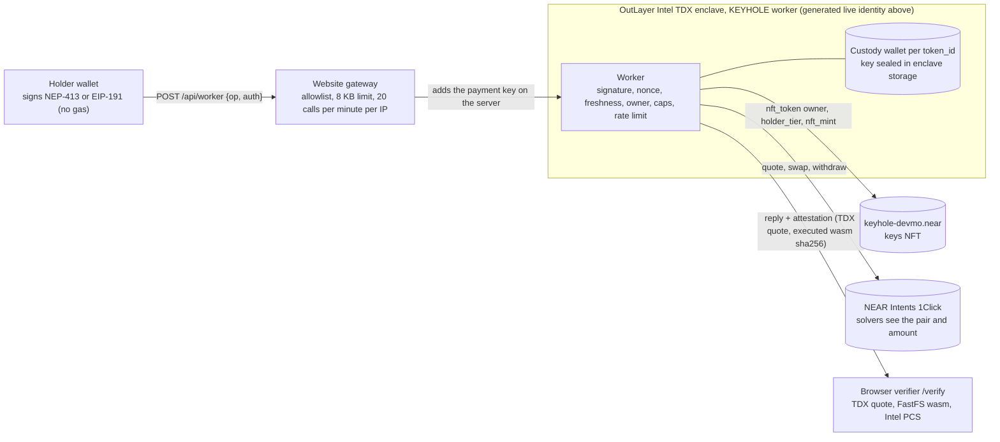

# Architecture

## 4. How it works

- **Owner check on every request.** The worker reads the owner from [`keyhole-devmo.near`](https://nearblocks.io/address/keyhole-devmo.near) on each signed request, and again just before a swap or withdraw is sent. The on-chain owner is the authorization source; private ownership/epoch synchronization state is not an authorization substitute.
- **Custody wallet per token, inside TDX.** One OutLayer confidential custody wallet per `token_id`, its key sealed in enclave storage. A transfer moves the wallet to the new owner; the balance does not change.
- **Sessions.** One wallet signature starts a 30-minute grant with a $5 cap. A session can read, quote, swap, lower limits and revoke itself. It cannot withdraw or raise limits.
- **Earned tiers.** A key rises from its own settled trades through `level_up`. Bronze to Silver (tier 1 to 2) is on mainnet. Caps follow the tier, and the contract refuses a lower value.
- **Built-in sale and listing freeze.** `nft_list`, `nft_unlist` and `nft_buy` are in the contract. A listed key's account is frozen for value moves: the worker refuses swap and withdraw while it is listed (`listed`), and quote and chain signature refuse a key locked for sale. Balance reads still work.
- **Verifiable builds.** Three different checks, with the commands in [§7](../README.md#verify): deployed bytes match historical attestations ([identity block](../README.md#live-mainnet-identities)); the historical v2.5 source rebuild matches its [generated release identity](../contracts/keys/release/v2.5/identity.json); rebuilding the worker from this checkout is not the same as reproducing the deployed worker. Every call is attested with the executed wasm hash, and the browser checks the quote.

### Worker ops and their auth

| op | auth | what it does |
|---|---|---|
| `info` | none | version, keys contract, NEP-413 recipient, TEE minter, limits per tier |
| `status` | NEP-413 | tier, limits, today's spend |
| `quote` | NEP-413 + key | confidential 1Click quote checked against caps. `execute: true` returns a real deposit address and counts toward the daily cap |
| `mint` | NEP-413 | one free Bronze key per account, within a global daily quota. The enclave writes `media` (the key art URL) and `media_hash` (base64 sha256 of that file) |
| `account` | NEP-413 + key | the key's confidential custody wallet (one per `token_id`), created inside the TEE. It can optionally return a cross-chain deposit address |
| `balance` | NEP-413 + key | confidential balances |
| `swap` / `copy` | NEP-413 + key | confidential swap within caps, logged privately |
| `withdraw` | NEP-413 + key | worker source requires `chain: "near"` and `to` equal to the verified current NFT holder; caps and a fresh holder signature still apply (`holder_withdraw_*` tests) |
| `history` | NEP-413 + key | the caller's own rows of the key's private log (last 100 entries), plus the key log chain |
| `record` | none | public, enclave-signed record of a key that is listed for sale: owner, tier, listing price and seller, settled swaps, volume, PnL totals and the log head. Refused `not_listed` for any key not listed |
| `lock` | NEP-413 + key | `{hours: 1..168}`: refuse swap and withdraw until then. Cannot be lifted early; ends on transfer |
| `prove` | NEP-413 + key | `{token, min}`: enclave-signed statement that the key's account holds at least `min`. No exact amount |
| `sweep_minter` | none | moves a retired minter's NEAR to the current minter ([sweep tx](https://nearblocks.io/txns/5Z7TktfcgeFrzRnz8NSpFSbTw77R5779d3PRsrEBPbYA), 0.0286 NEAR) |

### Caps, cooldown, lock and log

| Tier | Key | Per trade | Per UTC day | Requests per minute |
|---|---|---|---|---|
| 1 | Bronze (free mint) | $1 | $5 | 6 |
| 2 | Silver | $10 | $50 | 12 |
| 3 | Gold | $100 | $500 | 30 |

- **Limits.** Global limits are 120 requests per minute and 25 free mints per day. Only tier 1 keys are minted today.
- **Legendary is a finish, not a tier.** Every key is a one-of-one (`copies: 1`). When the on-chain tier is 3, one key in eight is drawn as the Legendary finish from the token seed (`finishOf`, [`web/lib/traits.ts`](../web/lib/traits.ts)). Its caps stay the Gold caps.
- **Holder limits.** A holder can set caps under the tier caps. A cut applies at once. A raise waits 24 hours (`RAISE_DELAY_MS`, [`tee/worker/src/lib.rs:868`](../tee/worker/src/lib.rs)).
- **New-owner cooldown.** A new owner cannot withdraw for 10 minutes after the enclave records the transfer (`TRANSFER_COOLDOWN_MS`, [`tee/worker/src/lib.rs:870`](../tee/worker/src/lib.rs)). Trades inside the account still run.
- **Seller lock.** `lock` refuses swap and withdraw for 1 to 168 hours. The holder cannot lift it early, it ends on transfer, and it binds only the owner who set it (`op_lock`, [`tee/worker/src/main.rs:656`](../tee/worker/src/main.rs)).
- **Proof of holding.** `prove` returns an enclave-signed statement that the account holds at least a given amount. It does not reveal the exact balance. Check it with `node tee/worker/verify-log.mjs --proof`.
- **Signed, hash-chained log.** Each key's events (deposits, withdrawals, locks, transfers and the rest) form a hash chain. The TEE minter signs the head. `history` returns only the rows the caller wrote. The browser re-verifies the chain on [/key](https://www.getkeyhole.xyz/key?id=k5f4750858f328940) (`op_provenance`, [`tee/worker/src/main.rs:641`](../tee/worker/src/main.rs)).

<b>Request checks, in order</b> (nine checks; each refusal code was produced on mainnet)

| # | Check | Code if refused | Where | Mainnet proof |
|---|---|---|---|---|
| 1 | NEP-413 payload `sha256(borsh(2147484061) ‖ borsh{message, nonce, recipient, callbackUrl})`, ed25519 strict verify. Or EIP-191 `personal_sign` over the same intent, recovered address must equal the `0x` account | `bad_signature` | `verify_nep413` [`tee/worker/src/lib.rs:92`](../tee/worker/src/lib.rs), `verify_eip191` [`:183`](../tee/worker/src/lib.rs) | [`942b4cff`](https://api.outlayer.ai/attestations/by-call/942b4cff-23c9-4e4d-8ebc-79bfa01cd029) |
| 2 | Recipient is `keyhole` | `wrong_recipient` | `tee/worker/src/lib.rs` | [`b9c8cb4f`](https://api.outlayer.ai/attestations/by-call/b9c8cb4f-e3aa-480f-bb47-70fc30a96d67) |
| 3 | The message is JSON `{op, account_id, ts_ms, params}`; the worker acts only on the signed fields | `op_mismatch`, `no_auth` | `tee/worker/src/main.rs` | [`7a703e8f`](https://api.outlayer.ai/attestations/by-call/7a703e8f-2678-4978-b6ce-4d291828141d), [`750defed`](https://api.outlayer.ai/attestations/by-call/750defed-2267-45b1-8a8c-74b528aa30ee) |
| 4 | The NEP-413 public key is a **full-access** key of the account, checked over RPC. A function-call key is refused for holder requests. For EIP-191 the account is the recovered `0x` address | `key_not_owned`, `account_mismatch` | `tee/worker/src/main.rs:131` | [evidence](../docs/evidence/publish-a55ebb14/README.md) |
| 5 | `ts_ms` is within 5 minutes of the latest **final block** time, not the caller's clock | `expired` | `check_freshness` [`tee/worker/src/lib.rs:219`](../tee/worker/src/lib.rs) | [`e7ac0627`](https://api.outlayer.ai/attestations/by-call/e7ac0627-be6d-41e9-95d0-71dcc59aed43) |
| 6 | **Owner check.** `nft_tokens_for_owner` and `nft_token.owner_id` are read live, before the nonce is used. The owner is read again just before a swap or withdraw is sent | `not_owner` | `owns` [`tee/worker/src/main.rs:92`](../tee/worker/src/main.rs), `authenticate` [`:119`](../tee/worker/src/main.rs), `settle_if_owner` [`:527`, `:562`](../tee/worker/src/main.rs) | [`711795b9`](https://api.outlayer.ai/attestations/by-call/711795b9-3e77-4a59-98ee-d798cb63ccc2), [`e805f050`](https://www.getkeyhole.xyz/verify?call=e805f050-d416-4a04-9b12-270adbe02068) |
| 7 | Rate limits: per holder per minute by tier (6 / 12 / 30), and 120 per minute globally | `rate_limited`, `busy` | `GLOBAL_PER_MINUTE` [`tee/worker/src/lib.rs:293`](../tee/worker/src/lib.rs) | [`d892ac43`](https://api.outlayer.ai/attestations/by-call/d892ac43-b786-4d5b-909a-764b6c92f6fd) |
| 8 | Replay. `(account, nonce)` is written with an atomic `set_if_absent` | `replay` | [`tee/worker/src/lib.rs:256`](../tee/worker/src/lib.rs) | [`ac289f04`](https://api.outlayer.ai/attestations/by-call/ac289f04-0df8-4161-9123-e872ab3b75ab) |
| 9 | Caps. The USD value comes from the solver's quote (`amountInUsd`), never from the caller. Per trade and per UTC day | `over_cap_per_tx`, `over_cap_daily` | `limits_for_tier` [`tee/worker/src/lib.rs:285`](../tee/worker/src/lib.rs). Nothing is sent when refused | [`a02613a2`](https://api.outlayer.ai/attestations/by-call/a02613a2-d503-45e2-83b8-ef71927c2533) |

A definite refusal before dispatch or a provider-proven never-executed failure releases its daily spend. A pending or UNKNOWN custody outcome retains the reservation and must reconcile the same operation; a generic error is not rollback proof. The worker source also refuses another receiver, a non-owner or old holder after transfer, and any chain other than NEAR (`assert_withdraw_to`, [`tee/worker/src/lib.rs`](../tee/worker/src/lib.rs); `holder_withdraw_*` regression tests). The vault withdrawal builder takes no destination override and uses the signed-in account on NEAR (`web/tests/destination.test.ts`).

<b>Custody, sessions, keys and gateway in detail</b>

**Custody wallet per token**

- One OutLayer confidential custody wallet per `token_id`. Its API key is created in the enclave and stored under `t/<token_id>/wallet` (`holder_wallet`, [`tee/worker/src/main.rs:402`](../tee/worker/src/main.rs)).
- Wallets that earlier builds created per NEAR account move to the key once, on that account's first call (`custody_lookup`, [`tee/worker/src/lib.rs:778`](../tee/worker/src/lib.rs)). Caps are per key, so moving a key between your own accounts does not reset the day's spend.
- A transfer moves the wallet to the new owner. The balance does not change. This is shown on mainnet in the transfer handover in [§2](../README.md#2-proven-on-near-mainnet).

**Sessions**

- **Start.** One wallet signature with `op: "session"` returns a token. Only its sha256 is stored. The grant lasts 30 minutes (`SESSION_TTL_MS`, [`web/lib/session.ts:12`](../web/lib/session.ts)) and has a USD cap of $5 (`SESSION_CAP_USD_MICRO`, [`web/lib/session.ts:14`](../web/lib/session.ts)).
- **Scope.** A session can call `status`, `quote`, `account`, `balance`, `swap`, `copy`, `history`, `pnl`, `limits`, `dashboard` and `session_revoke`. It cannot call `withdraw`, and it cannot raise limits. The worker answers `session_scope` (HTTP 403 at the gateway).
- **Owner check still applies.** Each session request re-reads the owner. A session made for a key the signer no longer holds is refused `not_owner`.

**Keys that never leave the enclave**

- **Minter key.** Drawn inside the enclave on first use and stored in encrypted storage. Only the public key leaves. The minter signs NEAR transactions itself (borsh, tested byte-for-byte against near-api-js in [`tee/worker/src/tests.rs`](../tee/worker/src/tests.rs)).
- **Custody wallet keys.** One per `token_id`, sealed in enclave storage.
- **Chain key.** The key page shows the EVM address derived in the browser and the line "derived address — signing is disabled in this build" ([`web/app/key/view.tsx`](../web/app/key/view.tsx)). `chain_address` is the enclave derivation ([`tee/worker/src/main.rs:865`](../tee/worker/src/main.rs), [`tee/worker/src/chainsig.rs`](../tee/worker/src/chainsig.rs)). `chain_sign` returns `unsupported_authority` in this revision ([`tee/worker/src/main.rs:883`](../tee/worker/src/main.rs)). One MPC signature was made on the earlier build `09d481a5` (call [`0cd1c3bd`](https://api.outlayer.ai/attestations/by-call/0cd1c3bd-21be-44dc-bc60-e792a42344e6), tx [`7P9VFx4p…`](https://nearblocks.io/txns/7P9VFx4pz5oxyXpXkyDVE6SheDuTqHgQc), [evidence](../docs/evidence/publish-09d481a5/README.md#chain-signatures-one-real-mpc-signature)).

**Website gateway**

- **Allowlist.** [`web/lib/gateway.ts:7`](../web/lib/gateway.ts) (`ALLOWED_OPS`). `pledge_inventory` and `reconcile_value_op` are holder-authenticated; inventory never belongs to the anonymous lender projection. `swap` and `withdraw` are relayed only with a NEP-413 `auth` whose signed `op` matches. The gateway refuses `copy` with `bad_op`, and `copy` stays on the CLI and MCP. The candidate also validates exact public `loan_certificate` parameters and never adds epoch fields after signing.
- **Limits.** Bodies over 8 KB get HTTP 413 ([`web/app/api/worker/route.ts:23`](../web/app/api/worker/route.ts)). Each IP gets 20 calls a minute, with HTTP 429 and `retry-after` ([`:21`](../web/app/api/worker/route.ts)).
- **Secrets and logs.** The OutLayer payment key is a server-only secret. Request bodies, amounts and accounts are not logged. `info` is cached for 5 minutes.
- **Parity.** The browser signs the same NEP-413 construction as the CLI ([`web/lib/nep413.ts`](../web/lib/nep413.ts)). [`web/tests/nep413.test.ts`](../web/tests/nep413.test.ts) checks it byte-for-byte against the reference the TEE accepted on mainnet.

Gateway calls on mainnet, signed with the website's own [`web/lib/nep413.ts`](../web/lib/nep413.ts) on build `3ea56ee6` (the 0.2.0 worker on project `keyhole-probe`, unless the row says otherwise):

| call | result | attestation | evidence |
|---|---|---|---|
| status | ok, tier 1 | [`9c258ced`](https://api.outlayer.ai/attestations/by-call/9c258ced-40c4-4738-8621-794e35f41f5d) | — |
| quote 0.05 USDC → wNEAR | policy passed | [`57d03a3b`](https://api.outlayer.ai/attestations/by-call/57d03a3b-def4-46dc-a66f-6cfd36570572) | [quote.json](../docs/evidence/site-gateway/quote.json) |
| quote 2 USDC | refused `over_cap_per_tx` | [`a28106f0`](https://api.outlayer.ai/attestations/by-call/a28106f0-8eff-49e6-8998-57d99d2e9298) | [quote_overcap.json](../docs/evidence/site-gateway/quote_overcap.json) |
| same signed request twice | first ok, then `replay` | [`1792da1a`](https://api.outlayer.ai/attestations/by-call/1792da1a-0a36-4df0-84b0-0d28e7a4828c) → [`6eccc374`](https://api.outlayer.ai/attestations/by-call/6eccc374-ed17-4764-810b-f3f56a1ad6bd) | [replay.json](../docs/evidence/site-gateway/replay.json) |
| account | confidential id issued | [`e977cb88`](https://api.outlayer.ai/attestations/by-call/e977cb88-0490-47f8-abfd-eb409eb572b4) | [account.json](../docs/evidence/site-gateway/account.json) |
| balance | ok | [`22cb472d`](https://api.outlayer.ai/attestations/by-call/22cb472d-a759-4284-a3fd-651b059dc576) | [balance.json](../docs/evidence/site-gateway/balance.json) |
| history | ok | [`b4038809`](https://api.outlayer.ai/attestations/by-call/b4038809-2347-43fd-aa28-f829b677e7d1) | [history.json](../docs/evidence/site-gateway/history.json) |
| info via `/api/keyhole` on project `keyhole` | `keyhole-worker/0.2.0` | [`f198ce3a`](https://api.outlayer.ai/attestations/by-call/f198ce3a-a3df-4c27-ac26-79ef50003fb1) (build `f13efe92`) | — |

The website's `/api/keyhole` route answers the `info` op on project `keyhole` at build `f13efe92`.

