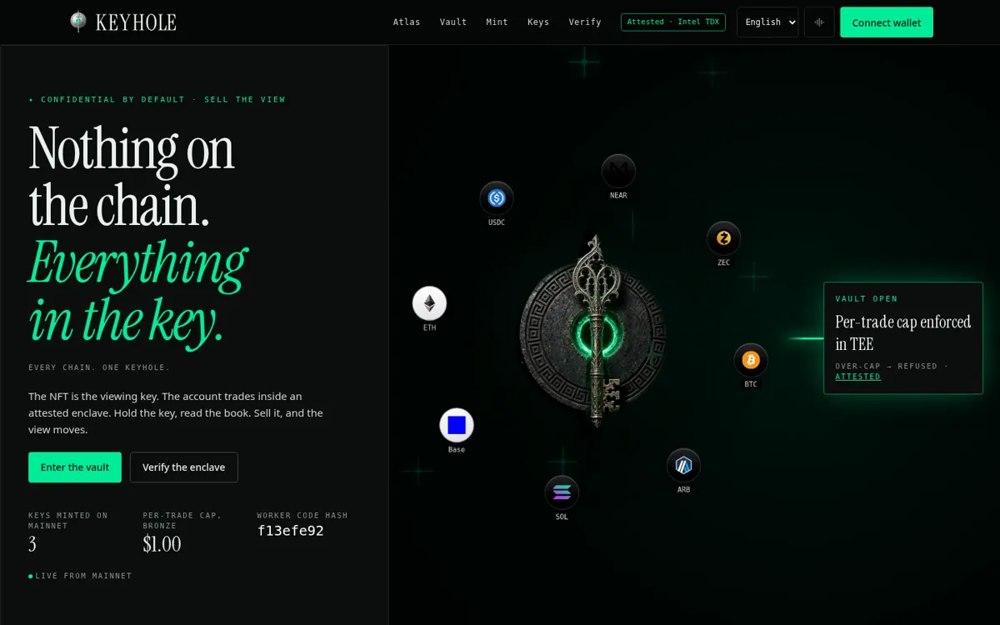
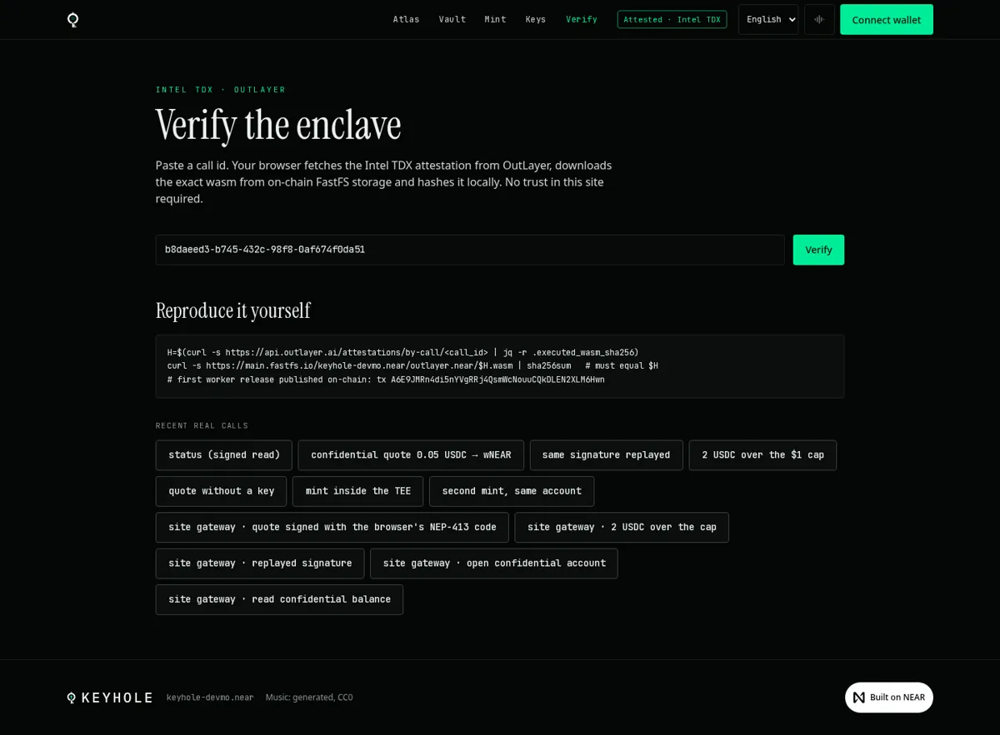
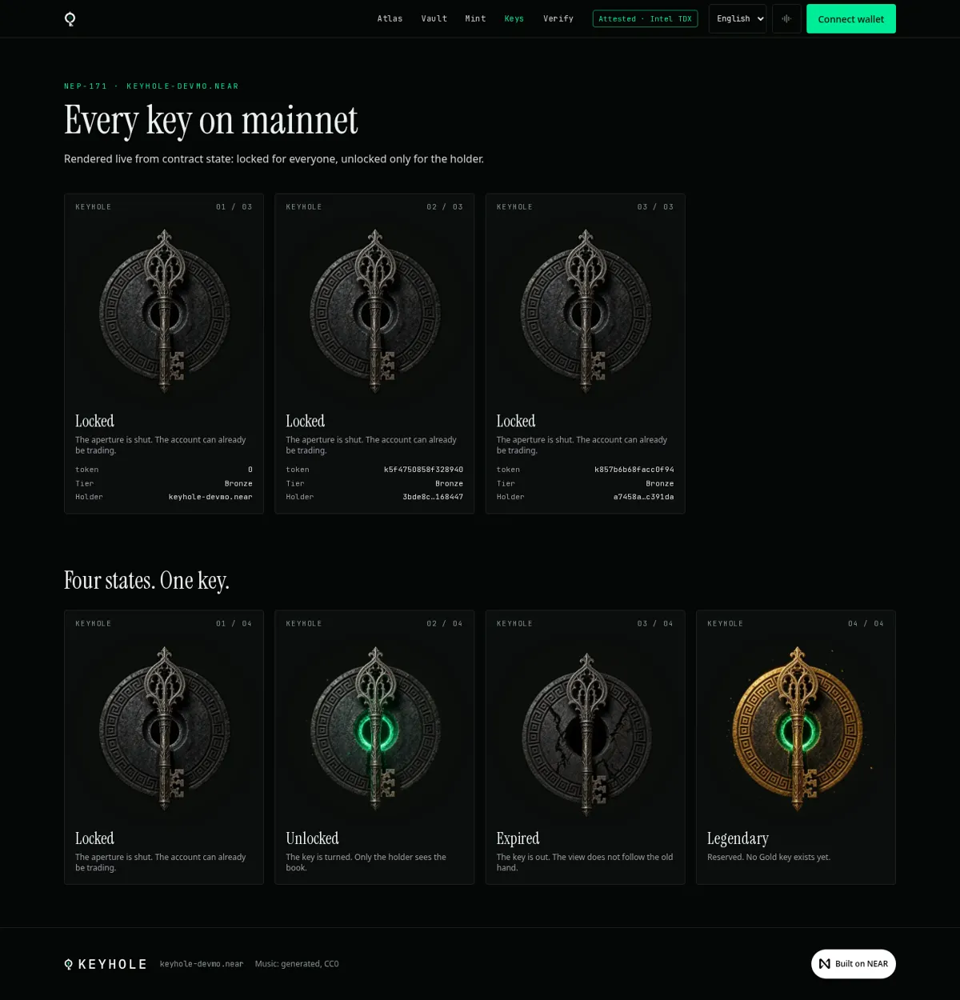
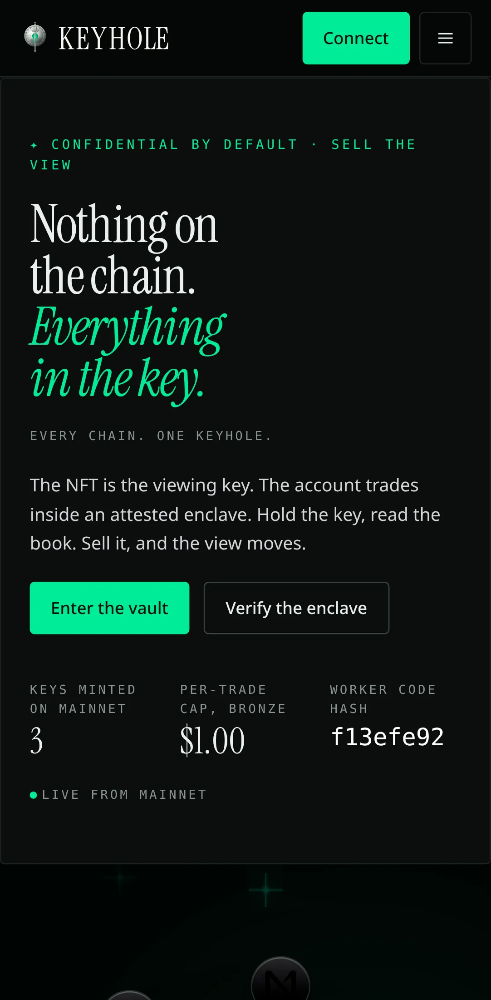
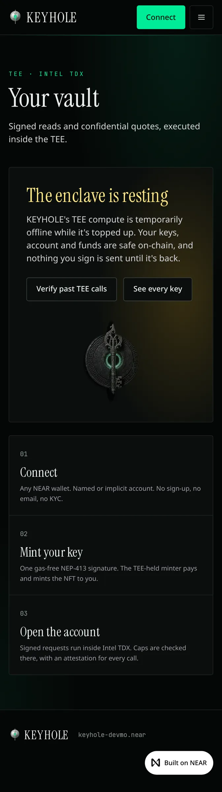

# KEYHOLE web

Live: **https://keyhole-seven.vercel.app** (NEAR mainnet only)



| Page | What it does | Real source |
|---|---|---|
| `/` | Hero, three steps, proof table | `nft_total_supply`, `config` views on `keyhole-devmo.near` (revalidated every 30 s) |
| `/atlas` | Chain marks, each one with its trail | NearBlocks tx links and OutLayer attestations. Marks without a trail are labeled "No trail yet" |
| `/vault` | Signed limits, confidential quote, your confidential account, balance, history | TEE worker ops `status`, `quote`, `account`, `balance`, `history` |
| `/mint` | Tier table and one-signature mint | TEE worker op `mint`. The TEE-held minter signs `nft_mint` |
| `/gallery` | Every key on mainnet, drawn from contract state | `nft_tokens`, `nft_tier` |
| `/verify` | Paste a call id to check it | OutLayer attestation plus the FastFS wasm, hashed in your browser |

## How a request flows

1. Your wallet signs a NEP-413 message (`signMessage`). There is no transaction and no gas.
   - `message = JSON.stringify({op, account_id, ts_ms, params})`
   - `recipient = "keyhole"`
   - `nonce` = 32 fresh random bytes
   - Source: [`lib/nep413.ts`](lib/nep413.ts).
2. The browser sends `{op, auth}` to `/api/keyhole`, which is the same handler as `/api/worker`. The route:
   - allows only `info|status|quote|mint|account|balance|history`;
   - rejects bodies over 8 KB;
   - limits each IP to 20 calls per minute;
   - adds the OutLayer payment key from a server-only env secret, then forwards the call;
   - never logs bodies, amounts or accounts.
   - Fund-moving ops (`swap`, `copy`, `withdraw`) and `sweep_minter` are refused here. They are available from the CLI.
3. The worker runs in Intel TDX. It verifies:
   - the ed25519 signature and the full-access key on-chain;
   - the 5-minute window;
   - the replay store;
   - your tier from the NFT;
   - your caps.
4. Every result shows its call id, an attestation link and a **verify** link.

The CLI can use this site as its gateway: `KEYHOLE_GATEWAY=https://keyhole-seven.vercel.app/api/keyhole keyhole status`.

## Verify without trusting this site

`/verify?call=<id>` runs the same three checks as `../verify.sh`:

1. An Intel TDX quote is present.
2. The registered `wasm_hash` equals `executed_wasm_sha256`.
3. `sha256` of the wasm bytes on FastFS equals the executed hash. Your browser computes this with `crypto.subtle`.



## Keys are drawn from chain state

The state of each key comes from on-chain data and the connected viewer:

| State | Rule |
|---|---|
| `legendary` | tier 3. It is reserved, and no tier-3 key exists. |
| `expired` | `metadata.expires_at` is in the past |
| `unlocked` | the connected account owns the token |
| `locked` | any other viewer |

The rule lives in [`lib/near.ts`](lib/near.ts) and is unit-tested.



## Wallets, languages, access

- **Wallets:** NEAR Wallet Selector with MyNearWallet, Meteor, HERE, Intear, Sender, Nightly and Ledger.
  - WalletConnect turns on when `NEXT_PUBLIC_WALLETCONNECT_PROJECT_ID` is set.
  - Redirect wallets resume the signed request after they return.
  - The wallet bundle loads only when you click Connect, or when you have connected before.
- **Languages:** English by default, plus Arabic with full RTL layout.
  - Message catalogs are in `messages/*.json`.
  - Each worker and gateway error code maps to a short message and a fix in both languages, and a test checks this against the worker source.
- **Access:**
  - Works on mobile from 360 px.
  - Touch targets are at least 44 px.
  - There is a skip link and visible focus rings.
  - `prefers-reduced-motion` freezes the hero on its settled frame.
  - On touch devices the WebGL field draws one frame only.
- **Security headers:** CSP, HSTS, nosniff, a strict referrer policy and `frame-ancestors 'none'`.

 

## Design and motion

- **Hero:** a 9-second entrance.
  - The headline rises in.
  - The relic turns in from −28° while an aperture mask opens.
  - A beam runs to the vault card.
  - Eight official chain marks fly in and orbit. ETH and Base sit on light discs so their marks stay visible.
- **Field:** a single fullscreen-triangle WebGL shader (`ogl`).
  - It loads after the `load` event plus 2.5 s.
  - It reacts to the cursor, with the key moving more than the ring.
  - Its brightness is capped, and it never crosses the solid text plate.
- **Music:** an optional ambient loop, off by default. It starts only when you click.
  - The track was generated procedurally for this project and is released under CC0. See `public/audio/LICENSE.txt`.
- **Brand:** swap the files in `public/brand/` to rebrand.

## Run, test, deploy

```bash
npm ci
OUTLAYER_PAYMENT_KEY=... npm run dev     # the key is only needed for /api/keyhole
npm run lint && npm run typecheck && npm test && npm run build
npx playwright install chromium && BASE_URL=https://keyhole-seven.vercel.app npm run e2e
```

Signed calls through the gateway are made with the browser's own signing code: `KEYFILE=key.json BASE=... npx tsx scripts/signed-call.mts status '{}'`
